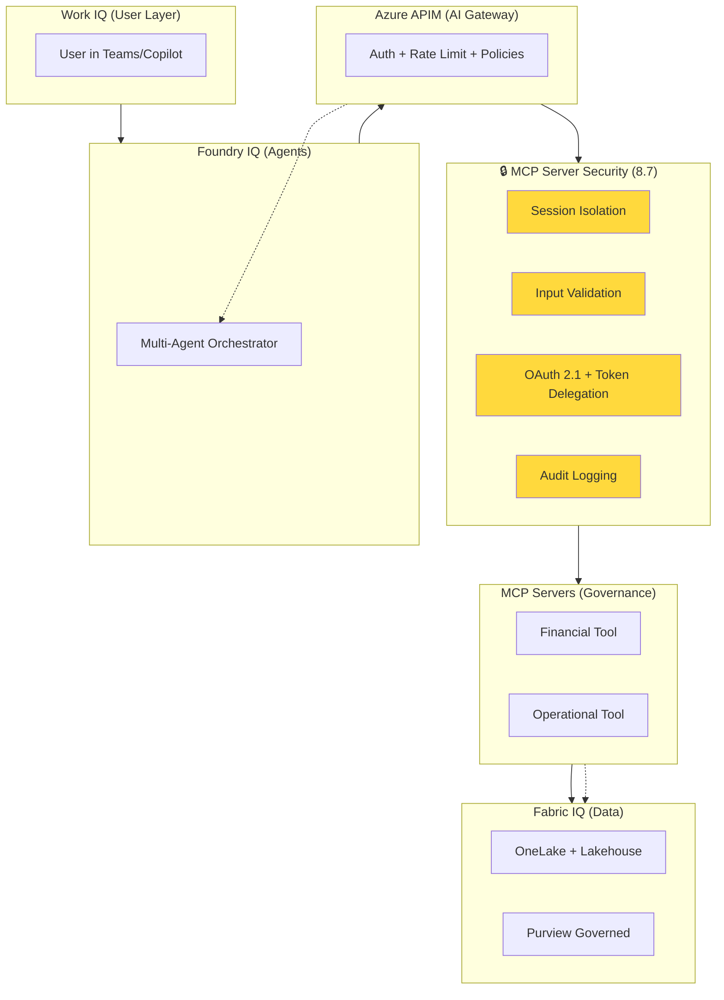

# 🔧 PLANO DE INTEGRAÇÃO: Mudanças Propostas ao Documento de Estratégia

---

## 📝 SUMÁRIO DE MUDANÇAS

| Mudança | Tipo | Localização | Prioridade |
|---|---|---|---|
| 1. Atualizar índice | Adicionar linha | Tabela de Conteúdo (início) | 🔴 P0 |
| 2. Inserir seção 8.7 | Inserir nova seção | Após 8.6 (Comunicação entre Agentes) | 🔴 P0 |
| 3. Expand 3.2 (APIM) | Revisar/expandir | Seção 3.2 | 🟡 P1 |
| 4. Atualizar diagrama integração | Atualizar visual | Seção 11 (Integração Completa) | 🟡 P1 |
| 5. Adicionar ao roadmap ondas | Expandir critério | Seção 3 (Estratégia de Adoção) | 🟡 P1 |
| 6. Roles no modelo operacional | Atualizar | Seção 12 (Modelo Operacional) | 🟡 P1 |
| 7. Referências cruzadas | Adicionar links | Seções 8.1, 8.6, 9, 10 | 🟡 P1 |

---

## 1️⃣ MUDANÇA 1: Atualizar Índice Executivo (TABELA DE CONTEÚDO)

### **Local**: Topo do documento, na tabela "🗂️ Índice Executivo"

### **Mudança**: Adicionar nova linha depois de "8.6. Comunicação entre Agentes"

**Antes**:
```markdown
| **8.6. Comunicação entre Agentes** | Padrões request-based, message-driven e híbrido com critérios de escolha. |
| **9. Evaluators (Qualidade e Evolução)** | Métricas e processo contínuo de avaliação para qualidade, risco e melhoria de agentes. |
```

**Depois**:
```markdown
| **8.6. Comunicação entre Agentes** | Padrões request-based, message-driven e híbrido com critérios de escolha. |
| **8.7. Segurança de MCP Servers** | Controles build-time e runtime para MCP servers seguindo OWASP GenAI (isolamento, validação, auth, deployment). |
| **9. Evaluators (Qualidade e Evolução)** | Métricas e processo contínuo de avaliação para qualidade, risco e melhoria de agentes. |
```

---

## 2️⃣ MUDANÇA 2: Inserir Seção 8.7 Completa

### **Local**: Depois da seção 8.6 (Comunicação entre Agentes), antes da seção 9 (Evaluators)

### **O quê**: Copiar integralmente o conteúdo de `SECAO_8_7_PRONTA_PARA_INSERCAO.md`

### **Como**: 
1. Abrir documento de estratégia atual
2. Localizar final de seção 8.6
3. Inserir quebra de linha (---) e conteúdo de 8.7
4. Validar que seção 9 inicia corretamente após 8.7

---

## 3️⃣ MUDANÇA 3: Expandir Seção 3.2 (Azure APIM) com Referência a 8.7

### **Local**: Seção 3.2, na subsection "🔗 Referências Microsoft" (final)

### **Mudança**: Adicionar parágrafo de "Complementariedade com MCP Security"

**Adicionar antes de "🔗 Referências Microsoft"**:

```markdown
### ⚙️ Complementaridade com Segurança de MCP Servers (Seção 8.7)

APIM fornece governança operacional (autenticação centralizada, rate limiting, policies), mas cada MCP server exposto via APIM também deve implementar controles internos de segurança (isolamento de sessão, validação, sanitização de dados, secrets management).

Veja **Seção 8.7 — Segurança de MCP Servers** para detalhes sobre:
- Isolamento de usuários/sessions
- Signed tool manifests
- Validação rigorosa de inputs/outputs
- OAuth 2.1 / OIDC e token delegation
- CI/CD security gates (SAST, SCA)
- Auditoria e continuous monitoring

**Resultado**: APIM (perímetro) + MCP Security (interior) = **defesa em profundidade**.
```

---

## 4️⃣ MUDANÇA 4: Atualizar Diagrama de Integração (Seção 11)

### **Local**: Seção 11 "Integração Completa (Arquitetura Final)" — diagrama Mermaid principal

### **Mudança**: Adicionar componente "MCP Server Security" ao fluxo

**Antes**: Diagrama mostra Work IQ → Foundry IQ → APIM → MCP Servers → Fabric

**Depois**: Adicionar "Security Controls (OWASP)" em paralelo com MCP Servers



---

## 5️⃣ MUDANÇA 5: Adicionar Critério de Segurança MCP ao Roadmap (Seção 3)

### **Local**: Seção 3 "Estratégia de Adoção (Curto e Médio Prazo)" — subsection de ondas

### **Mudança**: Expandir cada onda com "Critério de Segurança MCP"

**Exemplo**:

**Onda 1 (Piloto Controlado)**
```markdown
✅ Critério de Adoção:
- 1 agente + 1 MCP server via APIM
- [NOVO] OAuth 2.1/OIDC implementado ← MCP Security 8.7
- [NOVO] Session isolation + audit logging ← MCP Security 8.7

✅ Critério de Segurança:
- [NOVO] Isolamento de sessão validado (sem shared state)
- [NOVO] Inputs validados contra JSON Schema
- [NOVO] Secrets em vault, nunca em code/logs
```

**Onda 2 (Escala por Domínio)**
```markdown
✅ Critério Técnico:
- Múltiplos MCP servers por domínio
- [NOVO] Signed tool manifests ← MCP Security 8.7

✅ Critério de Segurança:
- [NOVO] CI/CD gates (SAST, SCA) obrigatório
- [NOVO] Formal onboarding approval workflow
- [NOVO] Peer review de security pré-deploy
```

**Onda 3 (Otimização Contínua)**
```markdown
✅ Critério Técnico:
- Integração com Evaluators para anomaly detection
- [NOVO] Runtime monitoring + SIEM ← MCP Security 8.7

✅ Critério de Segurança:
- [NOVO] Centralized audit logging (SIEM ingestion)
- [NOVO] Alerts para padrões suspeitos
- [NOVO] Regular penetration testing de MCP servers
```

---

## 6️⃣ MUDANÇA 6: Atualizar Modelo Operacional (Seção 12)

### **Local**: Seção 12.2 "Matriz de Papéis e Responsabilidades" (se existe) ou Seção 12 geral

### **Mudança**: Adicionar ou expandir role "Security & Compliance"

**Responsabilidade adicionada**:
```markdown
### 👥 Role: Security & Compliance (ou Platform Security)

**Responsabilidades**:
- Definir e manter OWASP MCP Security checklist
- Revisar signed tool manifests antes de onboarding
- Auditoria periódica de MCP servers (trimestral)
- Monitorar alertas de segurança em SIEM
- Responder a CVE em MCP dependencies (SLA: crítico 24h, alto 7d)
- Validar CI/CD security gates (SAST, SCA, container scan)
- Treinar DevOps teams em secure MCP deployment
```

---

## 7️⃣ MUDANÇA 7: Adicionar Referências Cruzadas

### **Local**: Múltiplas seções (veja abaixo)

### **8.1 (Microsoft Entra ID - Agent ID)**
Adicionar ao final:
```markdown
**Complementariedade com 8.7 (MCP Server Security)**:  
Entra Agent ID gerencia identidade de agentes como NHI. 
Seção 8.7 exige que cada MCP call seja validado contra essa identidade via OAuth 2.1/OIDC + token delegation (RFC 8693).
Resultado: rastreabilidade de quem chamou qual tool.
```

### **8.2 (Microsoft Purview)**
Adicionar ao final:
```markdown
**Complementariedade com 8.7 (MCP Server Security)**:  
Purview classifica dados (PII, confidencial, público). 
Seção 8.7 exige sanitização de dados sensíveis antes de retornar ao LLM (masking de CC, SSN, tokens).
Resultado: dados corporativos protegidos por classification + sanitization.
```

### **8.6 (Comunicação entre Agentes)**
Adicionar parágrafo no final:
```markdown
### 🔒 Segurança de Comunicação: A2A e A2Tool

Além da arquitetura de roteamento, a comunicação entre agentes (A2A) e entre agentes e ferramentas (A2Tool via MCP) requer controles de segurança:
- **A2A**: Entra ID gerencia identidade de agentes; comunicação pode ser request-based (sincrona) ou message-driven (assíncrona)
- **A2Tool**: MCP servers devem implementar isolamento de sessão, validação rigorosa, sanitização de dados, e auditoria de chamadas

Veja **Seção 8.7 — Segurança de MCP Servers** para detalhes técnicos.
```

### **9 (Evaluators)**
Adicionar após descrição:
```markdown
**Integração com 8.7 (MCP Server Security)**:  
Evaluators detectam anomalias em agentes (ex.: agente faz unexpected tool calls). 
Para isso funcionar, seção 8.7 exige audit logs detalhados com parâmetros de cada tool invocation.
Resultado: continuous monitoring de anomalias de segurança.
```

### **10 (Human-in-the-Loop)**
Adicionar após descrição:
```markdown
**Integração com 8.7 (MCP Server Security)**:  
Seção 8.7 recomenda HITL para ações críticas em MCP servers (deletar dados, transferir fundos, mudanças de config).
Use MCP elicitations ou notificações para solicitar aprovação do usuário antes de executar.
```

---

## ✅ CHECKLIST DE IMPLEMENTAÇÃO

- [ ] **Etapa 1**: Adicionar linha ao índice (Mudança 1)
- [ ] **Etapa 2**: Inserir seção 8.7 completa (Mudança 2)
- [ ] **Etapa 3**: Revisar e expandir seção 3.2 com referência a 8.7 (Mudança 3)
- [ ] **Etapa 4**: Atualizar diagrama integração com security controls (Mudança 4)
- [ ] **Etapa 5**: Expandir roadmap ondas com critério segurança MCP (Mudança 5)
- [ ] **Etapa 6**: Adicionar/expandir role Security & Compliance (Mudança 6)
- [ ] **Etapa 7**: Adicionar referências cruzadas em 8.1, 8.2, 8.6, 9, 10 (Mudança 7)
- [ ] **Validação**: Verificar links internos, diagrama rendering, formatação markdown
- [ ] **Revisão**: Security team review, Architecture team review
- [ ] **Publicação**: Incluir atribuição OWASP + CC BY-SA 4.0 license reference

---

## 📏 ESTIMATIVA DE IMPACTO

### **Volume de Mudanças**
- 1 linha no índice
- 1 seção nova completa (8.7) ≈ 3-4 páginas de conteúdo
- 1-2 parágrafos em cada: 3.2, 8.1, 8.2, 8.6, 9, 10
- 1 diagrama atualizado
- 1 expansão de roadmap ondas
- Total: ≈ 5-6 páginas de novo conteúdo + referências cruzadas

### **Tempo de Implementação**
- Inserção de conteúdo: 30 minutos
- Validação de links/formatting: 20 minutos
- Peer review: 45 minutos
- **Total**: ≈ 1.5 horas

---

## 📚 DOCUMENTOS ENTREGÁVEIS

Todos os arquivos abaixo estão em `c:\CODE\HARASKILL\`:

1. **ANALISE_PDF_vs_ESTRATEGIA.md** — Análise detalhada (gap analysis, mapeamento, contradições)
2. **RESUMO_EXECUTIVO_MCP_SEGURANCA.md** — Resumo executivo (1 página, decisão rápida)
3. **SECAO_8_7_PRONTA_PARA_INSERCAO.md** — Seção 8.7 completa e pronta para copiar/colar
4. **PLANO_DE_INTEGRACAO.md** (este arquivo) — Mudanças propostas ao documento principal
5. **pdf_content.txt** — Conteúdo extraído do PDF (referência)

---

## 🎯 DECISÃO EXECUTIVA RECOMENDADA

**Incluir seção 8.7 como subsseção de Guard Rails (APIM 3.2 + MCP Security 8.7 = defesa em profundidade)?**

✅ **SIM — P0 (crítico)**

**Justificativa**:
- 95% alinhado com estratégia existente
- Complementar, não contraditório
- Reduz risco de segurança exponencialmente em produção
- Facilita implementação prática (DevOps teams têm checklist claro)
- Alinha a NIST AI Risk Management Framework
- 1.5 horas de trabalho, impacto alto

---

*Análise concluída — Pronto para decisão e implementação.*

