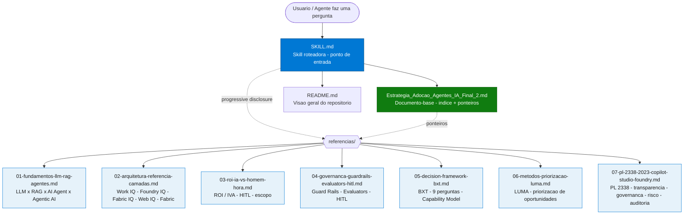
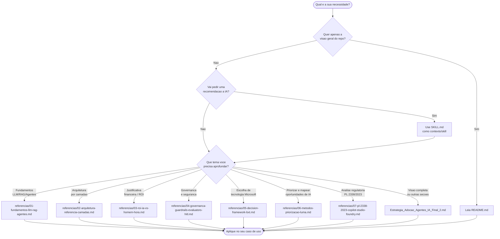

# HARASKILL

## O que e este projeto

Este repositorio organiza uma base pratica para orientar a adocao corporativa de agentes de IA no ecossistema Microsoft. O foco e apoiar decisoes de arquitetura alvo com integracao entre Work IQ, Foundry IQ, Fabric IQ e Web IQ, conectando estrategia de negocio, dados governados, contexto externo, seguranca, guard rails, evaluators e operacao em escala.

O projeto foi estruturado para servir como referencia executiva e tecnica: ajuda times de negocio, arquitetura, dados e seguranca a alinharem uma visao comum de como planejar, pilotar e expandir iniciativas de IA agentica com menor risco e maior previsibilidade de valor.

## Objetivo

- Definir uma arquitetura de referencia para agentes de IA em contexto corporativo.
- Padronizar recomendacoes com foco em governanca, compliance e observabilidade.
- Apoiar um roadmap em ondas (piloto, expansao e escala) com criterios claros.
- Explicitar trade-offs entre custo, risco, velocidade e complexidade.

## O que voce encontra neste repositorio

- SKILL.md: definicao unica da skill (roteador) que orienta respostas consistentes em contexto de arquitetura de adocao. Aponta para os arquivos de referencia sob demanda (progressive disclosure).
- Estrategia_Adocao_Agentes_IA_Final_2.md: guia principal e documento-base, com visao executiva, indice e ponteiros para os arquivos de referencia.
- referencias/: conteudo tematico fatiado para carregamento sob demanda:
   - referencias/01-fundamentos-llm-rag-agentes.md: LLM x RAG x AI Agent x Agentic AI; espectro de complexidade e guia de decisao.
   - referencias/02-arquitetura-referencia-camadas.md: Microsoft IQ (Work IQ, Foundry IQ, Fabric IQ, Web IQ), Microsoft Fabric e especificacoes tecnicas por camada.
   - referencias/03-roi-ia-vs-homem-hora.md: modelo de ROI/IVA, HITL e multiplicador de escopo.
   - referencias/04-governanca-guardrails-evaluators-hitl.md: Guard Rails, Evaluators e Human-in-the-Loop.
   - referencias/05-decision-framework-bxt.md: Microsoft AI Decision Framework (Intake Filter, BXT, 9 perguntas criticas, Capability Model e selecao de tecnologia por cenario).
   - referencias/06-metodos-priorizacao-luma.md: adendo com os metodos de priorizacao do LUMA System (Rose/Thorn/Bud, Affinity Clustering, Statement Starters, Bull's-Eye) para priorizar e mapear oportunidades de projetos de IA.
   - referencias/07-pl-2338-2023-copilot-studio-foundry.md: analise do PL 2338/2023 e como Microsoft Copilot Studio, Microsoft Foundry e Purview respondem aos eixos de transparencia, governanca, risco, auditoria, supervisao humana e protecao de dados com fontes oficiais.
- ROI-IA-Calculadora.xlsx: planilha operacional do modelo de ROI/IVA (referencias/03), com 5 abas (Calculadora, Sensibilidade HITL, Como usar, Capacidade e Grafico, Ampliacao). Preencha as celulas azuis com as premissas da operacao e obtenha IVA, ROI (%), veredito (USAR IA / MANTER HUMANO) e impacto na capacidade da equipe. Instrucoes de uso e interpretacao em referencias/03-roi-ia-vs-homem-hora.md.

> Observacao: IVA (Indice de Vantagem da IA) e a razao entre o custo humano da tarefa e o custo total da IA por tarefa (IVA = Custo Humano / Custo IA). IVA > 1 indica que a IA e financeiramente vantajosa (um IVA de 4,0 significa que a tarefa via IA custa 1/4 do valor da mesma tarefa feita por uma pessoa); IVA = 1 e o ponto de equilibrio; IVA < 1 indica manter o trabalho humano. Nao confundir com o imposto IVA (Imposto sobre Valor Agregado).
- Guias complementares de dinamicas e setup para facilitar colaboracao e uso no VS Code.

## Estrutura do repositorio (diagrama)

O diagrama abaixo mostra como os arquivos se relacionam. O SKILL.md e o ponto de entrada (roteador); o documento-base concentra o conteudo completo e aponta, sob demanda, para os arquivos tematicos em referencias/.



## Como navegar (fluxograma de decisao)

Use este fluxo para escolher qual arquivo abrir conforme a sua necessidade.



## Publico-alvo

- Liderancas de tecnologia e negocio.
- Arquitetos corporativos, arquitetos de dados e equipes de plataforma.
- Times de governanca, seguranca e compliance.
- Squads que estao iniciando ou escalando agentes de IA.

## Como usar no Visual Studio Code

Pre-requisitos: VS Code, a extensao GitHub Copilot Chat e uma assinatura ativa do GitHub Copilot.

1. Clonar e abrir o repositorio:

   ```bash
   git clone https://github.com/<sua-org>/HARASKILL.git
   code HARASKILL
   ```

2. Abrir o Copilot Chat (icone de chat na barra lateral ou `Ctrl+Alt+I` / `Cmd+Alt+I`) e usar o modo Agent.
3. O arquivo `.github/copilot-instructions.md` e carregado automaticamente como contexto do workspace, garantindo respostas em pt-BR e o formato executivo padrao.
4. Trazer um arquivo para o contexto da conversa de uma destas formas:
   - Digitar `#` e selecionar o arquivo (ex.: `#SKILL.md`).
   - Arrastar o arquivo do Explorer para o painel de chat.
   - Abrir o arquivo no editor e referenciar com `#file`.
5. Fluxo recomendado: comece pelo `SKILL.md` e deixe o agente carregar os arquivos de `referencias/` sob demanda (progressive disclosure), conforme o tema da pergunta.

Exemplo de prompt:

> Usando o #SKILL.md, recomende a arquitetura alvo para um copilot de atendimento com dados governados no Fabric.

Dica: para tratar o `SKILL.md` como uma skill reutilizavel no formato oficial do VS Code, copie-o (ou crie um link) para uma pasta como `.github/skills/haraskill/` ou `~/.copilot/skills/haraskill/`. Neste repositorio, o arquivo na raiz funciona como **fonte canonica/roteador** para uso por referencia direta em prompts, enquanto a instalacao formal da skill deve seguir a convencao de pasta em minusculas.

## Como usar no GitHub Copilot CLI

Pre-requisitos: Node.js 22 ou superior, uma assinatura ativa do GitHub Copilot e (no Windows) PowerShell 6+.

1. Instalar o CLI (npm em qualquer plataforma):

   ```bash
   npm install -g @github/copilot
   ```

   Alternativas oficiais: `brew install copilot-cli` (macOS/Linux) ou `winget install GitHub.Copilot` (Windows).

2. Entrar na pasta do repositorio e iniciar uma sessao interativa (o CLI usa o diretorio atual como contexto e pede confirmacao para confiar nele):

   ```bash
   cd HARASKILL
   copilot
   ```

3. Autenticar na primeira execucao: se voce ainda nao estiver logado, use o comando `/login` na sessao e siga as instrucoes na tela.
4. Referenciar os arquivos do repositorio diretamente no prompt. O CLI tem acesso de leitura aos arquivos do diretorio de trabalho:

   > Leia o SKILL.md e o referencias/05-decision-framework-bxt.md e me ajude a escolher a tecnologia Microsoft para um agente proativo de monitoramento.

5. Para um prompt unico e nao interativo, usar o modo programatico (`-p` / `--prompt`):

   ```bash
   copilot -p "Com base em SKILL.md, gere uma visao executiva da arquitetura alvo (Work IQ, Foundry IQ, Fabric IQ)."
   ```

Observacoes:

- O CLI combina automaticamente arquivos de custom instructions, mas nao carrega `.github/copilot-instructions.md` exatamente como o VS Code. Para garantir o tom executivo em pt-BR, referencie o `SKILL.md` explicitamente no prompt.
- Use caminhos relativos (ex.: `referencias/03-roi-ia-vs-homem-hora.md`) ao citar arquivos, para que a ferramenta os localize.
- Inicie o CLI apenas em diretorios confiaveis; evite executa-lo a partir do seu diretorio pessoal.
