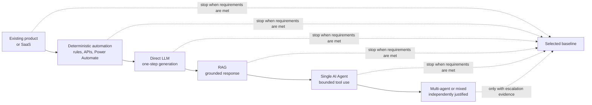
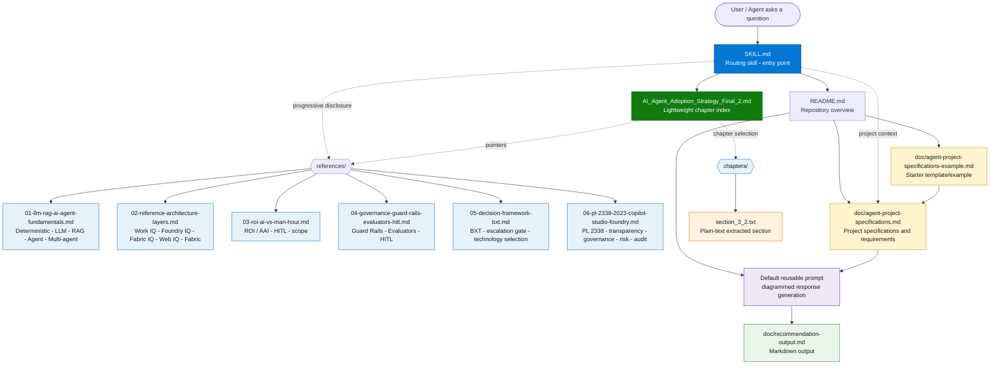
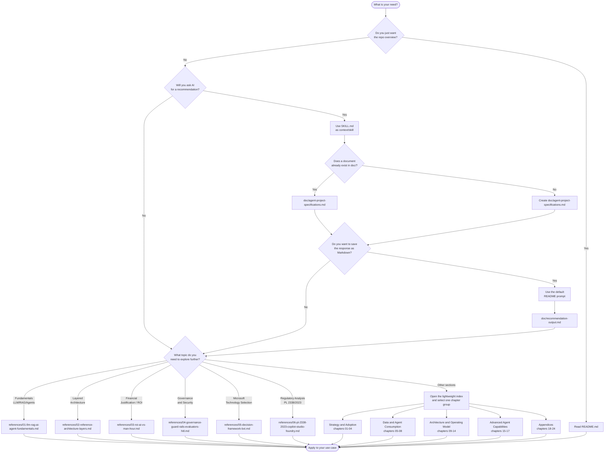

# hubsp-ai-skill

## What is this project

This repository organizes a practical knowledge base to guide the corporate adoption of AI in the Microsoft ecosystem. The focus is on selecting the **simplest viable architecture first**, then combining Microsoft IQ context workloads (Work IQ, Foundry IQ, Fabric IQ and Web IQ), explicit agent runtimes, governed data, security, guard rails, evaluators and operations only where the current requirements justify them.

The project was structured to serve as both an executive and technical reference: it helps business, architecture, data and security teams align on a common vision for planning, piloting and expanding AI initiatives with lower risk and greater value predictability. Skill version **1.4.0** makes low-complexity-first selection mandatory and requires evidence before escalating to agentic, multi-agent or mixed-runtime solutions.

## Objective

- Define a reference architecture for AI agents in a corporate context.
- Evaluate existing products, deterministic automation, LLM, RAG, single-agent and multi-agent options in ascending complexity.
- Stop at the first option that reliably satisfies current requirements and require evidence before every escalation.
- Standardize recommendations focused on governance, compliance and observability.
- Support a wave-based roadmap (pilot, expansion and scale) with clear criteria.
- Make trade-offs explicit across cost, risk, speed and complexity.

## Low-complexity-first decision policy

The skill evaluates options in this mandatory order:



For every escalation, the recommendation must identify:

1. The current requirement the preceding option cannot satisfy.
2. The test result, pilot evidence or explicit assumption supporting that conclusion.
3. The additional cost, latency, failure modes, operational ownership and governance burden.
4. The measurable trigger that would justify adding deferred complexity later.

When evidence is incomplete, the skill recommends the lower-complexity pilot and turns the uncertainty into a validation objective. Security, compliance, multiple teams or expected growth do not automatically justify multi-agent or mixed architecture. Apply identity, least privilege, isolated tools, data controls, audit, evaluators and HITL to the simpler baseline first.

## What you will find in this repository

- SKILL.md: version 1.4.0 skill definition and router. Enforces the low-complexity-first ladder, evidence-based escalation and consistent adoption architecture responses while loading reference files on demand.
- AI_Agent_Adoption_Strategy_Final_2.md: lightweight index that routes to thematic references and the 24 individual guide chapters.
- chapters/: complete guide content split for selective, on-demand loading and organized into five groups:
   - Strategy and Adoption: chapters 01-04 (executive overview, adoption strategy, tools and approaches).
   - Data and Agent Consumption: chapters 05-08 (Fabric consumption, agent access and usage examples).
   - Architecture and Operating Model: chapters 09-14 (integration, operating model, Microsoft architecture alignment, instructions and skills).
   - Advanced Agent Capabilities: chapters 15-17 (orchestration, memory and operational implementation).
   - Appendices: chapters 18-24 (code examples, templates, tool decision tree, OpenTelemetry, dataset curation and consolidated references).
- section_3_2.txt: extracted plain-text section used as a lightweight source for quick copy, review and prompt experiments without markdown formatting overhead.
- references/: thematically sliced content for on-demand loading:
   - references/01-llm-rag-ai-agent-fundamentals.md: existing/deterministic alternatives, LLM, RAG, AI Agent and Agentic AI; complexity spectrum and escalation decision guide.
   - references/02-reference-architecture-layers.md: Microsoft IQ context workloads, agent runtimes, Microsoft Fabric and technical specifications per layer.
   - references/03-roi-ai-vs-man-hour.md: ROI/AAI model, HITL and scope multiplier.
   - references/04-governance-guard-rails-evaluators-hitl.md: Guard Rails, Evaluators and Human-in-the-Loop.
   - references/05-decision-framework-bxt.md: Microsoft AI Decision Framework (Intake Filter, BXT, 9 critical questions, Capability Model, mandatory complexity-escalation gate and technology selection by scenario).
   - references/06-pl-2338-2023-copilot-studio-foundry.md: analysis of PL 2338/2023 and how Microsoft Copilot Studio, Microsoft Foundry and Purview address the axes of transparency, governance, risk, audit, human oversight and data protection with official sources.
- doc/agent-project-specifications-example.md: starter example of a project specification document to accelerate onboarding before creating or customizing doc/agent-project-specifications.md.
- doc/agent-project-specifications.md: working specification used as primary project input in recommendation prompts.
- doc/recommendation-output.md: generated output artifact where the executive recommendation is persisted in markdown format.

> Note: AAI (AI Advantage Index) is the ratio between the human cost of the task and the total AI cost per task (AAI = Human Cost / AI Cost). AAI > 1 indicates that AI is financially advantageous (an AAI of 4.0 means the task via AI costs 1/4 of the same task done by a person); AAI = 1 is the break-even point; AAI < 1 indicates keeping human work. Not to be confused with VAT (Value Added Tax).
- Supplementary guides for dynamics and setup to facilitate collaboration and use in VS Code.

## Repository structure (diagram)

The diagram below shows how the files relate to each other. SKILL.md is the entry point (router); the lightweight index points to thematic references and individual chapters that are loaded on demand.



## How to navigate (decision flowchart)

Use this flow to choose which file to open based on your need.



## Target audience

- Technology and business leaders.
- Enterprise architects, data architects and platform teams.
- Governance, security and compliance teams.
- Squads starting or scaling AI agents.

## How to use in Visual Studio Code

Prerequisites: VS Code, the GitHub Copilot Chat extension and an active GitHub Copilot subscription.

1. Clone and open the repository:

   ```bash
   git clone https://github.com/<your-org>/hubsp-ai-skill.git
   code hubsp-ai-skill
   ```

2. Open Copilot Chat (chat icon in the sidebar or `Ctrl+Alt+I` / `Cmd+Alt+I`) and use Agent mode.
3. The `.github/copilot-instructions.md` file is automatically loaded as workspace context, ensuring the executive response format is applied consistently.
4. Bring a file into the conversation context in one of these ways:
   - Type `#` and select the file (e.g., `#SKILL.md`).
   - Drag the file from the Explorer into the chat panel.
   - Open the file in the editor and reference it with `#file`.
5. Recommended flow: start with `SKILL.md` and let the agent load one file from `references/` or `chapters/` on demand, based on the topic of the question. Do not attach the complete `chapters/` folder.

For topics beyond the six curated references, open `AI_Agent_Adoption_Strategy_Final_2.md`, choose the relevant chapter group and load only the chapter or chapters required by the request. This progressive-disclosure approach keeps the context focused and avoids loading the full knowledge base.

Example prompt:

> **Applicability disclaimer:** PL 2338/2023 applies only to Brazilian clients and companies. For scenarios outside Brazil, omit the PL 2338/2023 analysis from the prompt or explicitly instruct the agent to state that PL 2338/2023 is not applicable to the scenario being analyzed.

> Using #SKILL.md, recommend the simplest viable target architecture for a support copilot with governed data in Fabric. Evaluate existing Microsoft/SaaS capabilities, deterministic automation, direct LLM, RAG, single-agent and multi-agent or mixed architecture in that order. Stop at the first option that meets current requirements, document why each simpler rejected option is insufficient, and define measurable escalation triggers for deferred complexity.

Example with project specifications document:

> **Applicability disclaimer:** PL 2338/2023 applies only to Brazilian clients and companies. For scenarios outside Brazil, omit the PL 2338/2023 analysis from the prompt or explicitly instruct the agent to state that PL 2338/2023 is not applicable to the scenario being analyzed.

> Using #SKILL.md and #doc/agent-project-specifications.md, generate an executive recommendation in full format. First evaluate existing Microsoft/SaaS capabilities, deterministic automation, direct LLM, RAG, single-agent and multi-agent or mixed architecture in ascending complexity; stop at the first option that reliably meets current requirements. For every escalation, state the unmet requirement, supporting evidence or assumption, and incremental cost, latency, operational risk and governance burden. Identify the simplest viable baseline, rejected simpler options, deferred capabilities and measurable escalation triggers. Then provide: (1) medium executive summary (1-2 paragraphs) with at least 1 Mermaid diagram or flowchart to explain the recommended decision, (2) recommended architectural pattern with detailed justifications, official Microsoft links and at least 1 Mermaid diagram or flowchart, (3) target architecture with Microsoft IQ context workloads (Work IQ, Foundry IQ, Fabric IQ and Web IQ when applicable), an explicit agent runtime and Microsoft Fabric, with detailed explanation and 2 mandatory Mermaid diagrams (architecture and decision flowchart), (4) governance and security with guard rails, evaluators, PL 2338/2023 analysis and explanation of how the selected tools and services address transparency, governance, risk, audit, human oversight and data protection with official sources, and at least 1 Mermaid diagram or flowchart, (5) phased deployment plan that starts with the simplest viable pilot and details objective, scope, integrations, entry/exit criteria, target KPI and dominant risk per phase, with at least 1 Mermaid diagram or flowchart, (6) ROI/AAI assumptions with at least 1 Mermaid diagram or flowchart, (7) success KPIs with at least 1 Mermaid diagram or flowchart, and (8) risks and mitigations with official Microsoft links and at least 1 Mermaid diagram or flowchart. Deliver the response in a new markdown document called doc/recommendation-output.md.

Tip: to use `SKILL.md` as a reusable skill in the official VS Code format, copy it (or create a link) to a folder such as `.github/skills/hubsp-ai-skill/` or `~/.copilot/skills/hubsp-ai-skill/`. In this repository, the file at the root acts as the **canonical source/router** for direct reference in prompts, while the formal skill installation should follow the lowercase folder convention.

## Note on project documents (`doc` folder)

To standardize skill usage across any channel (VS Code, GitHub Copilot App and CLI), create a `doc/` folder at the repository root and add to it a document with the project's specifications and requirements to be analyzed.

Recommended path example:

`doc/agent-project-specifications.md`

Ready-to-use template:

`doc/agent-project-specifications.md` (fill in and attach this file to the chat alongside `SKILL.md`).

Recommended minimum document structure (suggested order):

1. Business context and agent objective.
2. Current process, existing products/SaaS capabilities and deterministic automation already available.
3. Functional scope (what the AI solution does and does not do).
4. User profiles, journeys and channels.
5. Non-functional requirements (SLA, latency, availability, scale).
6. Data, integrations, required actions and autonomy (sources, APIs, systems, data classification).
7. Governance and security (guard rails, compliance, audit, HITL).
8. Success criteria and KPIs.
9. Constraints, risks and assumptions.
10. Wave-based roadmap and measurable escalation triggers (pilot, expansion, scale).

Supported file extensions (recommended practice):

- `.md`: best performance and highest reading predictability by the agent (recommended).
- `.txt`: high performance, without formatting features.
- `.pdf`: supported, but may lose structure in tables/diagrams and vary depending on text extraction.
- `.docx`: supported, good for executive authoring, with possible interpretation variation in complex layouts.

Best overall performance for skill analysis: **`.md`** (plain text, clear sections and objective headings).

## Default reusable prompt (generate a diagrammed Markdown file)

Use this prompt in any project with a document at `doc/agent-project-specifications.md`:

> **Applicability disclaimer:** PL 2338/2023 applies only to Brazilian clients and companies. For scenarios outside Brazil, omit the PL 2338/2023 analysis from the prompt or explicitly instruct the agent to state that PL 2338/2023 is not applicable to the scenario being analyzed.

> Using #SKILL.md and #doc/agent-project-specifications.md, generate an executive recommendation in full format. First evaluate existing Microsoft/SaaS capabilities, deterministic automation, direct LLM, RAG, single-agent and multi-agent or mixed architecture in ascending complexity; stop at the first option that reliably meets current requirements. For every escalation, state the unmet requirement, supporting evidence or assumption, and incremental cost, latency, operational risk and governance burden. Identify the simplest viable baseline, rejected simpler options, deferred capabilities and measurable escalation triggers. Then provide: (1) medium executive summary (1-2 paragraphs) with at least 1 Mermaid diagram or flowchart, (2) recommended architectural pattern with detailed justifications, official Microsoft links and at least 1 Mermaid diagram or flowchart, (3) target architecture with Microsoft IQ context workloads, an explicit agent runtime and Microsoft Fabric, with detailed explanation and 2 mandatory Mermaid diagrams, (4) governance and security with guard rails, evaluators and applicable regulatory analysis with official sources and at least 1 Mermaid diagram or flowchart, (5) phased deployment plan starting with the simplest viable pilot and detailing objective, scope, integrations, entry/exit criteria, target KPI and dominant risk per phase, with at least 1 Mermaid diagram or flowchart, (6) ROI/AAI assumptions with at least 1 Mermaid diagram or flowchart, (7) success KPIs with at least 1 Mermaid diagram or flowchart, and (8) risks and mitigations with official Microsoft links and at least 1 Mermaid diagram or flowchart. Deliver the response in a new markdown document called doc/recommendation-output.md.

Variation for GitHub Copilot CLI:

> **Applicability disclaimer:** PL 2338/2023 applies only to Brazilian clients and companies. For scenarios outside Brazil, omit the PL 2338/2023 analysis from the prompt or explicitly instruct the agent to state that PL 2338/2023 is not applicable to the scenario being analyzed.

> Read SKILL.md and doc/agent-project-specifications.md and generate an executive recommendation in advanced format. Evaluate existing Microsoft/SaaS capabilities, deterministic automation, direct LLM, RAG, single-agent and multi-agent or mixed architecture in that order, stopping at the first reliable option. Document the simplest viable baseline, evidence for rejecting simpler options, incremental complexity, deferred capabilities and measurable escalation triggers. Include: medium executive summary with Mermaid diagram or flowchart; architectural pattern with detailed justifications and Microsoft sources; Microsoft IQ context workloads plus an explicit agent runtime and Microsoft Fabric, with Mermaid architecture and decision diagrams; governance and security with applicable regulatory analysis and official sources; a phased plan beginning with the simplest viable pilot; ROI/AAI assumptions; KPIs; and risks and mitigations. Deliver the response in a new markdown document called doc/recommendation-output.md.

## How to use in the GitHub Copilot App

Prerequisites: GitHub Copilot app with repository access and an active GitHub Copilot subscription.

1. Open this repository in the app as a workspace/project.
2. Start a chat in Agent mode.
3. Attach `SKILL.md` to the context (or use `#SKILL.md`) to apply the response format rules.
4. When depth is needed, also attach the relevant file from `references/` or one selected file from `chapters/` based on the topic. Avoid attaching all chapters at once.
5. Ask the question with business context and decision objective.
