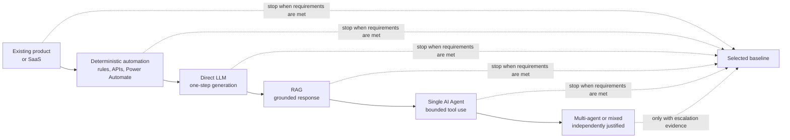
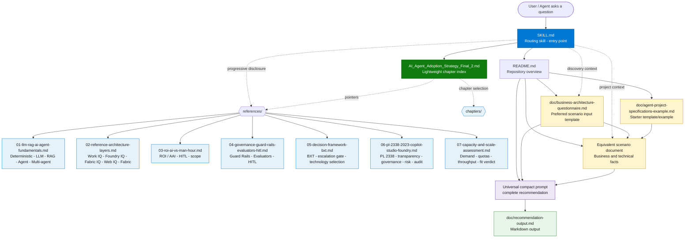
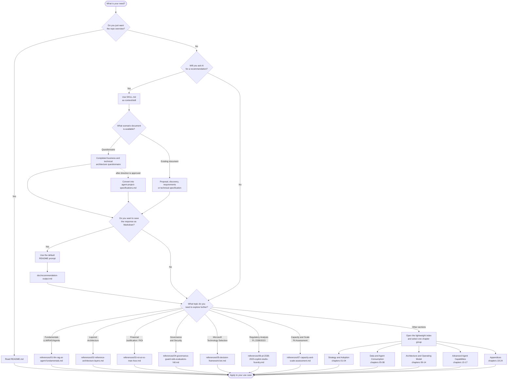

# hubsp-ai-skill

## What is this project

This repository organizes a practical knowledge base to guide the corporate adoption of AI in the Microsoft ecosystem. The focus is on selecting the **simplest viable architecture first**, then combining Microsoft IQ context workloads (Work IQ, Foundry IQ, Fabric IQ and Web IQ), explicit agent runtimes, governed data, security, guard rails, evaluators and operations only where the current requirements justify them.

The project was structured to serve as both an executive and technical reference: it helps business, architecture, data and security teams align on a common vision for planning, piloting and expanding AI initiatives with lower risk and greater value predictability. Skill version **1.9.0** accepts either the completed 30-question intake or any equivalent business and technical scenario document, makes low-complexity-first selection mandatory, requires evidence before escalating to agentic, multi-agent or mixed-runtime solutions, and requires a capacity and scale fit verdict before a Microsoft product, SaaS capability, license, SKU or configuration is approved for production. The skill metadata remains compatible with Claude's custom-skill upload requirements.

## Objective

- Define a reference architecture for AI agents in a corporate context.
- Evaluate existing products, deterministic automation, LLM, RAG, single-agent and multi-agent options in ascending complexity.
- Stop at the first option that reliably satisfies current requirements and require evidence before every escalation.
- Validate product licensing, quotas, throughput, concurrency, data/index size, regional availability, downstream limits and scale headroom against peak requirements.
- Standardize recommendations focused on governance, compliance and observability.
- Support a wave-based roadmap (pilot, expansion and scale) with clear criteria.
- Make trade-offs explicit across cost, risk, speed and complexity.

## Low-complexity-first decision policy

The skill evaluates options in this mandatory order:



For every escalation, the recommendation must identify:

1. The current requirement the preceding option cannot satisfy.
2. The test result, pilot evidence or explicit assumption supporting that conclusion.
3. The additional cost, latency, failure modes, operational ownership and governance burden.
4. The measurable trigger that would justify adding deferred complexity later.

When evidence is incomplete, the skill recommends the lower-complexity pilot and turns the uncertainty into a validation objective. Security, compliance, multiple teams or expected growth do not automatically justify multi-agent or mixed architecture. Apply identity, least privilege, isolated tools, data controls, audit, evaluators and HITL to the simpler baseline first.

## Capacity and scale decision policy

Every production recommendation must include a component-level capacity and scale fit matrix. It separates commercial entitlement (licenses, credits, messages or prepaid capacity) from technical throughput (RPM/RPH, TPM, concurrency, CUs, Search Units, replicas/partitions and downstream limits). The lowest sustainable limit in the complete runtime path is treated as the effective capacity.

Each selected component receives a **Fit**, **Conditional fit** or **Not fit** verdict. Unknown peak demand, tenant entitlement, subscription quota, region support or downstream capacity produces a conditional recommendation and a named pre-production validation gate. Daily or monthly volume alone is insufficient; the assessment uses peak demand, p50/p95 work per interaction, explicit headroom and representative end-to-end load testing.

## Who can use the architecture questionnaire

Anyone can use `doc/business-architecture-questionnaire.md` to provide structured inputs for an architecture recommendation. It does not require prior AI, Microsoft cloud or architecture expertise, and respondents should describe the need rather than choose a technology.

Typical users include:

- Business owners, process owners and subject-matter experts defining a problem or opportunity.
- Product managers, analysts and project managers preparing a discovery, business case or pilot.
- Developers, data teams, security teams and platform teams validating technical feasibility.
- Enterprise and solution architects comparing architecture options.
- Consultants, partners and pre-sales teams running customer workshops or assessments.
- Students, startups and individual practitioners evaluating an idea before implementation.

The questionnaire supports several working modes:

- **Individual intake:** one person completes Part A using available information. The skill produces an initial conditional recommendation and identifies only the missing inputs that could change it.
- **Collaborative workshop:** business participants complete Part A, while technical participants complete Part B during or after the workshop.
- **Interview guide:** a facilitator asks the questions and records concise answers, assumptions and validation owners.
- **Architecture review:** an existing project team uses both parts to challenge a proposed design and expose unsupported product, capacity, security or operational assumptions.
- **Proposal or discovery input:** consultants and partners use the completed questionnaire as a consistent basis for recommendations, estimates and next-step planning.

Part A alone is sufficient for an initial architecture direction. Part B improves product, integration, security, capacity and production-readiness decisions. Enter **Unknown** instead of guessing; an unknown answer does not prevent initial analysis, but material unknowns remain explicit validation gates.

## What you will find in this repository

- SKILL.md: version 1.10.0 skill definition and router. Normalizes a completed questionnaire or equivalent scenario document, enforces the low-complexity-first ladder, evidence-based escalation, capacity and scale validation, and consistent adoption architecture responses while loading reference files on demand.
- AI_Agent_Adoption_Strategy_Final_2.md: lightweight index that routes to thematic references and the 24 individual guide chapters.
- chapters/: complete guide content split for selective, on-demand loading and organized into five groups:
   - Strategy and Adoption: chapters 01-04 (executive overview, adoption strategy, tools and approaches).
   - Data and Agent Consumption: chapters 05-08 (Fabric consumption, agent access and usage examples).
   - Architecture and Operating Model: chapters 09-14 (integration, operating model, Microsoft architecture alignment, instructions and skills).
   - Advanced Agent Capabilities: chapters 15-17 (orchestration, memory and operational implementation).
   - Appendices: chapters 18-24 (code examples, templates, tool decision tree, OpenTelemetry, dataset curation and consolidated references).
- references/: thematically sliced content for on-demand loading:
   - references/01-llm-rag-ai-agent-fundamentals.md: existing/deterministic alternatives, LLM, RAG, AI Agent and Agentic AI; complexity spectrum and escalation decision guide.
   - references/02-reference-architecture-layers.md: conditional Microsoft IQ context capabilities, managed agent platforms, Agent Framework hosting boundaries, Microsoft Fabric and technical specifications per layer.
   - references/03-roi-ai-vs-man-hour.md: ROI/AAI model, HITL and scope multiplier.
   - references/04-governance-guard-rails-evaluators-hitl.md: Guard Rails, Evaluators and Human-in-the-Loop.
   - references/05-decision-framework-bxt.md: Microsoft AI Decision Framework (Intake Filter, BXT, 9 critical questions, Capability Model, mandatory complexity-escalation gate and technology selection by scenario).
   - references/06-pl-2338-2023-copilot-studio-foundry.md: analysis of PL 2338/2023 and how Microsoft Copilot Studio, Microsoft Foundry and Purview address the axes of transparency, governance, risk, audit, human oversight and data protection with official sources.
   - references/07-capacity-and-scale-assessment.md: demand model, product-specific licensing/quota/throughput checks, fit verdict, headroom, load validation and official Microsoft capacity references.
- doc/agent-project-specifications-example.md: starter example of a project specification document to accelerate onboarding before creating or customizing doc/agent-project-specifications.md.
- doc/business-architecture-questionnaire.md: business and technical discovery questionnaire that captures outcomes, current process, users, data, actions, risk, demand, economics, identity, integrations, runtime, networking, reliability, security, observability and delivery without asking stakeholders to choose a technology.
- doc/agent-project-specifications.md: implementation-ready scenario input template used when requirements have already been formalized.
- doc/recommendation-output.md: generated output artifact where the executive recommendation is persisted in markdown format.

> Note: AAI (AI Advantage Index) is the ratio between the human cost of the task and the total AI cost per task (AAI = Human Cost / AI Cost). AAI > 1 indicates that AI is financially advantageous (an AAI of 4.0 means the task via AI costs 1/4 of the same task done by a person); AAI = 1 is the break-even point; AAI < 1 indicates keeping human work. Not to be confused with VAT (Value Added Tax).
- Supplementary guides for dynamics and setup to facilitate collaboration and use in VS Code.

## Repository structure (diagram)

The diagram below shows how the files relate to each other. SKILL.md is the entry point (router); the lightweight index points to thematic references and individual chapters that are loaded on demand.



## How to navigate (decision flowchart)

Use this flow to choose which file to open based on your need.



## Target audience

- Anyone who needs structured inputs for an AI architecture recommendation, including people without architecture expertise.
- Technology and business leaders.
- Enterprise architects, data architects and platform teams.
- Governance, security and compliance teams.
- Squads starting or scaling AI agents.

## How to use in Visual Studio Code

Prerequisites: VS Code, the GitHub Copilot Chat extension and an active GitHub Copilot subscription.

1. Clone and open the repository:

   ```bash
   git clone https://github.com/<your-org>/hubsp-ai-skill.git
   code hubsp-ai-skill
   ```

2. Open Copilot Chat (chat icon in the sidebar or `Ctrl+Alt+I` / `Cmd+Alt+I`) and use Agent mode.
3. The `.github/copilot-instructions.md` file is automatically loaded as workspace context, ensuring the executive response format is applied consistently.
4. Bring a file into the conversation context in one of these ways:
   - Type `#` and select the file (e.g., `#SKILL.md`).
   - Drag the file from the Explorer into the chat panel.
   - Open the file in the editor and reference it with `#file`.
5. Recommended flow: start with `SKILL.md` and let the agent load one file from `references/` or `chapters/` on demand, based on the topic of the question. Do not attach the complete `chapters/` folder.

For topics beyond the seven curated references, open `AI_Agent_Adoption_Strategy_Final_2.md`, choose the relevant chapter group and load only the chapter or chapters required by the request. This progressive-disclosure approach keeps the context focused and avoids loading the full knowledge base.

## Universal compact prompt

Attach `SKILL.md` and one scenario input document. The scenario document can be a completed copy of `doc/business-architecture-questionnaire.md` or any proposal, discovery note, requirements document, workshop summary or technical specification containing the available business and technical facts. It does not need to use the questionnaire's headings or order.

Use the same prompt for every supported client:

> Apply hubsp-ai-skill to the attached scenario document. Recommend the simplest viable Microsoft architecture and save the complete recommendation to `doc/recommendation-output.md`. Treat missing decision-critical information as explicit assumptions or validation gates; do not invent facts.

The skill supplies the architecture ladder, evidence-based escalation, target output structure, diagrams, capacity fit, governance, applicable regulation, ROI/AAI, roadmap, KPIs, risks and official-source requirements. Keeping those rules in `SKILL.md` avoids prompt duplication and produces consistent results across clients.

Questionnaire-based architecture flow:

1. Any individual or team can start by completing the 15 questions in Part A of `doc/business-architecture-questionnaire.md`. When technical participants are available, use the 15 questions in Part B to strengthen feasibility and production-readiness inputs. Respondents may answer **Unknown** and name a validation owner instead of guessing.
2. Attach the completed questionnaire with `SKILL.md`, or attach another document containing equivalent business and technical facts.
3. Convert the approved recommendation and unresolved technical items into `doc/agent-project-specifications.md` before implementation planning.

Tip: to use `SKILL.md` as a reusable skill in the official VS Code format, copy it (or create a link) to a folder such as `.github/skills/hubsp-ai-skill/` or `~/.copilot/skills/hubsp-ai-skill/`. In this repository, the file at the root acts as the **canonical source/router** for direct reference in prompts, while the formal skill installation should follow the lowercase folder convention.

## How to use in Claude Desktop

Claude custom skills use progressive disclosure and are uploaded as a ZIP package. Skills are available on Free, Pro, Max, Team and Enterprise plans, but **Code execution and file creation** must be enabled.

1. From the parent directory of this repository, create a ZIP whose root is the `hubsp-ai-skill/` folder:

   ```bash
   cd ..
   zip -r hubsp-ai-skill.zip hubsp-ai-skill \
     -x "hubsp-ai-skill/.git/*"
   ```

2. In Claude Desktop, enable the required capability:
   - Free, Pro or Max: open **Settings > Capabilities** and enable **Code execution and file creation**.
   - Team or Enterprise: an owner must enable **Code execution and file creation** and **Skills** under **Organization settings > Skills**.
3. Open **Customize > Skills**.
4. Select **+ > Create skill > Upload a skill** and upload `hubsp-ai-skill.zip`.
5. Confirm that the skill appears in the list and toggle it on.
6. Start a new chat, attach the completed questionnaire or another scenario document, and apply the universal compact prompt:

   > Apply hubsp-ai-skill to the attached scenario document. Recommend the simplest viable Microsoft architecture and save the complete recommendation to `doc/recommendation-output.md`. Treat missing decision-critical information as explicit assumptions or validation gates; do not invent facts.

7. Claude loads the skill instructions dynamically, maps the attached document to the questionnaire fields and uses it as case context. The document can use any clear structure.
8. After changing this repository, rebuild the ZIP and replace the uploaded skill so Claude uses the latest version.

Review the ZIP contents before uploading, especially if scripts or external dependencies are added later. Custom skills can execute code, so do not include credentials or secrets.

Official Anthropic references:

- [Use skills in Claude](https://support.claude.com/en/articles/12512180-use-skills-in-claude)
- [How to create custom skills](https://support.claude.com/en/articles/12512198-how-to-create-custom-skills)
- [What are skills?](https://support.claude.com/en/articles/12512176-what-are-skills)

## How to use in Microsoft Scout

> **Preview notice:** Microsoft Scout is a Frontier preview desktop application. Availability, prerequisites and behavior can change before general availability.

Current prerequisites include Windows 11 or macOS 12+, a Microsoft 365 work or school account, Microsoft 365 Copilot access, a GitHub Copilot Business or Enterprise license, local installation permission and administrator enablement for the Frontier preview.

1. Join the [Microsoft Frontier preview program](https://adoption.microsoft.com/copilot/frontier-program/) and confirm that your administrator has enabled Microsoft Scout access.
2. [Download Microsoft Scout](https://aka.ms/msscout), install it and sign in to both Microsoft 365 and GitHub when prompted.
3. Set this repository, or the project directory containing the scenario input document, as the Scout workspace.
4. From this repository root, install the complete skill in Scout's global skills directory so its references and chapters remain available:

   ```bash
   mkdir -p ~/.copilot/skills/hubsp-ai-skill
   rsync -a --exclude '.git' ./ ~/.copilot/skills/hubsp-ai-skill/
   ```

5. Start a new conversation. Scout discovers custom skills at the beginning of future conversations; loaded skills appear in the conversation context.
6. Attach the completed questionnaire or another scenario document and ask Scout to apply the skill:

   > Apply hubsp-ai-skill to the attached scenario document. Recommend the simplest viable Microsoft architecture and save the complete recommendation to `doc/recommendation-output.md`. Treat missing decision-critical information as explicit assumptions or validation gates; do not invent facts.

7. Keep **Auto-approve** disabled while validating the skill. Review requests to run shell commands, write files, use the browser or act on Microsoft 365 data before approving them.
8. To update the installed skill after repository changes, rerun the `rsync` command and begin a new conversation.

Scout operates within the configured workspace and your existing permissions. Custom skills are not validated by Microsoft, so review generated recommendations and all sensitive actions before approval. Microsoft 365 data processed through GitHub Copilot can be subject to different protection and data-processing terms than data processed entirely within Microsoft 365.

Official Microsoft references:

- [Get started with Microsoft Scout](https://learn.microsoft.com/microsoft-scout/get-started)
- [Use Microsoft Scout](https://learn.microsoft.com/microsoft-scout/use-microsoft-scout)
- [Microsoft Scout common questions](https://learn.microsoft.com/microsoft-scout/faq)

## Note on project documents (`doc` folder)

To standardize skill usage across any channel, provide one scenario input document containing the available business and technical facts. Use a completed `doc/business-architecture-questionnaire.md`, or reuse an existing proposal, discovery note, requirements document, workshop summary or technical specification. Do not rewrite a useful document only to match the questionnaire structure.

Recommended path example:

`doc/agent-project-specifications.md`

Preferred discovery template:

`doc/business-architecture-questionnaire.md` (complete the known answers and attach it alongside `SKILL.md`).

Implementation-ready template:

`doc/agent-project-specifications.md` (use when requirements have already been formalized).

Recommended minimum document structure (suggested order):

1. Business context and agent objective.
2. Current process, existing products/SaaS capabilities and deterministic automation already available.
3. Functional scope (what the AI solution does and does not do).
4. User profiles, journeys and channels.
5. Non-functional requirements (SLA, latency, availability, scale).
6. Data, integrations, required actions and autonomy (sources, APIs, systems, data classification).
7. Governance and security (guard rails, compliance, audit, HITL).
8. Success criteria and KPIs.
9. Constraints, risks and assumptions.
10. Wave-based roadmap and measurable escalation triggers (pilot, expansion, scale).

Supported file extensions (recommended practice):

- `.md`: best performance and highest reading predictability by the agent (recommended).
- `.txt`: high performance, without formatting features.
- `.pdf`: supported, but may lose structure in tables/diagrams and vary depending on text extraction.
- `.docx`: supported, good for executive authoring, with possible interpretation variation in complex layouts.

Best overall performance for skill analysis: **`.md`** (plain text, clear sections and objective headings).

## Default reusable prompt

After attaching `SKILL.md` and one scenario input document, use:

> Apply hubsp-ai-skill to the attached scenario document. Recommend the simplest viable Microsoft architecture and save the complete recommendation to `doc/recommendation-output.md`. Treat missing decision-critical information as explicit assumptions or validation gates; do not invent facts.

Variation for GitHub Copilot CLI:

> Read `SKILL.md` and the supplied scenario document. Apply hubsp-ai-skill, recommend the simplest viable Microsoft architecture, and save the complete recommendation to `doc/recommendation-output.md`. Treat missing decision-critical information as explicit assumptions or validation gates; do not invent facts.

## How to use in the GitHub Copilot App

Prerequisites: GitHub Copilot app with repository access and an active GitHub Copilot subscription.

1. Open this repository in the app as a workspace/project.
2. Start a chat in Agent mode.
3. Attach `SKILL.md` and one completed questionnaire or equivalent scenario document.
4. Use the universal compact prompt. The skill loads only the relevant files from `references/` or `chapters/` when additional depth is required.
