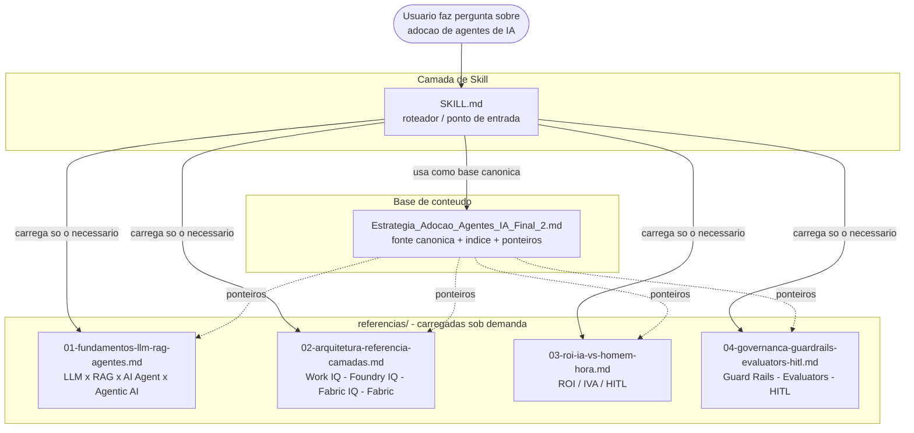
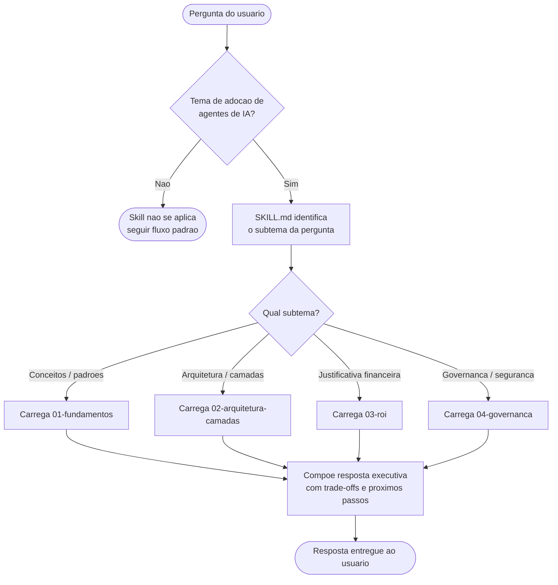

# HARASKILL

## O que e este projeto

Este repositorio organiza uma base pratica para orientar a adocao corporativa de agentes de IA no ecossistema Microsoft. O foco e apoiar decisoes de arquitetura alvo com integracao entre Work IQ, Foundry IQ e Fabric IQ, conectando estrategia de negocio, dados governados, seguranca, guard rails, evaluators e operacao em escala.

O projeto foi estruturado para servir como referencia executiva e tecnica: ajuda times de negocio, arquitetura, dados e seguranca a alinharem uma visao comum de como planejar, pilotar e expandir iniciativas de IA agentica com menor risco e maior previsibilidade de valor.

## Objetivo

- Definir uma arquitetura de referencia para agentes de IA em contexto corporativo.
- Padronizar recomendacoes com foco em governanca, compliance e observabilidade.
- Apoiar um roadmap em ondas (piloto, expansao e escala) com criterios claros.
- Explicitar trade-offs entre custo, risco, velocidade e complexidade.

## O que voce encontra neste repositorio

- SKILL.md: definicao unica da skill (roteador) que orienta respostas consistentes em contexto de arquitetura de adocao. Aponta para os arquivos de referencia sob demanda (progressive disclosure).
- Estrategia_Adocao_Agentes_IA_Final_2.md: guia principal e fonte canonica, com visao executiva, indice e ponteiros para os arquivos de referencia.
- referencias/: conteudo tematico fatiado para carregamento sob demanda:
  - referencias/01-fundamentos-llm-rag-agentes.md: LLM x RAG x AI Agent x Agentic AI; espectro de complexidade e guia de decisao.
  - referencias/02-arquitetura-referencia-camadas.md: Work IQ, Foundry IQ, Fabric IQ, Microsoft Fabric e especificacoes tecnicas por camada.
  - referencias/03-roi-ia-vs-homem-hora.md: modelo de ROI/IVA, HITL e multiplicador de escopo.
  - referencias/04-governanca-guardrails-evaluators-hitl.md: Guard Rails, Evaluators e Human-in-the-Loop.
- Guias complementares de dinamicas e setup para facilitar colaboracao e uso no VS Code.

## Estrutura do repositorio (diagrama)

O diagrama abaixo mostra como os arquivos se relacionam. O SKILL.md atua como roteador e
carrega apenas a referencia necessaria (progressive disclosure); o guia principal e a fonte
canonica com ponteiros para os arquivos tematicos.

## Fluxograma de uso (como a skill responde)

## Publico-alvo

- Liderancas de tecnologia e negocio.
- Arquitetos corporativos, arquitetos de dados e equipes de plataforma.
- Times de governanca, seguranca e compliance.
- Squads que estao iniciando ou escalando agentes de IA.
