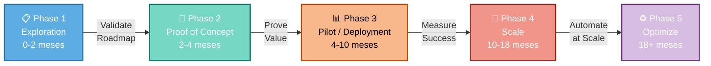
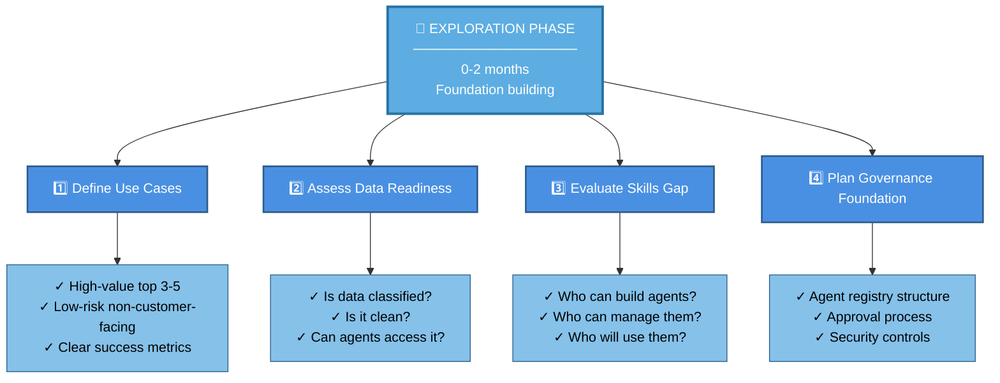
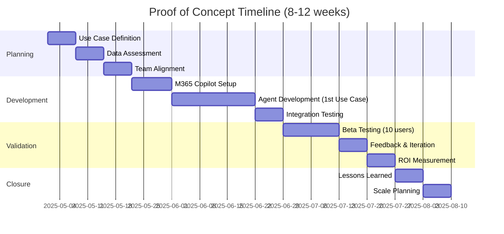
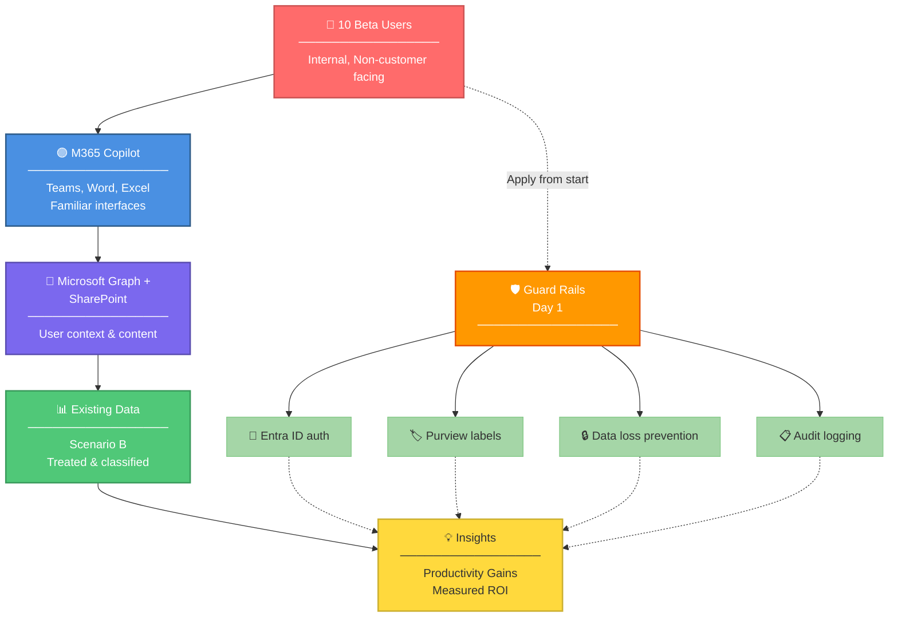
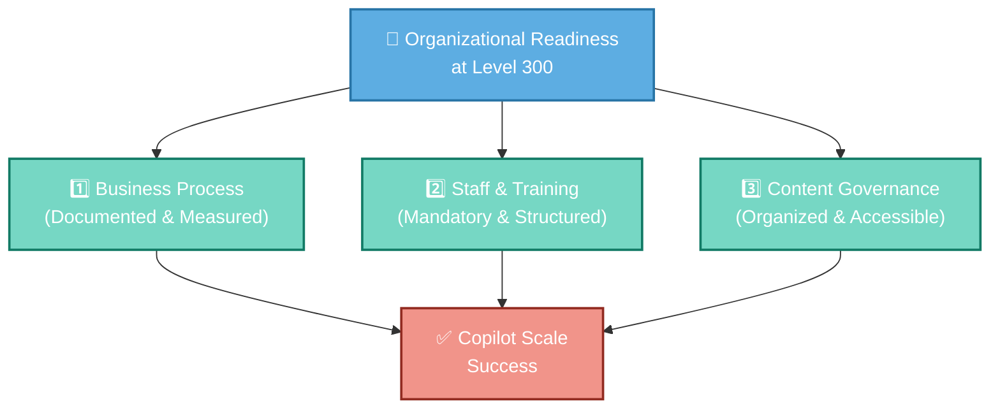
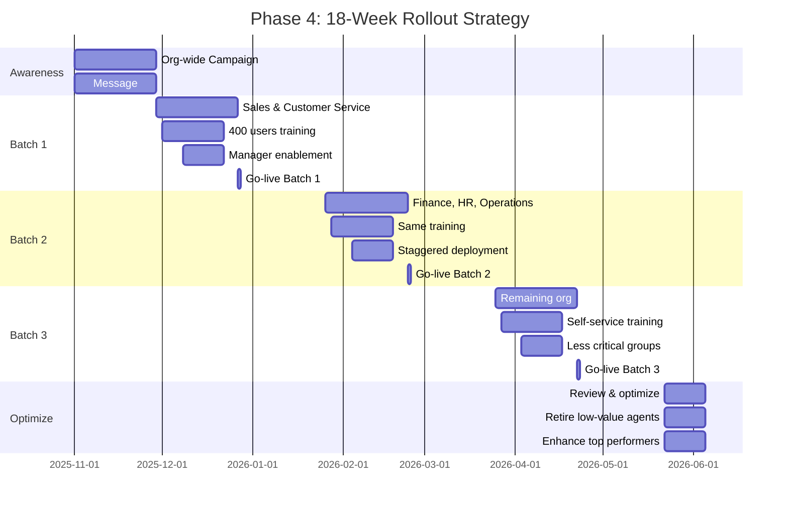
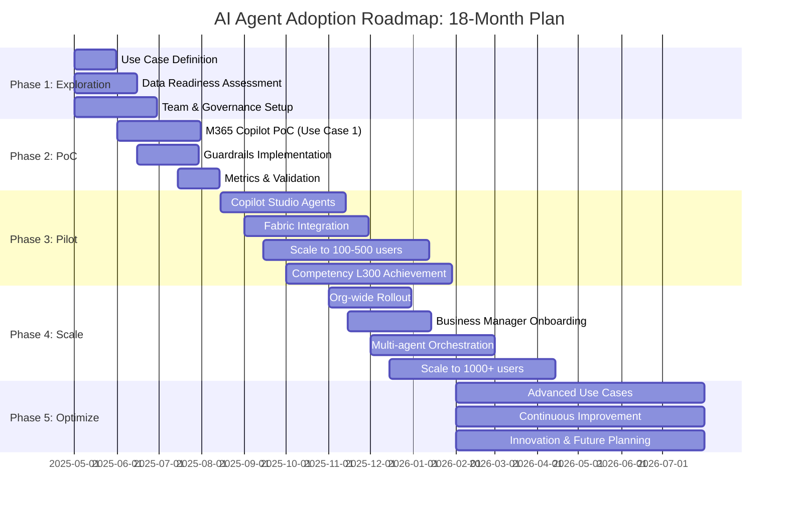

## ⏱️ 3. Adoption Strategy (Short and Medium Term)

The adoption strategy follows an internal model of **5 evolutionary phases**, aligned with Microsoft's framework for AI agents (**Plan, Govern and secure, Build, Manage**). The objective is to build organizational capability, not merely deliver technology. Success depends on people, processes and governed data.

---

### 🔍 Phase 1: Exploration (0–2 months) — Initial Validation

**🎯 Objective**
Validate technical feasibility, prioritize use cases and measure organizational readiness.

**📋 Key Activities**

| Activity | Owner | Deliverable | Metric |
|-----------|-------------|-----------|----------|
| Identify AI use cases | Business + IT | Document of 3-5 priority use cases | ROI alignment |
| Assess data readiness | Data governance | Quality, sensitivity, accessibility report | % data classified |
| Assess org. capacity | HR + Business | Skills map, training needs | # people with AI skills |
| Define team | IT + Business | RACI (Responsibilities/Accountability) | Full coverage of critical roles |
| Establish baseline | Operations | Initial metrics: productivity, time, cost | KPIs before AI |

**🏗️ Architecture — Phase 1 Key Activities**

**⚠️ Common Risks**
- Lack of executive sponsorship → Mitigation: C-level alignment workshop
- Overly complex use cases → Mitigation: Select already-documented processes
- Unclassified data → Mitigation: Classify 80% before PoC

**✅ Success Criteria**
- ✓ 3-5 use cases documented with projected ROI
- ✓ 80%+ of relevant data classified and catalogued
- ✓ Multidisciplinary team designated (Business, IT, Data, AI)
- ✓ Baseline metrics established per use case

---

### 🔬 Phase 2: Proof of Concept (2–4 months) — Technical Validation

**🎯 Objective**
Demonstrate feasibility of 1-2 priority cases with real data, identify practical risks and confirm ROI.

**🛠️ Approach — Work IQ + Scenario B**

Phase 2 combines **Microsoft 365 Copilot** (Work IQ) with **curated data** (Scenario B) to maximize rapid impact with controlled technical risk:

| Dimension | Work IQ (M365 Copilot) | Existing Data | Benefit |
|----------|---|---|---|
| **Setup Time** | 3-5 days | Already available | Go-to-value in days |
| **Technical Risk** | Low (managed service) | Controlled | Low-risk PoC |
| **User Impact** | Direct (embedded in Word, Excel, Teams) | Immediate (current context) | Visible value in weeks |
| **Governance** | Native (Microsoft Purview) | Already classified (Scenario B) | Compliance from day 1 |
| **Scalability** | SaaS (auto-scale) | Fabric integration path | Clear evolution path |

**📋 PoC Activities**

**🧩 PoC Architecture**

**📊 Metrics & Success Criteria (Phase 2)**

| Metric | Target | Measurement |
|---------|--------|---------|
| **Time-to-Value** | < 2 weeks | Date of user's first action |
| **User Adoption** | > 70% weekly use | Usage analytics |
| **Output Quality** | > 80% satisfaction | User survey (1-5 scale) |
| **Security Incidents** | 0 breaches | Audit logs, DLP alerts |
| **Cost** | < $50K | Azure + Copilot licensing |
| **ROI Projection** | > 3:1 | Hours saved × hourly rate |

**⚠️ Common Pitfalls (Level 200 Trap)**

Microsoft research shows the **Top 3 Blockers** for AI rollout:

1. **Inaccurate output & hallucinations (68.7%)** — AI generates incorrect responses
   - Mitigation: Implement Groundedness Check, mandatory human validation

2. **Data security concerns (68.5%)** — Sensitive data exposed
   - Mitigation: Purview labels + RLS from Phase 2 onwards, not after

3. **Employees don't see value (64.2%)** — Lack of relevance to daily work
   - Mitigation: PoC on existing workflows, not new processes

**❌ Do NOT do in Phase 2**
- ✗ Do not roll out to "all employees" yet (Level 200 trap)
- ✗ Do not measure success by "licenses assigned" (wrong metric)
- ✗ Do not skip governance (Purview labels, RLS, audit logging)
- ✗ Do not use untreated/unclassified data

**✅ Phase 2 Success Criteria**
- ✓ 1-2 agents in production with 10+ active users
- ✓ Complete documentation (prompts, guardrails, SOP)
- ✓ Projected ROI approved (business is convinced)
- ✓ No significant security incidents during pilot, with comprehensive audit trail
- ✓ Scale plan documented (Phase 3)

---

### 📊 Phase 3: Pilot / Deployment (4–10 months) — Controlled Scale

**🎯 Objective**
Scale from 10 users to 100-500 users, validate operational processes and consolidate adoption culture.

**🚀 Approach — Hybrid (Scenario A + B) + Fabric + Foundry**

Phase 3 introduces **Copilot Studio** and **Microsoft Foundry** for:
- Domain-specific agents
- Integration with Fabric Data Products
- Multi-agent orchestration
- Advanced governance

| Tool | Use Case | Characteristics |
|-----------|----------|---|
| **M365 Copilot** | General productivity | Embedded AI, familiar experience |
| **Copilot Studio** | Domain-specific agents | Low-code, conversational agents |
| **Microsoft Foundry** | Complex, multi-step scenarios | Code-first, advanced reasoning |
| **Fabric Data Products** | Governed data | OneLake, RLS, Purview integration |

**🎯 Three Critical Competencies (Microsoft Maturity Model)**

For success in Phase 3, **3 competencies must be at Level 300**:

**1️⃣ Business Process (Level 300)**
- ✓ Documented processes (not just "John knows how to do it")
- ✓ Measured processes (clear success metrics)
- ✓ Processes ready for automation (AI can execute)
- ✓ Consistent data dictionary (names, definitions)

*Example:* "Support request triage" documented in Visio, with 4h SLA, ready for automation.

**2️⃣ Staff & Training (Level 300)**
- ✓ MANDATORY training (not voluntary), managed by HR
- ✓ Managers adopt FIRST (before their teams)
- ✓ Champions program with structure (4h/month, manager must support)
- ✓ Training focused on **business value**, not just "how to use AI"

*Example:* 1. HR makes training mandatory. 2. Managers take 40h "AI fundamentals for managers". 3. Sales team trained by their manager.

**3️⃣ Content Governance (Level 300)**
- ✓ Clear, up-to-date documentation (well-organized SharePoint)
- ✓ Sensitivity labels applied (Purview)
- ✓ Correct permissions (no over-sharing)
- ✓ Clear versioning & ownership

*Example:* All shared docs have an owner, version, and sensitivity label. No "shared with everyone".

**📋 Scale Plan**

| Month | Users | Agents | Focus | Competency |
|-----|----------|---------|------|-------------|
| M4 | 50 | 2 | Phase 2 lessons, small group expansion | Business Process L300 |
| M5-6 | 150 | 3-4 | Add Copilot Studio agents, department rollout | Staff & Training L300 |
| M7-8 | 300-500 | 5-8 | Fabric integration, multi-agent, advanced use cases | Content Governance L300 |
| M9-10 | 1000+ | 10+ | Evaluate for broader org rollout, establish patterns | All three L300+ |

**⚠️ Phase 3 Risks**

| Risk | Impact | Mitigation |
|-------|--------|-----------|
| Adoption plateaus at 20-30% | Investments stranded | Ensure 3 competencies at L300, not just tech |
| Quality issues escalate | Users lose trust in AI | Implement guard rails (Groundedness check, PII detection) |
| Data security breaches | Compliance failure | Enforce Purview + RLS from day 1 |
| Budget overruns | Stakeholder support lost | Cost monitoring via AI Gateway quotas |
| Champions burnout | Knowledge transfer fails | Formalize champions program (4h/mo, manager support) |

**✅ Phase 3 Success Criteria**
- ✓ 300-500 active users with 8+ agents in production
- ✓ All 3 competencies (Process, Training, Content) at Level 300
- ✓ >60% adoption rate among pilot groups
- ✓ ROI demonstrated (before/after analysis)
- ✓ Clear roadmap to Phase 4 approved

---

### 🚀 Phase 4: Scale (10–18 months) — Full Scale with Managed Agents

**🎯 Objective**
Scale to the entire organization, with agents as part of the operational workforce and governance led by business managers.

**🔑 Critical Shift in Phase 4**

Transition from **agents as experiment** to **agents as workforce**:

| Aspect | Phase 3 (Pilot) | Phase 4 (Scale) |
|--------|---|---|
| **Ownership** | IT + Data team | Domain business manager |
| **Agent Definition** | Technical description | Agent JD (job description) |
| **Management** | "Configure and forget" | Managers conduct performance reviews |
| **Updates** | Patch-driven | Manager requests updates when process changes |
| **Accountability** | Project | Operational (KPI, SLA, budget) |

*Example:* Sales agent is no longer an "ML project" — it's "Sales Agent Sarah" reporting to the Sales Manager, with objectives, SLA and performance reviews like any employee.

**📊 Scale-Out Pattern**

**🛡️ Governance at Scale**

With 1000+ users and 20+ agents, governance shifts from manual to automated:

| Control | Phase 3 | Phase 4 |
|---------|--------|--------|
| **Agent Registry** | Manual spreadsheet | Agent 365 (centralized, real-time) |
| **Policy Enforcement** | Per-project review | Automated via AI Gateway quotas |
| **Audit Logging** | Basic logs | Purview + Entra ID comprehensive audit |
| **Cost Tracking** | Monthly reports | Real-time cost alerts per business unit |
| **Compliance** | Per-team checks | Org-wide automated compliance scanning |

**⚠️ Level 400 Characteristics (Microsoft Maturity Model)**

The organization reaches **Level 400 - Predictable**:

- ✓ Copilot/agents available to ~70% of org (based on licensing)
- ✓ Training is an ongoing program (not a one-time event)
- ✓ Governance is comprehensive (regular audits and responsible AI compliance)
- ✓ Content is optimized for AI (well-organized, current, well-categorized)
- ✓ **Agents need managers** — but business managers, not IT managers
- ✓ Success measured by business outcomes, not just adoption %

**✅ Phase 4 Success Criteria**
- ✓ 1000+ users with 20+ operational agents
- ✓ Demonstrated 3:1+ ROI (documented)
- ✓ Adoption > 60% among target users
- ✓ 0 significant security incidents
- ✓ Clear ownership of agent portfolio by business managers

---

### ♻️ Phase 5: Optimize (18+ months) — Maturity and Continuous Innovation

**🎯 Objective**
Continuous optimization, expansion of advanced cases and exploration of new frontiers (multi-agent, reasoning and upcoming innovation cycles).

**🎓 Level 500 - Optimizing**

- Copilot is a **core strategic capability**, embedded in job descriptions
- Training is personalized and adaptive
- Advanced use cases: custom Copilot Studio agents, Foundry reasoning, multi-agent orchestration
- The org participates in preview programs and contributes feedback
- Business processes transformed (not merely enhanced) by AI

---

### 📈 Consolidated Roadmap (0-18 months)

---

### 🔗 Microsoft References

- [**AI Adoption Plan Framework**](https://learn.microsoft.com/azure/cloud-adoption-framework/ai/plan) — 6 phases: Strategy, Plan, Ready, Govern, Secure, Manage
- [**AI Agent Adoption Process**](https://learn.microsoft.com/azure/cloud-adoption-framework/ai-agents/) — 4 phases: Plan, Govern, Build, Manage
- [**Maturity Model: Microsoft 365 Copilot Implementation**](https://learn.microsoft.com/microsoft-365/community/maturity-model-microsoft365-practical-scenarios-copilot-implementation) — Levels 100-500, 3 critical competencies
- [**Organizational Readiness for AI Agents**](https://learn.microsoft.com/azure/cloud-adoption-framework/ai-agents/organization-people-readiness-plan) — Skills, change management, culture
- [**Microsoft Fabric Adoption Roadmap**](https://learn.microsoft.com/power-bi/guidance/fabric-adoption-roadmap) — Phases, change management, training strategy

---

