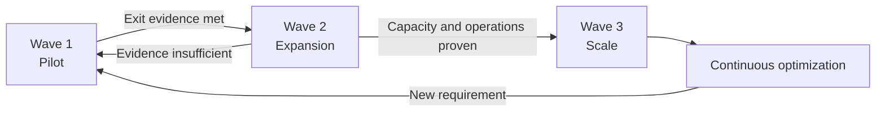

## ⏱️ 3. Adoption Strategy — Evidence-Gated Waves

This guide uses three deployment waves: **Pilot, Expansion and Scale**. These are internal decision gates, not Microsoft's named lifecycle or fixed calendar phases. Map them to the applicable Microsoft lifecycle: **Strategy, Plan, Ready, Govern, Secure and Manage** for general AI adoption; or **Plan for agents, Govern and secure agents, Build agents, and Manage, integrate and operate agents** for agent adoption. Governance and security apply throughout every wave. Duration, user count, product selection and architecture complexity depend on business evidence, risk, readiness, capacity and operational ownership.

The organization must evaluate options in this order and stop at the first one that reliably satisfies the current requirement:

1. Existing Microsoft product, SaaS capability or configuration.
2. Deterministic workflow, rules, API integration or Power Automate.
3. Direct LLM call for one-step generative work.
4. RAG for grounded answers without autonomous tool execution.
5. Single AI Agent for bounded multi-step reasoning or tool use.
6. Multi-agent or mixed architecture only when independently justified requirements cannot be met by one runtime.

### 🧭 Architecture and Product Selection Rule

Architecture follows the use case; the roadmap does not predetermine the architecture. Microsoft 365 Copilot, Copilot Studio, Microsoft Foundry Agent Service, Microsoft Agent Framework, Microsoft Fabric and Microsoft IQ capabilities are selected only when they meet a documented current requirement.

When applicable:

- **Work IQ** supplies Microsoft 365 work context.
- **Foundry IQ** supplies permission-aware enterprise knowledge and citations.
- **Fabric IQ** supplies governed business semantics and analytical context.
- **Web IQ** supplies current external web context when the selected endpoint's lifecycle, access and production terms fit the scenario.
- **Microsoft Foundry Agent Service or Copilot Studio** provides the selected managed agent platform.
- **Microsoft Agent Framework** provides development abstractions and requires an explicit hosting choice unless deployed as a Foundry hosted agent.
- **Microsoft Fabric** provides governed analytical consolidation and semantic reuse when those capabilities are required.

Work IQ, Foundry IQ, Fabric IQ and Web IQ are context workloads, not interchangeable orchestration runtimes. A mixed Copilot Studio and Foundry architecture is an exception that requires evidence that both runtime boundaries are necessary now.

---

### 🔬 Wave 1 — Smallest Viable Pilot

**Objective:** Prove a measurable business outcome with the lowest-complexity option that can satisfy the requirement.

**Entry criteria**

- A named business owner and a measurable baseline exist.
- The current process, users, channels, authoritative sources and intended actions are documented.
- Data sensitivity, identity path and human-accountability boundary are understood.
- The simplest plausible baseline and its assumptions are explicit.

**Core activities**

| Activity | Owner | Required evidence |
|---|---|---|
| Define the business outcome | Business owner | Baseline, target KPI and decision owner |
| Assess current capabilities | Product owner + architecture | Existing SaaS and deterministic options considered first |
| Select the minimum architecture | Architecture + engineering | Rejected simpler options and unmet requirements documented |
| Validate governed authority | Data owner + security | Approved sources, semantics, identity and access path |
| Establish guard rails and HITL | Risk + security + business | Controls mapped to concrete risks and decision impact |
| Define evaluators | Product + engineering | Quality, groundedness, safety and task-success measures |
| Assess capacity and cost | Platform + FinOps | Peak-demand assumption and initial fit verdict |

**Pilot design principles**

- Use representative users and production-like data within an approved scope.
- Keep actions read-only or human-approved until authorization, rollback and audit controls are proven.
- Test effective permissions and result filtering end to end; do not assume source controls transfer automatically.
- Measure loaded person-hour cost, AI cost per task, HITL effort and realization factor.
- Treat preview dependencies as controlled experiments with explicit exit and fallback criteria.

**Exit criteria**

- The target business KPI improves against the agreed baseline.
- Quality and safety meet thresholds defined before testing.
- Effective permissions, audit evidence and incident ownership are verified.
- Cost per successful task and operational effort are acceptable.
- Every production dependency has a **Fit**, **Conditional fit** or **Not fit** capacity verdict.
- Any move to a more complex architecture names the unmet requirement, evidence and incremental cost, latency, risk and governance burden.

---

### 📊 Wave 2 — Controlled Expansion

**Objective:** Expand only the proven capability to additional users, domains or integrations while validating repeatability and operations.

**Entry criteria**

- Wave 1 exit criteria are met and approved by the business, security and platform owners.
- The architecture remains the simplest option that satisfies the expanded scope.
- Support, monitoring, incident response, change control and rollback ownership are assigned.
- Capacity headroom and downstream bottlenecks are measured under representative peak load.

**Expansion decisions**

| Decision | Evidence required before approval |
|---|---|
| Add users or business units | Adoption, support demand, concurrency and permission-boundary tests |
| Add a data domain | Named authority, semantic owner, freshness target and path-specific access validation |
| Add an action or tool | Least privilege, parameter validation, HITL rule, audit and rollback behavior |
| Move from SaaS to custom RAG | Ranking, lifecycle, network or regulatory requirement the built-in option cannot meet |
| Move from RAG to a single agent | Bounded multi-step reasoning or tool execution that retrieval alone cannot satisfy |
| Add a second runtime or agent | Independently owned specialization that one runtime cannot reliably satisfy |
| Introduce Microsoft Fabric | Analytical consolidation, semantic reuse or governed data-product requirement |

**Operational controls**

- Version prompts, instructions, tools, policies, semantic definitions and evaluation datasets.
- Monitor task success, groundedness, latency, failure modes, cost, quota use and user overrides.
- Apply change gates based on risk rather than treating every update identically.
- Maintain a registry of deployed capabilities, including deterministic automations, RAG applications and agents.
- Retire low-value or duplicate solutions instead of scaling them by default.

**Exit criteria**

- Benefits repeat across the expanded population without material quality degradation.
- Capacity tests demonstrate required headroom at the lowest limit in the end-to-end path.
- Operational teams meet service, incident and recovery targets.
- Governance evidence remains complete across every added data and tool path.
- Funding and ownership are approved for sustained operation, not only project delivery.

---

### 🚀 Wave 3 — Governed Scale

**Objective:** Operate proven capabilities as a managed portfolio with predictable reliability, cost, security and business accountability.

Scale does not mean deploying more agents. It means scaling reliable decisions and useful automation while preserving the lowest sufficient complexity for each use case.

**Scale requirements**

| Area | Required operating capability |
|---|---|
| Portfolio | Named business owner, lifecycle state, value KPI and retirement criteria per capability |
| Identity and security | Isolated workload identities, least privilege, access reviews and tested incident response |
| Data governance | Approved authorities, semantic ownership, lineage, classification and retention |
| Reliability | Service objectives, dependency health, degraded behavior, recovery and rollback |
| Capacity | Demand forecast, measured headroom, quota lead time, scale trigger and regional fallback |
| FinOps | Cost per successful task, budget alerts, attribution and optimization ownership |
| Quality | Continuous evaluation, representative datasets, drift detection and release gates |
| Human accountability | Explicit HITL thresholds, escalation paths and accountable decision owners |

**Portfolio decisions**

- Expand only capabilities with demonstrated value and stable operations.
- Consolidate duplicated integrations and semantic definitions where ownership and permissions align.
- Preserve separate authoritative systems when legal, regional or domain boundaries require them.
- Use multi-agent orchestration only when evaluation shows one bounded agent or deterministic coordinator cannot meet current specialization or ownership requirements.
- Reassess commercial entitlement separately from technical throughput; licenses or prepaid capacity do not guarantee concurrency or downstream capacity.

---

### 📐 Capacity and Scale Gate

Before each wave transition, assess every selected product and material dependency.

| Required field | Decision question |
|---|---|
| Demand metric | What is the peak request, token, message, job, data or concurrency demand? |
| Limit and scope | Which tenant, environment, subscription, region, deployment or downstream limit applies? |
| Headroom | What margin is required for bursts, retries, growth and degraded dependencies? |
| Verdict | Is the component **Fit**, **Conditional fit** or **Not fit**? |
| Validation | Which pilot, load test or administrative quota check supports the verdict? |
| Monitoring | Which signal shows approaching saturation or quality degradation? |
| Scale action | What configuration, license, SKU, quota, partition, replica or architecture change is triggered? |
| Source | Which official Microsoft source was checked, and on what date? |

Unknown production demand, entitlement, quota, regional availability or downstream capacity produces a **Conditional fit** verdict and remains a pre-production gate.

### 📈 Success KPIs

- Business outcome improvement against the pre-pilot baseline.
- Task success and groundedness at the approved threshold.
- Cost per successful task, including HITL and amortized setup.
- Time saved with an explicit realization factor.
- Permission, audit and safety-control pass rate.
- Reliability, latency and recovery performance.
- Adoption among intended users, paired with demonstrated business value.
- Number of capabilities retired, simplified or prevented from unnecessary escalation.

### 🔗 Microsoft References

- [Microsoft AI strategy](https://learn.microsoft.com/azure/cloud-adoption-framework/ai/strategy)
- [Cloud Adoption Framework AI agent adoption process](https://learn.microsoft.com/azure/cloud-adoption-framework/ai-agents/)
- [Microsoft Foundry Agent Service](https://learn.microsoft.com/azure/foundry/agents/overview)
- [Microsoft IQ](https://learn.microsoft.com/microsoft-iq/)
- [Azure architecture pattern for AI workloads](https://learn.microsoft.com/azure/well-architected/ai/architecture-pattern)

Official references accessed July 20, 2026. Revalidate product availability, licensing, quotas, limits and regional support before each production approval.