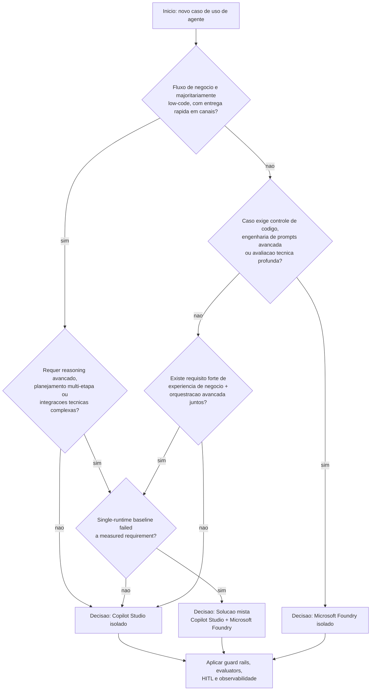

## 🛠️ 3.1. Adoption Tools — M365 Copilot, Copilot Studio and Microsoft Foundry

### 🎯 Objective
Map the three main tools to the adoption framework and short/medium-term scenarios

### 🏗️ Comparative Overview

#### 💼 Microsoft 365 Copilot

**🎯 Focus**
- individual productivity without development
- AI embedded in already-used interfaces (Teams, Word, Outlook, Excel)
- contextual assistance with Microsoft 365 and SharePoint data

**✅ Capabilities**
- content generation and summarization (documents, emails, meetings)
- data analysis with natural language via Copilot in Excel
- semantic search over corporate data via Microsoft Graph

**⚙️ Usage scenario**
`User → M365 Copilot → Graph / SharePoint → Immediate insight`

#### 🤖 Microsoft Copilot Studio

**🎯 Focus**
- creation of custom domain-specific agents (low-code / no-code)
- orchestration of conversational flows and automated actions
- native integration with Fabric, SharePoint, Dataverse and external APIs

**✅ Capabilities**
- agents publishable to Teams, web and external channels
- native connectors with M365, Power Platform and Fabric Data Products
- native guard rails and authentication via Entra ID (Agent ID)

**⚙️ Usage scenario**
`User → Agent (Copilot Studio) → Fabric / API → Action or Response`

#### 🔬 Microsoft Foundry

**🎯 Focus**
- development of complex agents with code
- multi-agent orchestration and advanced reasoning
- fine-tuning, evaluation and model deployment at scale

**✅ Capabilities**
- versioned agents, conversations, Responses API, tool calls and governed multi-step execution
- support for multiple models: GPT-4o, Claude, Mistral, Phi
- integration with Fabric OneLake, Purview, Entra ID and external APIs

**⚙️ Usage scenario**
`Engineer → Microsoft Foundry → Complex agent → Fabric + APIs → Automated decision`

### 🧠 Available models in Microsoft Foundry

Build 2026 consolidated the **MAI** family as a new Microsoft AI model line within the Foundry ecosystem. The consistent reading for this guide is to treat MAI as a **model portfolio** rather than a new architectural layer: models power the reasoning runtime, while **Work IQ, Foundry IQ and Fabric IQ remain complementary context workloads**.

**Executive reading of the MAI family**

| Model / family | Main use | Practical maturity | Adoption risk | Architecture fit |
| --- | --- | --- | --- | --- |
| MAI-Thinking-1 | Reasoning, planning and complex tasks | High value for advanced analysis | Medium | Reasoning layer in Foundry |
| MAI-Code-1-Flash | Agentic coding and efficient tool calling | Strong for development flows | Medium | Foundry for automation and build |
| MAI-Image-2.5 / Flash | Image generation and editing | Good for multimodal experiences | High when preview | Product extension and rich automation |
| MAI-Transcribe-1.5 | Transcription and voice input | Strong for speech scenarios | Medium | Multimodal input for agents |
| MAI-Voice-2 | Natural voice synthesis | Good for conversational experiences | High when preview | Experience layer / channels |

**Executive guideline for production**
- Prioritize MAI use by **capability and use case**, not by announcement novelty.
- Treat **preview** variants as a controlled innovation track, with guard rails and clear exit criteria.
- Maintain the guide's standard: governed data in Fabric, orchestration in Foundry, and evaluators/guard rails as cross-cutting controls.

**Official reference sources**
- [Microsoft AI: Building a hill-climbing machine: Launching seven new MAI models](https://microsoft.ai/news/building-a-hillclimbing-machine-launching-seven-new-mai-models/)
- [Foundry Models from partners and community — Microsoft](https://learn.microsoft.com/azure/foundry/foundry-models/concepts/models-from-partners#microsoft)
- [Deploy and use MAI image models in Microsoft Foundry (preview)](https://learn.microsoft.com/azure/foundry/foundry-models/how-to/use-foundry-models-mai)

### 🔌 Integration protocols in Microsoft Foundry

**MCP (Model Context Protocol):** open-source protocol by Anthropic to connect agents to external tools — Microsoft Foundry supports remote MCP servers with Entra ID authentication

**A2A (Agent-to-Agent):** protocol for communication between agents from different runtimes (Foundry, Copilot Studio, external platforms) — foundation for multi-agent systems in the medium term

**OpenAI Responses API:** standard Foundry Agent Service protocol for tool call orchestration, conversation state and streaming — supported by Claude via Anthropic SDK with Entra ID authentication

**Current SDK and API:** use `azure-ai-projects` 2.x for Foundry project and agent-definition operations, and the project-bound OpenAI client for conversations and Responses API calls. A current project endpoint follows `https://<resource>.ai.azure.com/api/projects/<project>`; provider-specific endpoints such as Anthropic are not the general project endpoint.

### 🔗 How They Work Together

An illustrative mixed pattern is `M365 Copilot (user interface) → Copilot Studio (domain agent) → Microsoft Foundry (advanced reasoning and orchestration) → Fabric (governed data)`. Use this full chain only when both runtimes have independently justified responsibilities.

### 🧭 When to use Copilot Studio, Foundry or a Mixed Solution

To avoid architectural ambiguities, adopt the following decision matrix:

| Option | When to use | When to avoid | Practical decision |
|---|---|---|---|
| **Copilot Studio (standalone)** | Well-defined business flows, low/medium complexity, low-code product team, fast delivery in channels like Teams and web | A tested requirement cannot be met without advanced pro-code reasoning, orchestration or model control | Prefer as the simpler runtime for bounded domain automation when it meets requirements |
| **Microsoft Foundry (standalone)** | A tested requirement needs pro-code control, advanced reasoning, technical evaluation or extensive tool integration | Existing products, deterministic automation or low-code implementation reliably solve the demand | Prefer only when the additional technical control is required and owned |
| **Mixed solution (Copilot Studio + Foundry)** | Business/channel capabilities and advanced pro-code orchestration are both required now, with distinct responsibilities | Either runtime can satisfy the current scope alone, or the additional operational boundary lacks clear ownership | Conditional exception: document the requirement each runtime satisfies and why a single runtime fails |

#### Objective criteria to trigger the mixed model

All criteria below must be satisfied:

1. **Channel and experience**: the current journey requires a capability best served by Copilot Studio.
2. **Technical requirement**: the current scope requires advanced pro-code reasoning or orchestration that Copilot Studio cannot reliably satisfy.
3. **Evidence**: a single-runtime baseline was tested or assessed against a specific requirement and rejected with evidence or an explicit pilot assumption.
4. **Ownership**: both runtime boundaries have clear operational owners, observability, identity, evaluation and incident-response responsibilities.

Risk, compliance and expected growth do not independently trigger a mixed model. Apply guard rails, auditability, data controls and evolvable interfaces to the simpler architecture first.

#### Decision flowchart (Copilot Studio vs Foundry vs Mixed)

#### Official Microsoft references for the decision

- Microsoft Copilot Studio documentation: https://learn.microsoft.com/microsoft-copilot-studio/
- Microsoft Foundry documentation: https://learn.microsoft.com/azure/foundry/
- Microsoft 365 Copilot documentation: https://learn.microsoft.com/microsoft-365-copilot/
- Microsoft Fabric documentation: https://learn.microsoft.com/fabric/
- Microsoft Purview governance overview: https://learn.microsoft.com/purview/governance-solutions-overview
- Microsoft Entra ID documentation: https://learn.microsoft.com/entra/identity/

#### Conditional reference pattern for the mixed solution

1. **Microsoft 365 Copilot / channels** receive user intent in the work context.
2. **Copilot Studio** handles the domain conversational layer, policies and operational routing.
3. **Microsoft Foundry** executes advanced reasoning, orchestration and complex integrations.
4. **Fabric + Purview + Entra** ensure governed data, security and least-privilege access.

#### Official Microsoft sources for architecture justification

- Microsoft Copilot Studio documentation: https://learn.microsoft.com/microsoft-copilot-studio/
- Microsoft Foundry documentation: https://learn.microsoft.com/azure/foundry/
- Microsoft 365 Copilot documentation: https://learn.microsoft.com/microsoft-365-copilot/
- Microsoft Fabric documentation: https://learn.microsoft.com/fabric/
- Microsoft Purview governance overview: https://learn.microsoft.com/purview/governance-solutions-overview
- Microsoft Entra ID documentation: https://learn.microsoft.com/entra/identity/

### 🚀 Mapping by Adoption Timeline

📣 **Insight**
> "M365 Copilot starts the value — Copilot Studio scales the agents — Microsoft Foundry enables the depth"

---

