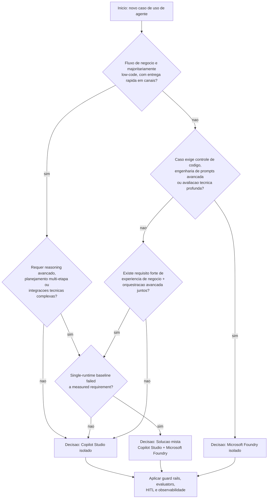

## 🛠️ 3.1. Adoption Tools — Microsoft 365 Copilot, Copilot Studio and Microsoft Foundry

### 🎯 Objective
Map the three main tools to the adoption framework and short/medium-term scenarios

### 🏗️ Comparative Overview

#### 💼 Microsoft 365 Copilot

**🎯 Focus**
- individual productivity without development
- AI embedded in already-used interfaces (Teams, Word, Outlook, Excel)
- contextual assistance with Microsoft 365 and SharePoint data

**✅ Capabilities**
- content generation and summarization (documents, emails, meetings)
- data analysis with natural language via Copilot in Excel
- semantic search over corporate data via Microsoft Graph

**⚙️ Usage scenario**
`User → Microsoft 365 Copilot → Graph / SharePoint → Immediate insight`

#### 🤖 Microsoft Copilot Studio

**🎯 Focus**
- creation of custom domain-specific agents (low-code / no-code)
- orchestration of conversational flows and automated actions
- native integration with Fabric, SharePoint, Dataverse and external APIs

**✅ Capabilities**
- agents publishable to Teams, web and external channels
- native connectors with M365, Power Platform and Fabric Data Products
- native guard rails and authentication via Entra ID (Agent ID)

**⚙️ Usage scenario**
`User → Agent (Copilot Studio) → Fabric / API → Action or Response`

#### 🔬 Microsoft Foundry

**🎯 Focus**
- development of complex agents with code
- multi-agent orchestration and advanced reasoning
- fine-tuning, evaluation and model deployment at scale

**✅ Capabilities**
- versioned agents, conversations, Responses API, tool calls and governed multi-step execution
- support for versioned GPT, Claude, Mistral and Phi deployments; lifecycle and hosting status vary by offer
- integration with Fabric OneLake, Purview, Entra ID and external APIs

**⚙️ Usage scenario**
`Engineer → Microsoft Foundry → Complex agent → Fabric + APIs → Automated decision`

### 🧠 Models and delivery surfaces

Microsoft introduced the Build 2026 MAI portfolio on **June 2, 2026**. Models power reasoning and multimodal tasks; Work IQ, Foundry IQ and Fabric IQ supply context. Availability in GitHub Copilot, MAI Playground, Azure Speech and Foundry must be assessed separately.

**Lifecycle of the cited MAI models, checked November 17, 2026**

| Model / family | Main use | Documented availability | Architecture fit |
| --- | --- | --- | --- |
| MAI-Thinking-1 | Reasoning, mathematics and software-engineering tasks | Public preview in Microsoft Foundry; Global Standard model version `2026-06-01` | Reasoning option under approved preview controls; PTU is not supported |
| MAI-Code-1.1-Flash | Agentic coding | In production in GitHub Copilot; the [October 7 update](https://microsoft.ai/news/mai-code-1-1-flash-br-better-faster-at-a-quarter-of-the-cost/) adds local downloads and announces experimental on-device Copilot access | Neither cloud production use nor local downloads establish Foundry API GA |
| MAI-Image-2.6 / MAI-Image-2.6-Flash | Image generation and editing | Public preview in Foundry, model version `2026-07-31` | Approved preview pilots; validate the exact catalog offer |
| MAI Image 2.7 | Image editing | [Preview launch on October 27, 2026](https://microsoft.ai/news/mai-image-2-7-debut/), including MAI Playground access | Foundry API GA is not established by the launch announcement |
| MAI-Transcribe-2 / 1.5 | Batch transcription | [Current Azure Speech guide](https://learn.microsoft.com/azure/ai-services/speech-service/mai-transcribe) documents availability without an explicit GA statement | Status unconfirmed for production selection; obtain current offer/SLA confirmation instead of inferring GA or asserting a blanket no-SLA condition |
| MAI-Transcribe-2-Streaming | Real-time transcription | [Public preview in Azure Speech](https://learn.microsoft.com/azure/ai-services/speech-service/mai-transcribe-2-streaming); no SLA | Separate preview dependency from batch transcription |
| MAI-Voice-2.1 / MAI-Voice-2.1-Flash | Expressive and low-latency speech | Public preview in Azure Speech; instant voice cloning remains gated | Current documented variants; apply consent, region and preview controls |

The [retirement schedule](https://learn.microsoft.com/azure/foundry/openai/concepts/model-retirement-schedule) lists **October 1, 2026** for MAI-Image-2.5 variants, although the image how-to still lists them as preview. Exclude these offers from new designs pending confirmation. MAI-Transcribe-1 was deprecated August 20 and has a September 15 retirement date. The same schedule marks `gpt-4.1-mini` deprecated and `gpt-5.4-mini` GA; examples use the latter as an illustrative deployment name.

**Executive guideline for production**
- Prioritize MAI use by **capability and use case**, not by announcement novelty.
- Treat **preview** variants as exception-based pilots. Guard rails do not convert a preview capability into a supported production dependency.
- Maintain the guide's standard: use the approved governed authority for each domain; introduce Microsoft Fabric for analytical consolidation or semantic reuse and a Foundry runtime only when current requirements justify them; apply evaluators and guard rails as cross-cutting controls.

**Official reference sources**
- [Microsoft AI: Building a hill-climbing machine: Launching seven new MAI models](https://microsoft.ai/news/building-a-hillclimbing-machine-launching-seven-new-mai-models/)
- [Foundry Models from partners and community — Microsoft](https://learn.microsoft.com/azure/foundry/foundry-models/concepts/models-from-partners#microsoft)
- [Deploy and use MAI-Thinking-1 in Microsoft Foundry](https://learn.microsoft.com/azure/foundry/foundry-models/how-to/use-foundry-models-mai-thinking)
- [MAI-Code-1.1-Flash: Better, faster, at a quarter of the cost](https://microsoft.ai/news/mai-code-1-1-flash-br-better-faster-at-a-quarter-of-the-cost/)
- [Deploy and use MAI image models in Microsoft Foundry](https://learn.microsoft.com/azure/foundry/foundry-models/how-to/use-foundry-models-mai-image)
- [MAI-Transcribe in the LLM Speech API](https://learn.microsoft.com/azure/ai-services/speech-service/mai-transcribe)
- [What is MAI-Voice?](https://learn.microsoft.com/azure/ai-services/speech-service/mai-voices)
- [Versioned model retirement schedule](https://learn.microsoft.com/azure/foundry/openai/concepts/model-retirement-schedule)

### 🔌 Integration protocols in Microsoft Foundry

**MCP (Model Context Protocol):** an open protocol for tools and data. Foundry supports remote MCP servers with supported authentication methods. [Long-running MCP tasks remain preview](https://learn.microsoft.com/azure/foundry/agents/how-to/tools/model-context-protocol#long-running-operations-preview).

**A2A (Agent-to-Agent):** an open protocol for cross-runtime agent communication. The [Foundry `a2a` tool with A2A 1.0 is GA](https://learn.microsoft.com/azure/foundry/agents/how-to/tools/agent-to-agent); `a2a_preview` with 0.3 remains preview. Check authentication, SDK and Copilot Studio integration status separately.

**Responses API and provider APIs:** Foundry Agent Service uses the Responses API for agent conversations and tool orchestration. Claude deployments use the Anthropic Messages API at the provider-specific `/anthropic/v1/messages` endpoint through the Anthropic SDK, with supported Entra ID or API-key authentication. Do not treat the Anthropic Messages API as the Responses API.

**Current SDK and API:** use Python `azure-ai-projects` 2.x for project and agent-definition operations, and the project-bound OpenAI client for conversations and Responses API calls. Copy the project endpoint from Foundry, for example `https://<resource>.services.ai.azure.com/api/projects/<project>`. [Hosted-agent migration](https://learn.microsoft.com/azure/foundry/agents/how-to/migrate-hosted-agent-preview) requires 2.3.0 or later. Package and service lifecycle are separate; some .NET SDKs and hosting adapters remain prerelease.

### 🔗 How They Work Together

An illustrative mixed pattern is `Microsoft 365 Copilot (user interface) → Copilot Studio (domain agent) → Microsoft Foundry (advanced reasoning and orchestration) → Fabric (governed data)`. Use this full chain only when both runtimes have independently justified responsibilities.

### 🧭 When to use Copilot Studio, Foundry or a Mixed Solution

To avoid architectural ambiguities, adopt the following decision matrix:

| Option | When to use | When to avoid | Practical decision |
|---|---|---|---|
| **Copilot Studio (standalone)** | Well-defined business flows, low/medium complexity, low-code product team, fast delivery in channels like Teams and web | A tested requirement cannot be met without advanced pro-code reasoning, orchestration or model control | Prefer as the simpler runtime for bounded domain automation when it meets requirements |
| **Microsoft Foundry (standalone)** | A tested requirement needs pro-code control, advanced reasoning, technical evaluation or extensive tool integration | Existing products, deterministic automation or low-code implementation reliably solve the demand | Prefer only when the additional technical control is required and owned |
| **Mixed solution (Copilot Studio + Foundry)** | Business/channel capabilities and advanced pro-code orchestration are both required now, with distinct responsibilities | Either runtime can satisfy the current scope alone, or the additional operational boundary lacks clear ownership | Conditional exception: document the requirement each runtime satisfies and why a single runtime fails |

#### Objective criteria to trigger the mixed model

All criteria below must be satisfied:

1. **Channel and experience**: the current journey requires a capability best served by Copilot Studio.
2. **Technical requirement**: the current scope requires advanced pro-code reasoning or orchestration that Copilot Studio cannot reliably satisfy.
3. **Evidence**: a single-runtime baseline was tested or assessed against a specific requirement and rejected with evidence or an explicit pilot assumption.
4. **Ownership**: both runtime boundaries have clear operational owners, observability, identity, evaluation and incident-response responsibilities.

Risk, compliance and expected growth do not independently trigger a mixed model. Apply guard rails, auditability, data controls and evolvable interfaces to the simpler architecture first.

#### Decision flowchart (Copilot Studio vs Foundry vs Mixed)

#### Official Microsoft references for the decision

- Microsoft Copilot Studio documentation: https://learn.microsoft.com/microsoft-copilot-studio/
- Microsoft Foundry documentation: https://learn.microsoft.com/azure/foundry/
- Microsoft 365 Copilot documentation: https://learn.microsoft.com/microsoft-365-copilot/
- Microsoft Fabric documentation: https://learn.microsoft.com/fabric/
- Microsoft Purview Data Security and Compliance: https://learn.microsoft.com/purview/
- Microsoft Entra ID documentation: https://learn.microsoft.com/entra/identity/

#### Conditional reference pattern for the mixed solution

1. **Microsoft 365 Copilot / channels** receive user intent in the work context.
2. **Copilot Studio** handles the domain conversational layer, policies and operational routing.
3. **Microsoft Foundry** executes advanced reasoning, orchestration and complex integrations.
4. **Fabric + Purview + Entra** ensure governed data, security and least-privilege access.

#### Official Microsoft sources for architecture justification

- Microsoft Copilot Studio documentation: https://learn.microsoft.com/microsoft-copilot-studio/
- Microsoft Foundry documentation: https://learn.microsoft.com/azure/foundry/
- Microsoft 365 Copilot documentation: https://learn.microsoft.com/microsoft-365-copilot/
- Microsoft Fabric documentation: https://learn.microsoft.com/fabric/
- Microsoft Purview Data Security and Compliance: https://learn.microsoft.com/purview/
- Microsoft Entra ID documentation: https://learn.microsoft.com/entra/identity/

### 🚀 Conditional Product Selection

📣 **Insight**
> "Use Microsoft 365 Copilot, Copilot Studio or Microsoft Foundry only when its current capabilities, controls, capacity and operating model fit the requirement. Product adoption is not a mandatory progression."

---

