## ⚖️ 4. Adoption Strategies — Governance Spectrum

The following scenarios are illustrative extremes, not the only choices. Self-service can be governed, and governed data can remain in Microsoft 365, operational systems, domain platforms, approved APIs or search indexes without requiring Fabric. Select controls and data paths by risk and authority, then choose Fabric only when analytical consolidation, shared semantics or reusable data products are required.

### 🅰️ Scenario A — Self-Service Agents

**✅ Pros**
- high innovation
- speed
- flexibility

**❌ Cons**
- shadow AI risk
- inconsistency
- variable cost

### 🅱️ Scenario B — Curated Data

**✅ Pros**
- governance
- consistency
- control

**❌ Cons**
- lower agility
- IT dependency

### 📊 Visual Comparison of Scenarios

```mermaid
graph TB
    subgraph ScenarioA ["🅰️ EXTREMO A - Self-Service sem governanca"]
        A1["📂 Dados Variados<br/>─────────────────<br/>ERP, CRM, Planilhas<br/>APIs públicas"]
        A2["⚡ Sem Classificação<br/>─────────────────<br/>Busca rápida<br/>Sem workflow"]
        A3["🤖 Agentes Livres<br/>─────────────────<br/>Acessam dados<br/>brutos direto"]
        A4["⚠️ Riscos<br/>─────────────────<br/>❌ Vazamento PII<br/>❌ Inconsistência<br/>❌ Sem auditoria<br/>❌ Shadow IT"]
        A5["✅ Vantagens<br/>─────────────────<br/>✓ Rápido<br/>✓ Inovativo<br/>✓ Flexível"]
        
        A1 --> A2
        A2 --> A3
        A3 --> A4
        A3 --> A5
    end
    
    subgraph ScenarioB ["🅱️ EXTREMO B - Plataforma analitica centralizada"]
        B1["📊 Dados Estruturados<br/>─────────────────<br/>Fabric Lakehouse<br/>Medallion Pattern"]
        B2["🏷️ Classificação<br/>Purview + Entra<br/>─────────────────<br/>Public/Confidential<br/>Row-Level Security"]
        B3["🔐 Agentes Controlados<br/>─────────────────<br/>Acessam dados<br/>Gold via SQL Endpoint"]
        B4["✅ Benefícios<br/>─────────────────<br/>✓ Governança<br/>✓ Consistência<br/>✓ Auditável<br/>✓ Compliance"]
        B5["⚠️ Desafios<br/>─────────────────<br/>❌ Mais lento<br/>❌ Depende TI<br/>❌ Planejamento"]
        
        B1 --> B2
        B2 --> B3
        B3 --> B4
        B3 --> B5
    end
    
    style A1 fill:#FFB347,stroke:#FF8C00,color:#000
    style A2 fill:#FF6347,stroke:#CC5555,color:#fff
    style A3 fill:#FF4444,stroke:#CC0000,color:#fff
    style A4 fill:#DC143C,stroke:#8B0000,color:#fff
    style A5 fill:#FFD93D,stroke:#CCB030,color:#000
    
    style B1 fill:#87CEEB,stroke:#4682B4,color:#000
    style B2 fill:#4A90E2,stroke:#2E5C8A,color:#fff
    style B3 fill:#3D7E6B,stroke:#2D5E4B,color:#fff
    style B4 fill:#50C878,stroke:#3A9B5C,color:#fff
    style B5 fill:#FFD93D,stroke:#CCB030,color:#000
```

### 🎯 Conclusion
The ideal model is **evidence-based and evolutionary**:
- **Pilot:** Start with the lowest-complexity option that meets the current requirement and establish guard rails, evaluators and a measurable baseline.
- **Expansion:** Add users, data domains, tools or a more capable runtime only after the pilot proves value, permissions, capacity and operational ownership.
- **Scale:** Operate the proven mix of SaaS capabilities, deterministic workflows, RAG solutions and agents as a governed portfolio. A hybrid or multi-agent architecture remains conditional on requirements that simpler options cannot satisfy.

**Rule**: Security and shared governed authority first; add complexity only with evidence and measurable escalation triggers.

---

> Content moved to [ROI Model — AI vs. Person-Hour Cost](../references/03-roi-ai-vs-man-hour.md).

