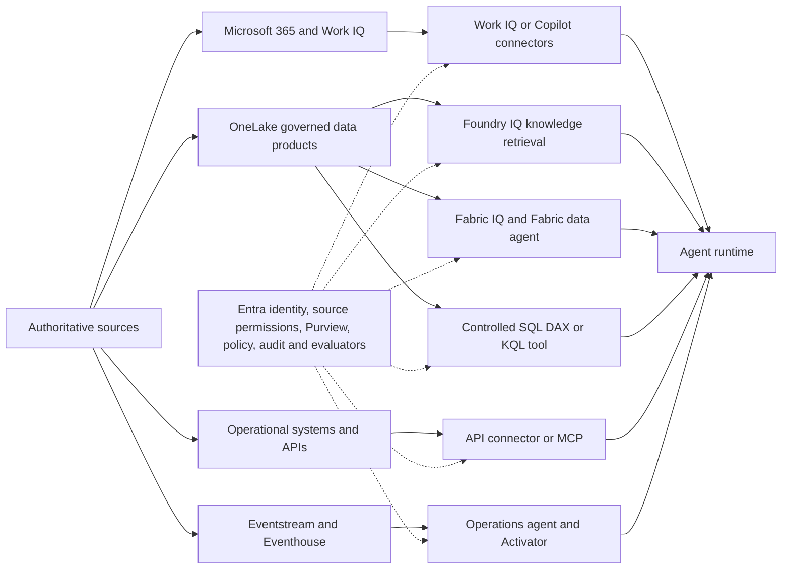
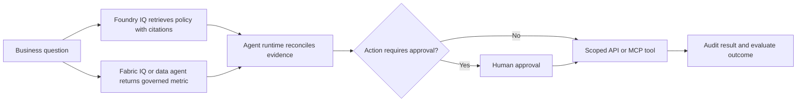
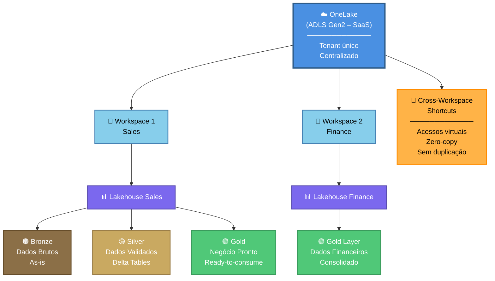
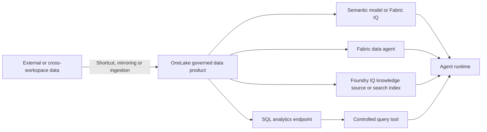

## 5. Data Consumption Strategies for AI Agents

> Lifecycle-sensitive capabilities checked against official Microsoft sources on **2026-11-17**. A GA platform can contain preview workloads, integrations and SDKs. See the [lifecycle register](../PRODUCT_LIFECYCLE_AUDIT.md) for evidence and retirement deadlines.

### Executive decision

There is no single data-access pattern for every agent. Microsoft recommends establishing a retrieval strategy per data domain, prioritizing built-in Microsoft capabilities and documenting whether the agent uses **search**, **semantic analytics**, a **live API or MCP tool**, or a combination. OneLake can provide the unified governed data foundation, but it is not the only source and Shortcuts are a data virtualization mechanism, not an agent retrieval interface.

Use the least complex pattern that meets freshness, grounding, permission, action and latency requirements:

1. Keep collaborative content in Microsoft 365 and use Work IQ or Microsoft Graph-based retrieval.
2. Use Foundry IQ for permission-aware enterprise knowledge and citations.
3. Use Fabric IQ or a Fabric data agent for business semantics and governed analytical data.
4. Use a deterministic SQL, DAX, KQL or governed API tool when the query contract is known and tightly controlled.
5. Use MCP when live operational data or actions are required.
6. Use Real-Time Intelligence and an operations agent when the system must continuously monitor events and trigger governed responses.

Escalate to custom indexing, retrieval code or compound patterns only when a documented requirement cannot be met by a built-in option.

Official architecture source: [Data architecture for AI agents](https://learn.microsoft.com/azure/cloud-adoption-framework/ai-agents/data-architecture-plan).

### Strategy selection matrix

| Strategy | Select when | Typical Microsoft capability | Freshness and behavior | Important constraints |
|---|---|---|---|---|
| **Work context retrieval** | The answer depends on the signed-in user's emails, meetings, chats, files, people or collaboration context | Work IQ API, Microsoft Graph, Microsoft 365 Copilot | Current Microsoft 365 context, permission-trimmed to the user | Work IQ API and the Copilot Studio Microsoft Copilot-harness integration are GA; Business apps workloads remain preview. Preserve user identity and validate selected workloads and write permissions |
| **External content in Microsoft 365** | Third-party knowledge must appear in Microsoft 365 search, Copilot or agents | Microsoft 365 Copilot connectors | Synced connectors index content in Microsoft Graph; federated connectors retrieve from the source at query time | Federated connectors reached GA on June 2, 2026, but connector-specific availability, ACL mapping, sync behavior and source limits still require validation |
| **Managed enterprise knowledge retrieval** | Agents need grounded answers over structured or unstructured enterprise content with citations | Foundry IQ knowledge bases and agentic retrieval | Keyword, vector or hybrid evidence retrieval; indexed sources refresh on a schedule | Partial GA: `2026-04-01` supports extractive retrieval. LLM planning, answer synthesis, non-minimal reasoning, multi-turn messages, some permission ingestion and portal access remain preview |
| **Custom RAG/search** | Built-in knowledge retrieval cannot meet ranking, schema, lifecycle, network or regulatory requirements | Azure AI Search or OneLake indexers with custom application logic | Application-controlled indexing and query pipeline | Higher engineering, evaluation, index security and operations burden; require evidence before selecting it over Foundry IQ |
| **Semantic business context** | Agents must use consistent business terms, KPIs, entities and relationships | Fabric IQ semantic models, ontology and Graph | Governed semantic context over OneLake analytical, operational and real-time data | IQ workload, Ontology and Graph remain preview. Semantic models and the read-only Power BI-focused Fabric IQ MCP server are GA; assess each integration separately |
| **Conversational analytics** | Users or an orchestrating agent need natural-language, read-only answers over Fabric data | Fabric data agent | Generates and executes SQL, DAX, KQL or Microsoft Graph queries using the requesting user's permissions | Core data agent is GA; advanced DAX, ontology-related answers and several Purview controls remain preview. Copilot Studio integration is GA; the Foundry OneLake Catalog integration remains preview |
| **Deterministic query tool** | The required query is predictable and a controlled contract is safer than open-ended retrieval | SQL analytics endpoint, semantic-model/DAX query, KQL endpoint or governed API/function | Live query against the serving layer | The application owns query allow-listing, parameter validation, connection limits, result shaping and identity propagation |
| **Live operational access or action** | The agent needs current system-of-record data or must create/update records | Built-in connector, API tool or MCP server | Real-time read or transaction at tool-call time | Separate read from write tools; require authentication, least privilege, policy, audit, idempotency and human approval for high-impact actions |
| **Streaming monitoring and response** | The workload must watch events continuously, detect conditions and initiate governed action | Fabric Eventstream, Eventhouse, optional Fabric IQ ontology, operations agent and Activator | Stream processing with scheduled agent monitoring over live and historical data | Operations agent core is GA; Ontology and [workspace OAP support](https://learn.microsoft.com/fabric/security/workspace-outbound-access-protection-operations-agent) remain preview. Use reasoning only where rules are insufficient and test blocked actions and degraded behavior |

**Keep the Fabric interfaces separate:** the [GA Fabric IQ MCP server](https://learn.microsoft.com/fabric/iq/connectors/fabric-iq-mcp) exposes read-only Power BI report and semantic-model tools, not data agents or ontologies. Foundry calls published data agents through the [preview Fabric IQ (OneLake Catalog) integration](https://learn.microsoft.com/fabric/data-science/data-agent-foundry-fabric-iq). The [legacy Microsoft Fabric tool](https://learn.microsoft.com/fabric/data-science/data-agent-foundry) became unsupported on **November 6, 2026**.

### Reference architecture

Microsoft Foundry Agent Service or Copilot Studio can provide the managed agent platform. Microsoft Agent Framework can implement application-managed orchestration but requires explicit hosting unless deployed as a Foundry hosted agent. Work IQ, Foundry IQ and Fabric IQ supply context; they are not interchangeable orchestration runtimes.

### Selection questions

1. **What kind of data is authoritative?** Collaboration content, documents, analytical tables, semantic metrics, events or an operational system of record.
2. **How fresh must it be?** Indexed on a schedule, queried live, streamed continuously or retrieved within a bounded cache interval.
3. **Is the task read-only or transactional?** Prefer retrieval for evidence and a separate, tightly scoped tool for actions.
4. **Whose permissions apply?** Preserve user identity when answers depend on user-level access; use a workload identity only for explicitly approved service-level scope.
5. **Does the answer require citations or exact calculations?** Use knowledge retrieval for evidence and semantic or deterministic query tools for trusted metrics.
6. **Can a built-in capability meet the need?** Use Foundry IQ, Fabric IQ, Fabric data agents, Work IQ or supported connectors before custom retrieval code.
7. **What is the effective capacity?** Validate the lowest limit across source APIs, connector sync, indexes, model calls, Fabric capacity, query endpoints and downstream tools.

### Compound pattern: retrieve, calculate, then act

Many enterprise scenarios need more than one strategy, but each data domain should still have one clear authority:

Example: retrieve the return policy through Foundry IQ, calculate order eligibility through a controlled Fabric semantic query, then create the return through a separately authorized MCP or API tool.

### OneLake as a governed data foundation

OneLake supports shared data products for analytics and AI. Use **Shortcuts** to reference supported external or cross-workspace data without copying, **Mirroring** when a replicated analytical copy and low-latency change capture are required, and ingestion pipelines when transformation, history or quality controls require materialization. These are data-supply choices; agents consume the resulting data through a supported retrieval or tool interface.

Governance is path-specific. Verify the caller identity, source permissions, workspace/item permissions, RLS/CLS or ACL behavior, Purview policy support, audit coverage and output controls for the selected interface. Do not assume that every source policy is inherited automatically by every agent, connector or custom tool.

---

### Supporting OneLake data-supply pattern

#### **Layer 1: Unified Storage (OneLake)**

**Technical characteristics** (Microsoft Fabric official):
- **Unique hierarchy:** One OneLake per tenant, multiple workspaces, multiple lakehouses
- **Delta Lake standard:** All table data is stored in Delta Parquet format (ACID transactions, schema enforcement, time-travel)
- **Shortcuts:** Supported external or cross-workspace data can be referenced without copying it into the consuming item; source compatibility, caching and permission behavior must be validated
- **Automatic provisioning:** Each lakehouse automatically creates /Tables and /Files, without infrastructure complexity

#### **Serving paths over OneLake**

**Important distinction:** SQL endpoints, semantic models, data agents and knowledge indexes are serving or retrieval interfaces. Shortcuts, mirroring and ingestion determine how data becomes available to those interfaces.

#### **Example runtime mappings**

| Runtime or experience | Preferred starting path | Add another path when |
|---|---|---|
| **Microsoft 365 Copilot or declarative agent** | Work IQ and Microsoft 365 content; Copilot connectors for external knowledge | Governed Fabric metrics or transactional tools are required |
| **Microsoft Foundry Agent Service** | Foundry IQ for enterprise knowledge; Fabric data agent or a controlled query tool for analytics | Live operational data or actions require API/MCP tools |
| **Copilot Studio** | Built-in knowledge sources, Copilot connectors or Fabric data agent | A bounded action requires a connector, flow, API or MCP tool |
| **Microsoft Agent Framework or custom application** | Built-in IQ endpoint or narrow governed API first | Custom RAG or direct query is justified by a requirement the built-in path cannot meet |

---

### Potential benefits and required validation

#### **1. Data Consistency (Shared Governed Authority and Semantics)**
- Agents can reuse the same certified data products and semantic definitions
- Reduction of "conflicting versions" of the same data
- Decisions can use a shared corporate definition when the selected retrieval paths point to the same governed authority

**Impact:** Reduces errors, conflicts and rework

#### **2. Reuse without Duplication (Zero-Copy)**
- Shortcuts can reference supported source data without creating another analytical copy
- Semantic models, data agents and query tools can reuse the same governed data product
- Foundry IQ indexes, synced Copilot connectors, mirroring and materialized transformations can create managed copies; include them in cost, freshness and retention decisions

**Impact:** Can reduce redundant pipelines and improve freshness, subject to the chosen supply and retrieval pattern

#### **3. Path-Specific Governance**
- Source, workspace, item and semantic-model permissions can constrain access
- RLS, CLS, ACLs, sensitivity labels and Purview policies apply only where the selected product and source combination supports them
- Custom APIs, query tools and MCP servers must enforce identity, authorization, result filtering and audit explicitly

**Impact:** Consistent controls are achievable, but must be tested end to end for each consumption path

#### **4. Horizontal Scalability**
- New agents can reuse approved knowledge bases, semantic models, data agents and data products
- Reuse avoids one bespoke data pipeline per agent when domains and permissions align
- Every added workload still consumes model, search, Fabric, API and connector capacity

**Impact:** Supports domain reuse while keeping capacity and ownership visible

---

### 📍 Analytical Consolidation Example

**Scenario:** Tim from Sales wants "customer ranking by revenue"; Finance wants "margin analysis by customer"; Marketing wants "segmentation by lifetime value"

**Without analytical consolidation:**
- Sales, Finance and Marketing can continue using separate authoritative systems and governed APIs when their ownership, latency or regulatory boundaries differ
- each domain retains its own metric contract, access controls, freshness target and audit evidence
- cross-domain analysis requires an approved composition layer and reconciliation rules

**When Fabric is justified for shared analytics:**
- Bronze: ingest customer data once
- Silver: validate once → single Delta table
- Gold: create dim_Customer once
- Tim, Finance and Marketing consume the same certified data product through the interface suited to each experience
- If user-level access is required, configure and test RLS, CLS or source ACL enforcement on every selected path

**Decision gate:** Select Fabric when the measurable benefit of analytical consolidation or semantic reuse exceeds migration, capacity, governance and operating cost. Do not classify every non-Fabric architecture as a silo.

**Result to validate:** appropriate reuse, consistent metric definitions where required, acceptable freshness, sufficient capacity and no unauthorized cross-domain exposure

### Official Microsoft sources

Lifecycle sources accessed **2026-11-17**; unchanged architecture sources retain their original publication history:

- [Data architecture for AI agents](https://learn.microsoft.com/azure/cloud-adoption-framework/ai-agents/data-architecture-plan)
- [Work IQ overview](https://learn.microsoft.com/microsoft-365/copilot/extensibility/work-iq)
- [Work IQ API overview](https://learn.microsoft.com/microsoft-365/copilot/extensibility/work-iq/api-overview)
- [Work IQ API GA and consumptive pricing](https://learn.microsoft.com/partner-center/announcements/2026-june#work-iq-api-and-consumptive-pricing-update)
- [Work IQ in Copilot Studio: GA and preview workloads](https://learn.microsoft.com/microsoft-copilot-studio/add-work-iq)
- [Microsoft 365 Copilot connectors overview](https://learn.microsoft.com/microsoft-365/copilot/connectors/overview)
- [What is Foundry IQ?](https://learn.microsoft.com/azure/foundry/agents/concepts/what-is-foundry-iq)
- [Migrate agentic retrieval code to the latest version](https://learn.microsoft.com/azure/search/agentic-retrieval-how-to-migrate)
- [What is Fabric IQ?](https://learn.microsoft.com/fabric/iq/overview)
- [What's new in Microsoft Fabric](https://learn.microsoft.com/fabric/fundamentals/whats-new)
- [Fabric data agent concepts](https://learn.microsoft.com/fabric/data-science/concept-data-agent)
- [Retrieval-augmented generation with Azure AI Search](https://learn.microsoft.com/azure/search/retrieval-augmented-generation-overview)
- [Model Context Protocol tool for Foundry Agent Service](https://learn.microsoft.com/azure/foundry/agents/how-to/tools/model-context-protocol)
- [MCP in Fabric Real-Time Intelligence](https://learn.microsoft.com/fabric/real-time-intelligence/mcp-overview)
- [OneLake shortcuts](https://learn.microsoft.com/fabric/onelake/onelake-shortcuts)
- [Mirroring in Microsoft Fabric](https://learn.microsoft.com/fabric/database/mirrored-database/overview)

---

