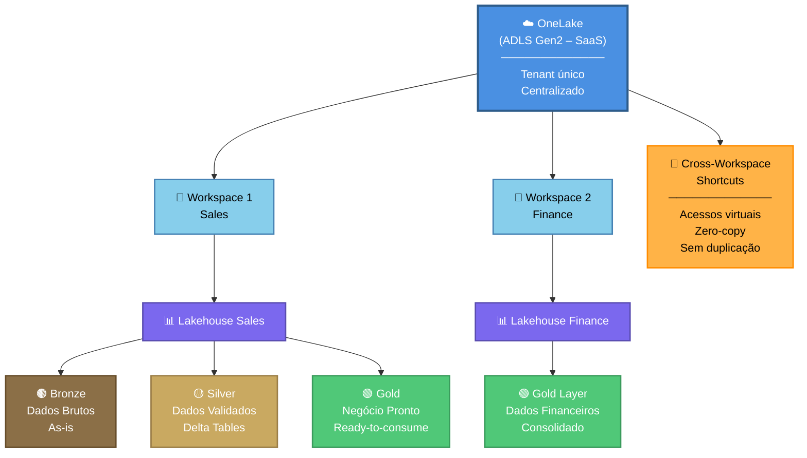
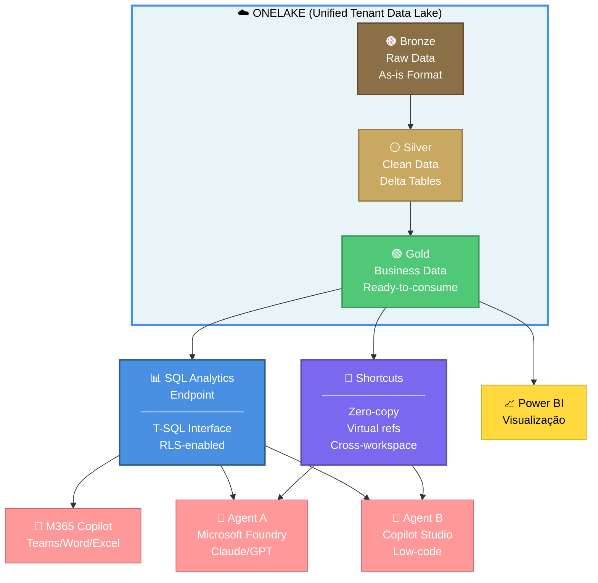

## 🔗 5. Fabric Data Consumption by Multiple Agents

### 🧠 Central Insight — OneLake as a Shared Corporate Asset

**Fonte oficial:** [Microsoft Fabric - OneLake Overview](https://learn.microsoft.com/fabric/onelake/onelake-overview)

> **"OneLake is a unified, enterprise-level data lake integrated with Microsoft Fabric that serves as the centralized storage layer for all of the organization's data workloads"**

#### Why this matters for agents:
- **A single source of truth:** All agents query the same data, reducing inconsistencies and conflicts
- **No duplication:** OneLake uses Zero-Copy Access — data remains in a single location while multiple agents access via **Shortcuts** (virtual references) and **SQL Analytics Endpoint**
- **Reuse by design:** Each agent (Copilot, Claude, AgentA, AgentB) leverages the same data asset, reducing ETL and complexity
- **Centralized governance:** Policies (sensitivity labels, RLS, audit) are applied once in OneLake and inherited by all consumers

**Consequence:** From "data in silos per agent" to "agents as consumers of governed data".

---

### 🏗️ Architecture — Three Consumption Layers

#### **Layer 1: Unified Storage (OneLake)**

**Technical characteristics** (Microsoft Fabric official):
- **Unique hierarchy:** One OneLake per tenant, multiple workspaces, multiple lakehouses
- **Delta Lake standard:** All table data is stored in Delta Parquet format (ACID transactions, schema enforcement, time-travel)
- **Shortcuts (zero-copy):** Data in external ADLS Gen2 or other workspaces appears as local tables — no ETL, no duplication
- **Automatic provisioning:** Each lakehouse automatically creates /Tables and /Files, without infrastructure complexity

#### **Layer 2: Multiple Access Interfaces**

**Interfaces de acesso:**
1. **SQL Analytics Endpoint (recomendado para agentes)**
   - Interface T-SQL nativa (SELECT, JOINs, stored procs)
   - Row-Level Security integrada (filtra por identidade do agente)
   - Automatic sync with Delta tables
   - Native Entra ID authentication

2. **Shortcuts (for cross-workspace references)**
   - Data in another lakehouse/workspace appears as local tables
   - No ETL, no COPY — direct fetch from ADLS Gen2
   - Centralized governance maintained at source
   - Ideal for data mesh and cross-domain sharing

3. **Microsoft Graph API (for Work IQ)**
   - Access to SharePoint, OneDrive, Exchange data
   - Authentication via OAuth 2.0 Entra ID
   - Contextual data for each user

#### **Layer 3: Per-Agent Consumption Pattern**

| Agent Type | Interface | Data Consumed | Authentication | Governance |
|---|---|---|---|---|
| **M365 Copilot (Work IQ)** | Microsoft Graph API | SharePoint, OneDrive, Teams | User context (Entra) | Purview labels |
| **Claude via Microsoft Foundry** | SQL Analytics Endpoint | OneLake Gold (Delta) | Managed Identity | RLS + Labels |
| **Copilot Studio** | SQL Analytics Endpoint or Connectors | OneLake Gold or SaaS APIs | User token or MI | RLS + Labels |
| **Custom Agent (Python/Node)** | SQL driver (pyodbc, mssql) | OneLake Gold (Delta) | Entra ID auth | RLS + Labels |

---

### ✅ Benefits — Why This Architecture Works

#### **1. Data Consistency (Single Source of Truth)**
- All 3 areas (Copilot, Agent A, Agent B) query the **same Gold layer** in OneLake
- Reduction of "conflicting versions" of the same data
- Decisions based on a single corporate truth

**Impact:** Reduces errors, conflicts and rework

#### **2. Reuse without Duplication (Zero-Copy)**
- Data ingested **once** into OneLake
- Agents, BI, Data Science access via SQL Analytics Endpoint or Shortcuts
- **No COPY, no replication, no duplication** — saves 40-60% in storage vs data silos

**Impact:** Reduces cost (less storage), reduces latency (fresher data)

#### **3. Automatically Inherited Governance**
- Sensitivity labels applied in Purview once
- Row-Level Security (RLS) configured in SQL Analytics Endpoint once
- All agents inherit these policies — no repeated reconfigurations

**Impact:** Compliance, security, audit "for free" for each new agent

#### **4. Horizontal Scalability**
- Adding 10 new agents **does not require** copying data 10 times
- Each agent is a consumer, not an isolated producer
- OneLake scales automatically (ADLS Gen2 as backbone)

**Impact:** Viable Data Mesh — domains can collaborate without complex infrastructure

---

### 📍 Real Reuse Example

**Scenario:** Tim from Sales wants "customer ranking by revenue"; Finance wants "margin analysis by customer"; Marketing wants "segmentation by lifetime value"

**Without Fabric (data silos):**
- Tim creates Sales table with 5M records
- Finance creates Margins table with same 5M records (DUPLICATES)
- Marketing creates LTV table with same 5M records (TRIPLICATES)
- 3x storage, 3x ETL, inconsistent security policies

**With Fabric (OneLake unified):**
- Bronze: ingest customer data once
- Silver: validate once → single Delta table
- Gold: create dim_Customer once
- Tim, Finance, Marketing query the same dim_Customer via SQL or Shortcuts
- Automatic RLS: Tim sees only his region, Finance sees consolidated, etc.

**Result:** -60% storage, -40% ETL time, elevated consistency

---

