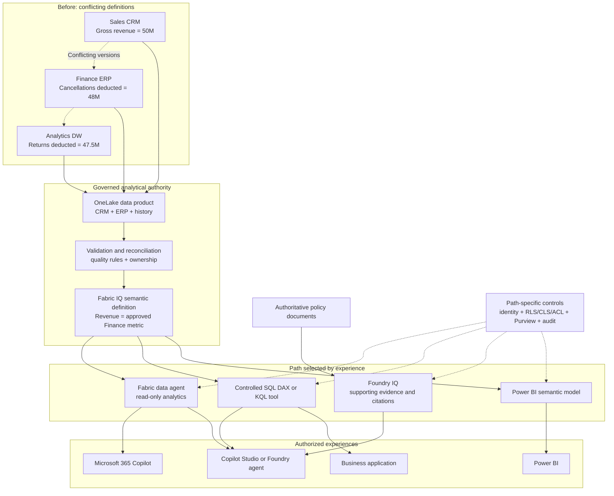

## 🧠 7. Key Strategic Insight

### 🔥 The Problem — Inconsistent Data = Conflicting Decisions

**Typical scenario in companies WITHOUT unified governance:**

| Department | Question: "What was Q3 revenue?" | Response | Source | Status |
|---|---|---|---|---|
| **Sales** | What was Q3 revenue? | R$ 50M | Salesforce (gross) | ❌ Not validated |
| **Finance** | What was Q3 revenue? | R$ 48M | ERP (cancellations deducted) | ✅ Validated |
| **BI/Analytics** | What was Q3 revenue? | R$ 47.5M | Data Warehouse (returns deducted) | ✅ Validated |
| **Agent A (Copilot)** | What was Q3 revenue? | R$ 50M (copies Salesforce) | Local cache | ❌ Outdated |
| **Agent B (Claude)** | What was Q3 revenue? | R$ 48.2M (copies ERP) | Integrated API | ⚠️ Conflicts with A |

**Consequences:**
- 🔴 **Conflicting decisions:** Executive receives 4 different responses in the same week
- 🔴 **Rework:** Finance complains that agents gave the wrong number; teams need to re-verify
- 🔴 **Loss of credibility:** "Which agent to trust?" → back to Excel spreadsheet
- 🔴 **Financial impact:** Pricing, provisioning and forecasting decisions can use the wrong business definition or stale data

---

### ✅ The Solution — Shared Governed Authority and Business Semantics

The objective is not to force every agent through one physical table or endpoint. It is to define one approved authority for each metric or knowledge domain, preserve the applicable user or workload permissions, and expose that authority through the simplest suitable retrieval path.

The following Fabric implementation is appropriate when analytical data from several systems must be reconciled and reused. Other domains can use Work IQ, Foundry IQ, supported connectors, governed APIs or MCP as described in [Data Consumption Strategies for AI Agents](05-fabric-data-consumption.md).

The selected managed agent platform, such as Microsoft Foundry Agent Service or Copilot Studio, orchestrates these context and tool paths. An application built with Microsoft Agent Framework can do the same when its hosting and operations are explicit. Work IQ, Foundry IQ and Fabric IQ supply context; they are not the runtime.

**How the governed authority solves it:**
1. **Ownership:** Finance is named as the metric owner and approves the revenue definition.
2. **Data supply:** CRM, ERP and historical data are reconciled in a governed Fabric data product when consolidation is required.
3. **Semantics:** Fabric IQ or a certified semantic model defines revenue once, including calculation, scope, currency, time period and freshness.
4. **Access:** Each experience uses an appropriate retrieval path. A data agent or semantic query can return the metric; Foundry IQ can retrieve supporting policies and citations; a governed API or MCP tool can provide live operational data.
5. **Controls:** Identity, RLS, CLS, ACLs, Purview policies, result filtering and audit are validated for each path rather than assumed to transfer automatically.

**Result:**
- ✅ Every experience uses the Finance-approved definition and reports its source, scope and freshness.
- ✅ Authorized users receive consistent results for the same scope and time; legitimate RLS, legal-entity or regional differences remain visible.
- ✅ Audit evidence records which authority and access path produced the response.

---

### 📌 The Message — It's Not About Having More Agents

> **"The differentiator is not having more agents. It is ensuring that every agent uses the right governed authority and business meaning."**

**Interpretation:**
- ❌ **Wrong:** "Let's buy 10 AI Agents and solve problems"
  - If data is inconsistent, 10 agents = 10x inconsistency

- ✅ **Right:** "Define the authority, semantics and access controls first; then select the simplest consumption path"
  - Existing Microsoft or SaaS capabilities can be sufficient for some domains
  - Work IQ fits Microsoft 365 work context
  - Foundry IQ fits permission-aware enterprise knowledge and citations
  - Fabric IQ and Fabric data agents fit governed business semantics and analytics
  - APIs or MCP fit live operational data and controlled actions

**Practical application:**
1. **Wave 1 — Authority and baseline:** Identify the domain owner, approved sources, semantic definitions, current quality and measurable business baseline. Reuse an existing product, SaaS capability or deterministic query where it already meets the requirement.
2. **Wave 2 — Smallest viable pilot:** Connect one approved data domain through the lowest-complexity retrieval path. Validate answer quality, freshness, permissions, capacity, cost and audit evidence with representative users.
3. **Wave 3 — Governed expansion:** Add data domains, channels or actions only after exit criteria pass. Reuse certified knowledge bases, semantic models, data agents and tools instead of creating an isolated data pipeline per agent.

**Risk if ignored:** Deploying agents before defining authoritative sources and access boundaries can produce conflicting answers, unauthorized exposure, avoidable rework and loss of trust. Fabric should be introduced when governed analytical consolidation or semantic reuse is required, not as an automatic prerequisite for every agent scenario.

**Microsoft architecture references:**
- [Data architecture for AI agents](https://learn.microsoft.com/azure/cloud-adoption-framework/ai-agents/data-architecture-plan)
- [What is Foundry IQ?](https://learn.microsoft.com/azure/foundry/agents/concepts/what-is-foundry-iq)
- [What is Fabric IQ?](https://learn.microsoft.com/fabric/iq/overview)
- [Fabric data agent concepts](https://learn.microsoft.com/fabric/data-science/concept-data-agent)

---

> Content moved to [Guard Rails, Evaluators and Human-in-the-Loop](../references/04-governance-guard-rails-evaluators-hitl.md) (governance and security).

