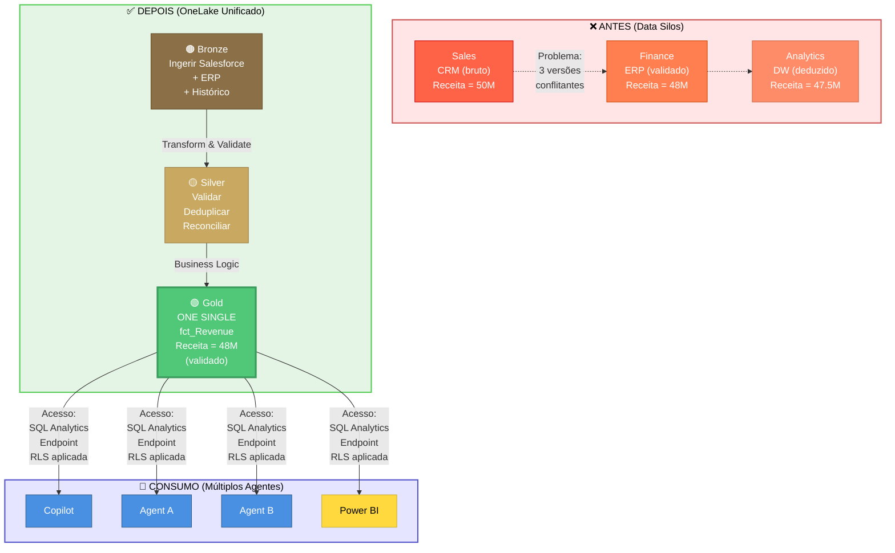

## 🧠 7. Key Strategic Insight

### 🔥 The Problem — Inconsistent Data = Conflicting Decisions

**Typical scenario in companies WITHOUT unified governance:**

| Department | Question: "What was Q3 revenue?" | Response | Source | Status |
|---|---|---|---|---|
| **Sales** | What was Q3 revenue? | R$ 50M | Salesforce (gross) | ❌ Not validated |
| **Finance** | What was Q3 revenue? | R$ 48M | ERP (cancellations deducted) | ✅ Validated |
| **BI/Analytics** | What was Q3 revenue? | R$ 47.5M | Data Warehouse (returns deducted) | ✅ Validated |
| **Agent A (Copilot)** | What was Q3 revenue? | R$ 50M (copies Salesforce) | Local cache | ❌ Outdated |
| **Agent B (Claude)** | What was Q3 revenue? | R$ 48.2M (copies ERP) | Integrated API | ⚠️ Conflicts with A |

**Consequences:**
- 🔴 **Conflicting decisions:** Executive receives 4 different responses in the same week
- 🔴 **Rework:** Finance complains that agents gave the wrong number; teams need to re-verify
- 🔴 **Loss of credibility:** "Which agent to trust?" → back to Excel spreadsheet
- 🔴 **Financial impact:** Errors in pricing, provisioning, forecasting = -X% margin

---

### ✅ The Solution — Unified Data in OneLake

**Governed architecture with Fabric:**

**How OneLake solves it:**
1. **Bronze:** Ingest raw data from ALL sources (Salesforce, ERP, historical)
2. **Silver:** Validation, deduplication, conflict reconciliation in **one single place**
3. **Gold:** Create a single, validated `fct_Revenue`, with a methodology note ("Revenue = sales minus cancellations and returns, per Finance SLA")
4. **Access:** All agents query **the same `fct_Revenue`** via SQL Analytics Endpoint with RLS — no room for conflict

**Result:**
- ✅ Copilot responds: "R$ 48M (per official Finance)"
- ✅ Agent A responds: "R$ 48M (per official Finance)"
- ✅ Agent B responds: "R$ 48M (per official Finance)"
- ✅ Audit: "All queried the same table, approved"

---

### 📌 The Message — It's Not About Having More Agents

> **"The differentiator is not having agents — it is ensuring all of them use the same truth"**

**Interpretation:**
- ❌ **Wrong:** "Let's buy 10 AI Agents and solve problems"
  - If data is inconsistent, 10 agents = 10x inconsistency

- ✅ **Right:** "First: unified and governed data. Then: agents consume that truth"
  - Good data → strong agents
  - Bad data → agents worse than a dashboard

**Practical application:**
1. **Phase 1 (months 0-4):** Build OneLake with validated Gold layer (Bronze → Silver → Gold)
   - Cost: -
   - Benefit: consistency established
   
2. **Phase 2 (months 4-10):** Connect agents (Copilot Studio, Microsoft Foundry)
   - Agents inherit the Gold "truth"
   - Decisions come out aligned
   
3. **Phase 3+ (months 10+):** Scale agents with confidence
   - Each new agent contributes, without duplicating problems

**Risk if ignored:** "Let's quickly deploy agents without Fabric"
- 3 months later: agents return conflicting data
- Executives: "AI is hype, let's go back to BI"
- Rework: dismantle agents, rebuild with Fabric = 2x cost

---

> Content moved to [references/04-governance-guard-rails-evaluators-hitl.md](references/04-governance-guard-rails-evaluators-hitl.md) — Guard Rails, Evaluators and Human-in-the-Loop (governance and security).

