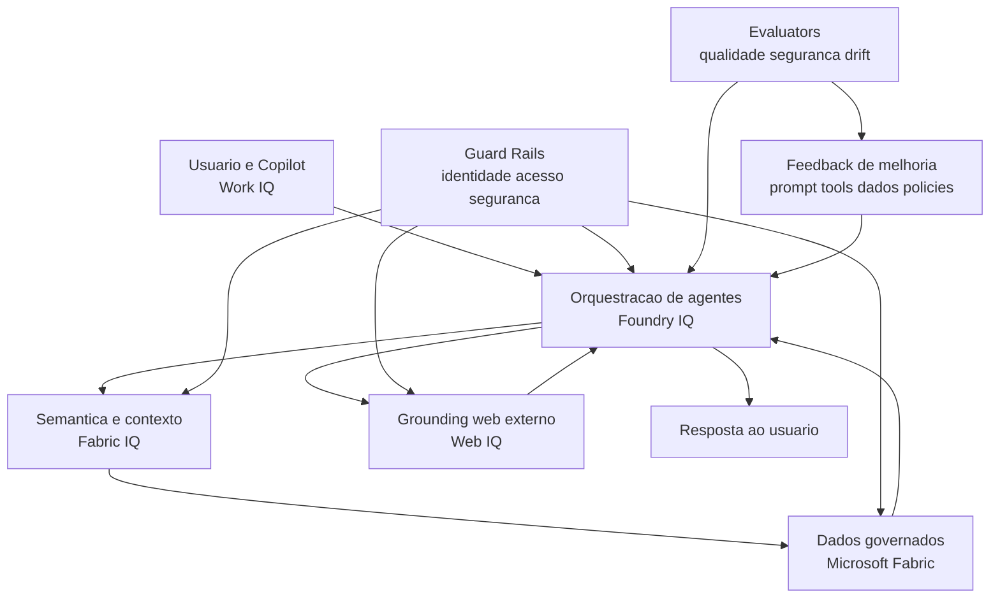

## 🔗 11. Full Integration (Final Architecture)

### 🎯 How the layers connect

This architecture connects experience, orchestration, data semantics, web context and analytics platform in a single, governed flow.

1. **Work IQ** receives user intent in work interfaces (Copilot, Teams, M365 apps).
2. **Foundry IQ** interprets the intent, plans execution and coordinates agents, tools and workflows.
3. **Fabric IQ** translates the question into the corporate semantic context (metrics, entities and business rules).
4. **Web IQ** supplements grounding with up-to-date external evidence (web, news and multimedia) when the case requires market context.
5. **Microsoft Fabric** delivers governed data for analytical execution and response grounding.
6. **Guard Rails** and **Evaluators** act cross-cuttingly: one controls risk and access, the other measures quality and feeds continuous improvement.

### 🧩 Consolidated diagram (Mermaid)

### 📌 Executive reading of the integration

- **Value**: AI-assisted decisions based on reliable corporate data and up-to-date external context.
- **Control**: security and compliance applied throughout the entire response cycle.
- **Evolution**: evaluators and observability convert usage into operational learning.

### 📣 Context update — Microsoft Build 2026 (Foundry IQ)

- **Foundry portal in GA (core scenarios):** the new Microsoft Foundry portal was announced as production-ready for core discovery, build and operation scenarios in Foundry projects.
- **Foundry IQ with partial GA:** at Build 2026, the official message is partial GA for Foundry IQ/agentic retrieval capabilities via stable APIs (Azure AI Search), while some advanced experiences remain in preview.
- **MAI as model portfolio:** Build 2026 launched the MAI family as a new Microsoft AI model line, covering reasoning, coding, image, transcription and voice; the architectural consistency here is to treat them as model catalogue options, with preview governance where applicable.
- **Critical distinction for target architecture:** the Foundry and Azure portals still expose agentic retrieval capabilities with components in preview; therefore, production decisions must explicitly separate GA dependencies from preview dependencies.
- **Executive implication:** the organization can accelerate rollout with Foundry in production, as long as governance guard rails are used to block preview in critical workloads or preview is treated as a controlled innovation track.

### 🧪 Context update — Microsoft Build 2026 (ASSERT and ACS)

- **ASSERT (open-source evaluation):** Build 2026 positions ASSERT as an open-source, policy-driven framework for transforming requirements into executable evaluations and continuous agent regression testing.
- **Agent Control Specification (ACS):** Build 2026 presents ACS as an open specification for deterministic controls at checkpoints in the agent execution cycle, focused on portability across frameworks.
- **Direct architectural value:** ASSERT reinforces the evaluators layer (continuous measurement and validation) and ACS reinforces guard rails (runtime enforcement), increasing auditability and operational consistency.
- **Recommended use in this guide:** treat ASSERT as a policy-driven evaluation mechanism in the continuous improvement cycle and ACS as the technical contract for controls in the agent runtime.
- **Acronym note:** in this document, **ACS** stands for **Agent Control Specification**. Not to be confused with **Azure ACS (Access Control Services)**, a legacy technology already retired in the SharePoint Online context.

---

