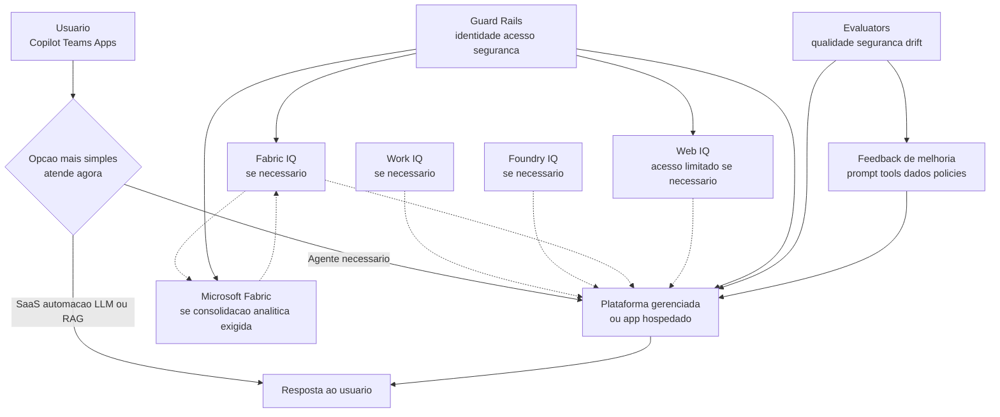

## 🔗 11. Full Integration (Final Architecture)

### 🎯 How the layers connect

This is a full-stack reference for cases in which every shown capability has been independently justified. It is not the default starting architecture. Simpler scenarios can stop at an existing SaaS capability, deterministic automation, direct LLM or RAG and omit any unnecessary IQ capability, agent platform or Fabric dependency.

1. **Copilot, Teams and business apps** receive user intent through familiar channels.
2. **Work IQ**, when required, supplies Microsoft 365 work context such as emails, chats, files, meetings and workflows.
3. **Foundry IQ**, when required, supplies permission-aware enterprise knowledge through knowledge bases and agentic retrieval.
4. **Fabric IQ**, when required, supplies corporate semantic context such as metrics, entities and business rules.
5. **Web IQ**, when available and required, supplements grounding with current external evidence.
6. **Microsoft Foundry Agent Service or Copilot Studio** provides the managed agent platform. An application built with **Microsoft Agent Framework** requires explicit hosting unless deployed as a Foundry hosted agent.
7. **Microsoft Fabric**, when analytical consolidation or semantic reuse is required, delivers governed analytical data.
8. **Guard Rails** and **Evaluators** act cross-cuttingly: one controls risk and access, the other measures quality and feeds continuous improvement.

### 🧩 Consolidated diagram (Mermaid)

### 📌 Executive reading of the integration

- **Value**: AI-assisted decisions based on reliable corporate data and up-to-date external context.
- **Control**: security and compliance applied throughout the entire response cycle.
- **Evolution**: evaluators and observability convert usage into operational learning.

### 📣 Context update — Foundry and Foundry IQ

- **Foundry platform:** Microsoft Learn describes Microsoft Foundry as a unified Azure PaaS with production-grade infrastructure. Portal experiences and individual capabilities retain their own lifecycle status; do not infer blanket GA from the platform description.
- **Foundry IQ mixed lifecycle:** some capabilities are GA through the Azure AI Search `2026-04-01` API, but that stable API provides a narrower extractive retrieval contract. Preview APIs are still required for capabilities such as advanced query planning, answer synthesis or multi-turn behavior, and portal-based agentic retrieval access remains preview.
- **MAI as model portfolio:** Build 2026 launched the MAI family as a new Microsoft AI model line, covering reasoning, coding, image, transcription and voice; the architectural consistency here is to treat them as model catalogue options, with preview governance where applicable.
- **Critical distinction for target architecture:** the Foundry and Azure portals still expose agentic retrieval capabilities with components in preview; therefore, production decisions must explicitly separate GA dependencies from preview dependencies.
- **Executive implication:** use GA APIs in production where their contract meets the requirement. Treat preview dependencies as exception-based pilots; governance controls do not change preview support or SLA status.

### 🧪 Context update — Microsoft Build 2026 (ASSERT and ACS)

- **ASSERT (open-source evaluation):** Microsoft Responsible AI introduced ASSERT as an MIT-licensed framework for converting natural-language behavior requirements into executable evaluations and repeatable regression tests. Teams can integrate it into CI/CD, but it is not a managed continuous-monitoring service.
- **Agent Control Specification (ACS):** Microsoft introduced ACS as an emerging open specification and reference implementation for portable runtime governance. Its implementation is public preview and requires adapter, conformance, fail-closed and version-compatibility validation before production reliance.
- **Direct architectural value:** ASSERT reinforces the evaluators layer (continuous measurement and validation) and ACS reinforces guard rails (runtime enforcement), increasing auditability and operational consistency.
- **Recommended use in this guide:** treat ASSERT as a policy-driven evaluation mechanism in the continuous improvement cycle and ACS as the technical contract for controls in the agent runtime.
- **Acronym note:** in this document, **ACS** stands for **Agent Control Specification**. Not to be confused with **Azure ACS (Access Control Services)**, a legacy technology already retired in the SharePoint Online context.

**Sources:**
- [What is Microsoft Foundry?](https://learn.microsoft.com/azure/foundry/what-is-foundry)
- [What is Foundry IQ?](https://learn.microsoft.com/azure/foundry/agents/concepts/what-is-foundry-iq)
- [Agentic retrieval overview](https://learn.microsoft.com/azure/search/agentic-retrieval-overview)
- [ASSERT announcement](https://commandline.microsoft.com/assert-written-intent-executable-evals/) and [official repository](https://github.com/responsibleai/ASSERT)
- [Agent Control Specification announcement](https://commandline.microsoft.com/agent-control-specification-runtime-governance/) and [official toolkit](https://github.com/microsoft/agent-governance-toolkit)

---

