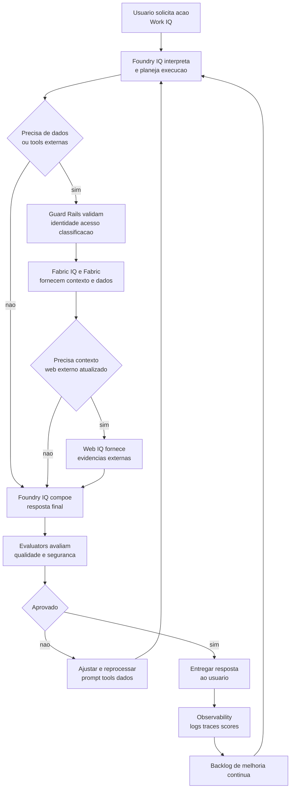

## 🧠 12. Operating Model

### 🎯 Operational objective
Standardize how each AI interaction happens in production, with predictability of quality, security and traceability.

### 🔄 Detailed operational flow

1. **Intent input (Work IQ)**
The user asks a question, requests an analysis or triggers a task in channels such as Copilot, Teams or M365 apps.

2. **Interpretation and planning (Foundry IQ)**
The agent identifies intent, context and task scope. At this step, it decides whether to respond directly or invoke tools and data.

3. **Policy validation (Guard Rails + Entra + Purview)**
Before any sensitive access, the flow applies identity, authorization and classification controls.

4. **Corporate grounding (Fabric IQ + Microsoft Fabric)**
The agent queries governed data and corporate semantics to produce a response anchored in reliable information.

5. **Complementary external grounding (Web IQ, when applicable)**
When the task requires market signals or recent public context, the flow incorporates web evidence with source traceability and a clear separation between internal and external data.

6. **Reasoning and response composition (Foundry IQ)**
With data and context, the agent synthesizes the final response in the format expected by the user.

7. **Quality and security validation (Evaluators)**
The output goes through quality evaluation (e.g., relevance, groundedness, coherence) and risk evaluation (e.g., safety/compliance).

8. **Delivery and observability**
Response is delivered to the user and operational signals (traces, metrics, scores and logs) are recorded for monitoring.

9. **Continuous improvement**
Evaluation results and incidents feed the improvement backlog for prompts, tools, policies, data and agent flows.

### 🧩 Operational flowchart (Mermaid)

### 📌 Responsibilities by layer

- **Work IQ**: end-user experience and productivity.
- **Foundry IQ**: orchestration, decision and agent execution.
- **Fabric IQ/Fabric**: semantic context and governed data.
- **Web IQ**: near-real-time external context for complementary grounding.
- **Guard Rails**: identity, access and data risk protection.
- **Evaluators**: objective measurement for continuous evolution.

### ✅ Readiness guideline (GA vs preview)

To preserve reliability and compliance at scale:

1. **Critical production:** prioritize only Foundry/Foundry IQ features classified as GA.
2. **Controlled innovation:** use preview features only with formal exception, reinforced telemetry and defined rollback.
3. **Continuous governance:** periodically review feature status (GA/preview) before promoting new agents to production.

---

