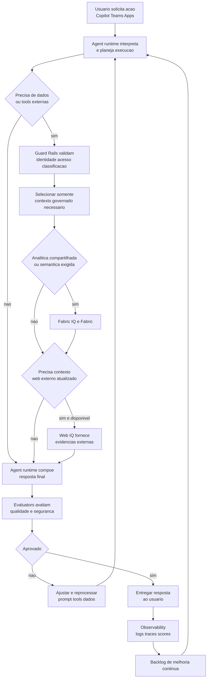

## 🧠 12. Operating Model

### 🎯 Operational objective
Standardize how each AI interaction happens in production, with predictability of quality, security and traceability.

### 🔄 Detailed operational flow

1. **Intent input (channels and experiences)**
The user asks a question, requests an analysis or triggers a task in channels such as Copilot, Teams or M365 apps.

2. **Interpretation and planning (agent runtime)**
The agent identifies intent, context and task scope. At this step, it decides whether to respond directly or invoke tools and data.

3. **Policy validation (Guard Rails + Entra + Purview)**
Before any sensitive access, the flow applies identity, authorization and classification controls.

4. **Organizational grounding (only the required governed paths)**
The solution selects Work IQ for Microsoft 365 work context, Foundry IQ for managed enterprise knowledge, Fabric IQ and Microsoft Fabric for shared semantics and analytics, or another governed authority only when that path is required. A direct answer or deterministic tool path can omit agent orchestration and unused context capabilities.

5. **Complementary external grounding (Web IQ, when applicable)**
When the task requires market signals or recent public context, the flow incorporates web evidence with source traceability and a clear separation between internal and external data.

6. **Reasoning and response composition (agent runtime)**
With data and context, the agent synthesizes the final response in the format expected by the user.

7. **Quality and security validation (Evaluators)**
The output goes through quality evaluation (e.g., relevance, groundedness, coherence) and risk evaluation (e.g., safety/compliance).

8. **Delivery and observability**
Response is delivered to the user and operational signals (traces, metrics, scores and logs) are recorded for monitoring.

9. **Continuous improvement**
Evaluation results and incidents feed the improvement backlog for prompts, tools, policies, data and agent flows.

### 🧩 Operational flowchart (Mermaid)

### 📌 Responsibilities by layer

- **Channels and experiences**: Copilot, Teams and apps through which users request and receive work.
- **Work IQ**: contextual intelligence from Microsoft 365 work signals.
- **Foundry IQ**: managed, permission-aware enterprise knowledge and agentic retrieval.
- **Fabric IQ/Fabric**: semantic context and governed data.
- **Web IQ**: external grounding through approved GA endpoints; Commerce remains private preview.
- **Managed agent platform or hosted application**: orchestration, reasoning, tool use, state and execution. Microsoft Agent Framework requires explicit hosting unless deployed as a Foundry hosted agent.
- **Guard Rails**: identity, access and data risk protection.
- **Evaluators**: objective measurement for continuous evolution.

### ✅ Readiness guideline (GA vs preview)

To preserve reliability and compliance at scale:

1. **Critical production:** verify supported GA service capabilities and reviewed released dependencies across the complete path, including models, APIs, SDKs and integrations.
2. **Controlled innovation:** keep preview or unconfirmed dependencies in approved pilots with telemetry, exit criteria and a supported fallback.
3. **Continuous governance:** review lifecycle evidence and retirement deadlines before releases. Foundry monitoring remains preview; use supported Azure Monitor/Application Insights telemetry for a GA-only baseline.

Lifecycle checked **2026-11-17** against the [Foundry GA matrix](https://learn.microsoft.com/azure/foundry/concepts/general-availability) and [Web IQ endpoint status](https://learn.microsoft.com/web-iq/resources/pricing). See the [repository lifecycle register](../PRODUCT_LIFECYCLE_AUDIT.md) for all selected dependencies and source conflicts.

---

