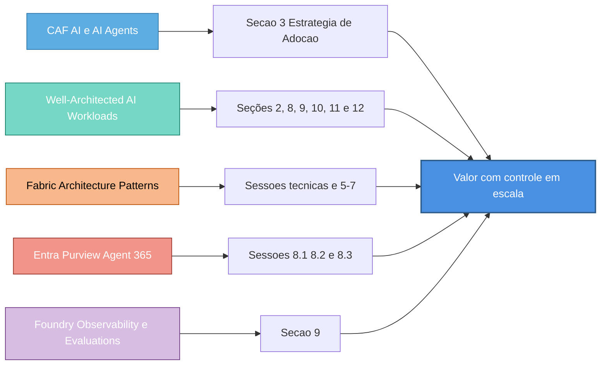

## 🧭 15. Alignment with Official Microsoft Architecture Standards

This section summarizes how the content of this document connects to Microsoft's official standards for AI adoption and architecture, reinforcing coherence across strategy, governance, engineering and operations.

| Official Microsoft standard | What the standard guides | How this document is aligned |
|---|---|---|
| **Cloud Adoption Framework (AI + AI Agents)** | Structure adoption in a planning, governance/security, build and agent operation cycle. | The phased adoption strategy (section 3) is mapped to the official agent adoption flow and includes organizational readiness, governance and continuous operations. |
| **Azure Well-Architected Framework (AI Workloads)** | Balance reliability, security, cost, operational excellence and performance. | The architecture, guard rails, HITL, evaluation and operating model sections (sections 2, 8, 9, 10, 11 and 12) cover security, observability, performance and governance as architecture decisions, not just implementation. |
| **Microsoft Fabric Architecture Patterns** | Unify data for analytics/AI with governance and reuse at scale. | The Bronze/Silver/Gold design with OneLake, SQL Analytics Endpoint and Data Products (technical sections and 5-7) applies the unified data platform pattern for agents. |
| **Microsoft Entra + Purview + Agent 365** | Ensure identity, access, compliance and centralized agent control. | Sections 8.1, 8.2 and 8.3 detail agent identity, data classification/protection and the central control plane, focused on traceability and consistent policies. |
| **Microsoft Foundry Observability and Evaluations** | Measure quality and security throughout the lifecycle (pre-production and production). | Section 9 defines the evaluator taxonomy, continuous evaluation pipeline and observability integration for the operational feedback loop. |
| **Build 2026 Open Trust Stack (ASSERT + Agent Control Specification)** | Standardize policy-driven evaluation and deterministic security controls in the agent loop, with interoperability across frameworks. | This guide's architecture already separates continuous evaluation (evaluators) and enforcement (guard rails); ASSERT and ACS strengthen this design and allow evolution with more evidence, portability and governance. |
| **Microsoft AI Decision Framework (BXT + 9 questions + Capability Model)** | Select the right technology in a repeatable way: Intake Filter, BXT (Business/Experience/Technology), 9 critical questions and scenario-based selection. | The selection method is detailed in references/05-decision-framework-bxt.md, connecting the complexity spectrum (LLM→Agentic), the ROI/AAI and the Work IQ, Foundry IQ, Fabric IQ and Web IQ layers to the framework phases. |

### 🧩 Visual Alignment Map (Mermaid)

### 📌 Executive reading of the alignment

1. The document follows Microsoft's principle that **AI adoption is operational transformation**, not just technology deployment.
2. The proposed architecture maintains **governed data as the foundation** and treats agents as consumers of that foundation, in line with data platform guides.
3. The control model combines **identity, data, security and continuous evaluation**, adhering to official governance standards for agents.
4. The phased evolution prioritizes **value with control**, reducing the risk of ungoverned scale (shadow AI and data inconsistency).

### ✅ Architectural coherence conclusion

The content of this document is coherent with Microsoft's official standards for AI adoption and corporate agent architecture, with explicit alignment across:
- adoption strategy,
- data architecture,
- governance and security,
- and evidence-driven operations.

---

