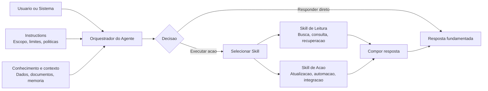
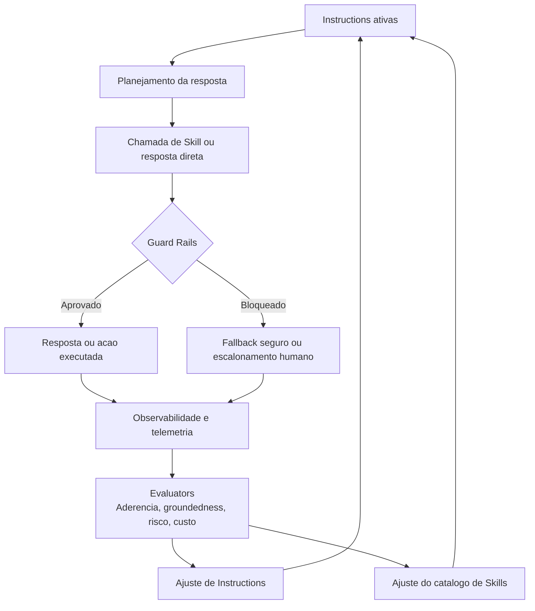
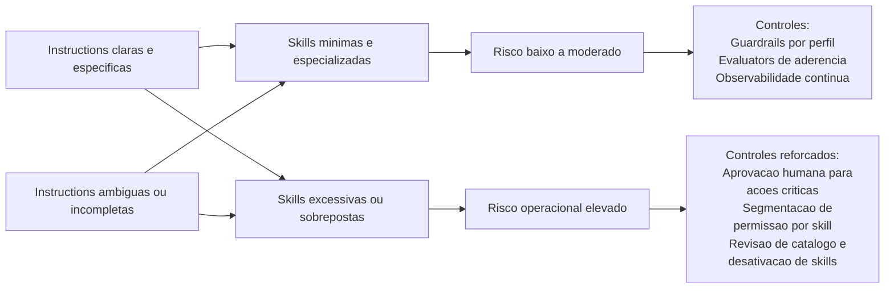

## 🧩 16. Instructions and Skills in Corporate Architecture

### 🎯 Official concepts and practical interpretation

Based on Microsoft's official documentation for agents, an agent's behavior depends on the combination of:
1. **Instructions**: central guidelines that define scope, boundaries, response policy and criteria for deciding when to use knowledge, tools, topics or other agents.
2. **Skills**: reusable capabilities that extend the agent to execute specialized tasks. Depending on the platform, they may appear as pro-code skills embedded at runtime, or as actionable components (tools, topics, actions, connectors) within generative orchestration.

In architectural terms:
- **Instructions** control the "how to decide".
- **Skills** control the "how to execute".

### 🧭 Diagram 1 - How Instructions and Skills relate in the flow

### 🏗️ How this impacts each layer of this architecture

| Corporate architecture layer | Instructions impact | Skills impact |
|---|---|---|
| **Work IQ (experience)** | Defines tone, conversational guardrails, escalation criteria and user response boundaries. | Enables productivity actions and business flows (e.g., queries, triggers and automations) with consistent experience. |
| **Foundry IQ (orchestration)** | Defines planning policy: when to retrieve context, when to call tools and when to request human confirmation. | Materializes execution capabilities: tool calling, connectors, functions, MCP and specialized integrations. |
| **Fabric IQ/Fabric (data)** | Defines rules for use of trusted sources, governed data priority and grounding criteria. | Enables data access skills (search, SQL query, semantic retrieval) with defined scope and purpose. |
| **Guard Rails (control)** | Explicitly states prohibitions, action limits and blocking conditions to reduce abuse and behavioral drift. | Restricts skills by profile, risk and policy; separates read skills from skills with write effects. |
| **Evaluators (continuous improvement)** | Measures adherence to instructions (task adherence, policy adherence, groundedness). | Measures skill effectiveness and safety (tool call quality, execution error, fallback rate, operational impact). |

### 🛡️ Diagram 2 - Execution governance and continuous improvement

### 📊 Diagram 3 - Executive matrix (Instructions x Skills x Risk x Control)

### 🔄 Recommended design pattern (consistent with Microsoft)

1. **Define Instructions first**: objective, scope boundary, language, constraints and escalation criteria.
2. **Attach only necessary Skills**: reduce overlap and operational risk.
3. **Describe each skill clearly**: name and description influence the orchestrator's decision on when to invoke each capability.
4. **Tie Instructions to real sources and skills**: avoid instructions for unconfigured resources.
5. **Apply validation and observability**: measure quality, safety, adherence and cost per skill.
6. **Evolve by evidence**: adjust instructions and skills catalogue based on evaluator results.

### ⚠️ Risks when Instructions and Skills are not aligned

- Ambiguous instructions: increases incorrect tool/skill calls.
- Excessive or overlapping skills: degrades orchestration and raises risk of unintended actions.
- Skills without explicit boundary: exposes the agent to operational side effects.
- Instructions misaligned with knowledge sources: reduces groundedness and trust.

### ✅ Expected outcome for the organization

When Instructions and Skills are treated as architectural assets (not just prompt configuration), the architecture gains:
1. **Predictability**: agents decide more consistently.
2. **Operational security**: smaller surface for unintended action.
3. **Scalability with governance**: new capabilities enter via controlled catalogue.
4. **Measurable evolution**: continuous improvement guided by evaluators and observability.

### 🔗 Microsoft References para Instructions e Skills

- [AI agent adoption - componentes do agente (instructions, retrieval, actions, memory)](https://learn.microsoft.com/azure/cloud-adoption-framework/ai-agents/)
- [Write agent instructions - Copilot Studio](https://learn.microsoft.com/microsoft-copilot-studio/authoring-instructions)
- [Configure high-quality instructions for generative orchestration](https://learn.microsoft.com/microsoft-copilot-studio/guidance/generative-mode-guidance)
- [Use skills in Copilot Studio](https://learn.microsoft.com/microsoft-copilot-studio/advanced-use-skills)
- [Use skills in Foundry (preview)](https://learn.microsoft.com/azure/foundry/agents/how-to/tools/skills)
- [Tool best practices for Microsoft Foundry Agent Service](https://learn.microsoft.com/azure/foundry/agents/concepts/tool-best-practice)

---

