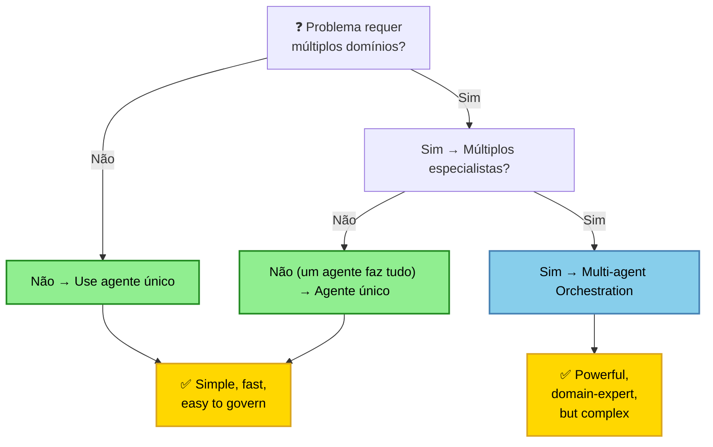
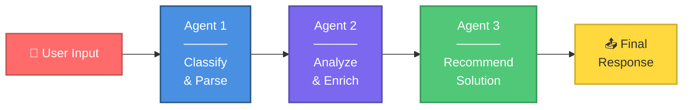
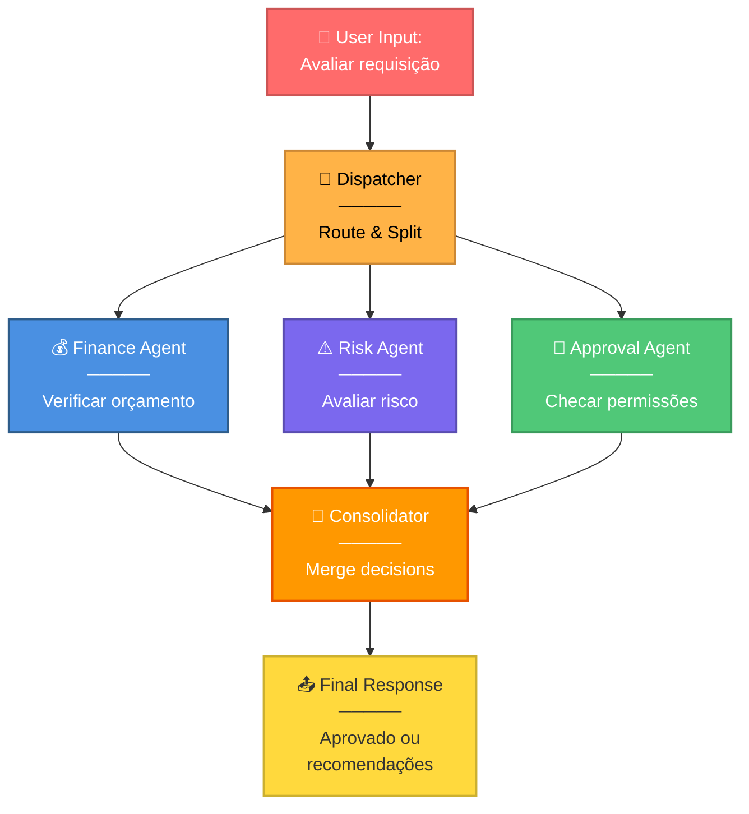
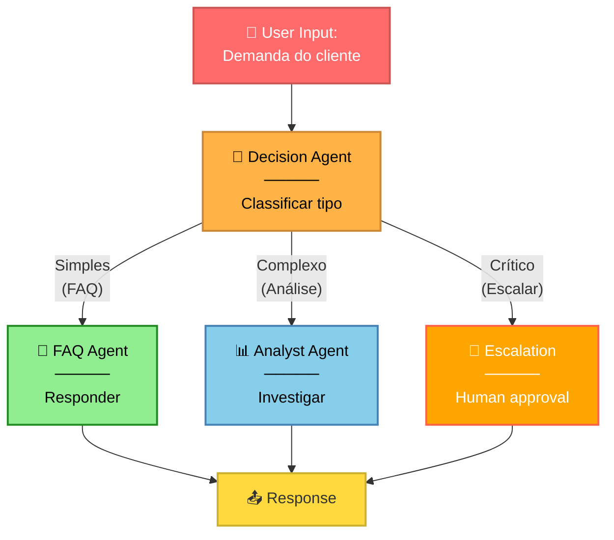
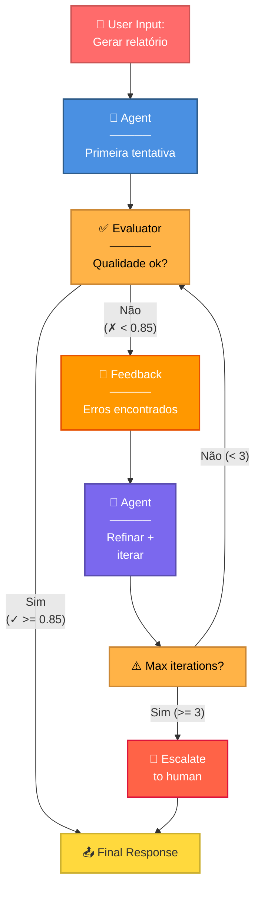
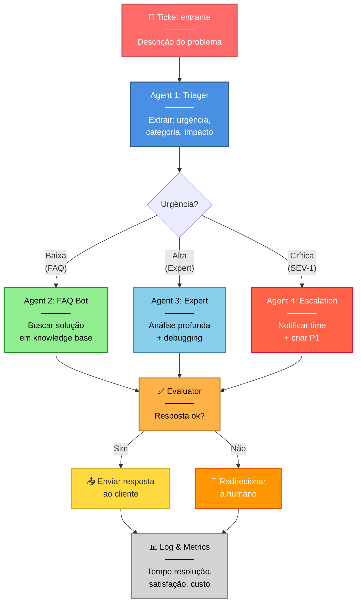

## 🔀 17. Agent Orchestration — Patterns, Implementation and Governance

### 📌 Definition

**Agent orchestration** is the process of coordinating multiple specialized AI agents to solve complex problems that no single agent can solve completely. Each agent executes its task within its domain, passes the result to the next, and a **central orchestrator** manages the flow, routing decisions, error handling and final response composition.

**Differentiation:**
- **Single agent**: Responds to a request with an LLM + tools. Fast, low latency, but limited to one domain.
- **Orchestrated multi-agent**: Multiple specialized agents solve different aspects of the problem. More powerful, but more complex to govern and with higher latency.

### 🎯 When Orchestration Is Worth It



**Examples of complex problems:**
- ✅ **Support request**: Triage Agent → Analysis Agent → Resolution Agent → Notifier
- ✅ **Contract analysis**: Parser Agent → Risk Agent → Compliance Agent → Summarizer
- ✅ **Demand forecasting**: Data Agent → Model Agent → Business Rules Agent → Planner

### 🏗️ Four Orchestration Patterns

#### **Pattern 1: Sequential (Pipeline)**

Agents execute one after another, passing results from one to the next.



**Characteristics:**
- ✓ Simple to implement and debug
- ✓ Predictable latency (sum of latencies)
- ✗ Failure in one agent breaks everything
- ✗ No parallelism

**Ideal use:** Linear workflows (support → analysis → resolution).

---

#### **Pattern 2: Parallel (Fan-out)**

Multiple agents execute simultaneously, then results are consolidated.



**Characteristics:**
- ✓ Reduced latency (parallel)
- ✓ Partial resilience (one agent fails, others continue)
- ✗ More complex to implement
- ✗ Consolidation can be difficult if responses conflict

**Ideal use:** Parallel evaluations (cost, risk, compliance).

---

#### **Pattern 3: Conditional (Decision Tree)**

Decision logic determines which agent to execute next.



**Characteristics:**
- ✓ Intelligent routing (resource savings)
- ✓ Automatic escalation when needed
- ✗ Decision can be incorrect
- ✗ No redundancy

**Ideal use:** Dynamic routing by complexity (simple FAQ vs. deep analysis vs. escalation).

---

#### **Pattern 4: Feedback Loop (Iterative)**

An agent executes, evaluates the result, and iterates until success or limit.



**Characteristics:**
- ✓ Self-improvement (refines until success)
- ✓ Higher reliability (retries)
- ✗ Potentially high latency
- ✗ Risk of infinite loops (needs limit)

**Ideal use:** High-quality content generation (reports, analyses).

### 📋 Pattern Comparison

| Pattern | Latency | Complexity | Resilience | Best for |
|--------|----------|--------------|-------------|------------|
| **Sequential** | Low | Low | Low | Simple pipelines, fixed order |
| **Parallel** | Very low | Medium | Medium | Independent evaluations |
| **Conditional** | Variable | Medium | Medium | Intelligent routing |
| **Feedback Loop** | High | High | High | Critical quality |

### 💼 Practical Use Case: Technical Support Request

**Scenario:** Customer opens a support ticket. The system must: (1) classify urgency, (2) extract technical data, (3) find a similar solution, (4) generate a response or escalate.

**Architecture (Sequential + Conditional):**



### 🔧 Foundry Implementation

```python
import json
import os
from datetime import datetime

from azure.ai.projects import AIProjectClient
from azure.identity import DefaultAzureCredential

project_client = AIProjectClient(
    endpoint=os.environ["FOUNDRY_PROJECT_ENDPOINT"],
    credential=DefaultAzureCredential(),
)
openai_client = project_client.get_openai_client()

# These versioned prompt agents are created and governed in the Foundry project.
TRIAGER_AGENT = "support-triager"
FAQ_AGENT = "support-faq"
EXPERT_AGENT = "support-expert"

def invoke_agent(agent_name: str, user_message: str) -> str:
    response = openai_client.responses.create(
        input=user_message,
        extra_body={
            "agent_reference": {
                "name": agent_name,
                "type": "agent_reference",
            }
        },
    )
    return response.output_text

# Orchestration logic
def handle_support_ticket(ticket_text: str):
    # Step 1: Classify with Triager
    triage_response = invoke_agent(
        TRIAGER_AGENT,
        f"Classify this ticket as JSON with urgency, category and impact: {ticket_text}",
    )

    triage_result = json.loads(triage_response)
    urgency = triage_result["urgency"]

    # Step 2: Route based on urgency
    if urgency == "Low":
        resolution = invoke_agent(FAQ_AGENT, ticket_text)
    elif urgency in ["Medium", "High"]:
        resolution = invoke_agent(EXPERT_AGENT, ticket_text)
    else:  # Critical
        # Escalate to human
        resolution = "HUMAN_ESCALATION"

    return {
        "urgency": urgency,
        "resolution": resolution,
        "timestamp": datetime.now().isoformat()
    }

# Usage
result = handle_support_ticket("My server has been offline for 2 hours")
print(result)
```

This example uses `azure-ai-projects` 2.x and the Responses API. For a production multi-agent system, enforce structured outputs, timeouts, retries, per-agent authorization and trace correlation rather than parsing unconstrained text.

### 🛡️ Challenges and Best Practices

#### **Challenge 1: Error Cascade**
If Agent 1 fails, Agent 2 receives invalid input. 

**Mitigation:**
- ✓ Validate each agent's output with schema
- ✓ Implement automatic fallback / retry
- ✓ Error log at each stage with context

#### **Challenge 2: Accumulated Latency**
In sequential, latency = Sum(Agent1 latency + Agent2 latency + ...).

**Mitigation:**
- ✓ Use parallel when possible
- ✓ Monitor end-to-end SLA
- ✓ Cache frequent responses

#### **Challenge 3: Response Inconsistency**
Agents may conflict or provide contradictory information.

**Mitigation:**
- ✓ Version instructions centrally
- ✓ Integrated orchestration testing (not just isolated agent)
- ✓ Consolidator with explicit conflict resolution logic

#### **Challenge 4: Multi-Agent Governance**
Who is responsible if something goes wrong? Agent 1? Agent 2? Orchestrator?

**Mitigation:**
- ✓ Assign owner per agent, owner per workflow
- ✓ Test permissions (RLS) in orchestration context
- ✓ Audit trail of each invocation and decision

#### **Challenge 5: Complex Debugging**
When the workflow fails, which agent is to blame?

**Mitigation:**
- ✓ Structured logging (OpenTelemetry) at each stage
- ✓ Distributed tracing (trace ID traverses workflow)
- ✓ Replicable simulation / test case

### ✅ Orchestration Checklist

Before launching a multi-agent workflow:

```
□ Each agent has versioned and documented instructions
□ Outputs from each agent are validated against schema
□ Integrated tests cover happy path + edge cases
□ End-to-end latency within SLA
□ RLS tested in orchestration context (Agent 1 → Agent 2 → response)
□ Permissions for each agent defined (which table, which operation)
□ Fallback/retry logic implemented for each stage
□ Monitoring & alerts configured (latency, failure, costs)
□ Rollback plan documented
□ Owner designated per agent and per workflow
□ Use case documentation and visual flow updated
```

### 📚 References — Orchestration in Foundry

- [Add other agents in Copilot Studio](https://learn.microsoft.com/microsoft-copilot-studio/authoring-add-other-agents)
- [Connect to an A2A agent from Foundry Agent Service](https://learn.microsoft.com/azure/foundry/agents/how-to/tools/agent-to-agent)
- [AI agent orchestration patterns](https://learn.microsoft.com/azure/architecture/ai-ml/guide/ai-agent-design-patterns)
- [Foundry Agent Service tool catalog](https://learn.microsoft.com/azure/foundry/agents/concepts/tool-catalog)

---

