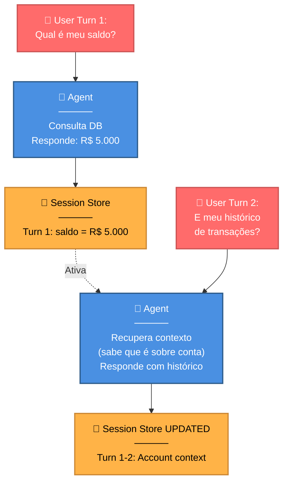
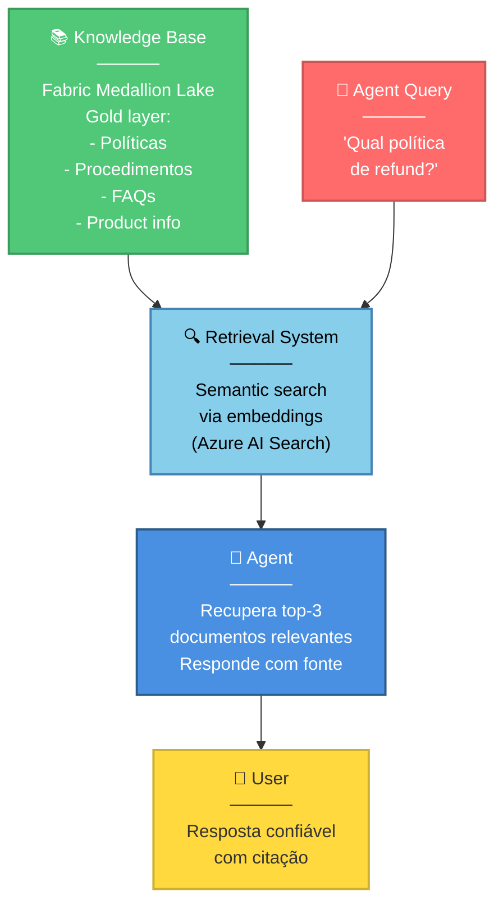
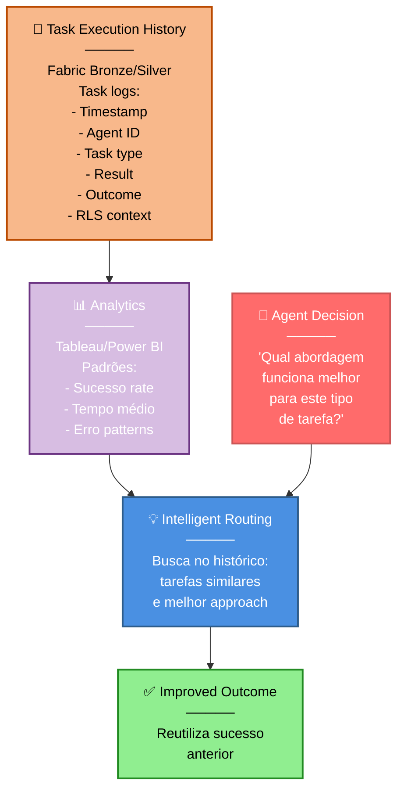
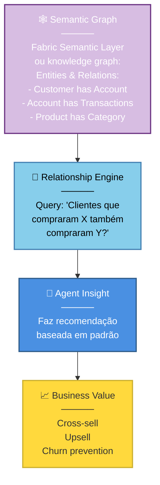
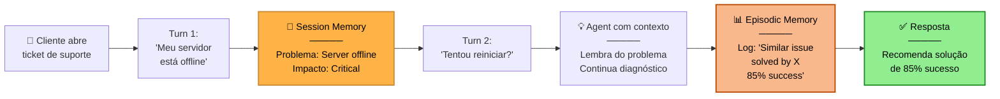
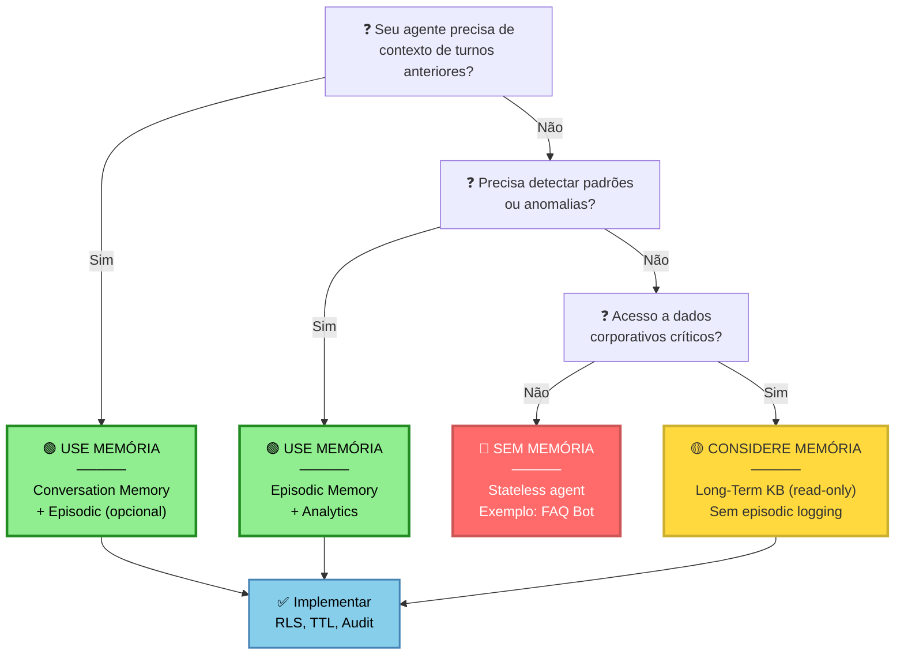
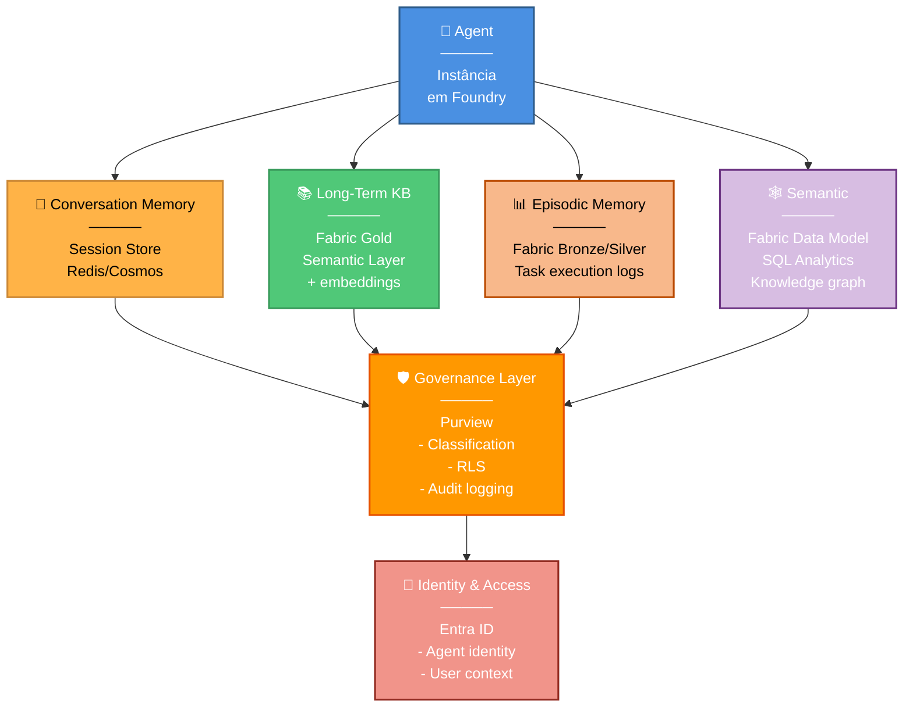
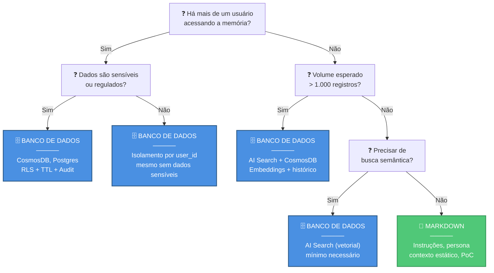

## 💾 18. Agent Memory — Concept, Types and Architectural Integration

### 📌 Definition

**Agent memory** is the ability of an agent to persist, retrieve and use information from previous interactions for context, learning and personalization. Without memory, each invocation is isolated; with memory, the agent builds history and contextualization over time.

**Human analogy:**
- Short-term memory = current conversation (conversation context)
- Long-term memory = accumulated knowledge (knowledge base, retrieval)
- Episodic memory = task history (task history, patterns)
- Semantic memory = facts and relationships (semantic layer)

### 🧠 Four Types of Memory in Corporate Architecture

#### **1. Conversation/Session Memory (Short Term)**

Context of the current conversation — what was said in the last N turns.



**Characteristics:**
- Scope: Single session (minutes to hours)
- Storage: In-memory or cache (Redis, Cosmos DB session store)
- Governance: None (not persistent)
- Cost: Low

**Ideal use:** Interactive conversations, turn-to-turn context.

---

#### **2. Long-Term Knowledge Base Memory**

Persistent facts, policies and procedures that the agent has learned or been configured with.



**Characteristics:**
- Scope: Corporate, permanent
- Storage: Fabric Gold Layer (semantic layer, embedding vectors)
- Governance: Purview labels, RLS, versioning
- Cost: Medium (indexing, storage)

**Ideal use:** Access to procedures, policies, corporate knowledge.

---

#### **3. Episodic Memory (Task History)**

Record of the agent's past actions — which tasks it executed, results, patterns.



**Characteristics:**
- Scope: Execution history (days to months)
- Storage: Fabric Bronze/Silver (raw logs + transformed)
- Governance: Audit trail, RLS by user/department
- Cost: High (retention)

**Ideal use:** Pattern learning, route optimization, anomaly detection.

---

#### **4. Semantic Memory (Relationship Graph)**

Conceptual structure — how entities relate to each other (customers ↔ products ↔ transactions).



**Characteristics:**
- Scope: Corporate, permanent
- Storage: Semantic layer (Fabric Data Models, SQL Analytics Endpoint)
- Governance: Purview lineage, RLS
- Cost: Low (queries only)

**Ideal use:** Recommendations, analysis, business insights.

### 📊 Memory Type Comparison

| Type | Scope | Latency | Persistence | Governance | Use |
|------|--------|----------|---|---|---|
| **Conversation** | Session | ms | No (minutes) | None | Turn-to-turn context |
| **Long-Term KB** | Corporate | 100ms-1s | Yes (permanent) | Purview labels, RLS | Policies, procedures |
| **Episodic** | History | 1-10s | Yes (logs) | Audit trail, RLS | Patterns, optimization |
| **Semantic** | Corporate | ms-100ms | Yes (permanent) | Lineage, RLS | Recommendations, insights |

### 🧭 Usage Scenarios — When and How to Use Memory

#### **Scenario 1: Conversational Technical Support (Conversation + Episodic)**



**Implementation:**
- ✅ Session memory active during conversation (TTL = 30 min)
- ✅ Episodic memory queries 90-day history
- ✅ Result: 30% faster resolution

---

#### **Scenario 2: Compliance & Regulatory (Long-Term KB + Episodic)**

```
Agent: "Qual é a política de LGPD para dados de clientes?"

Com memória:
1. Long-Term KB → Busca documento "LGPD_Policy_v2.3" (atualizado há 2 dias)
2. Episodic Memory → Verifica: este agente consultou esta política 47 vezes no mês
3. Resultado: Resposta com fonte, confiança 98%, auditável

Sem memória:
1. Agente sem contexto
2. Pode retornar versão antiga (3 meses)
3. Não sabe frequência de consultoria → impossível auditar
```

---

#### **Scenario 3: Product Recommendation (Semantic)**

```
Customer: "Comprei um laptop Dell, quais periféricos vocês recomendam?"

Com memória:
1. Semantic Memory → Relacionamento: "Dell laptop" ← relacionado com → "Docking Station", "Monitor", "Mouse"
2. Analisa histórico: "Clientes que compraram Dell laptop também compraram Docking + Monitor (92% co-purchase)"
3. Recomenda: "Docking Station (recomendado por 92% dos clientes)", "Monitor 4K"

Sem memória:
1. Agente recomenda aleatoriamente
2. Sem dados de co-purchase
3. Oportunidade perdida
```

---

### ✅ Pros and Cons — Memory vs. No Memory

#### **WITH Memory:**

| Aspect | Benefit |
|---------|-----------|
| **Quality** | ✅ Contextualized responses, reduced hallucinations |
| **UX Experience** | ✅ Natural conversation, no need to repeat context |
| **Efficiency** | ✅ Reuses successful patterns, 30-50% less time |
| **Insights** | ✅ Patterns emerge from history (anomalies, trends) |
| **Audit** | ✅ Complete decision traceability |
| **Governance** | ✅ RLS, compliance labels applied |
| **Personalization** | ✅ Agent learns user preferences and context |

**Custos:**
| Aspecto | Custo |
|---------|-------|
| **Storage** | 💰 Medium-High (log retention, embeddings) |
| **Latency** | ⏱️ +100-500ms per search (retrieval) |
| **Complexity** | 🛠️ More complex implementation (RLS, TTL, cleanup) |
| **Governance** | 📋 Mandatory compliance (LGPD, CCPA) |
| **Debugging** | 🔍 Harder to debug (multiple correlated data) |

---

#### **WITHOUT Memory (Stateless):**

| Aspect | Benefit |
|---------|-----------|
| **Simplicity** | ✅ Straightforward implementation, no state |
| **Latency** | ✅ Fast (no history search) |
| **Cost** | ✅ Very low (no storage) |
| **Security** | ✅ No leakage risk (retains no data) |
| **Compliance** | ✅ Easier (LGPD: data deleted immediately) |
| **Scalability** | ✅ Infinitely scalable (stateless) |

**Custos:**
| Aspecto | Custo |
|---------|-------|
| **Quality** | ❌ More hallucinations, zero context |
| **UX** | ❌ Frustrating (user repeats information each turn) |
| **Efficiency** | ❌ No learning, each task starts from scratch |
| **Insights** | ❌ Impossible to detect patterns |
| **ROI** | ❌ Less value delivered per agent |

---

### 🚦 Decision Matrix — When to Use Memory



### 📋 Checklist — When TO USE Memory

Answer YES to 3+ items → **USE MEMORY**

```
□ Agent conversa com o usuário (múltiplos turnos)?
□ Contexto anterior afeta a próxima resposta?
□ Usuário espera que agent "lembre" do que foi dito?
□ Há padrões históricos que melhoram resultado?
□ Auditoria/compliance precisa de rastreabilidade?
□ Dados são classificados (Purview labels)?
□ RLS já existe na organização?
□ TTL/cleanup policy definida?
□ Custo de storage justificado pelo valor?
```

---

### ⛔ Checklist — When NOT to Use Memory

Responda SIM a 2+ itens → **SEM MEMÓRIA**

```
❌ Agent responde uma pergunta única e encerra (stateless)?
   Exemplo: "Qual é a capital da França?" → "Paris" → fim

❌ Cada invocação é completamente independente?
   Exemplo: Processamento de batch (1000 documentos em paralelo)

❌ Dados são sensíveis demais para logs (criptografia de dados brutos)?
   Exemplo: números de cartão, senhas, segredos

❌ LGPD/CCPA "direito de ser esquecido" é crítico?
   Exemplo: App de consumidor europeu

❌ Performance é crítica (latência < 100ms)?
   Exemplo: Bot de automação ultra-rápido

❌ Escala é massiva (milhões de sessões simultâneas)?
   Exemplo: Público geral, não corporativo

❌ Budget de infraestrutura muito limitado?
   Exemplo: Startup com custo mínimo

❌ Dados mudam muito (KB desatualiza a cada hora)?
   Exemplo: Preços em tempo real, stocks
```

---

### 🎓 Practical Decision Examples

#### **Example 1: Technical Support Agent**

**Perfil:**
- Conversa com cliente (2-5 turnos)
- Cada turno depende da resposta anterior
- Precisa auditar conversas (compliance)
- Data: non-sensitive (public tickets)

**Decision:** ✅ **USE MEMORY**

**Implementation:**
- Conversation Memory (Session Store, TTL=2h)
- Episodic Memory (resolution logs in Fabric)
- Long-Term KB (docs de troubleshooting em Fabric Gold)

---

#### **Example 2: Budget Calculator**

**Perfil:**
- User enters value, agent calculates → done
- Sem contexto anterior
- Data: temporary, disposable
- Scale: very high (100K requests/minute)

**Decision:** ❌ **NO MEMORY**

**Implementation:**
- Stateless Azure Function
- Nenhum storage
- Latency < 50ms
- Cost: minimal

---

#### **Example 3: Product Recommendation (E-commerce)**

**Perfil:**
- Customer browsing, wants recommendations
- Context: purchase history (semantic memory)
- Not a turn-by-turn conversation
- Dados: classificados, com RLS por cliente

**Decision:** 🟡 **USE SELECTIVE MEMORY**

**Implementation:**
- Long-Term KB (semantic layer com products + categories)
- Episodic Memory (purchase history per customer + co-purchase patterns)
- NO Conversation Memory (uma consulta, uma resposta)

---

#### **Exemplo 4: Chatbot FAQ Interno**

**Perfil:**
- User asks a single question
- Agent responds with documentation
- Conversations are independent
- Data: internal public policies

**Decision:** ❌ **NO MEMORY** (mas com Long-Term KB read-only)

**Implementation:**
- Long-Term KB (FAQs em Fabric Gold + embeddings)
- NO Conversation/Episodic Memory
- Simple retrieval-only, sem aprendizado

---

### 🏗️ Integration in Corporate Architecture



### 🔐 Memory Security and Governance

#### **Challenge 1: Context Leakage Between Users**

If Agent A retains data from User 1, how to ensure User 2 cannot access it?

**Mitigation:**
- ✓ RLS em todas as camadas (session store, Fabric, semantic)
- ✓ Session storage isolado por user_id + tenant_id
- ✓ Purview labels aplicados aos dados de episodic memory
- ✓ Audit log de todas as leituras

```python
# Exemplo: RLS em session memory
def get_user_context(user_id: str, session_id: str, caller_identity: str):
    # Validar que caller é o próprio user ou um admin autorizado
    if caller_identity != user_id and not is_admin(caller_identity):
        raise PermissionError("Unauthorized")
    
    return session_store.get(f"{user_id}:{session_id}")
```

#### **Challenge 2: Sensitive Data in Memory**

PII, financial data, etc. must not be stored in plaintext.

**Mitigation:**
- ✓ Criptografia em repouso (Cosmos DB encryption, Fabric TDE)
- ✓ Sensitive data masking (Purview masking)
- ✓ Automatic TTL in session memory (clear after X minutes)
- ✓ Separate "necessary context" from "raw data"

```python
# Exemplo: Armazenar apenas referência, não dado completo
# ❌ Ruim: armazenar número completo de cartão
# session["card_number"] = "4532 1234 5678 9010"

# ✅ Bom: armazenar apenas sufixo + hash
session["card_reference"] = {
    "last_4": "9010",
    "card_hash": hash("4532 1234 5678 9010"),
    "retrieved_at": timestamp
}
```

#### **Challenge 3: Data Retention Violating LGPD/CCPA**

If an agent stores history, how to guarantee the "right to be forgotten"?

**Mitigation:**
- ✓ Policy-based TTL (session = 1h, logs = 90 days, KB = indefinite)
- ✓ Delete handlers integrados (quando user pede, apagar todos os dados)
- ✓ Purview compliance tags (data_retention_policy, pii_data)
- ✓ Audit trail de deletes

### 🧩 Foundry Implementation

#### **Multi-Layer Configuration:**

```python
from azure.cosmos import CosmosClient
from azure.search.documents import SearchClient
from datetime import datetime, timedelta

class AgentMemoryManager:
    def __init__(self, user_id: str, agent_id: str):
        self.user_id = user_id
        self.agent_id = agent_id
        
        # Conversation memory (Redis or Cosmos)
        self.session_store = CosmosClient.from_connection_string(
            connection_string
        ).get_database("session_store")
        
        # Long-term KB (Fabric via Azure AI Search)
        self.kb_search = SearchClient(
            endpoint="https://<search-service>.search.windows.net",
            index_name="fabric-kb-embeddings",
            credential=credential
        )
        
        # Episodic memory (Fabric via Spark SQL)
        self.task_history = f"fabric_workspace.task_execution_log_{self.user_id}"
        
    def get_conversation_context(self, session_id: str, max_turns: int = 10):
        """Retrieve recent conversation turns"""
        query = f"SELECT * FROM session_store WHERE user_id='{self.user_id}' AND session_id='{session_id}' ORDER BY timestamp DESC LIMIT {max_turns}"
        return self.session_store.query_items(query)
    
    def retrieve_knowledge_base(self, query: str, top_k: int = 3):
        """Semantic search in long-term KB"""
        results = self.kb_search.search(
            search_text=query,
            select=["id", "title", "content", "classification"],
            top=top_k,
            filter=f"user_access = '{self.user_id}' OR user_access = 'PUBLIC'"
        )
        return results
    
    def get_task_patterns(self, task_type: str, lookback_days: int = 30):
        """Analyze episodic memory for patterns"""
        query = f"""
        SELECT task_type, approach, avg(duration_ms) as avg_duration, 
               count(*) as frequency, success_rate
        FROM {self.task_history}
        WHERE task_type = '{task_type}' 
        AND created_date >= CURRENT_DATE - INTERVAL {lookback_days} DAY
        GROUP BY task_type, approach
        ORDER BY success_rate DESC
        """
        return self.spark.sql(query)
    
    def store_conversation_turn(self, user_input: str, agent_response: str):
        """Store turn with TTL"""
        item = {
            "id": f"{self.user_id}:{datetime.now().isoformat()}",
            "user_id": self.user_id,
            "agent_id": self.agent_id,
            "input": user_input,
            "response": agent_response,
            "timestamp": datetime.now().isoformat(),
            "ttl": 3600  # 1 hour expiration
        }
        self.session_store.create_item(item)
    
    def store_task_execution(self, task_type: str, result: dict):
        """Episodic memory: log task execution"""
        log_entry = {
            "user_id": self.user_id,
            "agent_id": self.agent_id,
            "task_type": task_type,
            "result": result,
            "duration_ms": result.get("duration_ms"),
            "success": result.get("success"),
            "created_date": datetime.now().isoformat()
        }
        # Insert into Fabric task_execution_log
        self.spark.sql(f"INSERT INTO {self.task_history} VALUES (...)")

# Usage in Agent
memory_mgr = AgentMemoryManager(user_id="user123", agent_id="sales_agent")

# Retrieve conversation context
context_turns = memory_mgr.get_conversation_context("session_abc")

# Retrieve relevant knowledge base articles
kb_results = memory_mgr.retrieve_knowledge_base("Qual é a política de refund?")

# Get best practices from past similar tasks
best_approach = memory_mgr.get_task_patterns("quote_generation")

# After task, store episodic memory
memory_mgr.store_task_execution("quote_generation", {
    "duration_ms": 1250,
    "success": True,
    "quote_value": 15000
})
```

### ⚠️ Common Challenges and Mitigations

#### **1. Hallucinations caused by incorrect memory**
Agent retrieves old or inaccurate information from history.

**Mitigation:**
- ✓ Source validation (where did this information come from?)
- ✓ Update timestamp (is the data still relevant?)
- ✓ Confidence score (what level of confidence?)
- ✓ KB versioning (which version of the policy applies today?)

#### **2. Memory too large = latency**
Session with 500 turns makes each invocation slow.

**Mitigation:**
- ✓ Automatic summarization (summarize old turns in 1-2 lines)
- ✓ Hierarchical memory (last 10 turns in hot memory, rest in archive)
- ✓ Relevance filtering (manter apenas turnos relevantes ao contexto atual)

#### **3. Scalable storage cost**
Episodic memory cresce indefinidamente.

**Mitigation:**
- ✓ Automatic archiving (logs > 90 days → cold storage)
- ✓ Aggregation (consolidate similar logs into summaries)
- ✓ Cleanup policies (GDPR right-to-forget, deletar automaticamente)

#### **4. Difficult debugging**
Qual turno anterior causou a resposta errada?

**Mitigation:**
- ✓ Distributed tracing com trace_id atravessando turnos
- ✓ Memory snapshot at each critical point
- ✓ Ability to "replay" a session with original memory

### ✅ Checklist: Agent Memory in Production

```
Conversation Memory:
□ Session store configurado (Redis ou Cosmos)
□ TTL automático definido (não manter para sempre)
□ RLS testado (usuário A não vê sessão de usuário B)
□ Criptografia em repouso habilitada

Long-Term KB:
□ Knowledge base indexado e embeddings criados
□ Semantic search testado (relevância > 0.75)
□ Purview labels aplicados (PII, Confidential, etc)
□ Versioning de documentos implementado
□ Source citations habilitadas no agent

Episodic Memory:
□ Task execution logs definidos (schema)
□ Retention policy clara (90 dias, GDPR compliant)
□ RLS por user/department/region
□ TTL automático para dados sensíveis
□ Audit trail de leitura/escrita

Semantic Memory:
□ Data model no Fabric mapeado
□ Relações principais documentadas
□ Query performance testada (< 500ms)
□ RLS aplicado em dados sensíveis

Governança & Security:
□ Classificação de dados via Purview
□ Encriptação em repouso e em trânsito
□ Delete handler para GDPR compliance
□ Distributed tracing para debugging
□ Cost monitoring implementado
```

---

### 📄 vs 🗄️ Comparison — Memory in Markdown Files vs. Database

When implementing long-term memory for agents, two approaches stand out: persisting information in **Markdown files** or using a **structured database** (relational, NoSQL or vector). Each approach has clear trade-offs in complexity, governance, performance and cost.

#### **Overview**

| Criterion | 📄 Markdown Files | 🗄️ Database |
|----------|---------------------|-------------------|
| **Implementation** | Very simple (create/read files) | Complex (schema, connection, queries) |
| **Initial cost** | Near zero (storage in repository) | Medium to high (provisioning) |
| **Scalability** | Low (hundreds of files) | High (millions of records) |
| **Read latency** | High (disk read, no index) | Low (optimized indexes, cache) |
| **Semantic search** | Requires manual parsing | Native (vector, full-text, RLS) |
| **Governance (RLS, LGPD)** | Manual and fragile | Native (row-level security, TTL) |
| **Audit** | Limited (git log, basic) | Complete (audit tables, native trail) |
| **Multi-user** | Access conflicts (no isolation) | Native isolation by session/user_id |
| **Versioning** | Via Git (ideal for technical teams) | Requires explicit version schema |
| **Human readability** | ✅ High (direct review in editor) | ❌ Requires tools/query client |
| **Portability** | ✅ High (any environment) | Medium (depends on engine) |
| **LLM integration** | Simple (inject directly into prompt) | Requires retrieval layer (AI Search) |

---

#### **Usage Scenarios — When to Use Each Approach**

##### **📄 Markdown Files — Recommended For:**

| Scenario | Justification |
|---------|--------------|
| **Development agents** (Copilot, code automation) | Instructions, preferences and project context live well in `.md` versioned with the code |
| **Personal / single-user agents** | No need for isolation; one user, one memory |
| **Prototyping and PoCs** | Zero overhead; team develops and tests quickly |
| **Preferences and instructions memory** | Short, static texts, read once per session |
| **Environments without database infrastructure** | Edge, local device, offline laptop |
| **Living agent documentation** | Constraints, persona and business rules read as context |

**Practical example:**
```markdown
# memoria_agente_vendas.md

## User Preferences
- Language: en-US, formal tone
- Focus segment: Enterprise (1000+ employees)
- Last mentioned client: Bank ABC (onboarding in progress)

## Active Business Rules
- Maximum discount without approval: 15%
- Standard response SLA: 2 business days
```
```python
# Inject Markdown memory directly into the system prompt
with open("memoria_agente_vendas.md", "r") as f:
    memory_context = f.read()

system_prompt = f"""
Você é o agente de vendas da empresa. Use o contexto abaixo:
{memory_context}
"""
```

---

##### **🗄️ Database — Recommended For:**

| Scenario | Justification |
|---------|--------------|
| **Corporate multi-user agents** | Isolation by user_id/tenant_id; mandatory RLS |
| **Conversation history (Episodic Memory)** | Thousands of turns per user; search by date, type, success |
| **Vector semantics (Long-Term KB)** | Embeddings for retrieval; no Markdown equivalent |
| **Regulatory compliance** (LGPD, SOX, HIPAA) | Automatic TTL, audit trail, native delete handler |
| **Production agents with SLA** | Predictable latency; Markdown does not scale for high load |
| **Dynamic personalization** | Preferences updated in real time without redeploy |
| **Pattern and anomaly detection** | SQL/NoSQL query over history; impossible in Markdown |

**Practical example:**
```python
# Cosmos DB — Session memory with automatic TTL
item = {
    "id": f"{user_id}:{session_id}:{turn_id}",
    "user_id": user_id,
    "tenant_id": tenant_id,
    "input": user_input,
    "response": agent_response,
    "timestamp": datetime.now().isoformat(),
    "ttl": 3600  # auto-delete after 1h (LGPD compliance)
}
container.create_item(item)

# Azure AI Search — Long-Term KB com semântica vetorial
results = search_client.search(
    search_text=query,
    vector_queries=[VectorizedQuery(vector=embedding, fields="content_vector")],
    filter=f"tenant_id eq '{tenant_id}'",  # RLS via filter
    top=5
)
```

---

#### **Detailed Pros and Cons**

##### **📄 Markdown Files**

| ✅ Pros | ❌ Cons |
|---------|-----------|
| Zero learning curve | No native semantic search |
| Versionable with Git (technical traceability) | No multi-user isolation |
| Human-readable without tools | Limited scale (slow with many files) |
| Portable (runs anywhere) | No automatic TTL/expiration |
| No infrastructure cost | No RLS; any FS access reads everything |
| Ideal for static context and instructions | Concurrent updates cause conflict |
| Easy to edit during development | Audit limited to git blame |
| Compatible with GitHub Copilot and VS Code | Not suitable for sensitive data |

##### **🗄️ Banco de Dados**

| ✅ Pros | ❌ Cons |
|---------|-----------|
| Native RLS (user A never sees user B's data) | Greater setup and maintenance complexity |
| Automatic TTL (LGPD compliance) | Provisioning cost |
| Integrated vector and full-text search | Requires schema design and migrations |
| Support for millions of records | Not directly readable (requires query) |
| Complete audit trail (who read, when) | Connection latency vs local file |
| Real-time updates | Vendor lock-in (CosmosDB, Postgres, etc.) |
| Native multi-tenant | Harder to version business rules |
| Integration with Purview and Fabric | Infrastructure overhead in PoCs |

---

#### **Decision Matrix — Markdown vs. Database**



#### **Recommended Hybrid Pattern (Production)**

In practice, the two approaches **complement each other** rather than being mutually exclusive:

```
📄 Markdown  →  Persona, instruções fixas, regras de negócio (versionado no repo)
🗄️ Banco     →  Histórico de turnos, preferências dinâmicas, KB semântico, episódios
```

| Memory Layer | Recommended Technology |
|-------------------|----------------------|
| Instructions / Persona | `.md` in the repository (read-only at runtime) |
| Conversation Memory | Cosmos DB + automatic TTL |
| Long-Term KB | Azure AI Search (vetorial) + Fabric Gold |
| Episodic Memory | Fabric Silver/Gold (Parquet + SQL) |
| Dynamic Preferences | Cosmos DB (updated by the agent) |

**Guiding principle:** use Markdown for what is **configuration** (changes with deploy), and database for what is **state** (changes with usage).

---

### 🗄️ Database Types Guide for Agent Memory

The database choice directly impacts latency, cost, governance and search capability. Each type of memory has a distinct access profile — choose the engine that best serves that profile.

#### **Consolidated View by Memory Type**

| Memory Type | Access Pattern | Recommended Engine | Alternatives |
|----------------|-----------------|-------------------|-------------|
| **Conversation / Session** | Key-based read/write (user+session), mandatory TTL | Redis (Azure Cache for Redis) | Cosmos DB (NoSQL), DynamoDB |
| **Long-Term Knowledge Base** | Semantic search (vector) + full-text | Azure AI Search | pgvector (Postgres), Qdrant, Weaviate |
| **Episodic / Task History** | Analytical query (aggregation, trend, date filter) | Microsoft Fabric (Parquet + SQL Analytics) | Postgres, Synapse Analytics |
| **Semantic / Graph** | Traversal de relacionamentos, grafos | Azure Cosmos DB (Gremlin / NoSQL) | Neo4j, Amazon Neptune |
| **Dynamic Preferences** | Frequent read/write by user_id, low latency | Cosmos DB (NoSQL API) | Redis Hash, Postgres JSONB |
| **Reference Data (read-only)** | Reading static catalogues with cache | Redis + Azure Blob Storage | Azure Table Storage |

---

#### **Detalhamento por Engine**

##### **🔴 Redis — Azure Cache for Redis**

**Ideal for:** Conversation Memory, preference cache, session deduplication.

| Atributo | Valor |
|----------|-------|
| Latency | < 1ms (in-memory) |
| Persistence | Optional (AOF/RDB) |
| TTL nativo | ✅ Por chave (EXPIRE) |
| RLS | ❌ Not native; implement via key prefix |
| Escalabilidade | Alta (cluster mode) |
| Cost | Low-Medium |
| Best for | Short-term sessions, KB results cache |

```python
import redis

r = redis.Redis.from_url(os.environ["REDIS_URL"])

# Armazenar turno de conversa com TTL de 1 hora
r.setex(
    name=f"session:{user_id}:{session_id}",
    time=3600,
    value=json.dumps({"turns": conversation_turns, "last_intent": last_intent})
)

# Recuperar contexto
context = json.loads(r.get(f"session:{user_id}:{session_id}") or "{}")
```

**Guard rail:** isolate namespaces per tenant with mandatory prefix (`{tenant}:{user}:{session}`). Never use glob keyal compartilhada.

---

##### **🔵 Azure Cosmos DB (NoSQL API)**

**Ideal for:** Dynamic preferences, lightweight episodic memory, session store with automatic TTL.

| Atributo | Valor |
|----------|-------|
| Latency | 5–15ms (SLA 99%) |
| Persistence | ✅ Always |
| TTL nativo | ✅ Por documento (campo `ttl`) |
| RLS | Via partition key + middleware |
| Escalabilidade | Muito alta (multi-region, serverless) |
| Cost | Medium (RU per operation) |
| Melhor para | Documentos JSON estruturados, multi-tenant |

```python
from azure.cosmos import CosmosClient

# Documento com TTL automático de 24h
item = {
    "id": f"{user_id}:{session_id}",
    "partitionKey": user_id,       # isolamento por usuário
    "tenant_id": tenant_id,
    "preferences": user_prefs,
    "last_updated": datetime.utcnow().isoformat(),
    "ttl": 86400                   # 24 horas — LGPD compliance
}
container.upsert_item(item)
```

**Guard rail:** use `partitionKey = user_id` to ensure physical data isolation. Never share partition key entre tenants.

---

##### **🟣 Azure AI Search (Vetorial)**

**Ideal for:** Long-Term Knowledge Base, semantic retrieval, indexed corporate documents.

| Atributo | Valor |
|----------|-------|
| Latency | 50–300ms (vector search) |
| Persistence | ✅ Always |
| Native TTL | ❌ Requires expiration field + indexer job |
| RLS | ✅ Via security filters (OData filter) |
| Scalability | High (shards, replicas) |
| Cost | Medium-High (per search unit) |
| Best for | Semantic search in documents, policies, FAQs |

```python
from azure.search.documents import SearchClient
from azure.search.documents.models import VectorizedQuery

# Busca híbrida: semântica + full-text com filtro de acesso
results = search_client.search(
    search_text=user_query,
    vector_queries=[
        VectorizedQuery(
            vector=get_embedding(user_query),
            k_nearest_neighbors=5,
            fields="content_vector"
        )
    ],
    filter=f"tenant_id eq '{tenant_id}' and classification ne 'Restricted'",
    select=["id", "title", "content", "source_url", "last_updated"],
    top=5
)
```

**Guard rail:** apply classification filters (Purview labels) as mandatory `filter=`. Never expose documents without verifying `tenant_id`.

---

##### **🟢 Microsoft Fabric (Parquet + SQL Analytics)**

**Ideal for:** Episodic Memory, pattern analysis, task history, evaluation trending.

| Atributo | Valor |
|----------|-------|
| Latency | 1–10s (analytical query) |
| Persistence | ✅ OneLake (durable Parquet) |
| TTL nativo | ❌ Via Maintenance jobs (DELETE + VACUUM) |
| RLS | ✅ Row-Level Security nativo |
| Scalability | Very high (distributed Spark) |
| Custo | Baixo por GB (OneLake) |
| Best for | Historical analysis, pattern detection, audit |

```python
# Write task execution log (Episodic Memory)
from pyspark.sql import SparkSession

spark = SparkSession.builder.getOrCreate()

log_df = spark.createDataFrame([{
    "user_id": user_id,
    "agent_id": agent_id,
    "task_type": task_type,
    "result": json.dumps(result),
    "success": result["success"],
    "duration_ms": result["duration_ms"],
    "created_date": datetime.utcnow().date().isoformat()
}])

log_df.write.mode("append").partitionBy("created_date").saveAsTable(
    "fabric_workspace.task_execution_log"
)

# Query episodic patterns
patterns = spark.sql("""
    SELECT task_type, approach,
           AVG(duration_ms) AS avg_ms,
           SUM(CASE WHEN success THEN 1 ELSE 0 END) / COUNT(*) AS success_rate
    FROM fabric_workspace.task_execution_log
    WHERE user_id = '{user_id}' AND created_date >= current_date - 30
    GROUP BY task_type, approach
    ORDER BY success_rate DESC
""".format(user_id=user_id))
```

**Guard rail:** partition by `created_date` + apply RLS by `user_id`/`department`. Define retention job to delete records exceeding the retention policy (LGPD).

---

##### **🟡 PostgreSQL com pgvector**

**Ideal for:** Scenarios where you want to consolidate conversation + vector in a single engine, or on-premises/multi-cloud environments.

| Atributo | Valor |
|----------|-------|
| Latency | 10–100ms |
| Persistence | ✅ Full ACID |
| TTL nativo | ❌ Via scheduled DELETE |
| RLS | ✅ Row-Level Security nativo (PostgreSQL) |
| Scalability | Medium (vertical + read replicas) |
| Custo | Baixo (open source) |
| Best for | Startups, unified environments, no Azure service dependency |

```sql
-- Extensão vetorial
CREATE EXTENSION IF NOT EXISTS vector;

-- Tabela de KB com embedding
CREATE TABLE agent_knowledge_base (
    id          UUID PRIMARY KEY DEFAULT gen_random_uuid(),
    tenant_id   TEXT NOT NULL,
    user_id     TEXT,
    title       TEXT,
    content     TEXT,
    embedding   vector(1536),  -- dimensão OpenAI text-embedding-3-small
    created_at  TIMESTAMPTZ DEFAULT NOW(),
    expires_at  TIMESTAMPTZ    -- TTL manual via cron job
);

-- Índice vetorial (ANN)
CREATE INDEX ON agent_knowledge_base 
    USING ivfflat (embedding vector_cosine_ops) WITH (lists = 100);

-- RLS
ALTER TABLE agent_knowledge_base ENABLE ROW LEVEL SECURITY;
CREATE POLICY tenant_isolation ON agent_knowledge_base
    USING (tenant_id = current_setting('app.tenant_id'));

-- Busca semântica
SELECT title, content, 1 - (embedding <=> $1::vector) AS similarity
FROM agent_knowledge_base
WHERE tenant_id = $2
ORDER BY embedding <=> $1::vector
LIMIT 5;
```

---

#### **Quick Decision Guide — Which Engine to Use?**

```
Need latency < 5ms?                     → Redis
Need semantic/vector search?            → Azure AI Search or pgvector
Need historical analysis/patterns?      → Microsoft Fabric
Need JSON documents + TTL?              → Cosmos DB
Need ACID + open source?                → PostgreSQL
Need relationship graph?                → Cosmos DB Gremlin or Neo4j
```

#### **Memory Layer Fit Summary**

| Layer | Primary Engine | Why |
|--------|-----------------|---------|
| **Conversation (session)** | Redis | Latency < 1ms, native TTL, low cost |
| **Long-Term KB** | Azure AI Search | Vector search + RLS via filter |
| **Episodic** | Microsoft Fabric | Analytical scale, native RLS, cost per GB |
| **Semantic (graph)** | Cosmos DB Gremlin | Relationship traversal in JSON/graph |
| **Preferences** | Cosmos DB NoSQL | TTL per document, simple upsert |
| **Unified alternative** | PostgreSQL + pgvector | Reduces number of engines (operational cost) |

---

### 📚 References — Agent Memory

- [Conversations and responses in Foundry Agent Service](https://learn.microsoft.com/azure/foundry/agents/concepts/runtime-components)
- [Semantic Search with Azure AI Search](https://learn.microsoft.com/azure/search/semantic-search-overview)
- [Fabric Medallion Architecture patterns](https://learn.microsoft.com/fabric/onelake/onelake-medallion-lakehouse-architecture)
- [Purview Data Classification for agent data](https://learn.microsoft.com/purview/data-classification-overview)
- [Row-Level Security in Fabric](https://learn.microsoft.com/fabric/data-warehouse/row-level-security)

---

