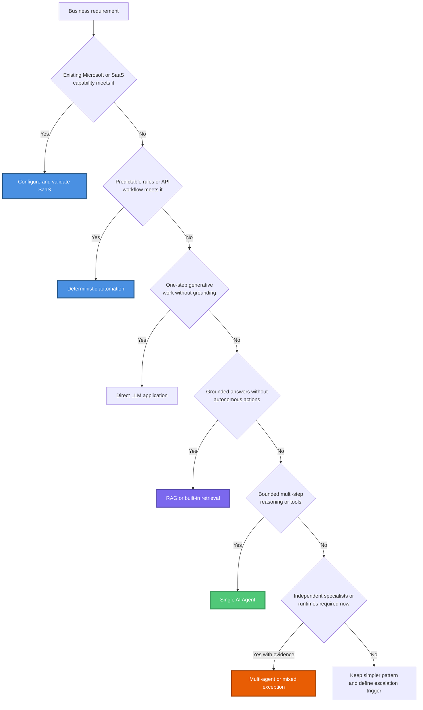

## 🌳 C. Decision Tree — Select the Pattern Before the Tool

After the pattern is selected, compare Microsoft products by required capability, data path, identity, engineering skill, channel, capacity, cost, region and feature status. Team profile and delivery speed are constraints, not substitutes for architecture requirements. Every production recommendation requires a **Fit**, **Conditional fit** or **Not fit** capacity verdict.

---

