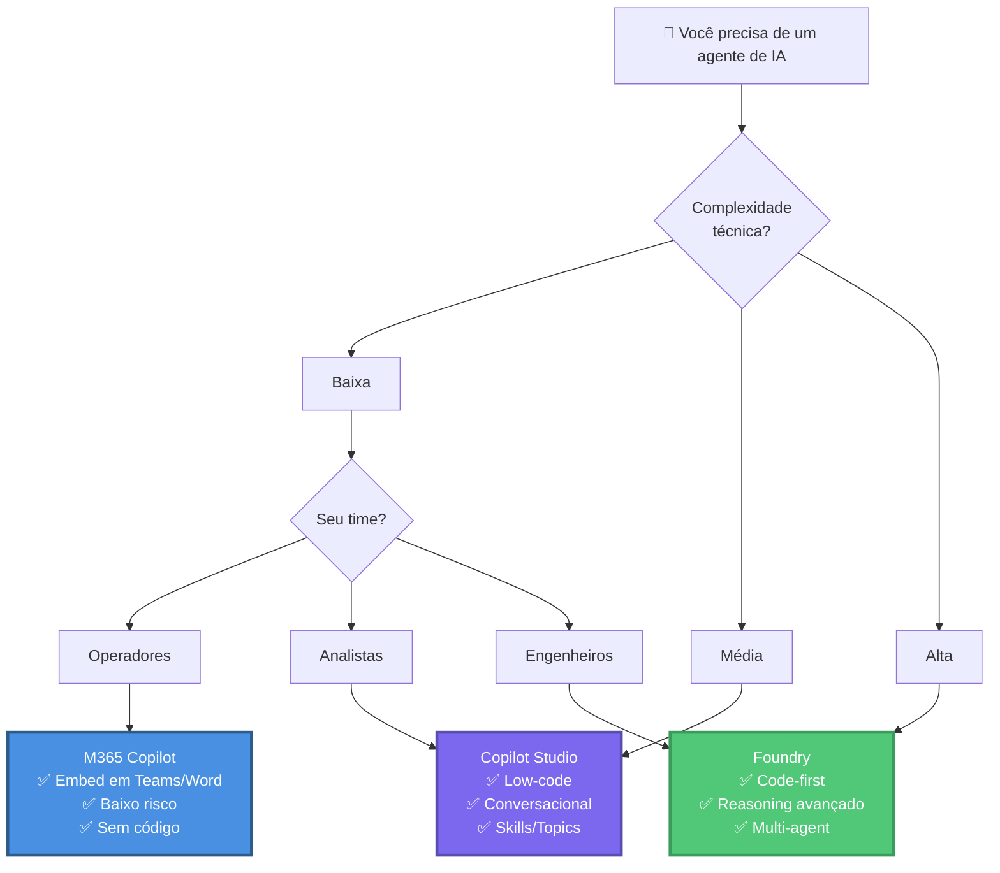

## 🌳 C. Decision Tree — When to Choose Which Tool

| Tool | When | Ideal team | Time |
|---|---|---|---|
| **M365 Copilot** | Simple cases, M365 data | End users | < 1 month |
| **Copilot Studio** | Conversational agents | Analysts | 1-3 months |
| **Foundry** | Complex reasoning | Engineers | 2-6 months |

---

