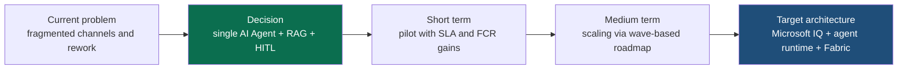
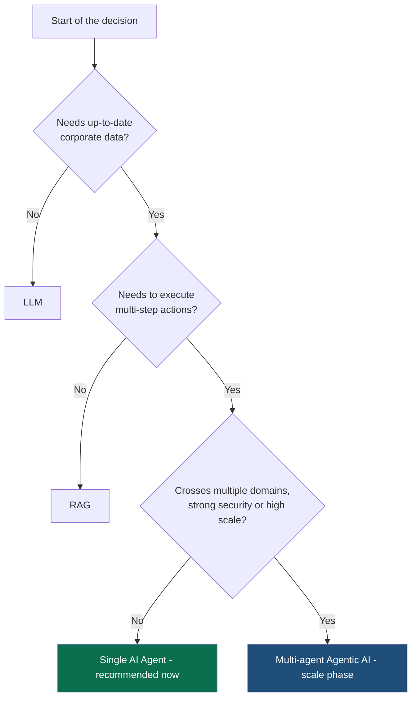
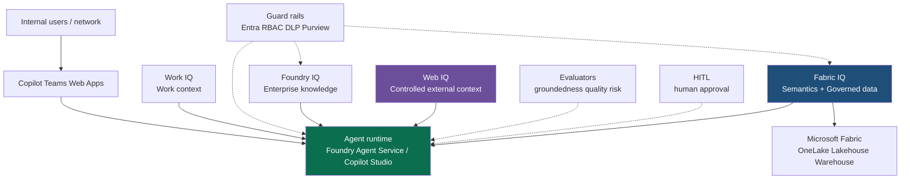
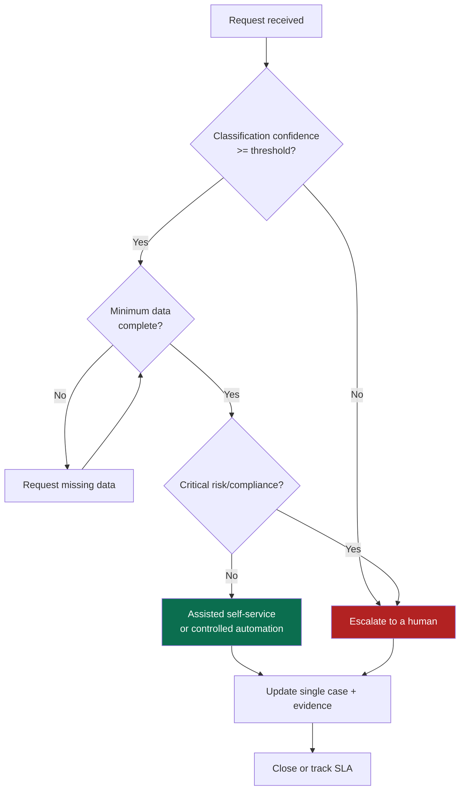
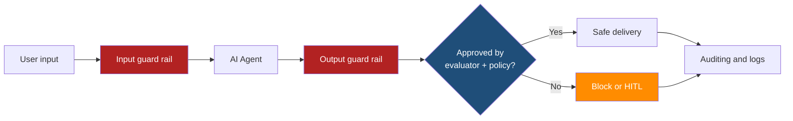
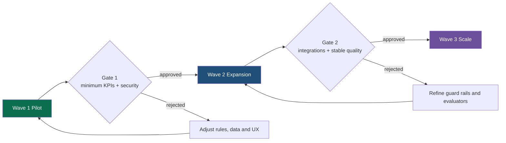
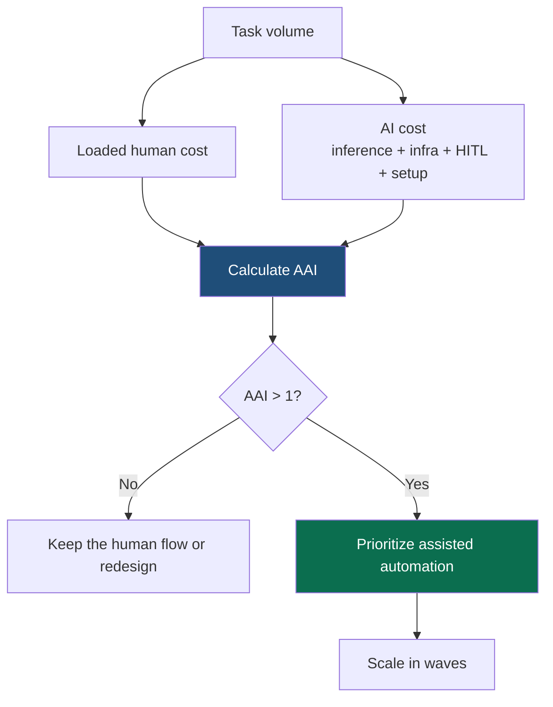
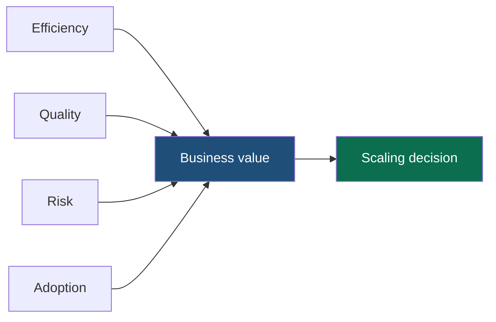
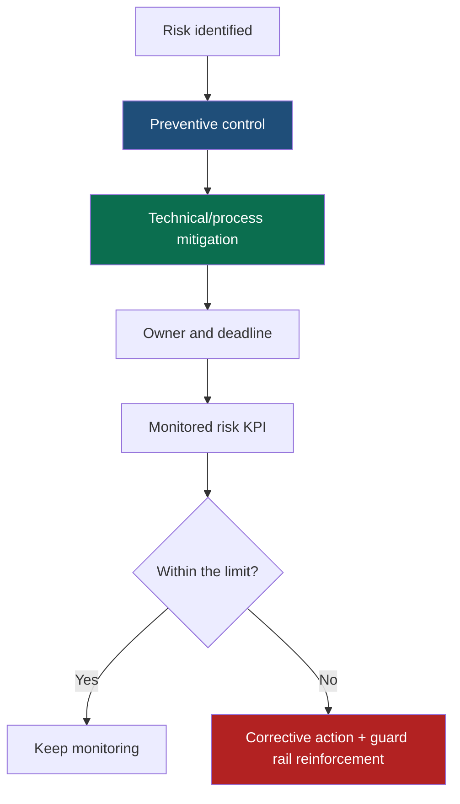

# Executive Recommendation - AI Agent Adoption (harafaz.ia)

## 1) Medium executive overview

The recommendation for harafaz.ia is to adopt a wave-based target architecture with a **single AI Agent with RAG grounding** as the initial pattern, evolving to **multi-agent Agentic AI** only in the flows that cross security boundaries, multiple domains or high orchestration complexity. This decision maximizes the speed of value capture in the short term (pilot in 8 weeks) and reduces operational risk by keeping HITL for sensitive cases, compliance and low confidence.

Over the 12-18 month horizon, the combination of **Microsoft IQ context workloads + an explicit agent runtime + Microsoft Fabric** creates a scalable target architecture, with governed data, an audit trail and an objective basis for ROI/AAI. The explicit trade-off is: lower initial complexity (faster and cheaper) versus controlled expansion of autonomy (more potential value, greater demand for guard rails and evaluators).

Microsoft reference: https://learn.microsoft.com/azure/cloud-adoption-framework/strategy/

---

## 2) Recommended architectural pattern (LLM/RAG/AI Agent/Agentic AI)

### Recommendation

**Recommended pattern for the current case:** `single AI Agent with RAG and mandatory HITL for critical decisions`.

### Detailed rationale

1. **Pure LLM** is not sufficient because the case requires grounding in rules, normative documents and current operational status.
2. **Pure RAG** improves accuracy, but does not cover multi-step triage, handoff, case updates and operational integrations well.
3. **Single AI Agent** balances cost, speed and governance: it allows tool calling, a multi-step flow and simpler debugging control.
4. **Multi-agent Agentic AI** should be introduced selectively in the scale phase, when there is a real need for separation by domain/team/compliance.

### Technical criteria applied

- Grounding: needed to reduce hallucination and keep the response anchored in governed data.
- Orchestration: needed for triage, collection of missing data, routing and handoff with context.
- Autonomy: partial; keep HITL at risk points.
- Data quality: depends on curation and versioning of rules/checklists.
- Latency and cost per task: feasible with a single agent + RAG + caching policies and context scoping.
- HITL need: high in compliance and exceptions.

Official Microsoft sources:

- Azure OpenAI overview: https://learn.microsoft.com/azure/ai-services/openai/overview
- RAG in Azure AI Search: https://learn.microsoft.com/azure/search/retrieval-augmented-generation-overview
- Microsoft Foundry Agent Service: https://learn.microsoft.com/azure/foundry/agents/overview
- Microsoft AI Decision Framework (CAF AI): https://learn.microsoft.com/azure/cloud-adoption-framework/scenarios/ai/

---

## 3) Target architecture (Microsoft IQ context, agent runtime and Fabric)

### 3.1 Layers and responsibilities

- **Channels and experiences:** Copilot, Teams, web and business apps where users request and receive work.
- **Work IQ (work context):** permission-aware Microsoft 365 context from emails, chats, files, meetings and workflows.
- **Foundry IQ (enterprise knowledge):** reusable knowledge bases and permission-aware agentic retrieval over authoritative content.
- **Fabric IQ (data intelligence):** corporate semantics, unified metrics, ontology, governed data and analytics.
- **Web IQ (external context):** controlled enrichment with current public context when needed (e.g., public regulatory references and market signals).
- **Agent runtime:** reasoning, orchestration, tool calling, state and execution through Foundry Agent Service, Copilot Studio or Agent Framework.
- **Cross-cutting controls:** guard rails, evaluators, Entra ID, Purview, DLP, auditing, HITL.

### 3.2 Architecture diagram (mandatory)

### 3.3 Decision and routing flowchart (mandatory)

Official Microsoft sources:

- Microsoft 365 Copilot: https://learn.microsoft.com/microsoft-365-copilot/
- Microsoft Foundry: https://learn.microsoft.com/azure/foundry/
- Foundry IQ: https://learn.microsoft.com/azure/foundry/agents/concepts/what-is-foundry-iq
- Fabric IQ: https://learn.microsoft.com/fabric/iq/overview
- Microsoft Fabric: https://learn.microsoft.com/fabric/

---

## 4) Governance and security (guard rails and evaluators)

### Recommended controls and mitigated risk

1. Entra ID + RBAC by role/environment: mitigates improper access.
2. DLP and connector policies: mitigate exfiltration and improper channel use.
3. Purview (classification/labels/auditing): mitigates sensitive-data risk and compliance failure.
4. Prompt/input/output guard rails: mitigate prompt injection, jailbreak and PII leakage.
5. Continuous evaluators (groundedness, routing accuracy, improper escalation rate): mitigate quality degradation.
6. HITL for critical decisions: mitigates high-impact/regulatory error.

Official Microsoft sources:

- Microsoft Entra: https://learn.microsoft.com/entra/identity/
- Microsoft Purview governance: https://learn.microsoft.com/purview/governance-solutions-overview
- Responsible AI in Microsoft Foundry: https://learn.microsoft.com/azure/foundry/responsible-use-of-ai-overview
- Azure AI Content Safety: https://learn.microsoft.com/azure/ai-services/content-safety/

---

## 5) Phased implementation plan (wave-based roadmap)

| Phase | Objective | Scope | Integrations | Entry criterion | Exit criterion | Target KPI | Dominant risk |
|---|---|---|---|---|---|---|---|
| **Wave 1 - Pilot (0-8 wks)** | Prove value and stability | 1 journey + 1-2 channels + single case + triage | Dataverse, Power Automate, SharePoint/KB, Teams/Web | Executive sponsor, prioritized backlog, measured baseline | FCR and SLA improve, handoff with context, active telemetry | -15% AHT, +10 p.p. FCR | Low initial adoption |
| **Wave 2 - Expansion (9-16 wks)** | Broaden coverage and robustness | 2-3 products/hubs, recurring automations, refined policies | Priority legacy systems, Email, Power BI | Stabilized pilot, minimum guard rails approved | Reduction of improper escalation, proven productivity gain | -25% rework, -20% improper escalation | Integration complexity |
| **Wave 3 - Scale (17-28 wks)** | Scale with corporate governance | Omnichannel, operating standard, continuous-evaluation playbook | Full Fabric, controlled Web IQ, expanded observability | Operation with defined SLO/SLA, ownership per domain | Predictable operation, consolidated auditing, positive ROI | cost per case -30%, internal NPS +15% | Quality drift at scale |

Critical dependencies: governed data, prioritized integrations, executive sponsorship, change management and clear ownership per domain.

Microsoft reference: https://learn.microsoft.com/azure/cloud-adoption-framework/plan/

---

## 6) ROI/AAI assumptions

### Recommended financial assumptions

1. Compare the loaded human cost vs. the AI cost per completed task.
2. Include inference, infrastructure, HITL and amortized setup.
3. Work with three scenarios: conservative, base and aggressive.
4. Measure over a 12-18 month horizon to avoid short-term bias.

### Base formula

- `AAI = Human cost per task / Total AI cost per task`
- Decision: AAI > 1 indicates an economic advantage for AI.

### Scenario example

| Scenario | Human cost/task | AI cost/task | AAI | Reading |
|---|---:|---:|---:|---|
| Conservative | R$ 42.00 | R$ 20.00 | 2.10 | Worth it, with controlled scale |
| Base | R$ 42.00 | R$ 12.00 | 3.50 | Strong advantage |
| Aggressive | R$ 42.00 | R$ 8.50 | 4.94 | High leverage |

Official Microsoft sources:

- Azure Pricing Calculator: https://azure.microsoft.com/pricing/calculator/
- Azure TCO Calculator: https://azure.microsoft.com/pricing/tco/calculator/

---

## 7) Success KPIs

### KPI structure (30/60/90 days)

- **Efficiency:** AHT, cost per case, productivity per analyst.
- **Quality:** groundedness, FCR, rework, reopening rate.
- **Risk:** improper escalation, security incidents, policy blocks.
- **Adoption:** active users, usage rate per channel, network internal NPS.

| Horizon | Main KPI | Suggested target | Adjustment trigger |
|---|---|---|---|
| 30 days | Adoption and baseline | >40% of the pilot base active | Poor UX, low intent coverage |
| 60 days | Operational quality | +10 p.p. FCR and -15% AHT | Improper escalation > limit |
| 90 days | Business value | -20% rework and falling cost/case | ROI below the base scenario |

Official Microsoft sources:

- Azure Monitor: https://learn.microsoft.com/azure/azure-monitor/
- Application Insights: https://learn.microsoft.com/azure/azure-monitor/app/app-insights-overview

---

## 8) Risks and mitigations

| Risk | Impact | Probability | Warning sign | Recommended mitigation | Microsoft reference |
|---|---|---|---|---|---|
| Insufficient knowledge base quality | Wrong answer and rework | Medium/High | Drop in groundedness and increase in reopenings | Continuous curation, versioning and per-topic evaluator | https://learn.microsoft.com/azure/foundry/responsible-use-of-ai-overview |
| Improper access to sensitive data | Security/compliance incident | Medium | Access attempts outside the profile | Entra ID, RBAC, Purview labels, DLP and auditing | https://learn.microsoft.com/entra/identity/ |
| Unstable legacy integrations | Delay and operational unavailability | Medium | High timeout and sync failure | Wave-based strategy, fallback, observability and SLO | https://learn.microsoft.com/azure/well-architected/operational-excellence/ |
| Excessive automation without HITL | Incorrect critical decision | Low/Medium | Late escalation in risk cases | Mandatory HITL for exceptions and low confidence | https://learn.microsoft.com/azure/well-architected/security/ |
| Low adoption of target channels | ROI below expectations | Medium | Parallel use of informal channels | Change management, incentives via visible SLA and UX simplification | https://learn.microsoft.com/security/ |

Official Microsoft sources:

- Microsoft Security: https://learn.microsoft.com/security/
- Well-Architected Security: https://learn.microsoft.com/azure/well-architected/security/
- Well-Architected Operational Excellence: https://learn.microsoft.com/azure/well-architected/operational-excellence/

---

## Executive closing

The recommended decision is to start with a **single AI Agent + RAG + HITL**, deployed through a wave-based roadmap, and evolve to **Agentic AI** only when the complexity triggers justify it. This approach reduces implementation risk, accelerates value capture and creates a governance foundation to scale securely on a governed-data model.
