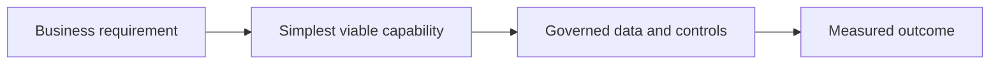

# Architecture Recommendation

> Generated artifact. Replace the placeholders using `SKILL.md` and the supplied scenario document. Do not invent missing facts; record them as assumptions or validation gates.

## Executive Summary

- Business problem and baseline:
- Simplest viable recommendation:
- Target architecture:
- Pilot result and scale outcome:
- Main trade-offs: cost, risk, speed and complexity.

## Architecture Pattern Decision

| Option evaluated in order | Verdict | Evidence or unmet requirement |
|---|---|---|
| Existing Microsoft/SaaS capability | | |
| Deterministic automation | | |
| Direct LLM | | |
| RAG | | |
| Single AI Agent | | |
| Multi-agent or mixed architecture | | |

- Deferred capabilities and escalation triggers:

## Recommended Architecture

- Experiences and channels:
- Required Microsoft IQ context capabilities:
- Managed agent platform or explicitly hosted Agent Framework application:
- Governed data and authoritative sources:
- Cross-cutting controls:

## Capacity and Scale Fit

| Component | Peak demand | Limit and scope | Headroom | License/SKU/configuration | Region | Bottleneck | Verdict | Validation, monitoring and scale trigger | Official source and access date |
|---|---|---|---|---|---|---|---|---|---|
| | | | | | | | Conditional fit | | |

## Governance and Security

| Risk | Guard rail or control | Evaluator or evidence | HITL | Owner |
|---|---|---|---|---|
| | | | | |

## Evidence-Gated Roadmap

| Wave | Objective | Entry criteria | Exit criteria | KPI | Dominant risk |
|---|---|---|---|---|---|
| Pilot | | | | | |
| Expansion | | | | | |
| Scale | | | | | |

Map the waves to the applicable Microsoft AI or agent-adoption lifecycle. Governance and security apply throughout every wave.

## Financial Justification

- Loaded person-hour cost:
- AI cost per successful task, including HITL and amortized setup:
- AAI and realization factor:
- Conservative, base and aggressive cases:

## Success KPIs

- Business value:
- Quality and groundedness:
- Risk and control effectiveness:
- Adoption and operations:

## Risks, Assumptions and Mitigations

| Risk or assumption | Impact | Warning signal | Mitigation | Owner |
|---|---|---|---|---|
| | | | | |

## Official Sources

- Source, claim supported and access date:
