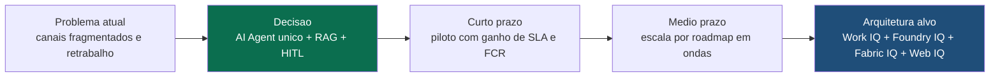
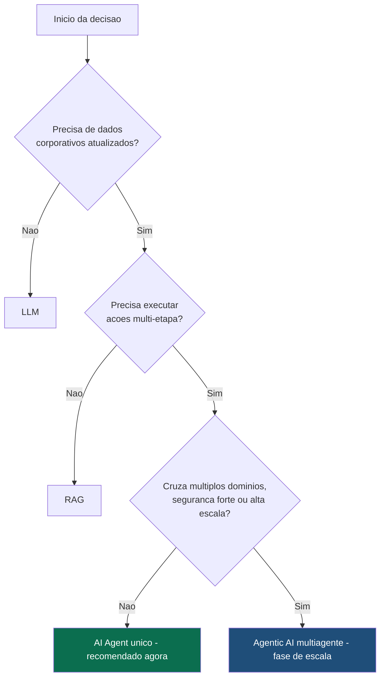
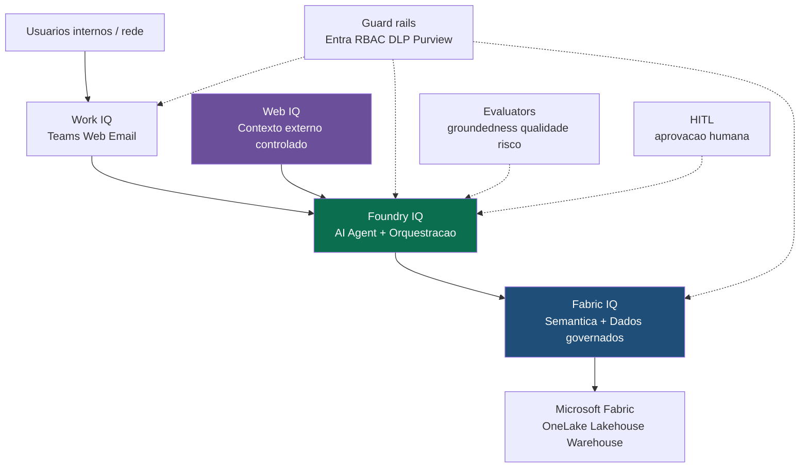
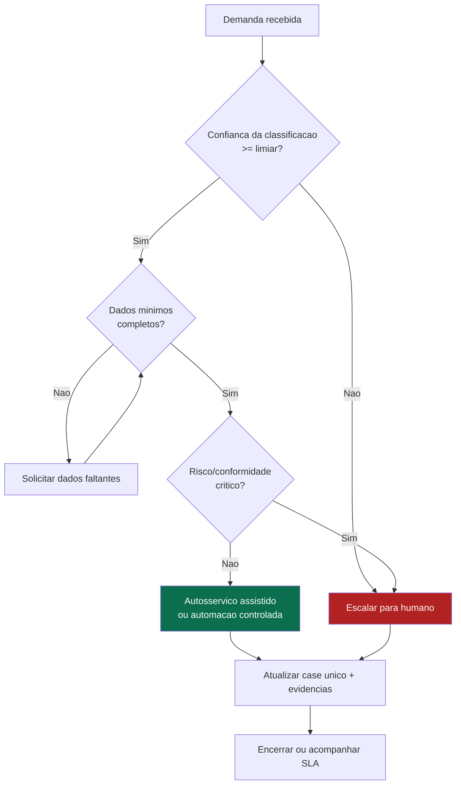
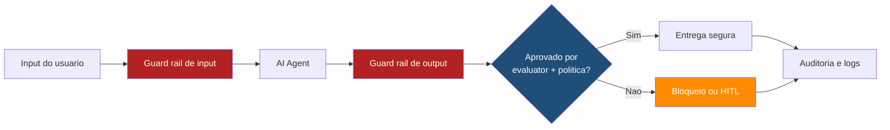
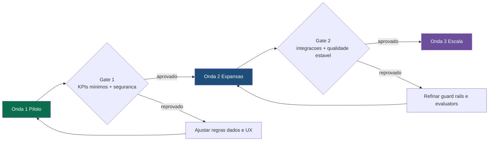
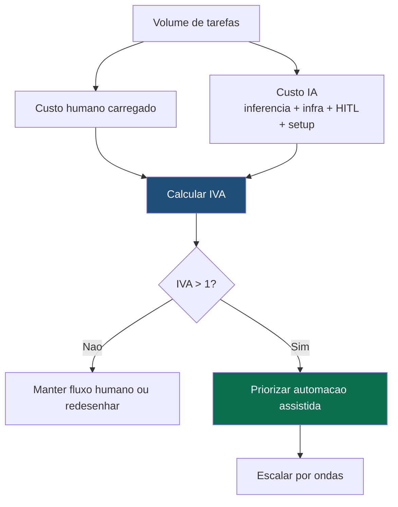
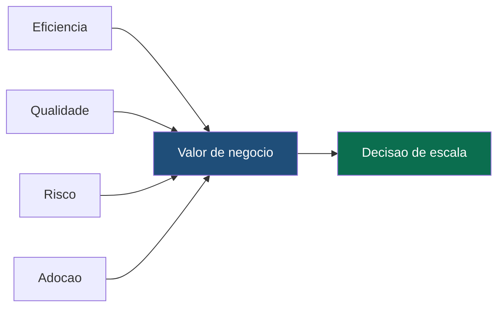
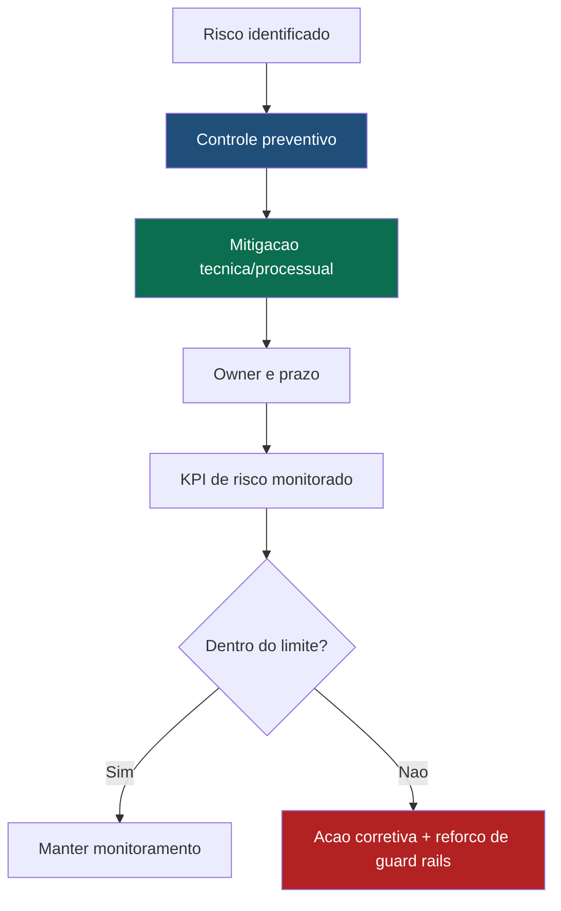

# Recomendacao Executiva - Adocao de Agentes de IA (harafaz.ia)

## 1) Visao executiva media

A recomendacao para harafaz.ia e adotar uma arquitetura alvo em ondas com **AI Agent unico com grounding RAG** como padrao inicial, evoluindo para **Agentic AI multiagente** apenas nos fluxos que cruzarem fronteiras de seguranca, multiplos dominios ou alta complexidade de orquestracao. Essa decisao maximiza velocidade de captura de valor no curto prazo (piloto em 8 semanas) e reduz risco operacional ao manter HITL para casos sensiveis, conformidade e baixa confianca.

No horizonte de 12-18 meses, a combinacao **Work IQ + Foundry IQ + Fabric IQ + Web IQ** cria uma arquitetura alvo escalavel, com dados governados, trilha de auditoria e base objetiva para ROI/IVA. O trade-off explicito e: menor complexidade inicial (mais rapido e barato) versus expansao controlada de autonomia (mais valor potencial, maior exigencia de guard rails e evaluators).

Referencia Microsoft: https://learn.microsoft.com/azure/cloud-adoption-framework/strategy/

---

## 2) Padrao arquitetural recomendado (LLM/RAG/AI Agent/Agentic AI)

### Recomendacao

**Padrao recomendado para o caso atual:** `AI Agent unico com RAG e HITL obrigatorio em decisoes criticas`.

### Justificativa detalhada

1. **LLM puro** nao e suficiente porque o caso exige grounding em regras, normativos e status operacional atual.
2. **RAG puro** melhora precisao, mas nao cobre bem triagem multi-etapa, handoff, atualizacao de case e integracoes operacionais.
3. **AI Agent unico** equilibra custo, velocidade e governanca: permite tool calling, fluxo multi-etapa e controle mais simples de depuracao.
4. **Agentic AI multiagente** deve entrar de forma seletiva na fase de escala, quando houver necessidade real de separacao por dominio/time/compliance.

### Criterios tecnicos aplicados

- Grounding: necessario para reduzir alucinacao e manter resposta ancorada em dados governados.
- Orquestracao: necessaria para triagem, coleta de dados faltantes, roteamento e handoff com contexto.
- Autonomia: parcial; manter HITL nos pontos de risco.
- Qualidade de dados: depende de curadoria e versionamento de regras/checklists.
- Latencia e custo por tarefa: viavel com agente unico + RAG + politicas de cache e escopo de contexto.
- Necessidade de HITL: alta em conformidade e excecoes.

Fontes oficiais Microsoft:

- Azure OpenAI overview: https://learn.microsoft.com/azure/ai-services/openai/overview
- RAG no Azure AI Search: https://learn.microsoft.com/azure/search/retrieval-augmented-generation-overview
- Azure AI Foundry Agents: https://learn.microsoft.com/azure/ai-foundry/agents/overview
- Microsoft AI Decision Framework (CAF AI): https://learn.microsoft.com/azure/cloud-adoption-framework/scenarios/ai/

---

## 3) Arquitetura alvo (Work IQ, Foundry IQ, Fabric IQ e Web IQ)

### 3.1 Camadas e responsabilidades

- **Work IQ (experiencia):** canais de negocio (Web, Teams, Email), UX conversacional e produtividade assistida.
- **Foundry IQ (agentes):** orquestracao do AI Agent, regras de decisao, tool calling, memoria de trabalho e avaliacao de confianca.
- **Fabric IQ (inteligencia de dados):** semantica corporativa, metricas unificadas, ontologia, dados governados e analytics.
- **Web IQ (contexto externo):** enriquecimento controlado com contexto publico atual quando necessario (ex.: referencia regulatoria publica e sinais de mercado).
- **Controles transversais:** guard rails, evaluators, Entra ID, Purview, DLP, auditoria, HITL.

### 3.2 Diagrama de arquitetura (obrigatorio)

### 3.3 Fluxograma de decisao e roteamento (obrigatorio)

Fontes oficiais Microsoft:

- Microsoft 365 Copilot: https://learn.microsoft.com/microsoft-365-copilot/
- Azure AI Foundry: https://learn.microsoft.com/azure/ai-foundry/
- Microsoft Fabric: https://learn.microsoft.com/fabric/

---

## 4) Governanca e seguranca (guard rails e evaluators)

### Controles recomendados e risco mitigado

1. Entra ID + RBAC por papel/ambiente: mitiga acesso indevido.
2. DLP e politicas de conectores: mitiga exfiltracao e uso indevido de canais.
3. Purview (classificacao/rotulos/auditoria): mitiga risco de dado sensivel e falha de conformidade.
4. Guard rails de prompt/input/output: mitiga prompt injection, jailbreak e vazamento de PII.
5. Evaluators continuos (groundedness, precisao de roteamento, taxa de escalonamento indevido): mitiga degradacao de qualidade.
6. HITL em decisao critica: mitiga erro de alto impacto/regulatorio.

Fontes oficiais Microsoft:

- Microsoft Entra: https://learn.microsoft.com/entra/identity/
- Microsoft Purview governance: https://learn.microsoft.com/purview/governance-solutions-overview
- Responsible AI em Azure AI Foundry: https://learn.microsoft.com/azure/ai-foundry/responsible-ai/overview
- Azure AI Content Safety: https://learn.microsoft.com/azure/ai-services/content-safety/

---

## 5) Plano de implantacao por fases (roadmap em ondas)

| Fase | Objetivo | Escopo | Integracoes | Criterio de entrada | Criterio de saida | KPI alvo | Risco dominante |
|---|---|---|---|---|---|---|---|
| **Onda 1 - Piloto (0-8 sem.)** | Provar valor e estabilidade | 1 jornada + 1-2 canais + case unico + triagem | Dataverse, Power Automate, SharePoint/KB, Teams/Web | Sponsor executivo, backlog priorizado, baseline medido | FCR e SLA melhoram, handoff com contexto, telemetria ativa | -15% TMA, +10 p.p. FCR | Baixa adocao inicial |
| **Onda 2 - Expansao (9-16 sem.)** | Ampliar cobertura e robustez | 2-3 produtos/hubs, automacoes recorrentes, politicas refinadas | Legados prioritarios, Email, Power BI | Piloto estabilizado, guard rails minimos aprovados | Reducao de escalonamento indevido, ganho de produtividade comprovado | -25% retrabalho, -20% escalonamento indevido | Complexidade de integracao |
| **Onda 3 - Escala (17-28 sem.)** | Escalar com governanca corporativa | Omnicanal, padrao de operacao, playbook de avaliacao continua | Fabric completo, Web IQ controlado, observabilidade expandida | Operacao com SLO/SLA definidos, ownership por dominio | Operacao previsivel, auditoria consolidada, ROI positivo | custo por caso -30%, NPS interno +15% | Deriva de qualidade em escala |

Dependencias criticas: dados governados, integracoes priorizadas, patrocinio executivo, change management e ownership claro por dominio.

Referencia Microsoft: https://learn.microsoft.com/azure/cloud-adoption-framework/plan/

---

## 6) Premissas de ROI/IVA

### Premissas financeiras recomendadas

1. Comparar custo humano carregado vs custo IA por tarefa concluida.
2. Incluir inferencia, infraestrutura, HITL e setup amortizado.
3. Trabalhar com tres cenarios: conservador, base e agressivo.
4. Medir em horizonte de 12-18 meses para evitar vies de curto prazo.

### Formula base

- `IVA = Custo humano por tarefa / Custo IA total por tarefa`
- Decisao: IVA > 1 indica vantagem economica da IA.

### Exemplo de cenarios

| Cenario | Custo humano/tarefa | Custo IA/tarefa | IVA | Leitura |
|---|---:|---:|---:|---|
| Conservador | R$ 42,00 | R$ 20,00 | 2,10 | Vale, com escala controlada |
| Base | R$ 42,00 | R$ 12,00 | 3,50 | Forte vantagem |
| Agressivo | R$ 42,00 | R$ 8,50 | 4,94 | Alta alavancagem |

Fontes oficiais Microsoft:

- Azure Pricing Calculator: https://azure.microsoft.com/pricing/calculator/
- Azure TCO Calculator: https://azure.microsoft.com/pricing/tco/calculator/

---

## 7) KPIs de sucesso

### Estrutura de KPIs (30/60/90 dias)

- **Eficiencia:** TMA, custo por caso, produtividade por analista.
- **Qualidade:** groundedness, FCR, retrabalho, taxa de reabertura.
- **Risco:** escalonamento indevido, incidentes de seguranca, bloqueios por politica.
- **Adocao:** usuarios ativos, taxa de uso por canal, NPS interno da rede.

| Horizonte | KPI principal | Meta sugerida | Gatilho de ajuste |
|---|---|---|---|
| 30 dias | Aducao e baseline | >40% da base piloto ativa | UX ruim, baixa cobertura de intents |
| 60 dias | Qualidade operacional | +10 p.p. FCR e -15% TMA | Escalonamento indevido > limite |
| 90 dias | Valor de negocio | -20% retrabalho e custo/caso em queda | ROI abaixo do cenario base |

Fontes oficiais Microsoft:

- Azure Monitor: https://learn.microsoft.com/azure/azure-monitor/
- Application Insights: https://learn.microsoft.com/azure/azure-monitor/app/app-insights-overview

---

## 8) Riscos e mitigacoes

| Risco | Impacto | Probabilidade | Sinal de alerta | Mitigacao recomendada | Referencia Microsoft |
|---|---|---|---|---|---|
| Qualidade insuficiente de base de conhecimento | Resposta errada e retrabalho | Media/Alta | Queda de groundedness e aumento de reabertura | Curadoria continua, versionamento e evaluator por tema | https://learn.microsoft.com/azure/ai-foundry/responsible-ai/overview |
| Acesso indevido a dado sensivel | Incidente de seguranca/compliance | Media | Tentativas de acesso fora de perfil | Entra ID, RBAC, Purview labels, DLP e auditoria | https://learn.microsoft.com/entra/identity/ |
| Integracoes legadas instaveis | Atraso e indisponibilidade operacional | Media | Timeout alto e falha de sincronizacao | Estrategia por ondas, fallback, observabilidade e SLO | https://learn.microsoft.com/azure/well-architected/operational-excellence/ |
| Automacao excessiva sem HITL | Decisao critica incorreta | Baixa/Media | Escalonamento tardio em casos de risco | HITL obrigatorio em excecoes e baixa confianca | https://learn.microsoft.com/azure/well-architected/security/ |
| Baixa adocao dos canais-alvo | ROI abaixo do esperado | Media | Uso paralelo de canais informais | Gestao de mudanca, incentivo por SLA visivel e simplificacao de UX | https://learn.microsoft.com/security/ |

Fontes oficiais Microsoft:

- Microsoft Security: https://learn.microsoft.com/security/
- Well-Architected Security: https://learn.microsoft.com/azure/well-architected/security/
- Well-Architected Operational Excellence: https://learn.microsoft.com/azure/well-architected/operational-excellence/

---

## Fechamento executivo

A decisao recomendada e iniciar com **AI Agent unico + RAG + HITL**, implantado por roadmap em ondas, e evoluir para **Agentic AI** somente quando os gatilhos de complexidade justificarem. Essa abordagem reduz risco de implementacao, acelera captura de valor e cria base de governanca para escalar com seguranca em um modelo de dados governados.