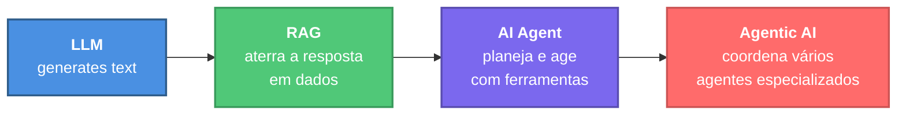
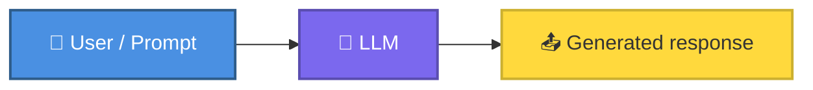
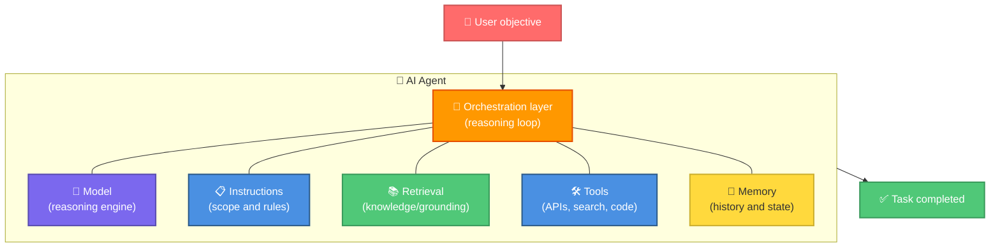
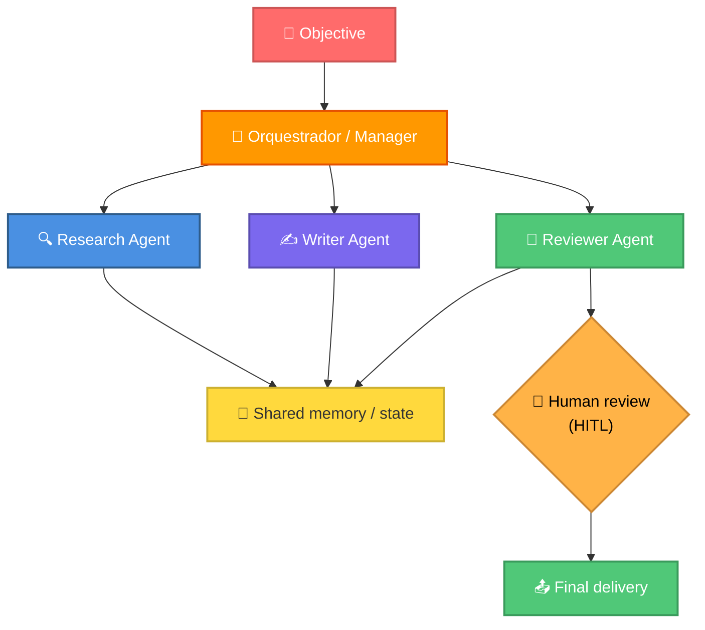
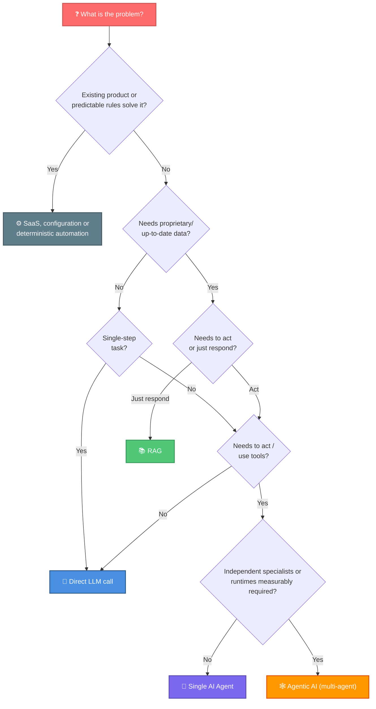

## 🧬 1.1. AI Architecture Fundamentals — LLM × RAG × AI Agent × Agentic AI

> This section establishes the conceptual foundation of the guide. Before detailing the corporate layers (Work IQ, Foundry IQ, Fabric IQ and the data platform), it is essential to understand the four patterns that form the **autonomy and complexity spectrum** of generative AI applications. They are not competing technologies: each level **incorporates** the previous one and adds a new capability.

### 📈 Overview — the complexity spectrum

Microsoft describes this progression as a **complexity spectrum** and recommends, as an architecture principle, using **the lowest level of complexity that reliably solves the problem** — each additional step introduces latency, cost and new failure modes.

> ⚠️ **Terminology note.** The industry uses "AI Agent" and "Agentic AI" in varied ways. In Microsoft's documentation, the main distinction is between a **single agent with tools** (single agent) and **multi-agent orchestration** (multi-agent), and there is no rigid boundary — it is a continuum. In this guide we treat "Agentic AI" as the **multi-agent orchestration** level (detailed in section 17).

### 📊 Comparison table

| Aspect | **LLM** | **RAG** | **AI Agent** | **Agentic AI** |
|---|---|---|---|---|
| **Definition** | Text generator: you ask, it responds based on what it learned in training. | LLM that retrieves information from a database *before* responding. | AI that plans steps, uses tools and executes complete tasks. | Set of specialized agents that collaborate, coordinated by an orchestrator. |
| **Architecture** | `question → model → response` | `question → index search → retrieves chunks → generates grounded response` | `objective → plan → tool use → evaluate → adjust → conclude` | `objective → orchestrator distributes → agents execute → review → delivery` |
| **Components** | A model trained on a large volume of text. | Model + searchable index (vector/keyword/hybrid) + *embeddings*. | Model + instructions + retrieval + tools + memory. | Multiple agents + shared memory/state + orchestration layer. |
| **Functionality** | Predicts the next token; generates natural language. | Responds grounded in proprietary and up-to-date data (*grounding*). | Decomposes the objective, chooses tools and iterates until completion. | Specialists distribute work, exchange context and coordinate like a team. |
| **Typical use case** | Writing, summarization, translation, classification. | Q&A on internal policies, manuals, knowledge base. | Multi-step research, data collection, workflow automation. | Campaigns, large projects, end-to-end business processes. |
| **Tools** | None. Operates in isolation. | Reads data via index, but does not execute actions. | Uses search, APIs, code etc. (via *function calling* / MCP). | Each agent uses the tools of its domain; integration via MCP / A2A. |
| **Memory** | No memory between sessions (context window only). | Fetches fresh information with each query, but does not remember previous questions. | Maintains state across steps (working memory). | State/memory shared among the agents on the team. |
| **Planning** | Responds immediately, without planning. | Retrieves and responds; does not plan ahead. | Reasons and self-corrects (ReAct, CoT, Plan-and-Solve, Reflexion). | Agents decide jointly; serial, concurrent or dynamic orchestration. |
| **Autonomy** | Reactive: requires a *prompt* for each interaction. | Retrieves documents automatically, but only responds when asked. | Executes the task on its own after receiving the objective. | Runs entire projects with minimal human supervision. |
| **Relative cost** *(illustrative)* | Lowest — pay only for generation. | Medium — model + index. | Higher — multiple calls and tools. | Highest of all — multiple agents running. |
| **Implementation time** *(illustrative)* | Hours. | Days. | Days to weeks. | Weeks or more. |
| **Strengths** | Fast, simple, great for text. | Reduces hallucination, cites sources, uses private and up-to-date knowledge. | Solves complex multi-step tasks; learns from errors. | Agent specialization; parallelism; solves large problems. |
| **Weaknesses** | Hallucinates; no memory; *knowledge cutoff*. | Quality limited by data/index quality; does not act. | Non-deterministic; requires governance and iteration limits. | Hard to configure and control; failure in one agent affects others. |
| **When to use** | Quick responses or simple text generation. | When the response must come from specific documents/data. | Multi-step projects, research, data collection. | Complex projects that would require an entire team. |

> The **Cost** and **Implementation time** fields are illustrative order-of-magnitude estimates — they are **not** official figures in Microsoft documentation.

### 🏛️ Architecture diagrams by pattern

#### Pure LLM

#### RAG — Retrieval · Augmentation · Generation

```mermaid
flowchart LR
    U["👤 User question"] --> Q["🔎 Consulta ao índice"]
    Q --> IDX["🗂️ Índice / Vector Store"]
    IDX --> C["📄 Trechos relevantes<br/>(grounding)"]
    C --> P["🧩 Prompt aumentado"]
    U --> P
    P --> M["🧠 LLM"]
    M --> A["📤 Resposta fundamentada<br/>+ citações"]

    style U fill:#4A90E2,stroke:#2E5C8A,color:#fff,stroke-width:2px
    style Q fill:#50C878,stroke:#3A9B5C,color:#fff,stroke-width:2px
    style IDX fill:#FF6B6B,stroke:#CC5555,color:#fff,stroke-width:2px
    style C fill:#50C878,stroke:#3A9B5C,color:#fff,stroke-width:2px
    style P fill:#FF9800,stroke:#E65100,color:#fff,stroke-width:2px
    style M fill:#7B68EE,stroke:#5A4DB0,color:#fff,stroke-width:2px
    style A fill:#FFD93D,stroke:#CCB030,color:#333,stroke-width:2px
```

The three canonical RAG steps, per Microsoft: **retrieval** (query to the external base), **augmentation** (combination of retrieved data with the prompt) and **generation** (the LLM produces the grounded response).

#### AI Agent — the 5 core components

Microsoft defines the agent on five components: **model** (reasoning engine), **instructions**, **retrieval/knowledge** (grounding), **actions/tools** and **memory**. The orchestration layer is the cyclic loop that receives information, reasons and decides the next action until reaching the objective or a stopping criterion.

#### Agentic AI — multi-agent orchestration

### 🧠 LLM — the language model

**What it is.** A model trained on a large volume of text that generates natural language by predicting the most likely continuation. It is the reasoning engine used by the selected agent runtime or direct model application. **Foundry IQ is a knowledge workload, not the model runtime.**

**Characteristics.** Knowledge frozen at training time (*knowledge cutoff*); no persistent memory between conversations; can **hallucinate** (plausible but incorrect statements); does not access external tools or systems on its own.

**When an LLM alone suffices (direct model call).** This is the **least complex** level: a single call with a well-crafted *prompt*, without agent logic or tools. If prompt engineering solves it (classify, summarize, translate, one-step tasks), **there is no need for an agent**.

### 📚 RAG — retrieval-augmented generation

**What it is.** A technique that **grounds** the LLM's responses in proprietary data, rather than relying solely on what the model learned in training. In this architecture, RAG can use **Foundry IQ** knowledge bases for managed agentic retrieval, **Fabric IQ + Microsoft Fabric** for semantic and analytical business context, and other governed indexes when appropriate.

**The three steps (Microsoft definition).**

1. **Retrieval:** the request queries an external base — *vector store*, keyword search or SQL — to obtain supporting data.
2. **Augmentation:** the supporting data is combined with the user's request, typically via an instructions *template*, forming the *prompt*.
3. **Generation:** the *prompt* is sent to the LLM, which generates the grounded response.

**Microsoft-validated benefits.** Incorporates **proprietary knowledge**; delivers **up-to-date information** (bypasses *knowledge cutoff*); allows **citing sources** (factual verification); and retrieval can enforce user permissions for supported sources. ACL synchronization, Purview label handling and Fabric RLS are capability-specific controls, not a universal guarantee across every source.

**RAG vs. Fine-tuning.** Choose **RAG** for dynamic content, broad topic coverage and limited training resources. Choose **fine-tuning** for performance on a very specific task, control over proprietary data and stable content.

### 🤖 AI Agent — single agent with tools

**Definition (Microsoft).** An agent is an AI application that uses a generative model to **reason** about requests and **take autonomous actions** to fulfill them. Unlike a chatbot that only generates text, the agent calls tools, accesses external data and makes decisions across **multiple steps**. This behavior belongs to an agent runtime such as Microsoft Foundry Agent Service, Copilot Studio or Microsoft Agent Framework.

**The 5 components (Cloud Adoption Framework).** (1) Generative model — reasoning engine; (2) Instructions — scope, limits and rules; (3) Retrieval/Knowledge — *grounding* data; (4) Actions/Tools — functions, APIs and systems; (5) Memory — history and state (see section 18).

**Essential difference between RAG and Agent.** RAG follows a **deterministic** retrieval process. The agent uses the generative model to **decide, at each step**, which knowledge and tools to use — **adaptive and non-deterministic** behavior that requires testing, evaluators (section 9) and robust governance (section 8).

**Reasoning and planning.** Agent frameworks incorporate methods such as **ReAct** (interleaves reasoning and action), **Chain-of-Thought**, **Plan-and-Solve** (divides the task into subtasks) and **Reflexion/self-critique** (self-reflection on feedback).

**Best practice.** To avoid infinite loops of tool calls, **define iteration limits**. The single agent is usually the **default pattern** for many corporate cases — simpler to debug and test than multi-agent arrangements.

### 🕸️ Agentic AI — multi-agent orchestration

**What it is.** Multiple specialized agents that **coordinate** to solve problems, with an orchestrator (or peer-to-peer protocol) managing work distribution, context sharing and result aggregation. The detailed Foundry implementation — with Sequential, Parallel, Conditional and Feedback Loop patterns — is in **section 17**.

**Advantages (Azure Architecture Center).** Specialization (each agent focuses on a domain); scalability (add/change agents without redesigning everything); maintainability (test agent by agent); optimization (each agent uses different models and tools).

**When multi-agent is justified.** Start with a single agent and escalate only when an evaluated requirement cannot be met reliably without independently owned or operated specialists. Evidence can include unacceptable orchestration failure rates, incompatible runtime requirements, independent domain release cycles, or isolation requirements that cannot be enforced safely through identities, permissions and tool boundaries in one runtime. Security/compliance requirements, multiple teams and planned growth are inputs to the assessment, not automatic multi-agent triggers.

**Multi-agent orchestration patterns (Microsoft documentation).**

| Pattern | Description | When to use |
|---|---|---|
| **Sequential (serial)** | Agents chained in a predefined order (A → B → C). | Processes with strict order, business rules and auditability. |
| **Concurrent (fan-out/fan-in)** | Multiple agents process the same input in parallel; results aggregated (*scatter-gather* / *map-reduce*). | Independent analyses from different perspectives. |
| **Orchestrator + subagents** | Orchestrator delegates to specialists (also "Russian doll" / magentic). | Clear separation of responsibilities; reuse of specialized agents. |
| **Agents-as-Tools** | A main agent invokes others as if they were tools (via *function calling*). | Direct requests, with 2–3 agents and well-defined scopes. |
| **Magentic** | Dynamic orchestration for open-ended problems, with no predefined flow. | Creative/exploratory domains where subtasks are not known in advance. |

**Tool integration and governance.** Microsoft recommends **MCP (Model Context Protocol)** for secure and authenticated access to tools/data, and the **A2A (Agent2Agent, Linux Foundation)** protocol for integration between agents from different platforms. Cross-cutting principles: **least privilege**, simplicity, auditability, robust governance and **HITL (human-in-the-loop)** at approval points (see section 10).

### 🧭 Architectural decision guide

Use the **lowest level of complexity** that reliably meets the current requirement. Evaluate non-agentic alternatives before generative or agentic patterns, and require evidence before every escalation.

**Practical summary.**

- **Existing product or predictable process →** SaaS, configuration or deterministic automation.
- **Text response, one step →** LLM.
- **Response grounded in documents →** RAG.
- **Multi-step task, with actions, in one domain →** Single AI Agent (corporate default).
- **Independent specialists, ownership domains or runtimes are measurably required and a single agent fails the requirement →** Agentic AI (multi-agent).

Security boundaries do not by themselves require multiple agents. First isolate identity, permissions, tools, data access, audit and HITL. Expected growth is a reason to define evolution triggers, not to pre-build a multi-agent architecture.

### 🔗 Mapping to Microsoft stack (including mixed solution)

| Need | Pattern | Recommended Microsoft technology |
|---|---|---|
| Personal and assistive productivity in the workflow | Lightweight LLM/RAG | Microsoft 365 Copilot |
| Domain conversational automation with low/medium complexity | Single AI Agent | Copilot Studio |
| Advanced reasoning, complex tool calling, multi-step and pro-code engineering | Advanced AI Agent / Agentic AI | Microsoft Foundry Agent Service / Microsoft Agent Framework |
| Business experience + advanced technical reasoning in the same case | Hybrid architecture | Copilot Studio + Microsoft Foundry |

**Practical rule:** when there is simultaneously a need for a business channel (Teams/web, low-code, fast cycle) and advanced technical orchestration (reasoning, complex tools, multi-agent), prioritize a **mixed solution**.

**Official Microsoft sources:**
- Microsoft 365 Copilot documentation: https://learn.microsoft.com/microsoft-365-copilot/
- Microsoft Copilot Studio documentation: https://learn.microsoft.com/microsoft-copilot-studio/
- Microsoft Foundry documentation: https://learn.microsoft.com/azure/foundry/
- Foundry IQ documentation: https://learn.microsoft.com/azure/foundry/agents/concepts/what-is-foundry-iq

### ✅ Validation with official Microsoft sources

| Statement | Status | Note |
|---|---|---|
| RAG searches documents before responding | ✅ Confirmed | The 3 steps (retrieval/augmentation/generation) are the canonical Microsoft definition. |
| RAG reduces fact invention and allows citing sources | ✅ Confirmed | Microsoft cites hallucination reduction, *grounding* and source citation. |
| LLM "forgets" after the conversation and can hallucinate | ✅ Confirmed | LLMs are static (training knowledge) and prone to hallucination without *grounding*. |
| Agent plans, uses tools and iterates | ✅ Confirmed | Microsoft definition of agent; includes ReAct, planning and self-correction. |
| Agent has memory of steps | ✅ Confirmed | Memory is one of the 5 core agent components. |
| Agentic AI = multiple coordinated specialists | ✅ Confirmed | Corresponds to multi-agent orchestration in the Azure Architecture Center. |
| AI Agent and Agentic AI are entirely distinct categories | ⚠️ Adjustment | Microsoft treats them as a **spectrum/continuum**, not as rigid boxes. |
| Agentic AI is "always" more expensive and time-consuming | ⚠️ Contextualise | True tendency, but the official recommendation is to **avoid** unnecessary complexity. |
| Cost and implementation time values | ⚠️ Illustrative | No official Microsoft figures; treat as order of magnitude. |

**Validation conclusion.** The definitions and capabilities of each pattern are **substantially correct**. The adjustments are ones of **framing**: (1) view the four patterns as a continuous complexity spectrum; (2) always use the minimum required level; (3) treat cost/time as estimates, not official facts.

### 📖 Fundamentals glossary

- **LLM (Large Language Model):** model trained to generate natural language by predicting the next token.
- **RAG (Retrieval-Augmented Generation):** pattern that grounds LLM responses in data retrieved from an external base.
- **Grounding:** anchoring the response in real/retrieved data, reducing hallucination.
- **Embeddings:** numerical representations (vectors) of content, used in similarity search.
- **Index / Vector Store:** structure optimized for retrieval (keyword, semantic, vector or hybrid).
- **AI Agent:** application that uses a model to reason and take autonomous actions with tools.
- **Agentic AI / Multi-agent:** system of multiple specialized agents coordinated by orchestration.
- **Orchestration:** layer/loop that distributes work, shares context and aggregates results between agents.
- **MCP (Model Context Protocol):** protocol for secure and authenticated access to tools and data.
- **A2A (Agent2Agent):** protocol (Linux Foundation) for integration between agents from different platforms.
- **Function calling:** mechanism by which the LLM generates parameters to invoke tools/functions.
- **ReAct (Reason + Act):** method that interleaves reasoning traces and specific actions.
- **Chain-of-Thought (CoT):** step-by-step reasoning before the response.
- **Plan-and-Solve:** divides the task into subtasks and executes them according to a plan.
- **Reflexion / self-critique:** the agent verbally reflects on feedback to improve future decisions.
- **HITL (Human-in-the-Loop):** human review/approval points in the flow (section 10).
- **Knowledge cutoff:** the date limit of knowledge learned by the model during training.
- **Fan-out/Fan-in:** concurrent pattern — distributes (fan-out) and aggregates (fan-in) results.

> **Connection to this guide's layers:** the **LLM** is the reasoning engine used by the application or agent runtime; **RAG** can consume Foundry IQ knowledge, Fabric IQ business context and governed data from Microsoft Fabric; **AI Agent** and **Agentic AI** execute in Foundry Agent Service, Copilot Studio or Agent Framework; Work IQ supplies Microsoft 365 context, while guard rails and evaluators apply cross-cutting controls.

---

