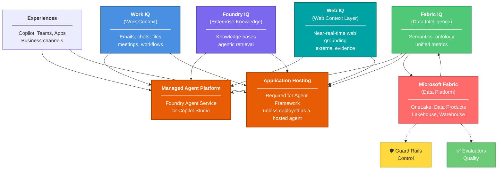
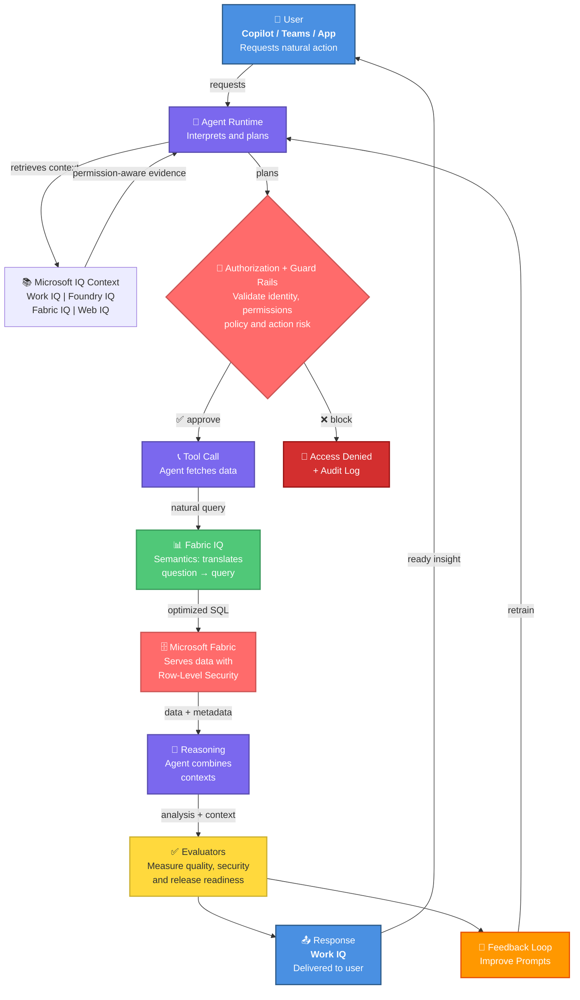

## 🏗️ 2. Reference Architecture (Overview)

> This is a capability map, not a mandatory product stack. Select only the context, runtime, framework, hosting and data components that a documented current requirement justifies. Start with an existing SaaS capability or deterministic automation and escalate through direct LLM, RAG, single agent and multi-agent only when the preceding option cannot reliably meet the requirement.

### 🧠 Role of each layer

#### 💼 **Work IQ (Work Context)**
The contextual intelligence workload for Microsoft 365. It captures how work happens across emails, chats, meetings, documents, people and workflows, subject to the user's identity and permissions. Its role is to:
- Supply current work context to agents and copilots
- Connect collaboration signals across Microsoft 365
- Support knowledge and actions through Microsoft 365 tools
- Preserve user-context and permission boundaries

**Example:** An executive types "summarize this meeting" in Word — Copilot (Work IQ) fetches the transcript from OneDrive, summarizes it and inserts it into the document.

**Lifecycle status (checked 2026-09-09):** The Work IQ API reached general availability on **June 16, 2026**. Work IQ in Microsoft Copilot Studio remains a **preview** integration and is not a production substitute for the GA API contract. Validate the exact surface, billing model, permissions and regional availability rather than assigning one lifecycle status to Work IQ as a whole.

**Technical sources (accessed 2026-09-09):** [Work IQ overview](https://learn.microsoft.com/microsoft-365/copilot/extensibility/work-iq/), [Work IQ API and consumptive pricing update](https://learn.microsoft.com/partner-center/announcements/2026-june#work-iq-api-and-consumptive-pricing-update) and [Work IQ in Copilot Studio (preview)](https://learn.microsoft.com/microsoft-copilot-studio/add-work-iq).

---

#### 📚 **Foundry IQ (Enterprise Knowledge)**
The managed, permission-aware enterprise knowledge workload. It is backed by Azure AI Search knowledge bases and agentic retrieval. Its role is to:
- Operate a permission-aware corporate knowledge base with structured and unstructured sources
- Execute agentic retrieval: decomposes questions into sub-queries, parallel search and re-ranks evidence with citations
- Enforce permissions and labels for supported sources and configurations; support varies by connector, API, region and feature status
- Connect Azure, SharePoint, OneLake and web in the same enterprise grounding plane

**Example:** An agent asks a shared knowledge base for the policies and authoritative documents relevant to a margin investigation. Foundry IQ plans retrieval, enforces supported source permissions and returns grounded evidence with citations.

**Lifecycle status (checked 2026-09-09):** Foundry IQ is **partially GA**. Azure AI Search REST API `2026-04-01` provides a stable but narrower retrieval contract. The current `2026-08-01-preview` API is still required for capabilities such as answer synthesis, non-minimal reasoning effort and multi-turn messages. Microsoft Foundry and Azure portal access to agentic retrieval remains preview.

**Technical sources (accessed 2026-09-09):** [What is Foundry IQ?](https://learn.microsoft.com/azure/foundry/agents/concepts/what-is-foundry-iq) and [Migrate agentic retrieval code to the latest version](https://learn.microsoft.com/azure/search/agentic-retrieval-how-to-migrate).

---

#### 🤖 **Agent Platform, Framework and Hosting**
The execution layer is separate from the IQ context workloads. **Microsoft Foundry Agent Service** and **Microsoft Copilot Studio** provide managed agent platforms. **Microsoft Agent Framework** is a development framework, not a hosting service; its application requires an explicit hosting and scaling choice unless it is deployed as a Foundry hosted agent. The selected platform or hosted application can:
- Interpret intent and plan multi-step execution
- Invoke models, knowledge sources, tools, MCP servers and other agents
- Maintain conversation state and apply approval checkpoints
- Trace, evaluate, version and operate agents

**Example:** A Foundry agent receives "analyze why the margin dropped," retrieves policies through Foundry IQ, obtains governed metrics through Fabric IQ/Fabric, optionally adds external evidence through Web IQ, and composes a controlled response.

**Lifecycle status (checked 2026-09-09):** Microsoft Foundry core agents and Foundry hosted agents are GA. Individual tools, integrations and observability capabilities retain their own status. Foundry Workflows remains preview and is scheduled for retirement on **December 1, 2026**; use Microsoft Agent Framework for new workflow orchestration. Agent Framework package status also varies: Python core is released, Go is public preview and some hosting integrations remain prerelease.

**Technical sources (accessed 2026-09-09):** [Microsoft Foundry Agent Service overview](https://learn.microsoft.com/azure/foundry/agents/overview), [Microsoft Foundry portal GA overview](https://learn.microsoft.com/azure/foundry/concepts/general-availability), [Agent Framework overview](https://learn.microsoft.com/agent-framework/overview/) and [Foundry hosted agents](https://learn.microsoft.com/agent-framework/hosting/foundry-hosted-agent).

---

#### 🌐 **Web IQ (Web Context Layer)**
The **external grounding** layer of Microsoft IQ for up-to-date public web context. Microsoft announced Web IQ on **June 2, 2026**, but the launch source does not assign a formal GA label and still directs customers to express interest. Treat access as controlled and the capability as a conditional dependency with an availability check and fallback. Its role is to:
- Bring web evidence (pages, news, images and videos) into agentic flows
- Operate with a focus on grounding quality, low latency and token efficiency
- Deliver denser passages/evidence to improve multi-step reasoning precision
- Respect publisher controls and web conventions (including robots and access preferences)
- Complement, without replacing, governed corporate data (Fabric IQ + Foundry IQ)

**Example:** When investigating a margin variation, the agent combines internal metrics (Fabric) with external market signals (Web IQ), maintaining a separate evidence trail for internal data and public sources.

**Technical source (accessed 2026-09-09):** [Announcing Microsoft Web IQ](https://blogs.bing.com/search/June-2026/Announcing-Microsoft-Web-IQ). Treat availability, commercial terms, regional support and feature status as production validation gates.

---

#### 📊 **Fabric IQ (Data Intelligence)**
The **semantics and context** layer that enriches data with corporate meaning when shared analytical definitions are required. It can provide governed definitions for metrics, dimensions and relationships without replacing authoritative operational or domain systems. Its role is to:
- Create semantic models: define metrics (revenue, margin, COGS) once and only once
- Map ontology: relationships between entities (products, customers, regions, periods)
- Ensure consistency: all agents use the same definition of "margin", "customer", "Q3"
- Accelerate development: new agents reuse existing models instead of rebuilding
- Enable natural analysis: users ask in natural language, semantic models translate to SQL

**Example:** Fabric IQ defines that "Margin = (Revenue - COGS) / Revenue". When an agent is queried about margin, it does not need to know the formula — it consumes the already-calculated metric.

**Lifecycle status (checked 2026-09-09):** The Fabric **IQ workload remains preview** and contains items with different lifecycle states. Plan reached GA in **July 2026** and Operations agent reached GA in **June 2026**. Ontology and Graph remain preview; Power BI semantic models and some data-agent integrations are GA. Validate the exact item and region.

**Technical sources (accessed 2026-09-09):** [What is Fabric IQ?](https://learn.microsoft.com/fabric/iq/overview) and [What's new in Microsoft Fabric](https://learn.microsoft.com/fabric/fundamentals/whats-new).

---

#### 🗄️ **Microsoft Fabric (Data Platform)**
An optional unified analytics platform for scenarios that require analytical consolidation, shared semantics or reusable data products. Other scenarios can retain governed Microsoft 365, operational, domain, API or search authorities. When selected, Fabric can:
- Store (OneLake): single logical repository per tenant, built on ADLS Gen2
- Transform (Spark, Python, SQL): ETL pipelines feeding Bronze → Silver → Gold
- Serve (SQL Analytics Endpoint): exposes data via T-SQL endpoint for agents to run queries
- Govern: integrates with Purview (classification), Entra ID (identity), Defender (security)
- Enable BI: Power BI accesses the same Fabric without data duplication

**Example:** Raw data (Bronze) → transformations (Silver) → Data Products ready for agents (Gold) → SQL Analytics Endpoint → Agents query in real time with row-level security.

**Technical sources (accessed 2026-07-23):** [Microsoft Fabric documentation](https://learn.microsoft.com/fabric/) and [What is the SQL analytics endpoint for a lakehouse?](https://learn.microsoft.com/fabric/data-engineering/lakehouse-sql-analytics-endpoint).

---

#### 🛡️ **Guard Rails (Cross-cutting)**
The **control and security** layer that permeates all agent operations. Its role is to:
- Detect attacks: Prompt Shields blocks prompt injection
- Filter content: Content Safety checks risk categories (violence, NSFW, etc.)
- Enforce explicit application and runtime policies in addition to source authorization
- Sanitize responses: PII Detection removes sensitive information before returning
- Auditability: every action is recorded in Audit Logs for compliance

**Example:** Entra identity, resource authorization and source permissions deny an unauthorized request. A deterministic guard rail can additionally block a disallowed tool or action, and the audit path records the decision.

**Technical sources (accessed 2026-07-23):** [Prompt Shields concepts](https://learn.microsoft.com/azure/ai-services/content-safety/concepts/jailbreak-detection), [Azure AI Content Safety overview](https://learn.microsoft.com/azure/ai-services/content-safety/overview) and [Microsoft Entra identity documentation](https://learn.microsoft.com/entra/identity/).

---

#### ✅ **Evaluators (Cross-cutting)**
The **continuous measurement** layer that validates whether agents are operating correctly. Its role is to:
- Assess quality: groundedness, task adherence, toxicity, security risks
- Detect drift: is the model starting to perform worse? Evaluators trigger alerts
- Generate feedback: evaluation results feed into retraining or prompt adjustments
- Support decisions: quality data justifies promoting to production or rolling back
- Integrate compliance: Purview logs of access to sensitive data become quality metrics

**Example:** Evaluators measure whether margin responses use the correct evidence and meet release thresholds. Runtime blocking occurs only when the architecture deliberately implements a deterministic policy or evaluated-response gate; evaluators do not replace source authorization.

**Technical sources (accessed 2026-07-23):** [Risk and safety evaluators](https://learn.microsoft.com/azure/foundry/concepts/evaluation-evaluators/risk-safety-evaluators) and [Foundry observability and evaluation](https://learn.microsoft.com/azure/foundry/concepts/observability).

---

### 📌 How They Work Together

**Insight:** The selected governed authority supplies data. Microsoft IQ capabilities add complementary work, knowledge, business or web context only when needed. A managed agent platform or hosted Agent Framework application plans and executes when an agent is justified. Authorization and guard rails constrain behavior; evaluators measure reliability and inform release decisions.

### 🧭 Adoption criteria: Copilot Studio, Foundry or mixed solution

| Option | When to prioritize | Main limitation |
|---|---|---|
| **Copilot Studio** | Business domain with well-defined conversational flow, low/medium technical effort and fast delivery in channels like Teams/web | Less control for advanced reasoning scenarios and complex engineering |
| **Microsoft Foundry** | Cases with deep technical integration, advanced tool calling, multi-step/multi-agent and need for pro-code control | Higher engineering and operational governance effort |
| **Mixed solution (Studio + Foundry)** | A measured requirement needs both a Copilot Studio experience boundary and Foundry capabilities that one platform cannot satisfy | Highest integration, identity, latency, cost and observability burden |

**Conditional target-architecture selection:**
1. Use an existing Microsoft/SaaS capability or deterministic workflow when it meets the outcome.
2. Add only the required context workload: Work IQ for Microsoft 365 work context, Foundry IQ for managed enterprise knowledge, Fabric IQ for shared business semantics, or Web IQ for approved external context.
3. When an agent is required, select one managed platform: Copilot Studio for low-code business experiences or Foundry Agent Service for managed pro-code agents.
4. Use Microsoft Agent Framework only with an explicit application-hosting choice or as a Foundry hosted agent.
5. Add Microsoft Fabric only for an analytical consolidation, semantic reuse or governed data-product requirement.
6. Combine platforms or agents only when evaluation proves that one bounded platform cannot meet independently justified requirements.

**Official Microsoft sources:**
- Microsoft Copilot Studio documentation: https://learn.microsoft.com/microsoft-copilot-studio/
- Microsoft Foundry documentation: https://learn.microsoft.com/azure/foundry/
- Foundry IQ documentation: https://learn.microsoft.com/azure/foundry/agents/concepts/what-is-foundry-iq
- Fabric IQ documentation: https://learn.microsoft.com/fabric/iq/overview
- Microsoft 365 Copilot documentation: https://learn.microsoft.com/microsoft-365-copilot/
- Microsoft Fabric documentation: https://learn.microsoft.com/fabric/

### 📰 Recent Microsoft IQ updates (2025-2026)

- **Microsoft IQ** is now explicitly described as the corporate intelligence layer with **Work IQ, Foundry IQ, Fabric IQ and Web IQ**.
- **Work IQ API** reached GA on June 16, 2026; Work IQ in Copilot Studio remains preview.
- **Foundry IQ** has a narrower GA contract in REST API `2026-04-01`; advanced behavior and portal access remain preview through newer preview APIs, currently `2026-08-01-preview`.
- **Fabric IQ** remains a preview workload with mixed item status. Plan is GA; Ontology and Graph remain preview.
- **Web IQ** launched on June 2, 2026, without a formal GA label in the launch source and still requires an access check and fallback.

---

## 🔧 2.1. Technical Specifications by Layer (Microsoft Fabric)

The detailed Fabric data-platform specifications were split into focused sub-references for on-demand loading (progressive disclosure). Load only the file relevant to the question:

- `references/02a-fabric-onelake-delta-shortcuts.md` — OneLake unified lake, Delta Lake storage format, Shortcuts (virtualized data) and the SQL analytics endpoint.
- `references/02b-fabric-medallion-architecture.md` — Medallion (Bronze/Silver/Gold) layered data organization.
- `references/02c-fabric-data-products-governance.md` — Data Products for reuse, Purview + Entra governance integration and the end-to-end raw-data-to-AI-insight summary.

Do not load these sub-references unless the Fabric data platform is in scope for the recommendation.
