## 🏗️ 2. Reference Architecture (Overview)

> This is a capability map, not a mandatory product stack. Select only the context, runtime, framework, hosting and data components that a documented current requirement justifies. Start with an existing SaaS capability or deterministic automation and escalate through direct LLM, RAG, single agent and multi-agent only when the preceding option cannot reliably meet the requirement.

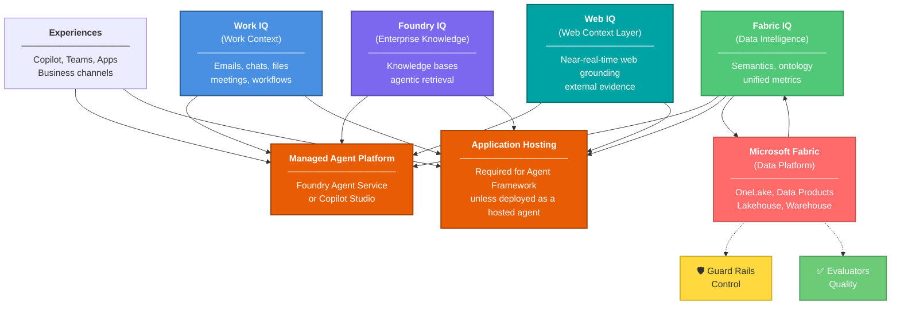

### 🧠 Role of each layer

#### 💼 **Work IQ (Work Context)**
The contextual intelligence workload for Microsoft 365. It captures how work happens across emails, chats, meetings, documents, people and workflows, subject to the user's identity and permissions. Its role is to:
- Supply current work context to agents and copilots
- Connect collaboration signals across Microsoft 365
- Support knowledge and actions through Microsoft 365 tools
- Preserve user-context and permission boundaries

**Example:** An executive types "summarize this meeting" in Word — Copilot (Work IQ) fetches the transcript from OneDrive, summarizes it and inserts it into the document.

---

#### 📚 **Foundry IQ (Enterprise Knowledge)**
The managed, permission-aware enterprise knowledge workload. It is backed by Azure AI Search knowledge bases and agentic retrieval. Its role is to:
- Operate a permission-aware corporate knowledge base with structured and unstructured sources
- Execute agentic retrieval: decomposes questions into sub-queries, parallel search and re-ranks evidence with citations
- Enforce permissions and labels for supported sources and configurations; support varies by connector, API, region and feature status
- Connect Azure, SharePoint, OneLake and web in the same enterprise grounding plane

**Example:** An agent asks a shared knowledge base for the policies and authoritative documents relevant to a margin investigation. Foundry IQ plans retrieval, enforces supported source permissions and returns grounded evidence with citations.

---

#### 🤖 **Agent Platform, Framework and Hosting**
The execution layer is separate from the IQ context workloads. **Microsoft Foundry Agent Service** and **Microsoft Copilot Studio** provide managed agent platforms. **Microsoft Agent Framework** is a development framework, not a hosting service; its application requires an explicit hosting and scaling choice unless it is deployed as a Foundry hosted agent. The selected platform or hosted application can:
- Interpret intent and plan multi-step execution
- Invoke models, knowledge sources, tools, MCP servers and other agents
- Maintain conversation state and apply approval checkpoints
- Trace, evaluate, version and operate agents

**Example:** A Foundry agent receives "analyze why the margin dropped," retrieves policies through Foundry IQ, obtains governed metrics through Fabric IQ/Fabric, optionally adds external evidence through Web IQ, and composes a controlled response.

---

#### 🌐 **Web IQ (Web Context Layer)**
The **external grounding** layer of Microsoft IQ for up-to-date public web context. Access is currently limited and should be treated as a conditional dependency with an availability check and fallback. Its role is to:
- Bring web evidence (pages, news, images and videos) into agentic flows
- Operate with a focus on grounding quality, low latency and token efficiency
- Deliver denser passages/evidence to improve multi-step reasoning precision
- Respect publisher controls and web conventions (including robots and access preferences)
- Complement, without replacing, governed corporate data (Fabric IQ + Foundry IQ)

**Example:** When investigating a margin variation, the agent combines internal metrics (Fabric) with external market signals (Web IQ), maintaining a separate evidence trail for internal data and public sources.

---

#### 📊 **Fabric IQ (Data Intelligence)**
The **semantics and context** layer that enriches data with corporate meaning when shared analytical definitions are required. It can provide governed definitions for metrics, dimensions and relationships without replacing authoritative operational or domain systems. Its role is to:
- Create semantic models: define metrics (revenue, margin, COGS) once and only once
- Map ontology: relationships between entities (products, customers, regions, periods)
- Ensure consistency: all agents use the same definition of "margin", "customer", "Q3"
- Accelerate development: new agents reuse existing models instead of rebuilding
- Enable natural analysis: users ask in natural language, semantic models translate to SQL

**Example:** Fabric IQ defines that "Margin = (Revenue - COGS) / Revenue". When an agent is queried about margin, it does not need to know the formula — it consumes the already-calculated metric.

---

#### 🗄️ **Microsoft Fabric (Data Platform)**
An optional unified analytics platform for scenarios that require analytical consolidation, shared semantics or reusable data products. Other scenarios can retain governed Microsoft 365, operational, domain, API or search authorities. When selected, Fabric can:
- Store (OneLake): single logical repository per tenant, built on ADLS Gen2
- Transform (Spark, Python, SQL): ETL pipelines feeding Bronze → Silver → Gold
- Serve (SQL Analytics Endpoint): exposes data via T-SQL endpoint for agents to run queries
- Govern: integrates with Purview (classification), Entra ID (identity), Defender (security)
- Enable BI: Power BI accesses the same Fabric without data duplication

**Example:** Raw data (Bronze) → transformations (Silver) → Data Products ready for agents (Gold) → SQL Analytics Endpoint → Agents query in real time with row-level security.

---

#### 🛡️ **Guard Rails (Cross-cutting)**
The **control and security** layer that permeates all agent operations. Its role is to:
- Detect attacks: Prompt Shields blocks prompt injection
- Filter content: Content Safety checks risk categories (violence, NSFW, etc.)
- Enforce explicit application and runtime policies in addition to source authorization
- Sanitize responses: PII Detection removes sensitive information before returning
- Auditability: every action is recorded in Audit Logs for compliance

**Example:** Entra identity, resource authorization and source permissions deny an unauthorized request. A deterministic guard rail can additionally block a disallowed tool or action, and the audit path records the decision.

---

#### ✅ **Evaluators (Cross-cutting)**
The **continuous measurement** layer that validates whether agents are operating correctly. Its role is to:
- Assess quality: groundedness, task adherence, toxicity, security risks
- Detect drift: is the model starting to perform worse? Evaluators trigger alerts
- Generate feedback: evaluation results feed into retraining or prompt adjustments
- Support decisions: quality data justifies promoting to production or rolling back
- Integrate compliance: Purview logs of access to sensitive data become quality metrics

**Example:** Evaluators measure whether margin responses use the correct evidence and meet release thresholds. Runtime blocking occurs only when the architecture deliberately implements a deterministic policy or evaluated-response gate; evaluators do not replace source authorization.

---

### 📌 How They Work Together

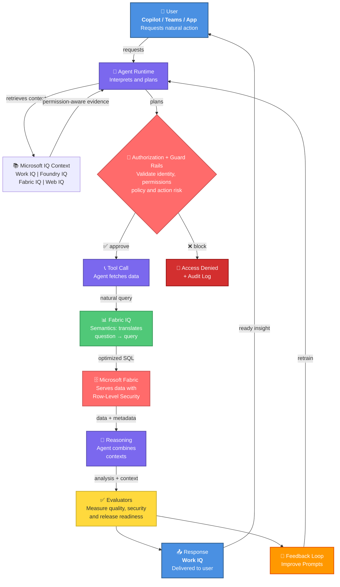

**Insight:** The selected governed authority supplies data. Microsoft IQ capabilities add complementary work, knowledge, business or web context only when needed. A managed agent platform or hosted Agent Framework application plans and executes when an agent is justified. Authorization and guard rails constrain behavior; evaluators measure reliability and inform release decisions.

### 🧭 Adoption criteria: Copilot Studio, Foundry or mixed solution

| Option | When to prioritize | Main limitation |
|---|---|---|
| **Copilot Studio** | Business domain with well-defined conversational flow, low/medium technical effort and fast delivery in channels like Teams/web | Less control for advanced reasoning scenarios and complex engineering |
| **Microsoft Foundry** | Cases with deep technical integration, advanced tool calling, multi-step/multi-agent and need for pro-code control | Higher engineering and operational governance effort |
| **Mixed solution (Studio + Foundry)** | A measured requirement needs both a Copilot Studio experience boundary and Foundry capabilities that one platform cannot satisfy | Highest integration, identity, latency, cost and observability burden |

**Conditional target-architecture selection:**
1. Use an existing Microsoft/SaaS capability or deterministic workflow when it meets the outcome.
2. Add only the required context workload: Work IQ for Microsoft 365 work context, Foundry IQ for managed enterprise knowledge, Fabric IQ for shared business semantics, or Web IQ for approved external context.
3. When an agent is required, select one managed platform: Copilot Studio for low-code business experiences or Foundry Agent Service for managed pro-code agents.
4. Use Microsoft Agent Framework only with an explicit application-hosting choice or as a Foundry hosted agent.
5. Add Microsoft Fabric only for an analytical consolidation, semantic reuse or governed data-product requirement.
6. Combine platforms or agents only when evaluation proves that one bounded platform cannot meet independently justified requirements.

**Official Microsoft sources:**
- Microsoft Copilot Studio documentation: https://learn.microsoft.com/microsoft-copilot-studio/
- Microsoft Foundry documentation: https://learn.microsoft.com/azure/foundry/
- Foundry IQ documentation: https://learn.microsoft.com/azure/foundry/agents/concepts/what-is-foundry-iq
- Fabric IQ documentation: https://learn.microsoft.com/fabric/iq/overview
- Microsoft 365 Copilot documentation: https://learn.microsoft.com/microsoft-365-copilot/
- Microsoft Fabric documentation: https://learn.microsoft.com/fabric/

### 📰 Recent Microsoft IQ updates (2025-2026)

- **Microsoft IQ** is now explicitly described as the corporate intelligence layer with **Work IQ, Foundry IQ, Fabric IQ and Web IQ**.
- **Work IQ** exposes work intelligence through chat, context, tools and workspaces; availability can differ by integration.
- **Foundry IQ** consolidates knowledge bases and agentic retrieval with citations and supported source permissions; capability status varies between GA and preview.
- **Fabric IQ** includes an IQ workload and items whose status varies; ontology, Plan and Graph capabilities require current preview and regional checks.
- **Web IQ** expands external grounding for agents but remains a limited-access dependency that requires an availability check and fallback.

---

## 🔧 2.1. Technical Specifications by Layer

### 🗄️ Microsoft Fabric — OneLake and Delta Lake

#### 📍 **OneLake: The Organization's Unified Lake**

**What it is:**
OneLake is a **single logical data lake per tenant**, automatically built on **Azure Data Lake Storage Gen2 (ADLS Gen2)**. It is the corporate equivalent of OneDrive for data — provisioned by default when you activate Fabric, with no additional configuration.

**Key characteristics:**
- 🎯 **Centralization:** All of the organization's analytics data in a single logical location
- 📦 **Multi-workspace:** Supports multiple workspaces (departments, domains) within the same OneLake
- 🔗 **Interoperability:** Accessible by all Fabric engines (Spark, SQL, Power BI) simultaneously
- 📊 **Duplication reduction:** Avoids data silos, reduces storage costs
- 🔐 **Unified governance:** Access, classification and compliance policies applied centrally via Purview

**Physical structure:**
When you create a **Lakehouse** in Fabric, two main folders are automatically provisioned in OneLake:
- `/Tables` — Stores managed tables in Delta format (ideal for structured data)
- `/Files` — Stores data in any format (CSV, Parquet, images, documents)

**Storage example:**

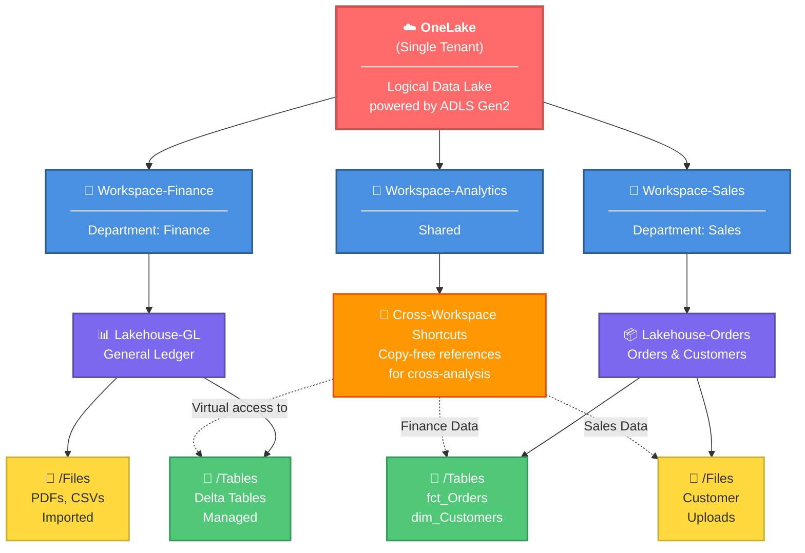

**Diagram reading:**
- 🔴 **OneLake (top):** Single tenant, automatically provisioned
- 🔵 **Workspaces:** Isolate data by department/domain
- 🟣 **Lakehouses:** Concrete (Finance-GL, Sales-Orders) in each workspace
- 🟢 **/Tables:** Stores managed Delta tables (structured)
- 🟡 **/Files:** Stores any format (raw)
- 🟠 **Shortcuts:** Create cross-workspace references without physical duplication

---

#### 🔄 **Delta Lake: The Standard Storage Format**

**What it is:**
**Delta Lake** is an open-source format maintained by the Linux Foundation that adds an ACID transactions layer, schema validation and history to Parquet files. Fabric standardizes on Delta Lake — every engine (Spark, SQL, Data Warehouse, Power BI) that writes data automatically creates Delta tables.

**Technical properties (Delta Lake vs pure Parquet):**

| Property | Parquet | Delta Lake |
|---|---|---|
| **ACID Transactions** | ❌ No | ✅ Yes (Atomicity, Consistency, Isolation, Durability) |
| **Schema Enforcement** | ❌ No | ✅ Yes (prevents "dirty" data) |
| **Time Travel** | ❌ No | ✅ Yes (query data from any point in time) |
| **Data Rollback** | ❌ No | ✅ Yes (revert bad writes) |
| **Unified Read** | ✅ Yes | ✅ Yes (all engines read the same copy) |
| **Query Performance** | Basic | **V-Order optimization** (much faster) |
| **Audit and Compliance** | ❌ No | ✅ Yes (Delta Lake table history) |

**Specific benefits for AI agents:**
- **Reliability:** Agents trust that data is correct (ACID prevents corruption)
- **Consistency:** Multiple agents reading simultaneously tend to see a consistent version
- **Traceability:** Complete history of when/who changed data (audit)
- **No duplication:** Spark transforms data → SQL reads → Power BI visualizes **from the same copy**

**Example:**
```
An agent writes "margin" data to Delta:
  ✅ Margin = (Revenue - COGS) / Revenue
  ✅ Schema enforcement: if someone tries to write "margins" (typo), it is blocked
  ✅ Another agent reads simultaneously, sees consistent data
  ✅ If an error is discovered, time-travel reverts to the previous version
```

---

#### 🔗 **Shortcuts: Virtualized Data Without Copying**

**What it is:**
Shortcuts are **virtual references** (like symbolic links) to external data. Agents query data as if it were in OneLake, but it is served from external sources without physical copying.

**Supported sources:**
- ✅ Azure Data Lake Storage Gen2 (ADLS Gen2)
- ✅ Amazon S3
- ✅ Google Cloud Storage
- ✅ Dataverse (Microsoft dynamics 365)
- ✅ Other lakehouses/workspaces (cross-workspace)

**Benefits:**
- 💰 **Zero copy:** Does not duplicate data, saves storage
- ⚡ **Fresh data:** Agents tend to see the most current version from the source
- 🔐 **Explicit security:** Access is the intersection of permissions on the shortcut path and target path; identity passthrough or delegated authentication depends on shortcut type and query engine
- 📍 **Governed access:** Configure OneLake roles, source permissions, connection identity, labels and downstream SQL/semantic-model controls for the selected path

**Example:**
```
HR data lives in an external ADLS Gen2 (managed by another team)
You create a Shortcut → it appears as a table in your Lakehouse
The agent runs: SELECT * FROM HR.Employees
  ↓ Direct fetch from ADLS Gen2, authenticated, with RLS applied
  ↓ No ETL, no duplication, centralized governance
```

---

#### 🔍 **SQL Analytics Endpoint: T-SQL Interface for Data**

**What it is:**
Each Lakehouse in Fabric **automatically provisions** a **SQL Analytics Endpoint** — a TDS (Tabular Data Stream) endpoint that exposes Delta tables as standard SQL tables, queryable with T-SQL.

**Characteristics:**
- 🚀 **Automatic:** Created together with the Lakehouse, zero setup
- 📖 **Read-only:** Does not support INSERT/UPDATE/DELETE (use Spark to modify data)
- ⚡ **High performance:** Powered by the same engine as the Fabric Data Warehouse
- 🔐 **Row & Column Security:** Applies granular SQL permissions (RLS, column masking)
- 📊 **Metadata Auto-Sync:** Delta tables automatically appear as SQL tables
- 🔗 **Cross-workspace:** Can query data via Shortcuts from other workspaces

**Capabilities:**
✅ `SELECT` against Delta tables (including via Shortcuts)  
✅ Create views, functions, stored procedures in T-SQL  
✅ Apply row-level security (RLS) and column security  
✅ Connect Power BI directly for reports  
✅ Run queries via Azure Data Studio, SQL Server Management Studio (SSMS), any TDS client  

**Agent usage example:**
```sql
-- Agent in Foundry runs:
SELECT 
    p.ProductName,
    SUM(s.Amount) as TotalSales,
    AVG(s.Amount) as AvgPrice
FROM Gold.Products p
INNER JOIN Gold.Sales s ON p.ProductID = s.ProductID
WHERE s.Date >= DATEADD(month, -3, GETDATE())
GROUP BY p.ProductName
ORDER BY TotalSales DESC

-- Result is returned via TDS to the agent
-- Row-level security has already filtered data according to the agent's permission (Entra ID)
```

**Performance considerations:**
- Metadata synchronization between a Lakehouse and its SQL analytics endpoint is asynchronous; measure propagation delay for the selected workload instead of assuming a fixed interval
- Uses **V-Order optimization:** Spark writes optimized Parquet for fast SQL reads
- Automatic indexes: Fabric maintains statistics and histograms without user action

---

#### 🏗️ **Medallion Architecture: Layered Organization**

##### 📖 **What is Medallion Architecture?**

The **Medallion Architecture** (also known as "Bronze-Silver-Gold" or "Delta Lake Medallion") is a **data organization pattern** recommended by Microsoft for structuring Lakehouses in a scalable, governable and reusable way. It is a model **proven at petabyte scale** (Microsoft IDEAS, for example, uses Medallion for 4 PiB of data).

**Core principles:**
- 🎯 **Quality progression:** Each layer increases data quality, validation and value
- 🔄 **Reuse:** Data transformed once, consumed by multiple consumers (agents, BI, apps)
- 🏗️ **Separation of concerns:** Bronze = ingestion, Silver = transformation, Gold = business
- 📊 **Scalability:** Supports growth from terabytes to petabytes without reorganization
- 🔐 **Stratified governance:** Each layer has its own policy (workspace isolation)

**Alternatives Medallion does not replace:**
- ✅ Medallion works well in a **Data Lake** (Bronze→Silver→Gold with Spark)
- ✅ Medallion works well in a **Data Warehouse** (dimensional modeling, slowly changing dimensions)
- ✅ Fabric allows **combination:** Bronze+Silver as lakehouses, Gold as data warehouse
- ✅ For highly decentralized cases: **Data Mesh** (multiple domains, each with its own Medallion)

---

##### 🌍 **General Flow: From Raw Data to Insights**

```mermaid
graph LR
    A["🚀 Data Source<br/>─────────────────<br/>ERP, CRM, APIs,<br/>Uploads, Sensors"]
    
    B["🟤 BRONZE<br/>RAW DATA<br/>─────────────────<br/>Original format<br/>No cleaning"]
    
    C["⚙️ Spark/Python<br/>Transformation<br/>Validation"]
    
    D["🟡 SILVER<br/>CLEAN DATA<br/>─────────────────<br/>Validated data<br/>Structured"]
    
    E["⚙️ Spark/SQL<br/>Aggregation<br/>Semantics"]
    
    F["🟢 GOLD<br/>BUSINESS DATA<br/>─────────────────<br/>Ready for<br/>consumption"]
    
    G["📊 Consumption<br/>─────────────────<br/>Agents, BI,<br/>Apps, Reports"]
    
    A -->|"Ingest (as-is)"| B
    B -->|"Transform"| C
    C -->|"Validate, clean"| D
    D -->|"Aggregate"| E
    E -->|"Semanticize"| F
    F -->|"SQL Analytics<br/>Endpoint"| G
    
    style A fill:#FF6B6B,stroke:#CC5555,color:#fff,stroke-width:2px
    style B fill:#8B6F47,stroke:#664D2A,color:#fff,stroke-width:2px
    style C fill:#FFD93D,stroke:#CCB030,color:#333,stroke-width:2px
    style D fill:#C9A961,stroke:#9B7E48,color:#fff,stroke-width:2px
    style E fill:#FFD93D,stroke:#CCB030,color:#333,stroke-width:2px
    style F fill:#50C878,stroke:#3A9B5C,color:#fff,stroke-width:2px
    style G fill:#4A90E2,stroke:#2E5C8A,color:#fff,stroke-width:2px
```

---

##### 🟤 **Bronze Layer — RAW DATA**

**Purpose:**
- ✅ Capture data **as it arrives**, in original format
- ✅ Enable **audit** (traceability to origin)
- ✅ Enable **reprocessing** (if Silver/Gold logic changes)
- ✅ Maintain complete history (compliance, GDPR, etc.)

**Characteristics:**

| Aspect | Detail |
|---|---|
| **Formats** | CSV, JSON, Parquet, Delta, AVRO, images, PDFs — any |
| **Validation** | ❌ None — "trust but verify later" |
| **Duplication** | May have duplicate rows |
| **Schema** | Loose (can evolve without breaking) |
| **Retention** | Typical: 90 days to 2 years (compliance) |
| **Workspace** | Private (Bronze-Workspace) |
| **Owner** | Data Engineers (ingestion) |
| **Technology** | Data Factory, Mirroring, Synapse Spark, Dataflows |

**Bronze content example:**

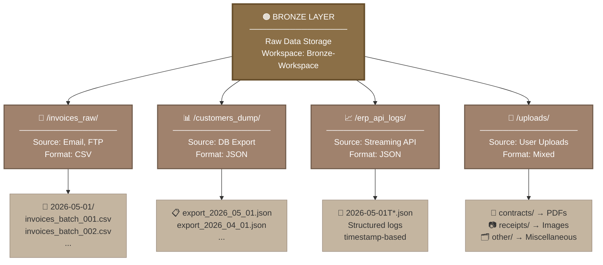

**Example characteristics:**

| Folder | Source | Format | Size | Frequency | Quality |
|---|---|---|---|---|---|
| `/invoices_raw/` | Email, FTP manual | CSV | 10-500 MB/day | Daily | ❌ May have errors, duplicates |
| `/customers_dump/` | DB Export (nightly) | JSON | 100 MB | Daily (1x) | ⚠️ May have special characters |
| `/erp_api_logs/` | Streaming API | JSON | 5-50 GB/day | Continuous | ⚠️ Timestamps may desync |
| `/uploads/` | User uploads | Mixed (PDF, IMG) | 1-10 GB/day | On-demand | ❌ May have viruses, corruption |

**Recommended flow for Bronze:**
1. **Mirroring** (ideal): Near real-time replication from DB → OneLake (supports SQL Server, MySQL, PostgreSQL, Snowflake)
2. **Data Factory:** Pipelines with 200+ native connectors
3. **Shortcuts:** Reference data from ADLS Gen2/S3 without copying
4. **Dataflow Gen2:** Visual interface, lightweight transformations

---

##### 🟡 **Silver Layer — CLEAN DATA (Validated and Structured Data)**

**Purpose:**
- ✅ **Validate** integrity: duplicates, nulls, data types
- ✅ **Clean** data: standardize formats, remove invalid values
- ✅ **Structure** for analysis: denormalizations, lightweight aggregations
- ✅ **Integrate** multiple sources: invoices + customers + products into coherent tables
- ✅ Serve as a governed, reusable analytical authority for analysts and agents within the defined domain and scope

**Characteristics:**

| Aspect | Detail |
|---|---|
| **Formats** | ✅ **Standard: Delta Lake** (ACID, schema enforcement) |
| **Validation** | ✅ Yes — referential integrity, types, ranges |
| **Duplication** | ❌ Removed (distinct keys guaranteed) |
| **Schema** | Strict (schema enforcement — rejects invalid data) |
| **Retention** | Policy-defined from legal, recovery, cost and operational requirements |
| **Workspace** | Semi-private (Silver-Workspace, controlled access) |
| **Owner** | Data Engineers (ELT transformation) |
| **Technology** | Spark (Python, SQL, Scala), Synapse notebooks |

**Typical Bronze → Silver transformations:**

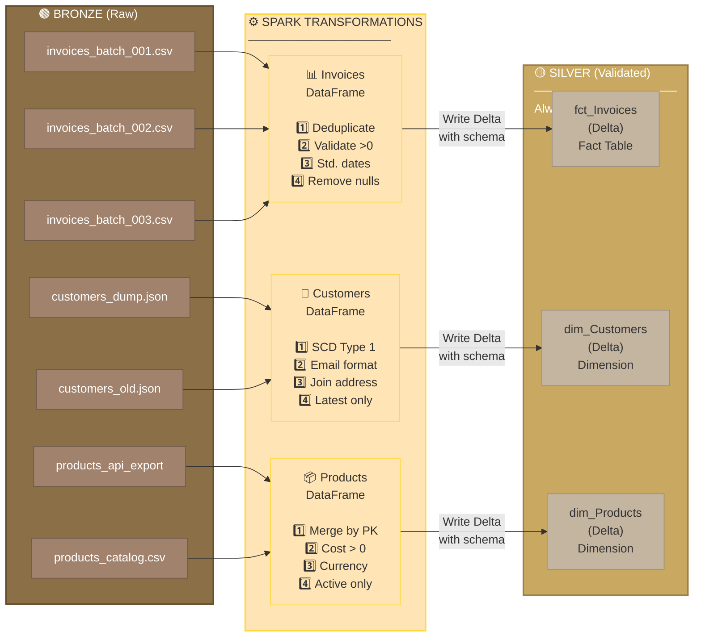

**Flow by category:**

| Source | Spark Processing | Validations | Silver Output |
|---|---|---|---|
| **Invoices** (multiple CSVs) | Spark DataFrame merge | ✅ Dedup by ID<br/>✅ Amount > 0<br/>✅ Date standard<br/>✅ Remove nulls | **fct_Invoices** (Delta) |
| **Customers** (JSON exports) | Spark DataFrame merge | ✅ Latest version (SCD1)<br/>✅ Email format<br/>✅ Join address data<br/>✅ Active only | **dim_Customers** (Delta) |
| **Products** (API export) | Spark DataFrame merge | ✅ Merge by ProductID<br/>✅ Cost > 0<br/>✅ Currency aligned<br/>✅ Active flag | **dim_Products** (Delta) |

**Silver quality guarantees:**
- 🔐 **ACID transactions** — no partial or corrupted data
- 🔑 **Primary key unique** — no duplicates by ID
- 📊 **Schema strict** — rejects data outside expected type
- ✅ **Data completeness** — no NULL in critical columns
- 🔄 **Referential integrity** — FK relationships validated

**Typical Silver structure:**

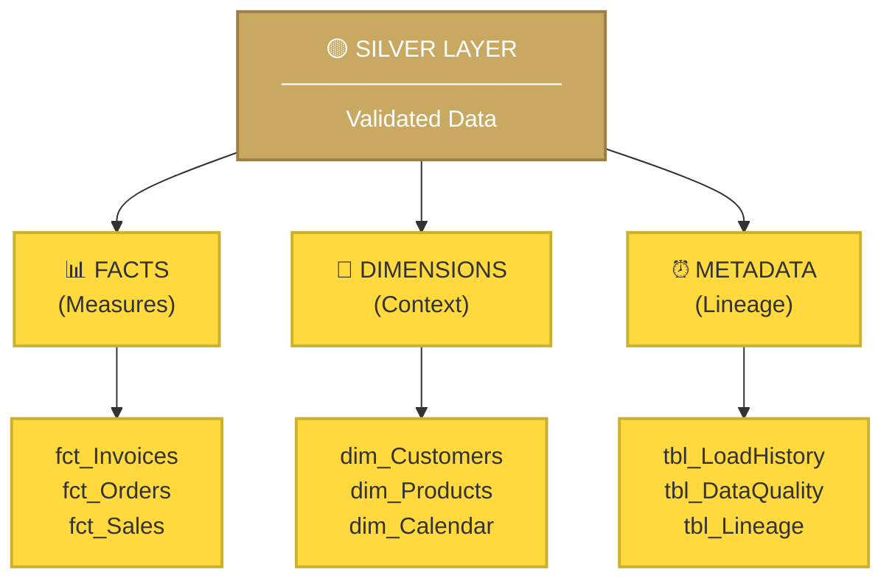

---

##### 🟢 **Gold Layer — BUSINESS DATA (Business-Ready Data)**

**Purpose:**
- ✅ **Aggregate** data into business dimensions (product, region, period)
- ✅ **Calculate** metrics (revenue, margin, COGS, KPIs)
- ✅ **Semanticize** data with comprehensible corporate names and logic
- ✅ Expose as **Data Products** consumable by agents, BI, apps
- ✅ Guarantee **performance** (pre-aggregated data, indexes, statistics)

**Characteristics:**

| Aspect | Detail |
|---|---|
| **Formats** | ✅ **Standard: Delta Lake** (with V-Order optimization) |
| **Aggregation** | ✅ Yes — facts aggregated by business dimensions |
| **Calculations** | ✅ Pre-calculated corporate metrics |
| **Schema** | Semantic — business names (not technical) |
| **Retention** | Policy-defined; retain only the history required by the scenario |
| **Workspace** | Controlled consumer access with least privilege |
| **Owner** | Analytics Engineers / Business Analysts |
| **Exposure** | SQL Analytics Endpoint, Power BI, APIs for agents |
| **Technology** | Spark (aggregations), SQL (views, stored procs), Power BI (semantic models) |

**Typical Gold structure (Data Products):**

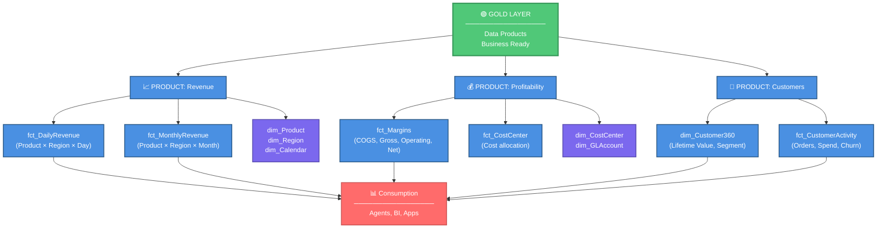

**Gold table examples:**

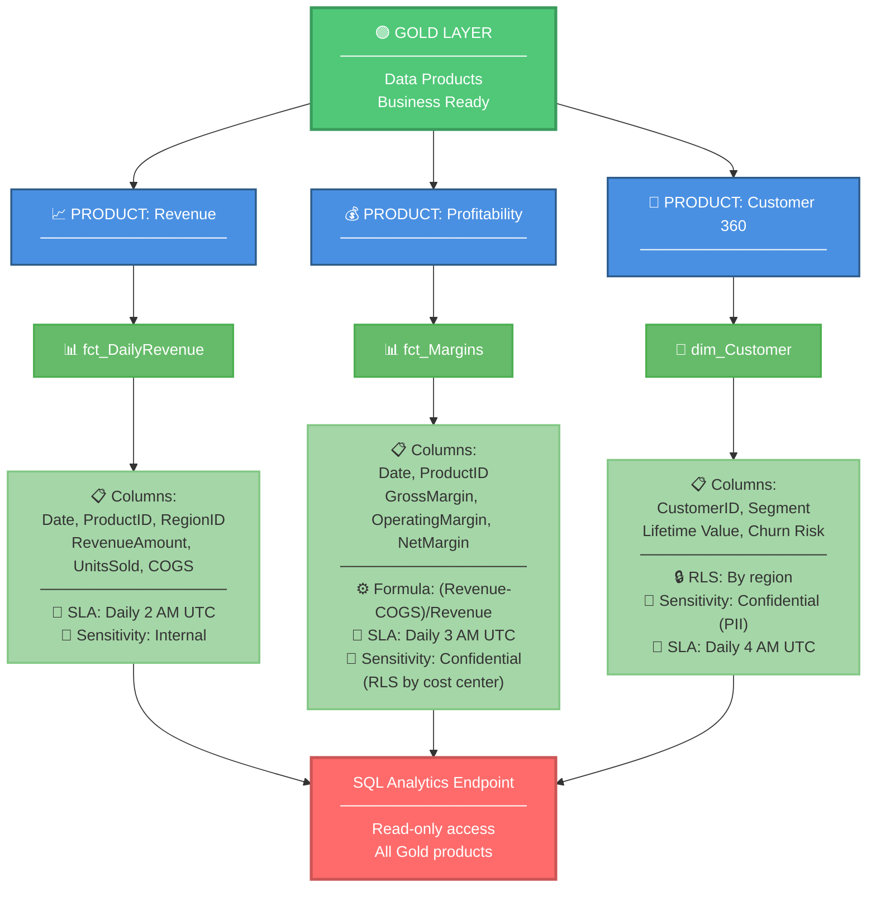

**Gold Data Products summary:**

| Product | Table | Purpose | Updated | Access |
|---|---|---|---|---|
| **Revenue** | `fct_DailyRevenue` | Revenue by product-region-day | 2 AM UTC | 🔵 Internal |
| **Profitability** | `fct_Margins` | Gross, operating, net margins | 3 AM UTC | 🟡 Confidential (RLS) |
| **Customer 360** | `dim_Customer` | Customer + lifetime value + churn risk | 4 AM UTC | 🔴 Confidential (PII + RLS) |

**Required service commitments per Data Product:**
- ✅ **Documentation:** Data dictionary, formulas, lineage
- ✅ **Freshness objective:** Defined update target with measured evidence and an accountable owner
- ✅ **Security:** Sensitivity labels plus explicitly configured identity, item, OneLake, SQL, RLS/CLS and sharing controls as applicable
- ✅ **Discovery:** Indexed in Data Catalog (Purview)
- ✅ **Audit:** Access recorded in Audit Logs

---

##### 🏢 **Workspace Isolation (Microsoft Recommendation)**

Microsoft recommends **creating each layer in a separate workspace** for better governance:

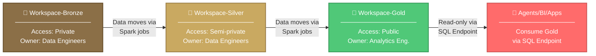

**Benefits:**
- 🔐 **Isolation:** Bronze (raw) not exposed to end users
- 👥 **Granular RBAC:** Different permissions per layer
- 📊 **Separate billing:** Track costs of each pipeline phase
- 🚀 **Performance:** Dedicated capacity for each workload
- 🔄 **Evolution:** Change Silver/Gold without affecting Bronze ingestion

---

##### 📚 **Implementation Patterns in Fabric**

There are **3 main patterns** recommended by Microsoft for implementing Medallion in Fabric. The choice depends on **team maturity, data complexity and BI requirements**.

---

###### **OPTION 1️⃣ — Three Lakehouses (one per layer)**

**When to use:**
- ✅ **Pure Data Engineering** teams (no traditional BI)
- ✅ **Broadly open** architecture (Delta Lake, no dimensional schema)
- ✅ Focus on **exploratory analyses and AI agents**
- ✅ Teams that master **Spark/Python** more than SQL

**Architecture:**

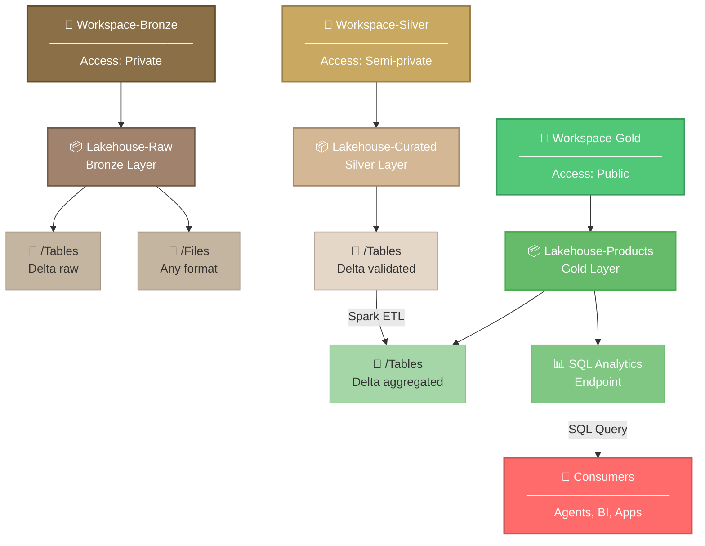

**Characteristics:**

| Aspect | Detail |
|---|---|
| **Lakehouses** | 3 separate (Bronze, Silver, Gold) |
| **Formats** | Bronze: multiple, Silver: Delta, Gold: Delta |
| **Compute** | Spark (transformation), SQL (queries) |
| **BI Support** | Limited — SQL Analytics Endpoint only |
| **Scalability** | ⭐⭐⭐⭐⭐ Excellent for data lakes |
| **Governance** | ⭐⭐⭐⭐ Workspace isolation |
| **Complexity** | Medium (3 lakehouses to maintain) |
| **Cost** | Workspace count does not determine capacity count; assign workspaces to capacity based on measured isolation, performance and governance needs |

**Real use cases:**
- Big Data agencies serving multiple clients
- Organizations with Data Science culture (Python/R dominant)
- Large-scale processing where representative workload tests validate the selected Fabric capacity
- Exploratory analyses and machine learning

---

###### **OPTION 2️⃣ — Bronze+Silver Lakehouse, Gold Data Warehouse** ⭐ **RECOMMENDED**

**When to use:**
- ✅ Teams with **traditional BI experience** (star schema, dimensional modeling)
- ✅ Need for **Power BI + SQL Reports** as consumers
- ✅ **Structured and repeatable** analyses (not exploratory)
- ✅ Teams that master **SQL/DAX** more than Spark/Python

**Architecture:**

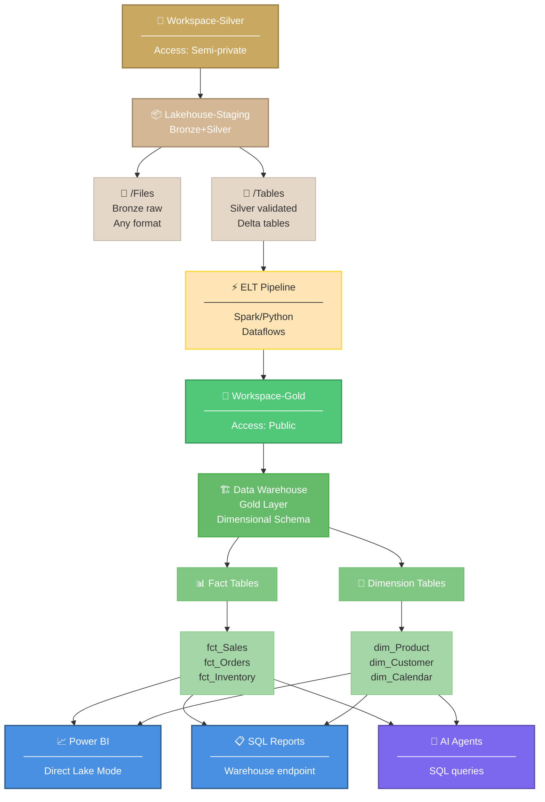

**Characteristics:**

| Aspect | Detail |
|---|---|
| **Lakehouses** | 1 (Bronze+Silver combined) |
| **Warehouses** | 1 (Gold in dimensional DW) |
| **Formats** | Bronze: multiple, Silver: Delta, Gold: DW schema |
| **Compute** | Spark (ETL), SQL (DW queries) |
| **BI Support** | ⭐⭐⭐⭐⭐ Native Power BI + SQL Reports |
| **Scalability** | ⭐⭐⭐⭐ Good for enterprise BI |
| **Governance** | ⭐⭐⭐⭐ Bronze/Silver vs Gold isolation |
| **Complexity** | Medium (1 Lakehouse + 1 DW) |
| **Cost** | Lakehouse and warehouse can share or use separate capacities; validate CUs, concurrency, isolation and cost with the Capacity Metrics app |

**Real use cases:**
- Organizations with mature BI (Power BI at scale)
- Companies transitioning from a traditional data warehouse
- Structured analyses with dimensional models
- Repeatable operational reports

**Unique benefit:** Uses Power BI **Direct Lake mode** — loads data directly from Delta tables in the DW, reducing the need for expensive Import dataset refreshes.

---

###### **OPTION 3️⃣ — Medallion + Data Mesh** (For large organizations)

**When to use:**
- ✅ **Large federated organizations** with independently owned data domains
- ✅ **Multiple autonomous domains** (Finance, Sales, Operations, HR, etc.)
- ✅ Need for **data federation** (each domain owns its data)
- ✅ Each domain operates its own **complete Medallion**

**Architecture:**

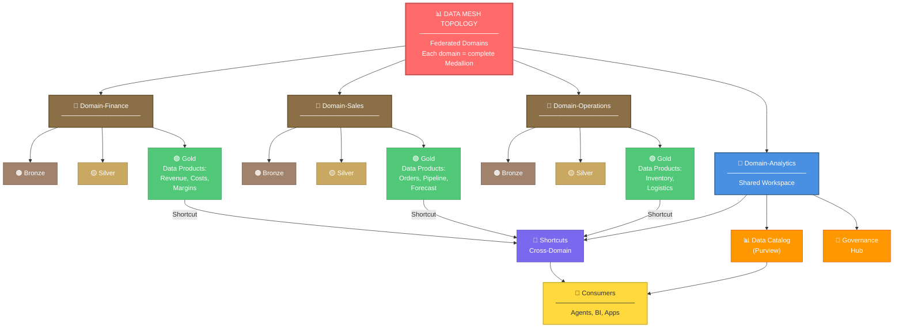

**Characteristics:**

| Aspect | Detail |
|---|---|
| **Domains** | 3+ (each one = complete Medallion) |
| **Ownership** | Each domain = autonomous team |
| **Integration** | Shortcuts + OneLake cross-workspace |
| **Governance** | Centralized hub (Purview) |
| **Scalability** | High potential, subject to selected capacity, data layout, concurrency and representative load validation |
| **Autonomy** | ⭐⭐⭐⭐⭐ Maximum independence |
| **Complexity** | High (requires discipline) |
| **Cost** | 💰💰💰 Multiple capacities |

**Data Mesh principles:**
1. **Domain ownership:** Each domain = owner of its data
2. **Data as product:** Gold layers are "Data Products" with SLA
3. **Self-serve infrastructure:** Each domain provisions its own Medallion
4. **Federated governance:** Central policies (Purview), local implementation

**Real use cases:**
- Large conglomerates (multiple subsidiaries, geographies)
- Fintech organizations (each service = independent domain)
- Organizations with multiple autonomous data-product teams and federated governance
- Media industry (multiple studios/platforms)

---

##### 📋 **Decision Matrix: Which Pattern to Choose?**

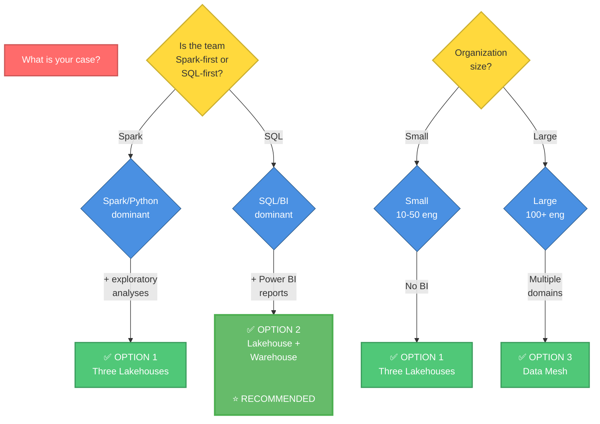

---

**Microsoft References:**

> **Source status:** Microsoft architecture, Fabric, Microsoft IQ, Agent Framework, Agent ID and security sources in this reference were rechecked on **2026-07-20**. Preview status, regional availability, licensing, authentication behavior and limits must be revalidated for each production design.
- [Understand medallion lakehouse architecture for Microsoft Fabric with OneLake](https://learn.microsoft.com/fabric/onelake/onelake-medallion-lakehouse-architecture)
- [Lakehouse end-to-end scenario: overview and architecture](https://learn.microsoft.com/fabric/data-engineering/tutorial-lakehouse-introduction)
- [Data Platform end-to-end with Microsoft Fabric](https://learn.microsoft.com/azure/architecture/example-scenario/dataplate2e/data-platform-end-to-end)

---

#### 📊 **Data Products: Data Packages for Reuse**

**What it is:**
A **Data Product** is a curated set of Gold tables with clear semantics, documentation, and a quality SLA — ready to be reused by multiple agents and users.

**Characteristics:**
- 📖 **Documented:** Data dictionary, lineage, clear business rules
- 🎯 **Semantically clear:** "Revenue = Sales Price × Quantity", unambiguous
- 🔐 **Secure:** Sensitivity labels classify data; explicitly configured OneLake, item, SQL, RLS/CLS and sharing controls enforce access
- ⚙️ **Operationalized:** Refresh pipelines help keep data fresh, with an update SLA
- 📈 **Versioned:** Schema changes are controlled, compatibility maintained
- 📣 **Discoverable:** The catalog (Data Catalog in Purview) indexes and describes it

**Data Product example:**

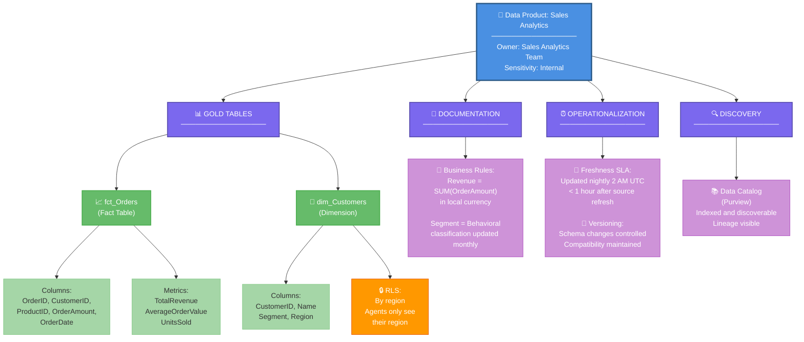

**Data Product components:**

| Component | What it is | Responsibility |
|---|---|---|
| **Fact Tables** | `fct_Orders` — measures (OrderAmount, UnitsSold) | Analytical core |
| **Dimensions** | `dim_Customers` — context (Name, Segment) | Business context |
| **Metrics** | TotalRevenue, AverageOrderValue | Pre-calculated KPIs |
| **RLS** | Row-level security by region | Security + compliance |
| **Documentation** | Business rules, formulas, glossary | Clear semantics |
| **SLA** | Updated 2 AM UTC, < 1h lag | Reliability |
| **Versioning** | Schema changes with compatibility | Controlled evolution |
| **Catalog** | Purview indexes and describes | Discovery |

**Usage by an Agent:**
```python
# Agent in Foundry
from azure.ai.projects import AIProjectClient
import pyodbc

# Connect via SQL Analytics Endpoint (authenticated with Agent ID via Entra)
conn = pyodbc.connect(
    'Driver=ODBC Driver 17 for SQL Server;'
    'Server=fabric.database.windows.net;'
    'Database=Sales_Analytics;'
    'Authentication=ActiveDirectoryMSI'
)

# Query the Gold Data Product (RLS must be configured and validated)
cursor = conn.cursor()
cursor.execute('''
    SELECT OrderAmount, CustomerSegment, OrderDate
    FROM fct_Orders
    WHERE OrderDate >= DATEADD(month, -3, GETDATE())
''')

# Agent reasons over the data
data = cursor.fetchall()
# ... Claude processes context, generates analysis
```

---

#### 🔐 **Governance Integration (Purview + Entra)**

The integration between **Microsoft Entra Agent ID**, **Microsoft Purview** and **Microsoft Fabric** creates a multi-level security architecture where each agent is authenticated as a distinct corporate identity (not just a generic application), and every data access is governed by sensitivity classification and access control rules.

##### 🪪 **Entra ID Agent Identity - Identities for AI**

Microsoft Entra Agent ID is an identity and security framework for AI agents. Agent identities are specialized Entra identity constructs; the effective controls depend on the identity type, token flow, licensing and configured security capabilities.

| Aspect | Service Principal (Legacy) | Entra Agent ID (New) |
|---------|-------------------------|---------------------|
| **Purpose** | General workload/application identity | Agent identity created from an agent identity blueprint |
| **Authentication** | Supported workload credential or federation | OAuth 2.0 token flow through the supported blueprint/agent identity pattern |
| **Authorization** | Resource permissions and application roles | The same resource authorization remains required; agent-specific security can add risk and lifecycle controls |
| **Audit** | Entra sign-in and audit signals | Agent sign-in and audit signals for supported identity flows |
| **Governance** | Workload lifecycle controls | Blueprint and agent lifecycle controls when configured and licensed |
| **Conditional Access** | Workload identity controls vary | Agent Conditional Access requires supported identity flows, configuration and licensing |

**How Agent ID works:**

1. **Creation:** Each agent receives a unique identity in Entra ID (e.g., `eng-sales-agent-001`)
2. **Authentication:** The application obtains an OAuth token through the supported agent identity flow; prefer managed credentials or workload identity federation over long-lived secrets
3. **The JWT contains:**
   - `app_displayname`: "Eng Sales Agent"
   - `appid`: unique GUID of the agent
   - `roles`: ["Data Explorer", "Contributor"] 
   - `oid`: object ID of the agent
4. **Zero Trust:** The target resource validates the token and enforces its own permissions; configured Entra security capabilities can add risk-based controls
5. **Renewal:** Token lifetime follows the effective Entra policy and token flow; do not assume a universal one-hour lifetime

**JWT Payload example:**
```json
{
  "aud": "https://database.windows.net",
  "iss": "https://sts.windows.net/12345678-1234-1234-1234-123456789012/",
  "iat": 1704067200,
  "nbf": 1704067200,
  "exp": 1704070800,
  "acr": "1",
  "appid": "87654321-4321-4321-4321-210987654321",
  "appidacr": "1",
  "email": "eng-sales-agent-001@company.onmicrosoft.com",
  "name": "Engineering Sales Agent",
  "oid": "11111111-1111-1111-1111-111111111111",
  "roles": ["Data Explorer", "Contributor"],
  "rh": "0.ARcAoP...",
  "scp": "user_impersonation",
  "sub": "oL....",
  "tid": "12345678-1234-1234-1234-123456789012",
  "unique_name": "eng-sales-agent-001@company.onmicrosoft.com",
  "upn": "eng-sales-agent-001@company.onmicrosoft.com",
  "uti": "....",
  "ver": "1.0"
}
```

---

##### 🏷️ **Purview Sensitivity Labels - Hierarchy and Classification**

Sensitivity labels in Purview provide multi-level classification with progressive protection:

| Label | Description | Use Scenario | Protection | Access by Agent |
|-------|-----------|---|----------|---|
| **Public** | No restriction, can be shared externally | Public marketing data, public prices | No encryption | ✅ Automatic |
| **Internal** | Internal use only, not sensitive | Operational documents, announcements | Watermark | ✅ Automatic |
| **Confidential** | Sensitive business data, restricted to authorized employees | Contracts, sales plans, internal analyses | Encryption + Access Restriction | ⚠️ Requires Conditional Access |
| **Highly Confidential** | Extremely sensitive data, maximum protection | Financial data, PII, trade secrets | Strong encryption + Strict restriction | ❌ Blocked (human-in-loop required) |

**Label Hierarchy in Purview:**

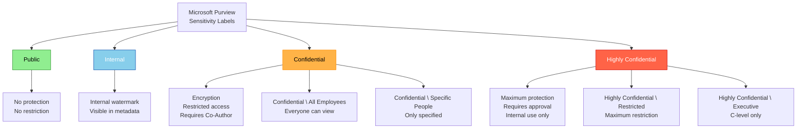

**Applying Labels in Fabric:**

When data is ingested into OneLake, Purview can apply labels automatically:

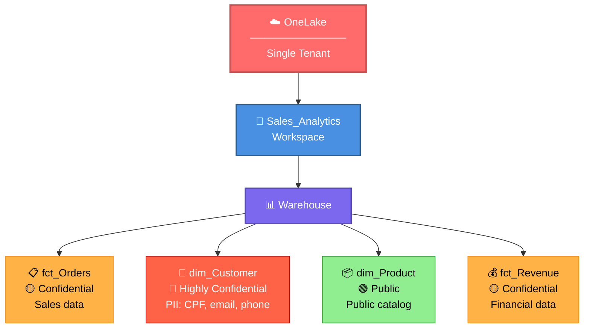

---

##### 🔒 **Row-Level Security (RLS) - Filtering by Agent Context**

The SQL Analytics Endpoint in Fabric supports RLS via `EXECUTE AS` with Agent ID:

```sql
-- Base table: fct_Orders
SELECT 
    OrderID, 
    Amount, 
    CustomerID, 
    OrderDate,
    SensitivityLabel  -- Column added by Purview
FROM [dbo].[fct_Orders]

-- RLS policy applied to Agent "eng-sales-agent-001"
CREATE SECURITY POLICY SalesRLS
    ADD FILTER PREDICATE dbo.fn_securitypredicate(SalesRegion)
    ON dbo.fct_Orders
    AFTER INSERT, AFTER UPDATE;

-- Function that defines the filter
CREATE FUNCTION dbo.fn_securitypredicate(@SalesRegion AS nvarchar(max))
    RETURNS TABLE
    WITH SCHEMABINDING
AS
RETURN SELECT 1 AS fn_securitypredicate_result
WHERE @SalesRegion IN (
    SELECT value FROM STRING_SPLIT(
        SESSION_CONTEXT(N'SalesRegion'), ','
    )
);

-- Agent connects with context
EXECUTE sp_set_session_context @key=N'SalesRegion', @value=N'LATAM,EMEA';
SELECT * FROM fct_Orders;  -- Returns only LATAM + EMEA
```

**RLS Flow for an Agent:**

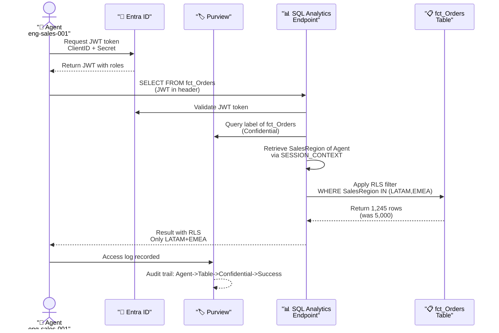

---

##### 🔐 **Conditional Access - Adaptive Policies**

When an Agent tries to access **Confidential** or **Highly Confidential** data, Entra ID evaluates Conditional Access policies:

**Policy Examples:**

| Scenario | Condition | Action |
|---------|----------|------|
| Agent on corporate IP + business hours | `TrustedLocation AND 09:00-18:00` | ✅ Allow |
| Agent outside business hours | `After 18:00 OR Weekend` | ⚠️ Requires MFA + PIM approval |
| Agent accessing Highly Confidential | Per corporate policy | ❌ Block + Notify admin |
| Agent with anomalous behavior | Elevated risk detected | ⚠️ Step-up (MFA, manual approval) |

**Example Policy (in Entra):**

```
Name: High Sensitivity Data Access
Applies to: All agents
Conditions:
  - Cloud apps: Azure Data Warehouse, SQL Database
  - Users: Service principals (agents)
  - Sensitivity: >= Confidential

Grant Controls:
  - Require multi-factor authentication
  - Require device to be marked as compliant
  - Require app protection policies
  
Session Controls:
  - Use app enforced restrictions
  - Sign-in frequency: 1 hour
```

**Integration with PIM (Privileged Identity Management):**

To access Highly Confidential data, the Agent needs approval:

```
Request Flow:
1. Agent tries SELECT * FROM dim_Customer (Highly Confidential)
2. Entra detects elevated risk
3. PIM requires approval from a Security Admin
4. Admin receives notification:
   "Agent 'eng-sales-001' requests access to 'Highly Confidential' data.
    Reason: [Agent provided]. Approve? [Yes/No]"
5. If approved: Access granted for 15 minutes
6. If rejected: Access blocked + Alert

Timeout: Token expires after 15 minutes or when PIM approval expires
```

---

##### 📋 **Audit & Compliance - Complete Traceability**

Purview and Entra record everything:

**What is audited:**

| Event | Who | When | What | Result |
|--------|------|--------|-------|----------|
| Agent authentication | Entra ID | 2024-01-15 10:32:45Z | Agent `eng-sales-001` authenticated | ✅ Success |
| Query execution | Fabric RLS | 2024-01-15 10:33:12Z | SELECT fct_Orders (Confidential) | ✅ 1,245 rows |
| Label check | Purview | 2024-01-15 10:33:12Z | Sensitivity: Confidential, RLS: Applied | ✅ Pass |
| Conditional Access | Entra | 2024-01-15 10:33:12Z | IP: 192.168.1.100, Location: Trust, Risk: Low | ✅ Allow |
| Data export | Purview DLP | 2024-01-15 10:35:00Z | Agent exported 1,245 rows to CSV | ❌ Blocked (DLP) |
| Failed access | Fabric + Purview | 2024-01-15 10:45:00Z | Agent tried Highly Confidential (PIM pending) | ❌ Denied |

**Audit Log example:**

```json
{
  "timestamp": "2024-01-15T10:33:12.456Z",
  "auditEventType": "DataAccessAudit",
  "actor": {
    "type": "ServicePrincipal",
    "id": "87654321-4321-4321-4321-210987654321",
    "displayName": "eng-sales-agent-001"
  },
  "resource": {
    "type": "Table",
    "id": "fct_Orders",
    "workspace": "Sales Analytics",
    "sensitivity": "Confidential"
  },
  "action": {
    "type": "Query",
    "query": "SELECT OrderID, Amount, CustomerID FROM fct_Orders",
    "result": "Success"
  },
  "security": {
    "authentication": "EntraID_JWT",
    "authenticationResult": "Success",
    "rls_applied": true,
    "rls_filter": "SalesRegion IN ('LATAM','EMEA')",
    "rows_returned": 1245,
    "conditional_access": "Allow",
    "risk_level": "Low"
  },
  "compliance": {
    "regulatory_framework": ["LGPD", "SOC2", "ISO27001"],
    "data_residency": "BR-South",
    "encryption": "AES-256"
  }
}
```

**Log retention requirements:**

- Verify each Entra, Fabric, Purview and Azure Monitor retention setting against the tenant's current license, region, workspace configuration and official service documentation.
- Record the required investigation and regulatory period, current configured retention, archive or export path, deletion behavior, owner and source access date.
- Do not assume that a default retention period or an external archive provides complete evidence until retrieval and access controls are tested.

---

##### 🔄 **Complete Access Flow (4 Validation Layers)**

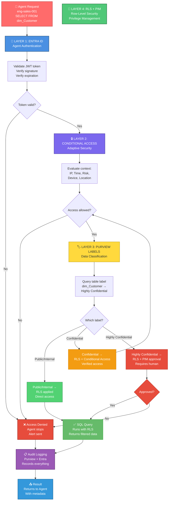

---

##### 🔗 **Microsoft References**

- [**Microsoft Entra Agent ID**](https://learn.microsoft.com/entra/agent-id/what-is-microsoft-entra-agent-id) - Identity foundation for AI agents; licensing and individual feature status vary
- [**Conditional Access for Agents**](https://learn.microsoft.com/entra/identity/conditional-access/agent-id) - Adaptive policies for agent identities
- [**Microsoft Entra Authentication in Fabric**](https://learn.microsoft.com/fabric/data-warehouse/entra-id-authentication) - Zero Trust authentication for SQL Analytics Endpoint
- [**Sensitivity Labels in Fabric**](https://learn.microsoft.com/fabric/governance/protected-sensitivity-labels) - Data classification with automatic protection
- [**Row-Level Security in Fabric**](https://learn.microsoft.com/fabric/security/service-admin-row-level-security) - Data filtering by user/agent context
- [**Data Governance with Purview**](https://learn.microsoft.com/azure/cloud-adoption-framework/data/governance-security-baselines-purview-data-estate-unify-data-platform) - Classification, governance and compliance
- [**Audit Logging in Purview**](https://learn.microsoft.com/purview/audit-solutions-overview) - Tracking and regulatory compliance
- ⏹️ **Conditional Access:** Approvals for sensitive data

### 📋 Technical Summary — From Raw Data to AI Insights

| Component | Function | Do Agents Use It? |
|---|---|---|
| **OneLake** | Single logical storage, no silos | Implicitly (via SQL endpoint) |
| **Delta Lake** | ACID guarantee, reliability, time-travel | Implicitly (through tables) |
| **Shortcuts** | Access to external data without copying | ✅ Yes (see them as local tables) |
| **SQL Analytics Endpoint** | T-SQL interface for queries | ✅ Yes (primary access method) |
| **Medallion (Bronze→Silver→Gold)** | Progressive organization and quality | ✅ Yes (access the Gold layer) |
| **Data Products** | Curated packages for reuse | ✅ Yes (primary consumer) |
| **Purview Labels** | Data classification and governance | ✅ Yes (define who accesses what) |
| **Entra ID (Agent ID)** | Agent identity and authentication | ✅ Yes (authentication + audit) |

**Microsoft References:**
- [Understand medallion lakehouse architecture for Microsoft Fabric with OneLake](https://learn.microsoft.com/fabric/onelake/onelake-medallion-lakehouse-architecture)
- [What is a lakehouse in Microsoft Fabric?](https://learn.microsoft.com/fabric/data-engineering/lakehouse-overview)
- [What is the SQL analytics endpoint for a lakehouse?](https://learn.microsoft.com/fabric/data-engineering/lakehouse-sql-analytics-endpoint)
- [Delta Lake table format interoperability](https://learn.microsoft.com/fabric/fundamentals/delta-lake-interoperability)

---

