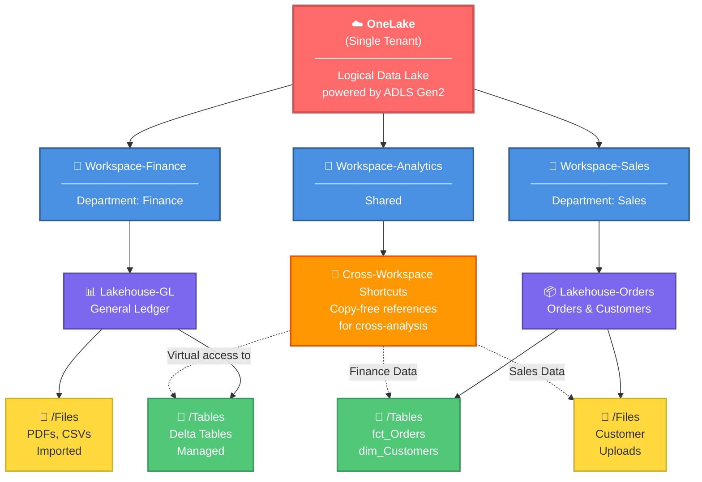

# Reference 02a — Microsoft Fabric: OneLake, Delta Lake, Shortcuts and SQL Analytics Endpoint

> Part of the layered reference architecture. See `references/02-reference-architecture-layers.md` for the layer overview and how the pieces fit together. Load this file only when OneLake, Delta Lake, Shortcuts or the SQL analytics endpoint are in scope.

## 🔧 2.1. Technical Specifications by Layer

### 🗄️ Microsoft Fabric — OneLake and Delta Lake

#### 📍 **OneLake: The Organization's Unified Lake**

**What it is:**
OneLake is a **single logical data lake per tenant**, automatically built on **Azure Data Lake Storage Gen2 (ADLS Gen2)**. It is the corporate equivalent of OneDrive for data — provisioned by default when you activate Fabric, with no additional configuration.

**Key characteristics:**
- 🎯 **Centralization:** All of the organization's analytics data in a single logical location
- 📦 **Multi-workspace:** Supports multiple workspaces (departments, domains) within the same OneLake
- 🔗 **Interoperability:** Accessible by all Fabric engines (Spark, SQL, Power BI) simultaneously
- 📊 **Duplication reduction:** Avoids data silos, reduces storage costs
- 🔐 **Unified governance:** Access, classification and compliance policies applied centrally via Purview

**Physical structure:**
When you create a **Lakehouse** in Fabric, two main folders are automatically provisioned in OneLake:
- `/Tables` — Stores managed tables in Delta format (ideal for structured data)
- `/Files` — Stores data in any format (CSV, Parquet, images, documents)

**Storage example:**



**Diagram reading:**
- 🔴 **OneLake (top):** Single tenant, automatically provisioned
- 🔵 **Workspaces:** Isolate data by department/domain
- 🟣 **Lakehouses:** Concrete (Finance-GL, Sales-Orders) in each workspace
- 🟢 **/Tables:** Stores managed Delta tables (structured)
- 🟡 **/Files:** Stores any format (raw)
- 🟠 **Shortcuts:** Create cross-workspace references without physical duplication

---

#### 🔄 **Delta Lake: The Standard Storage Format**

**What it is:**
**Delta Lake** is an open-source format maintained by the Linux Foundation that adds an ACID transactions layer, schema validation and history to Parquet files. Fabric standardizes on Delta Lake — every engine (Spark, SQL, Data Warehouse, Power BI) that writes data automatically creates Delta tables.

**Technical properties (Delta Lake vs pure Parquet):**

| Property | Parquet | Delta Lake |
|---|---|---|
| **ACID Transactions** | ❌ No | ✅ Yes (Atomicity, Consistency, Isolation, Durability) |
| **Schema Enforcement** | ❌ No | ✅ Yes (prevents "dirty" data) |
| **Time Travel** | ❌ No | ✅ Yes (query data from any point in time) |
| **Data Rollback** | ❌ No | ✅ Yes (revert bad writes) |
| **Unified Read** | ✅ Yes | ✅ Yes (all engines read the same copy) |
| **Query Performance** | Basic | **V-Order optimization** (much faster) |
| **Audit and Compliance** | ❌ No | ✅ Yes (Delta Lake table history) |

**Specific benefits for AI agents:**
- **Reliability:** Agents trust that data is correct (ACID prevents corruption)
- **Consistency:** Multiple agents reading simultaneously tend to see a consistent version
- **Traceability:** Complete history of when/who changed data (audit)
- **No duplication:** Spark transforms data → SQL reads → Power BI visualizes **from the same copy**

**Example:**
```
An agent writes "margin" data to Delta:
  ✅ Margin = (Revenue - COGS) / Revenue
  ✅ Schema enforcement: if someone tries to write "margins" (typo), it is blocked
  ✅ Another agent reads simultaneously, sees consistent data
  ✅ If an error is discovered, time-travel reverts to the previous version
```

---

#### 🔗 **Shortcuts: Virtualized Data Without Copying**

**What it is:**
Shortcuts are **virtual references** (like symbolic links) to external data. Agents query data as if it were in OneLake, but it is served from external sources without physical copying.

**Supported sources:**
- ✅ Azure Data Lake Storage Gen2 (ADLS Gen2)
- ✅ Amazon S3
- ✅ Google Cloud Storage
- ✅ Dataverse (Microsoft dynamics 365)
- ✅ Other lakehouses/workspaces (cross-workspace)

**Benefits:**
- 💰 **Zero copy:** Does not duplicate data, saves storage
- ⚡ **Fresh data:** Agents tend to see the most current version from the source
- 🔐 **Explicit security:** Access is the intersection of permissions on the shortcut path and target path; identity passthrough or delegated authentication depends on shortcut type and query engine
- 📍 **Governed access:** Configure OneLake roles, source permissions, connection identity, labels and downstream SQL/semantic-model controls for the selected path

**Example:**
```
HR data lives in an external ADLS Gen2 (managed by another team)
You create a Shortcut → it appears as a table in your Lakehouse
The agent runs: SELECT * FROM HR.Employees
  ↓ Direct fetch from ADLS Gen2, authenticated, with RLS applied
  ↓ No ETL, no duplication, centralized governance
```

---

#### 🔍 **SQL Analytics Endpoint: T-SQL Interface for Data**

**What it is:**
Each Lakehouse in Fabric **automatically provisions** a **SQL Analytics Endpoint** — a TDS (Tabular Data Stream) endpoint that exposes Delta tables as standard SQL tables, queryable with T-SQL.

**Characteristics:**
- 🚀 **Automatic:** Created together with the Lakehouse, zero setup
- 📖 **Read-only:** Does not support INSERT/UPDATE/DELETE (use Spark to modify data)
- ⚡ **High performance:** Powered by the same engine as the Fabric Data Warehouse
- 🔐 **Row & Column Security:** Applies granular SQL permissions (RLS, column masking)
- 📊 **Metadata Auto-Sync:** Delta tables automatically appear as SQL tables
- 🔗 **Cross-workspace:** Can query data via Shortcuts from other workspaces

**Capabilities:**
✅ `SELECT` against Delta tables (including via Shortcuts)  
✅ Create views, functions, stored procedures in T-SQL  
✅ Apply row-level security (RLS) and column security  
✅ Connect Power BI directly for reports  
✅ Run queries via Azure Data Studio, SQL Server Management Studio (SSMS), any TDS client  

**Agent usage example:**
```sql
-- Agent in Foundry runs:
SELECT 
    p.ProductName,
    SUM(s.Amount) as TotalSales,
    AVG(s.Amount) as AvgPrice
FROM Gold.Products p
INNER JOIN Gold.Sales s ON p.ProductID = s.ProductID
WHERE s.Date >= DATEADD(month, -3, GETDATE())
GROUP BY p.ProductName
ORDER BY TotalSales DESC

-- Result is returned via TDS to the agent
-- Row-level security has already filtered data according to the agent's permission (Entra ID)
```

**Performance considerations:**
- Metadata synchronization between a Lakehouse and its SQL analytics endpoint is asynchronous; measure propagation delay for the selected workload instead of assuming a fixed interval
- Uses **V-Order optimization:** Spark writes optimized Parquet for fast SQL reads
- Automatic indexes: Fabric maintains statistics and histograms without user action
