# Reference 02b — Microsoft Fabric: Medallion Architecture

> Part of the layered reference architecture. See `references/02-reference-architecture-layers.md` for the layer overview. Continues `references/02a-fabric-onelake-delta-shortcuts.md`. Load this file only when Bronze/Silver/Gold (medallion) data organization is in scope.

#### 🏗️ **Medallion Architecture: Layered Organization**

##### 📖 **What is Medallion Architecture?**

The **Medallion Architecture** (also known as "Bronze-Silver-Gold" or "Delta Lake Medallion") is a **data organization pattern** recommended by Microsoft for structuring Lakehouses in a scalable, governable and reusable way. It is a model **proven at petabyte scale** (Microsoft IDEAS, for example, uses Medallion for 4 PiB of data).

**Core principles:**
- 🎯 **Quality progression:** Each layer increases data quality, validation and value
- 🔄 **Reuse:** Data transformed once, consumed by multiple consumers (agents, BI, apps)
- 🏗️ **Separation of concerns:** Bronze = ingestion, Silver = transformation, Gold = business
- 📊 **Scalability:** Supports growth from terabytes to petabytes without reorganization
- 🔐 **Stratified governance:** Each layer has its own policy (workspace isolation)

**Alternatives Medallion does not replace:**
- ✅ Medallion works well in a **Data Lake** (Bronze→Silver→Gold with Spark)
- ✅ Medallion works well in a **Data Warehouse** (dimensional modeling, slowly changing dimensions)
- ✅ Fabric allows **combination:** Bronze+Silver as lakehouses, Gold as data warehouse
- ✅ For highly decentralized cases: **Data Mesh** (multiple domains, each with its own Medallion)

---

##### 🌍 **General Flow: From Raw Data to Insights**

```mermaid
graph LR
    A["🚀 Data Source<br/>─────────────────<br/>ERP, CRM, APIs,<br/>Uploads, Sensors"]
    
    B["🟤 BRONZE<br/>RAW DATA<br/>─────────────────<br/>Original format<br/>No cleaning"]
    
    C["⚙️ Spark/Python<br/>Transformation<br/>Validation"]
    
    D["🟡 SILVER<br/>CLEAN DATA<br/>─────────────────<br/>Validated data<br/>Structured"]
    
    E["⚙️ Spark/SQL<br/>Aggregation<br/>Semantics"]
    
    F["🟢 GOLD<br/>BUSINESS DATA<br/>─────────────────<br/>Ready for<br/>consumption"]
    
    G["📊 Consumption<br/>─────────────────<br/>Agents, BI,<br/>Apps, Reports"]
    
    A -->|"Ingest (as-is)"| B
    B -->|"Transform"| C
    C -->|"Validate, clean"| D
    D -->|"Aggregate"| E
    E -->|"Semanticize"| F
    F -->|"SQL Analytics<br/>Endpoint"| G
    
    style A fill:#FF6B6B,stroke:#CC5555,color:#fff,stroke-width:2px
    style B fill:#8B6F47,stroke:#664D2A,color:#fff,stroke-width:2px
    style C fill:#FFD93D,stroke:#CCB030,color:#333,stroke-width:2px
    style D fill:#C9A961,stroke:#9B7E48,color:#fff,stroke-width:2px
    style E fill:#FFD93D,stroke:#CCB030,color:#333,stroke-width:2px
    style F fill:#50C878,stroke:#3A9B5C,color:#fff,stroke-width:2px
    style G fill:#4A90E2,stroke:#2E5C8A,color:#fff,stroke-width:2px
```

---

##### 🟤 **Bronze Layer — RAW DATA**

**Purpose:**
- ✅ Capture data **as it arrives**, in original format
- ✅ Enable **audit** (traceability to origin)
- ✅ Enable **reprocessing** (if Silver/Gold logic changes)
- ✅ Maintain complete history (compliance, GDPR, etc.)

**Characteristics:**

| Aspect | Detail |
|---|---|
| **Formats** | CSV, JSON, Parquet, Delta, AVRO, images, PDFs — any |
| **Validation** | ❌ None — "trust but verify later" |
| **Duplication** | May have duplicate rows |
| **Schema** | Loose (can evolve without breaking) |
| **Retention** | Typical: 90 days to 2 years (compliance) |
| **Workspace** | Private (Bronze-Workspace) |
| **Owner** | Data Engineers (ingestion) |
| **Technology** | Data Factory, Mirroring, Synapse Spark, Dataflows |

**Bronze content example:**

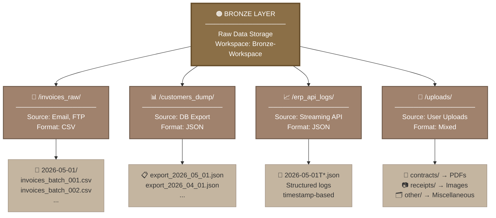

**Example characteristics:**

| Folder | Source | Format | Size | Frequency | Quality |
|---|---|---|---|---|---|
| `/invoices_raw/` | Email, FTP manual | CSV | 10-500 MB/day | Daily | ❌ May have errors, duplicates |
| `/customers_dump/` | DB Export (nightly) | JSON | 100 MB | Daily (1x) | ⚠️ May have special characters |
| `/erp_api_logs/` | Streaming API | JSON | 5-50 GB/day | Continuous | ⚠️ Timestamps may desync |
| `/uploads/` | User uploads | Mixed (PDF, IMG) | 1-10 GB/day | On-demand | ❌ May have viruses, corruption |

**Recommended flow for Bronze:**
1. **Mirroring** (ideal): Near real-time replication from DB → OneLake (supports SQL Server, MySQL, PostgreSQL, Snowflake)
2. **Data Factory:** Pipelines with 200+ native connectors
3. **Shortcuts:** Reference data from ADLS Gen2/S3 without copying
4. **Dataflow Gen2:** Visual interface, lightweight transformations

---

##### 🟡 **Silver Layer — CLEAN DATA (Validated and Structured Data)**

**Purpose:**
- ✅ **Validate** integrity: duplicates, nulls, data types
- ✅ **Clean** data: standardize formats, remove invalid values
- ✅ **Structure** for analysis: denormalizations, lightweight aggregations
- ✅ **Integrate** multiple sources: invoices + customers + products into coherent tables
- ✅ Serve as a governed, reusable analytical authority for analysts and agents within the defined domain and scope

**Characteristics:**

| Aspect | Detail |
|---|---|
| **Formats** | ✅ **Standard: Delta Lake** (ACID, schema enforcement) |
| **Validation** | ✅ Yes — referential integrity, types, ranges |
| **Duplication** | ❌ Removed (distinct keys guaranteed) |
| **Schema** | Strict (schema enforcement — rejects invalid data) |
| **Retention** | Policy-defined from legal, recovery, cost and operational requirements |
| **Workspace** | Semi-private (Silver-Workspace, controlled access) |
| **Owner** | Data Engineers (ELT transformation) |
| **Technology** | Spark (Python, SQL, Scala), Synapse notebooks |

**Typical Bronze → Silver transformations:**

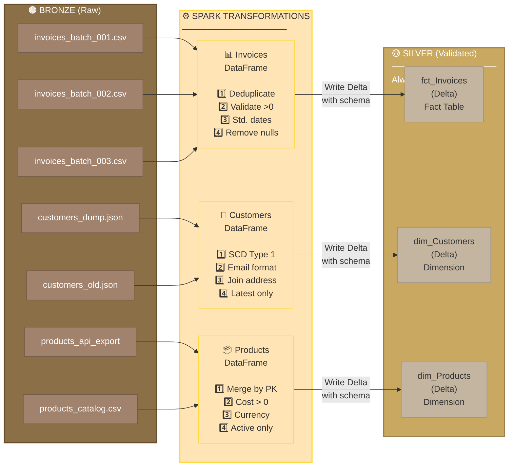

**Flow by category:**

| Source | Spark Processing | Validations | Silver Output |
|---|---|---|---|
| **Invoices** (multiple CSVs) | Spark DataFrame merge | ✅ Dedup by ID ✅ Amount > 0 ✅ Date standard ✅ Remove nulls | **fct_Invoices** (Delta) |
| **Customers** (JSON exports) | Spark DataFrame merge | ✅ Latest version (SCD1) ✅ Email format ✅ Join address data ✅ Active only | **dim_Customers** (Delta) |
| **Products** (API export) | Spark DataFrame merge | ✅ Merge by ProductID ✅ Cost > 0 ✅ Currency aligned ✅ Active flag | **dim_Products** (Delta) |

**Silver quality guarantees:**
- 🔐 **ACID transactions** — no partial or corrupted data
- 🔑 **Primary key unique** — no duplicates by ID
- 📊 **Schema strict** — rejects data outside expected type
- ✅ **Data completeness** — no NULL in critical columns
- 🔄 **Referential integrity** — FK relationships validated

**Typical Silver structure:**

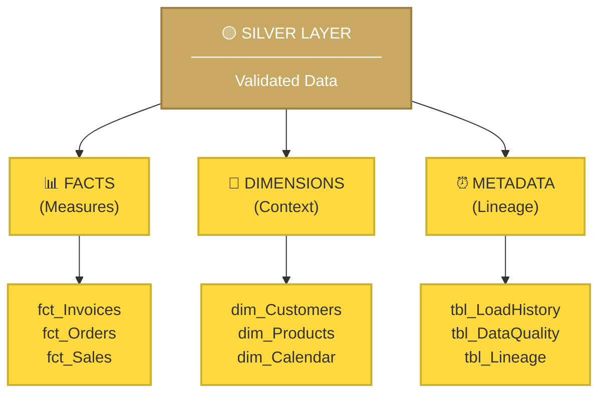

---

##### 🟢 **Gold Layer — BUSINESS DATA (Business-Ready Data)**

**Purpose:**
- ✅ **Aggregate** data into business dimensions (product, region, period)
- ✅ **Calculate** metrics (revenue, margin, COGS, KPIs)
- ✅ **Semanticize** data with comprehensible corporate names and logic
- ✅ Expose as **Data Products** consumable by agents, BI, apps
- ✅ Guarantee **performance** (pre-aggregated data, indexes, statistics)

**Characteristics:**

| Aspect | Detail |
|---|---|
| **Formats** | ✅ **Standard: Delta Lake** (with V-Order optimization) |
| **Aggregation** | ✅ Yes — facts aggregated by business dimensions |
| **Calculations** | ✅ Pre-calculated corporate metrics |
| **Schema** | Semantic — business names (not technical) |
| **Retention** | Policy-defined; retain only the history required by the scenario |
| **Workspace** | Controlled consumer access with least privilege |
| **Owner** | Analytics Engineers / Business Analysts |
| **Exposure** | SQL Analytics Endpoint, Power BI, APIs for agents |
| **Technology** | Spark (aggregations), SQL (views, stored procs), Power BI (semantic models) |

**Typical Gold structure (Data Products):**

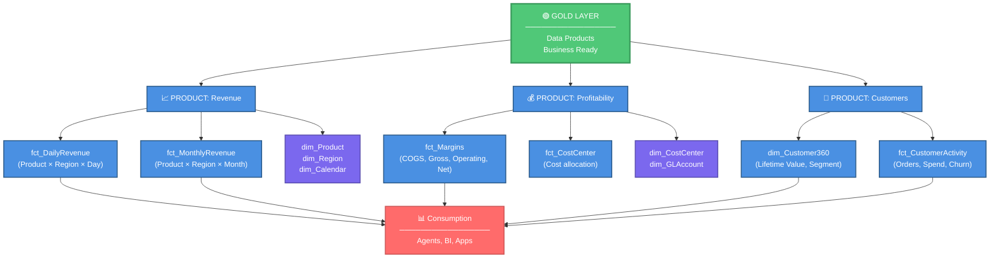

**Gold table examples:**

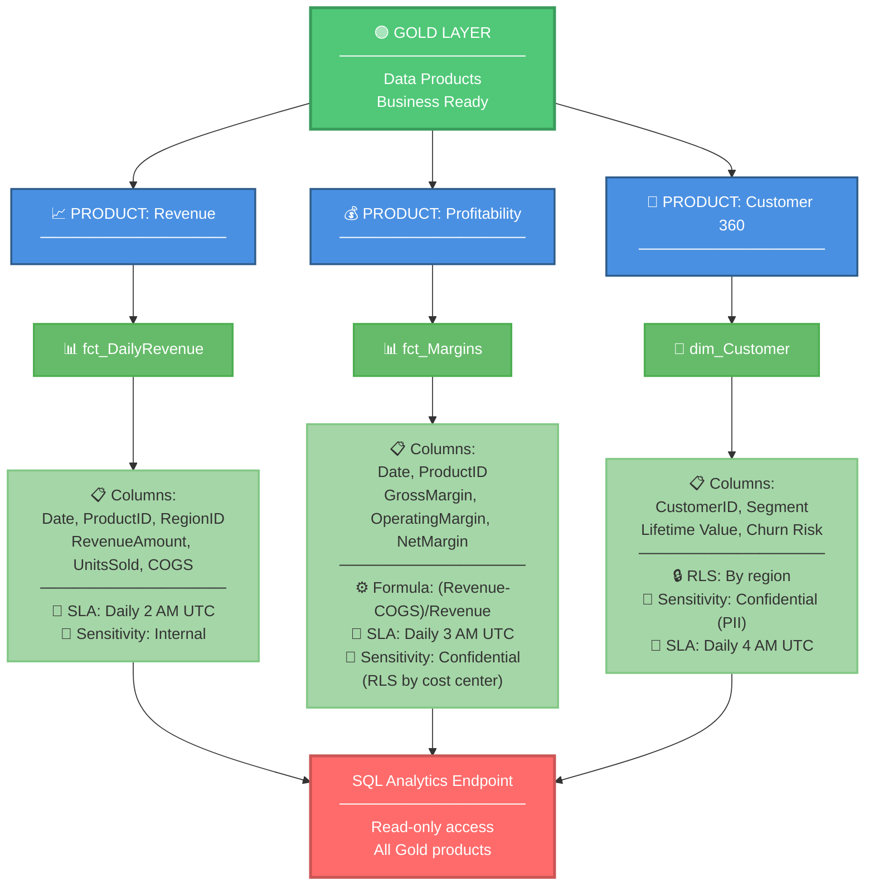

**Gold Data Products summary:**

| Product | Table | Purpose | Updated | Access |
|---|---|---|---|---|
| **Revenue** | `fct_DailyRevenue` | Revenue by product-region-day | 2 AM UTC | 🔵 Internal |
| **Profitability** | `fct_Margins` | Gross, operating, net margins | 3 AM UTC | 🟡 Confidential (RLS) |
| **Customer 360** | `dim_Customer` | Customer + lifetime value + churn risk | 4 AM UTC | 🔴 Confidential (PII + RLS) |

**Required service commitments per Data Product:**
- ✅ **Documentation:** Data dictionary, formulas, lineage
- ✅ **Freshness objective:** Defined update target with measured evidence and an accountable owner
- ✅ **Security:** Sensitivity labels plus explicitly configured identity, item, OneLake, SQL, RLS/CLS and sharing controls as applicable
- ✅ **Discovery:** Indexed in Data Catalog (Purview)
- ✅ **Audit:** Access recorded in Audit Logs

---

##### 🏢 **Workspace Isolation (Microsoft Recommendation)**

Microsoft recommends **creating each layer in a separate workspace** for better governance:

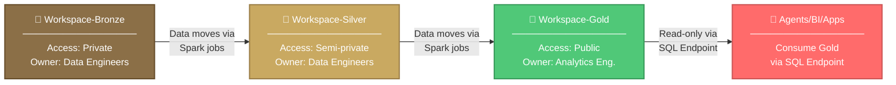

**Benefits:**
- 🔐 **Isolation:** Bronze (raw) not exposed to end users
- 👥 **Granular RBAC:** Different permissions per layer
- 📊 **Separate billing:** Track costs of each pipeline phase
- 🚀 **Performance:** Dedicated capacity for each workload
- 🔄 **Evolution:** Change Silver/Gold without affecting Bronze ingestion

---

##### 📚 **Implementation Patterns in Fabric**

There are **3 main patterns** recommended by Microsoft for implementing Medallion in Fabric. The choice depends on **team maturity, data complexity and BI requirements**.

---

###### **OPTION 1️⃣ — Three Lakehouses (one per layer)**

**When to use:**
- ✅ **Pure Data Engineering** teams (no traditional BI)
- ✅ **Broadly open** architecture (Delta Lake, no dimensional schema)
- ✅ Focus on **exploratory analyses and AI agents**
- ✅ Teams that master **Spark/Python** more than SQL

**Architecture:**

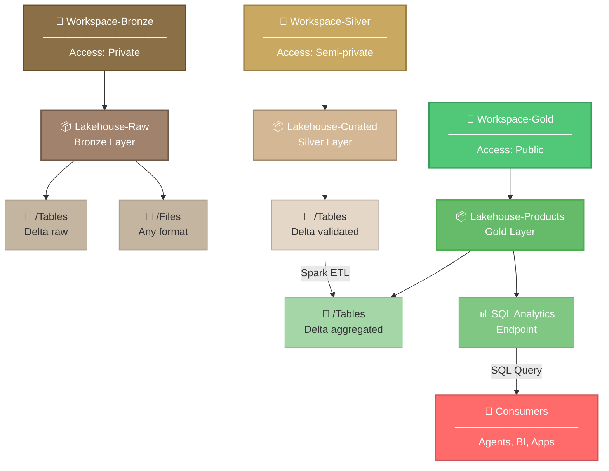

**Characteristics:**

| Aspect | Detail |
|---|---|
| **Lakehouses** | 3 separate (Bronze, Silver, Gold) |
| **Formats** | Bronze: multiple, Silver: Delta, Gold: Delta |
| **Compute** | Spark (transformation), SQL (queries) |
| **BI Support** | Limited — SQL Analytics Endpoint only |
| **Scalability** | ⭐⭐⭐⭐⭐ Excellent for data lakes |
| **Governance** | ⭐⭐⭐⭐ Workspace isolation |
| **Complexity** | Medium (3 lakehouses to maintain) |
| **Cost** | Workspace count does not determine capacity count; assign workspaces to capacity based on measured isolation, performance and governance needs |

**Real use cases:**
- Big Data agencies serving multiple clients
- Organizations with Data Science culture (Python/R dominant)
- Large-scale processing where representative workload tests validate the selected Fabric capacity
- Exploratory analyses and machine learning

---

###### **OPTION 2️⃣ — Bronze+Silver Lakehouse, Gold Data Warehouse** ⭐ **RECOMMENDED**

**When to use:**
- ✅ Teams with **traditional BI experience** (star schema, dimensional modeling)
- ✅ Need for **Power BI + SQL Reports** as consumers
- ✅ **Structured and repeatable** analyses (not exploratory)
- ✅ Teams that master **SQL/DAX** more than Spark/Python

**Architecture:**

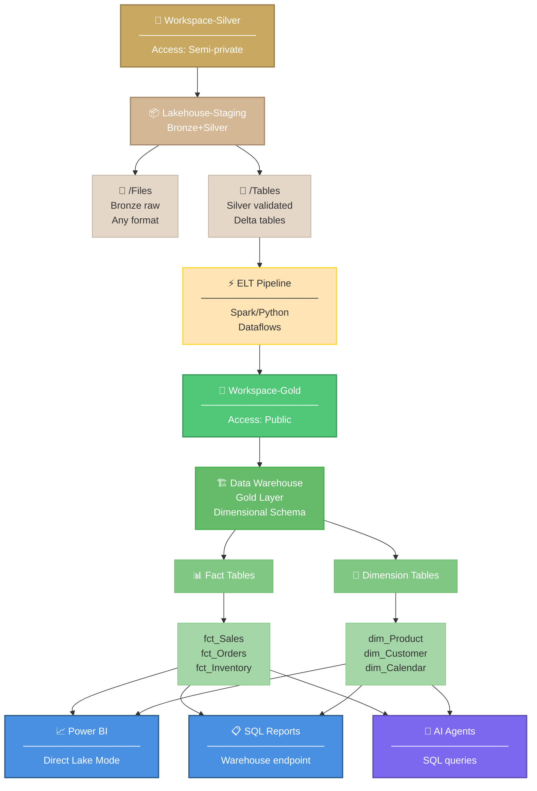

**Characteristics:**

| Aspect | Detail |
|---|---|
| **Lakehouses** | 1 (Bronze+Silver combined) |
| **Warehouses** | 1 (Gold in dimensional DW) |
| **Formats** | Bronze: multiple, Silver: Delta, Gold: DW schema |
| **Compute** | Spark (ETL), SQL (DW queries) |
| **BI Support** | ⭐⭐⭐⭐⭐ Native Power BI + SQL Reports |
| **Scalability** | ⭐⭐⭐⭐ Good for enterprise BI |
| **Governance** | ⭐⭐⭐⭐ Bronze/Silver vs Gold isolation |
| **Complexity** | Medium (1 Lakehouse + 1 DW) |
| **Cost** | Lakehouse and warehouse can share or use separate capacities; validate CUs, concurrency, isolation and cost with the Capacity Metrics app |

**Real use cases:**
- Organizations with mature BI (Power BI at scale)
- Companies transitioning from a traditional data warehouse
- Structured analyses with dimensional models
- Repeatable operational reports

**Unique benefit:** Uses Power BI **Direct Lake mode** — loads data directly from Delta tables in the DW, reducing the need for expensive Import dataset refreshes.

---

###### **OPTION 3️⃣ — Medallion + Data Mesh** (For large organizations)

**When to use:**
- ✅ **Large federated organizations** with independently owned data domains
- ✅ **Multiple autonomous domains** (Finance, Sales, Operations, HR, etc.)
- ✅ Need for **data federation** (each domain owns its data)
- ✅ Each domain operates its own **complete Medallion**

**Architecture:**

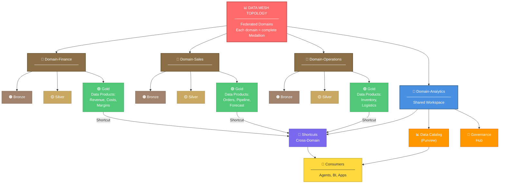

**Characteristics:**

| Aspect | Detail |
|---|---|
| **Domains** | 3+ (each one = complete Medallion) |
| **Ownership** | Each domain = autonomous team |
| **Integration** | Shortcuts + OneLake cross-workspace |
| **Governance** | Centralized hub (Purview) |
| **Scalability** | High potential, subject to selected capacity, data layout, concurrency and representative load validation |
| **Autonomy** | ⭐⭐⭐⭐⭐ Maximum independence |
| **Complexity** | High (requires discipline) |
| **Cost** | 💰💰💰 Multiple capacities |

**Data Mesh principles:**
1. **Domain ownership:** Each domain = owner of its data
2. **Data as product:** Gold layers are "Data Products" with SLA
3. **Self-serve infrastructure:** Each domain provisions its own Medallion
4. **Federated governance:** Central policies (Purview), local implementation

**Real use cases:**
- Large conglomerates (multiple subsidiaries, geographies)
- Fintech organizations (each service = independent domain)
- Organizations with multiple autonomous data-product teams and federated governance
- Media industry (multiple studios/platforms)

---

##### 📋 **Decision Matrix: Which Pattern to Choose?**

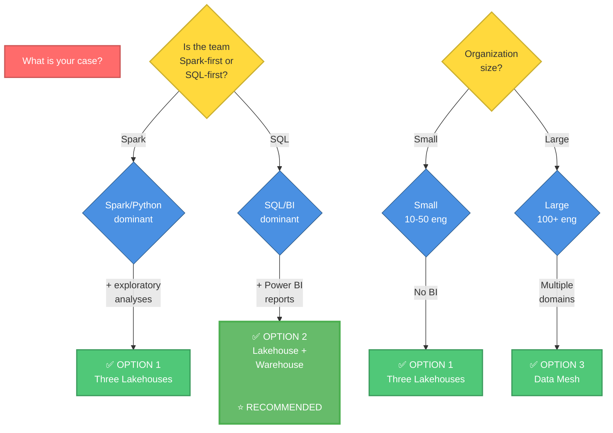

---

**Microsoft References:**

> **Source status:** Microsoft architecture, Fabric, Microsoft IQ, Agent Framework, Agent ID and security sources in this reference were rechecked on **2026-07-20**. Preview status, regional availability, licensing, authentication behavior and limits must be revalidated for each production design.
- [Understand medallion lakehouse architecture for Microsoft Fabric with OneLake](https://learn.microsoft.com/fabric/onelake/onelake-medallion-lakehouse-architecture)
- [Lakehouse end-to-end scenario: overview and architecture](https://learn.microsoft.com/fabric/data-engineering/tutorial-lakehouse-introduction)
- [Data Platform end-to-end with Microsoft Fabric](https://learn.microsoft.com/azure/architecture/example-scenario/dataplate2e/data-platform-end-to-end)
