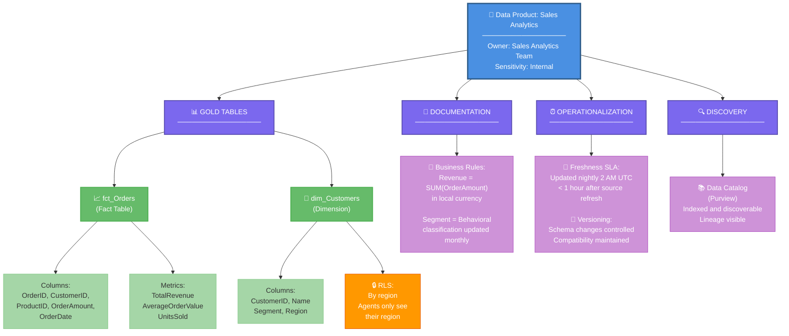
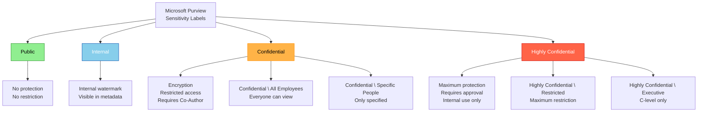
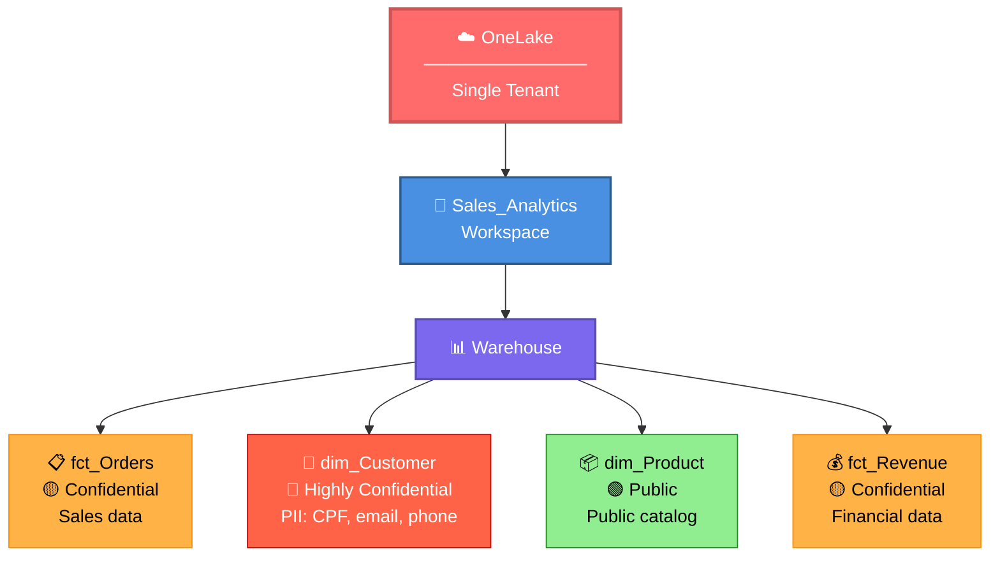
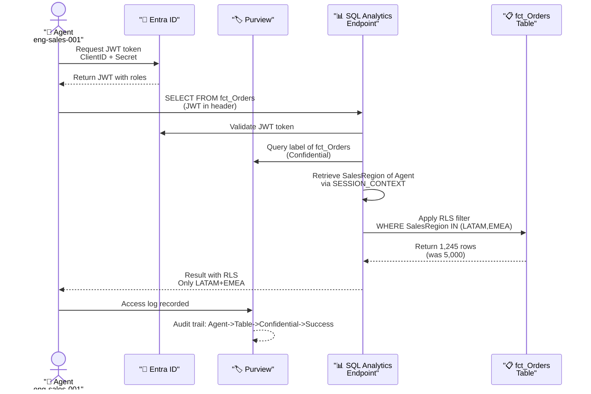
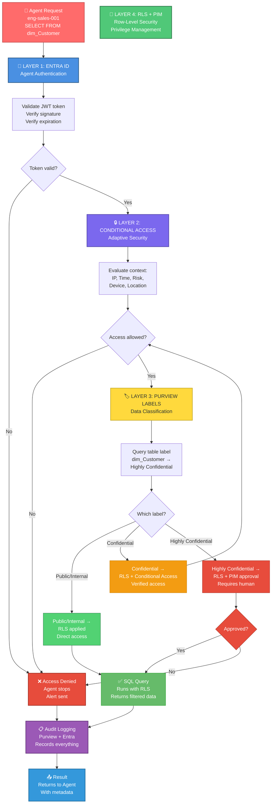

# Reference 02c — Microsoft Fabric: Data Products, Governance and Raw-to-Insight Summary

> Part of the layered reference architecture. See `references/02-reference-architecture-layers.md` for the layer overview. Continues `references/02b-fabric-medallion-architecture.md`. Load this file only when data products, Purview/Entra governance integration or the end-to-end data-to-insight summary are in scope.

#### 📊 **Data Products: Data Packages for Reuse**

**What it is:**
A **Data Product** is a curated set of Gold tables with clear semantics, documentation, and a quality SLA — ready to be reused by multiple agents and users.

**Characteristics:**
- 📖 **Documented:** Data dictionary, lineage, clear business rules
- 🎯 **Semantically clear:** "Revenue = Sales Price × Quantity", unambiguous
- 🔐 **Secure:** Sensitivity labels classify data; explicitly configured OneLake, item, SQL, RLS/CLS and sharing controls enforce access
- ⚙️ **Operationalized:** Refresh pipelines help keep data fresh, with an update SLA
- 📈 **Versioned:** Schema changes are controlled, compatibility maintained
- 📣 **Discoverable:** The catalog (Data Catalog in Purview) indexes and describes it

**Data Product example:**



**Data Product components:**

| Component | What it is | Responsibility |
|---|---|---|
| **Fact Tables** | `fct_Orders` — measures (OrderAmount, UnitsSold) | Analytical core |
| **Dimensions** | `dim_Customers` — context (Name, Segment) | Business context |
| **Metrics** | TotalRevenue, AverageOrderValue | Pre-calculated KPIs |
| **RLS** | Row-level security by region | Security + compliance |
| **Documentation** | Business rules, formulas, glossary | Clear semantics |
| **SLA** | Updated 2 AM UTC, < 1h lag | Reliability |
| **Versioning** | Schema changes with compatibility | Controlled evolution |
| **Catalog** | Purview indexes and describes | Discovery |

**Usage by an Agent:**
```python
# Agent in Foundry
from azure.ai.projects import AIProjectClient
import pyodbc

# Connect via SQL Analytics Endpoint (authenticated with Agent ID via Entra)
conn = pyodbc.connect(
    'Driver=ODBC Driver 17 for SQL Server;'
    'Server=fabric.database.windows.net;'
    'Database=Sales_Analytics;'
    'Authentication=ActiveDirectoryMSI'
)

# Query the Gold Data Product (RLS must be configured and validated)
cursor = conn.cursor()
cursor.execute('''
    SELECT OrderAmount, CustomerSegment, OrderDate
    FROM fct_Orders
    WHERE OrderDate >= DATEADD(month, -3, GETDATE())
''')

# Agent reasons over the data
data = cursor.fetchall()
# ... Claude processes context, generates analysis
```

---

#### 🔐 **Governance Integration (Purview + Entra)**

The integration between **Microsoft Entra Agent ID**, **Microsoft Purview** and **Microsoft Fabric** creates a multi-level security architecture where each agent is authenticated as a distinct corporate identity (not just a generic application), and every data access is governed by sensitivity classification and access control rules.

##### 🪪 **Entra ID Agent Identity - Identities for AI**

Microsoft Entra Agent ID is an identity and security framework for AI agents. Agent identities are specialized Entra identity constructs; the effective controls depend on the identity type, token flow, licensing and configured security capabilities.

| Aspect | Service Principal (Legacy) | Entra Agent ID (New) |
|---------|-------------------------|---------------------|
| **Purpose** | General workload/application identity | Agent identity created from an agent identity blueprint |
| **Authentication** | Supported workload credential or federation | OAuth 2.0 token flow through the supported blueprint/agent identity pattern |
| **Authorization** | Resource permissions and application roles | The same resource authorization remains required; agent-specific security can add risk and lifecycle controls |
| **Audit** | Entra sign-in and audit signals | Agent sign-in and audit signals for supported identity flows |
| **Governance** | Workload lifecycle controls | Blueprint and agent lifecycle controls when configured and licensed |
| **Conditional Access** | Workload identity controls vary | Agent Conditional Access requires supported identity flows, configuration and licensing |

**How Agent ID works:**

1. **Creation:** Each agent receives a unique identity in Entra ID (e.g., `eng-sales-agent-001`)
2. **Authentication:** The application obtains an OAuth token through the supported agent identity flow; prefer managed credentials or workload identity federation over long-lived secrets
3. **The JWT contains:**
   - `app_displayname`: "Eng Sales Agent"
   - `appid`: unique GUID of the agent
   - `roles`: ["Data Explorer", "Contributor"] 
   - `oid`: object ID of the agent
4. **Zero Trust:** The target resource validates the token and enforces its own permissions; configured Entra security capabilities can add risk-based controls
5. **Renewal:** Token lifetime follows the effective Entra policy and token flow; do not assume a universal one-hour lifetime

**JWT Payload example:**
```json
{
  "aud": "https://database.windows.net",
  "iss": "https://sts.windows.net/12345678-1234-1234-1234-123456789012/",
  "iat": 1704067200,
  "nbf": 1704067200,
  "exp": 1704070800,
  "acr": "1",
  "appid": "87654321-4321-4321-4321-210987654321",
  "appidacr": "1",
  "email": "eng-sales-agent-001@company.onmicrosoft.com",
  "name": "Engineering Sales Agent",
  "oid": "11111111-1111-1111-1111-111111111111",
  "roles": ["Data Explorer", "Contributor"],
  "rh": "0.ARcAoP...",
  "scp": "user_impersonation",
  "sub": "oL....",
  "tid": "12345678-1234-1234-1234-123456789012",
  "unique_name": "eng-sales-agent-001@company.onmicrosoft.com",
  "upn": "eng-sales-agent-001@company.onmicrosoft.com",
  "uti": "....",
  "ver": "1.0"
}
```

---

##### 🏷️ **Purview Sensitivity Labels - Hierarchy and Classification**

Sensitivity labels in Purview provide multi-level classification with progressive protection:

| Label | Description | Use Scenario | Protection | Access by Agent |
|-------|-----------|---|----------|---|
| **Public** | No restriction, can be shared externally | Public marketing data, public prices | No encryption | ✅ Automatic |
| **Internal** | Internal use only, not sensitive | Operational documents, announcements | Watermark | ✅ Automatic |
| **Confidential** | Sensitive business data, restricted to authorized employees | Contracts, sales plans, internal analyses | Encryption + Access Restriction | ⚠️ Requires Conditional Access |
| **Highly Confidential** | Extremely sensitive data, maximum protection | Financial data, PII, trade secrets | Strong encryption + Strict restriction | ❌ Blocked (human-in-loop required) |

**Label Hierarchy in Purview:**



**Applying Labels in Fabric:**

When data is ingested into OneLake, Purview can apply labels automatically:



---

##### 🔒 **Row-Level Security (RLS) - Filtering by Agent Context**

The SQL Analytics Endpoint in Fabric supports RLS via `EXECUTE AS` with Agent ID:

```sql
-- Base table: fct_Orders
SELECT 
    OrderID, 
    Amount, 
    CustomerID, 
    OrderDate,
    SensitivityLabel  -- Column added by Purview
FROM [dbo].[fct_Orders]

-- RLS policy applied to Agent "eng-sales-agent-001"
CREATE SECURITY POLICY SalesRLS
    ADD FILTER PREDICATE dbo.fn_securitypredicate(SalesRegion)
    ON dbo.fct_Orders
    AFTER INSERT, AFTER UPDATE;

-- Function that defines the filter
CREATE FUNCTION dbo.fn_securitypredicate(@SalesRegion AS nvarchar(max))
    RETURNS TABLE
    WITH SCHEMABINDING
AS
RETURN SELECT 1 AS fn_securitypredicate_result
WHERE @SalesRegion IN (
    SELECT value FROM STRING_SPLIT(
        SESSION_CONTEXT(N'SalesRegion'), ','
    )
);

-- Agent connects with context
EXECUTE sp_set_session_context @key=N'SalesRegion', @value=N'LATAM,EMEA';
SELECT * FROM fct_Orders;  -- Returns only LATAM + EMEA
```

**RLS Flow for an Agent:**



---

##### 🔐 **Conditional Access - Adaptive Policies**

When an Agent tries to access **Confidential** or **Highly Confidential** data, Entra ID evaluates Conditional Access policies:

**Policy Examples:**

| Scenario | Condition | Action |
|---------|----------|------|
| Agent on corporate IP + business hours | `TrustedLocation AND 09:00-18:00` | ✅ Allow |
| Agent outside business hours | `After 18:00 OR Weekend` | ⚠️ Requires MFA + PIM approval |
| Agent accessing Highly Confidential | Per corporate policy | ❌ Block + Notify admin |
| Agent with anomalous behavior | Elevated risk detected | ⚠️ Step-up (MFA, manual approval) |

**Example Policy (in Entra):**

```
Name: High Sensitivity Data Access
Applies to: All agents
Conditions:
  - Cloud apps: Azure Data Warehouse, SQL Database
  - Users: Service principals (agents)
  - Sensitivity: >= Confidential

Grant Controls:
  - Require multi-factor authentication
  - Require device to be marked as compliant
  - Require app protection policies
  
Session Controls:
  - Use app enforced restrictions
  - Sign-in frequency: 1 hour
```

**Integration with PIM (Privileged Identity Management):**

To access Highly Confidential data, the Agent needs approval:

```
Request Flow:
1. Agent tries SELECT * FROM dim_Customer (Highly Confidential)
2. Entra detects elevated risk
3. PIM requires approval from a Security Admin
4. Admin receives notification:
   "Agent 'eng-sales-001' requests access to 'Highly Confidential' data.
    Reason: [Agent provided]. Approve? [Yes/No]"
5. If approved: Access granted for 15 minutes
6. If rejected: Access blocked + Alert

Timeout: Token expires after 15 minutes or when PIM approval expires
```

---

##### 📋 **Audit & Compliance - Complete Traceability**

Purview and Entra record everything:

**What is audited:**

| Event | Who | When | What | Result |
|--------|------|--------|-------|----------|
| Agent authentication | Entra ID | 2024-01-15 10:32:45Z | Agent `eng-sales-001` authenticated | ✅ Success |
| Query execution | Fabric RLS | 2024-01-15 10:33:12Z | SELECT fct_Orders (Confidential) | ✅ 1,245 rows |
| Label check | Purview | 2024-01-15 10:33:12Z | Sensitivity: Confidential, RLS: Applied | ✅ Pass |
| Conditional Access | Entra | 2024-01-15 10:33:12Z | IP: 192.168.1.100, Location: Trust, Risk: Low | ✅ Allow |
| Data export | Purview DLP | 2024-01-15 10:35:00Z | Agent exported 1,245 rows to CSV | ❌ Blocked (DLP) |
| Failed access | Fabric + Purview | 2024-01-15 10:45:00Z | Agent tried Highly Confidential (PIM pending) | ❌ Denied |

**Audit Log example:**

```json
{
  "timestamp": "2024-01-15T10:33:12.456Z",
  "auditEventType": "DataAccessAudit",
  "actor": {
    "type": "ServicePrincipal",
    "id": "87654321-4321-4321-4321-210987654321",
    "displayName": "eng-sales-agent-001"
  },
  "resource": {
    "type": "Table",
    "id": "fct_Orders",
    "workspace": "Sales Analytics",
    "sensitivity": "Confidential"
  },
  "action": {
    "type": "Query",
    "query": "SELECT OrderID, Amount, CustomerID FROM fct_Orders",
    "result": "Success"
  },
  "security": {
    "authentication": "EntraID_JWT",
    "authenticationResult": "Success",
    "rls_applied": true,
    "rls_filter": "SalesRegion IN ('LATAM','EMEA')",
    "rows_returned": 1245,
    "conditional_access": "Allow",
    "risk_level": "Low"
  },
  "compliance": {
    "regulatory_framework": ["LGPD", "SOC2", "ISO27001"],
    "data_residency": "BR-South",
    "encryption": "AES-256"
  }
}
```

**Log retention requirements:**

- Verify each Entra, Fabric, Purview and Azure Monitor retention setting against the tenant's current license, region, workspace configuration and official service documentation.
- Record the required investigation and regulatory period, current configured retention, archive or export path, deletion behavior, owner and source access date.
- Do not assume that a default retention period or an external archive provides complete evidence until retrieval and access controls are tested.

---

##### 🔄 **Complete Access Flow (4 Validation Layers)**



---

##### 🔗 **Microsoft References**

- [**Microsoft Entra Agent ID**](https://learn.microsoft.com/entra/agent-id/what-is-microsoft-entra-agent-id) - Identity foundation for AI agents; licensing and individual feature status vary
- [**Conditional Access for Agents**](https://learn.microsoft.com/entra/identity/conditional-access/agent-id) - Adaptive policies for agent identities
- [**Microsoft Entra Authentication in Fabric**](https://learn.microsoft.com/fabric/data-warehouse/entra-id-authentication) - Zero Trust authentication for SQL Analytics Endpoint
- [**Sensitivity Labels in Fabric**](https://learn.microsoft.com/fabric/governance/protected-sensitivity-labels) - Data classification with automatic protection
- [**Row-Level Security in Fabric**](https://learn.microsoft.com/fabric/security/service-admin-row-level-security) - Data filtering by user/agent context
- [**Data Governance with Purview**](https://learn.microsoft.com/azure/cloud-adoption-framework/data/governance-security-baselines-purview-data-estate-unify-data-platform) - Classification, governance and compliance
- [**Audit Logging in Purview**](https://learn.microsoft.com/purview/audit-solutions-overview) - Tracking and regulatory compliance
- ⏹️ **Conditional Access:** Approvals for sensitive data

### 📋 Technical Summary — From Raw Data to AI Insights

| Component | Function | Do Agents Use It? |
|---|---|---|
| **OneLake** | Single logical storage, no silos | Implicitly (via SQL endpoint) |
| **Delta Lake** | ACID guarantee, reliability, time-travel | Implicitly (through tables) |
| **Shortcuts** | Access to external data without copying | ✅ Yes (see them as local tables) |
| **SQL Analytics Endpoint** | T-SQL interface for queries | ✅ Yes (primary access method) |
| **Medallion (Bronze→Silver→Gold)** | Progressive organization and quality | ✅ Yes (access the Gold layer) |
| **Data Products** | Curated packages for reuse | ✅ Yes (primary consumer) |
| **Purview Labels** | Data classification and governance | ✅ Yes (define who accesses what) |
| **Entra ID (Agent ID)** | Agent identity and authentication | ✅ Yes (authentication + audit) |

**Microsoft References:**
- [Understand medallion lakehouse architecture for Microsoft Fabric with OneLake](https://learn.microsoft.com/fabric/onelake/onelake-medallion-lakehouse-architecture)
- [What is a lakehouse in Microsoft Fabric?](https://learn.microsoft.com/fabric/data-engineering/lakehouse-overview)
- [What is the SQL analytics endpoint for a lakehouse?](https://learn.microsoft.com/fabric/data-engineering/lakehouse-sql-analytics-endpoint)
- [Delta Lake table format interoperability](https://learn.microsoft.com/fabric/fundamentals/delta-lake-interoperability)

---

