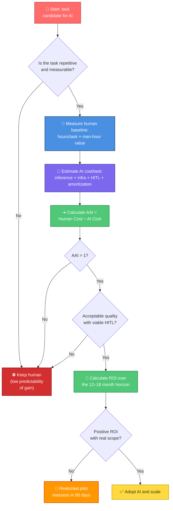
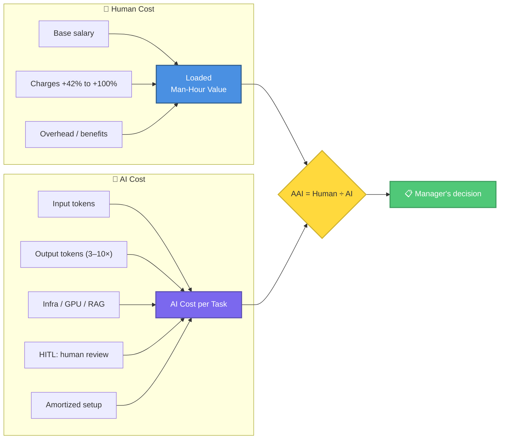
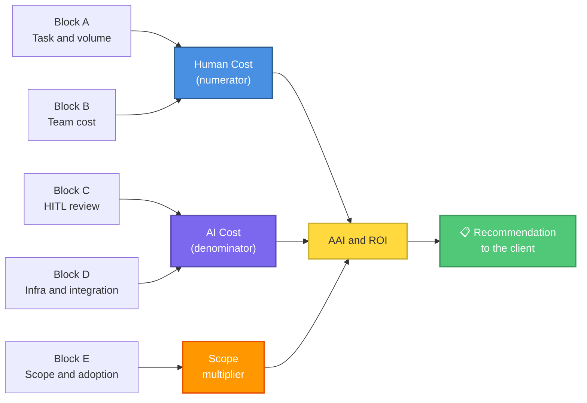
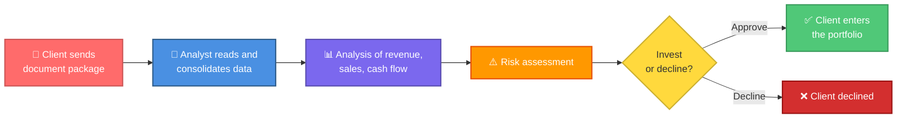
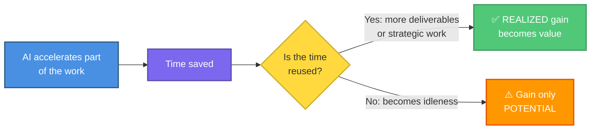

## 💰 4.1. ROI Model — AI vs. Man-Hour Cost

> **Objective:** give managers a **financial and auditable** decision model to answer, in each adoption scenario, the central question: *"is it worth more to use AI or to pay for human work?"* — and to justify, in numbers, the roadmap decisions in sections 3 and 4.

### 📌 Executive summary

The decision should not be made "on the token" (unit cost of inference), but rather **on the cost per completed and validated task**. The price of a token is negligible; the hidden cost lies in *rework, human review (HITL) and infrastructure*. The rule of thumb: **measuring cost per completed task, not per token, is what separates those who optimize from those who merely save.**

The central formula is the **AI Advantage Index (AAI)**:

$$
\text{AAI} = \frac{\text{Human Cost of the Task}}{\text{Total AI Cost per Task}}
$$

- **AAI > 1** → AI is financially advantageous.
- **AAI = 1** → break-even point (indifferent).
- **AAI < 1** → keep the human work.

The higher the AAI, the greater the return. An AAI of $4.0$ means that the task via AI costs **¼** of the value of the same task done by a person.

> **Two ways to evaluate ROI.**
> 1. **Efficiency/replacement mode:** *"does AI do this task cheaper than a human?"* — uses the AAI above.
> 2. **Amplification mode:** *"how much does AI increase the productivity of the employee who stays in charge?"* — AI does not replace the person; it amplifies the throughput of whoever is already there (see the end of this section). Consistent with the *amplification* mode of the Work IQ and Foundry IQ layers in this guide.

### 🧮 The two halves of the equation

**Human Cost of the Task (numerator):**

$$
\text{Cost}_{\text{Human}} = \text{Value}_{\text{Man-Hour}} \times \text{Hours}_{\text{per Task}} \times \text{N}^\circ_{\text{Tasks}}
$$

| Variable | Description | How to obtain |
|---|---|---|
| `Man_Hour_Value` | **Fully loaded** cost (salary + charges + overhead), **not** the base salary | Hourly wage × loading factor |
| `Hours_per_Task` | Average time a human takes on the task | Sampling / ticketing system |
| `Num_Tasks` | Volume of tasks in the period | Operational history |

> ⚠️ **Most common mistake:** using the gross salary. The BLS (US) *Employment Cost Index* points to an additional load of **~42% over the salary**. In Brazil, CLT charges raise the cost by **+70% to +100%** over the base salary. **Always use the loaded cost.** Example (Brazil/CLT): base salary R$ 8,000 × loading factor 1.8 = R$ 14,400/month ÷ ~160 h ≈ **R$ 90/hour**.

**Total AI Cost per Task (denominator):**

$$
\text{Cost}_{\text{AI Task}} = \text{Cost}_{\text{Inference}} + \text{Cost}_{\text{Infra}} + \text{Cost}_{\text{HITL}} + \text{Cost}_{\text{Amortized}}
$$

| Component | What it includes | Critical note |
|---|---|---|
| `Inference_Cost` | Input + output tokens × model price | **Output** tokens cost **3× to 10× more** than input |
| `Infra_Cost` | GPUs/cloud, agent orchestration, vector databases (RAG), APIs | Diluted per task |
| `HITL_Cost` | Human time for **reviewing, correcting and approving** AI outputs | This is where the *"phantom productivity"* lives |
| `Amortized_Cost` | One-time setup (integration, *prompt engineering*, data cleaning) ÷ total volume | Legacy integration usually takes **2× to 3×** the estimate |

Inference cost detail:

$$
\text{Cost}_{\text{Inference}} = (\text{Tokens}_{\text{Input}} \times \text{Price}_{\text{Input}}) + (\text{Tokens}_{\text{Output}} \times \text{Price}_{\text{Output}})
$$

Reference prices per **million tokens** (market, 2026 — input / output):

| Tier / Model | Input (US$/1M) | Output (US$/1M) | Typical use |
|---|---|---|---|
| Economy (Haiku, GPT mini, Gemini Flash) | ~0.10 – 1.00 | ~0.40 – 5.00 | Chat, classification, high volume |
| Intermediate (Sonnet, GPT-5) | ~2.50 – 3.00 | ~15.00 | Production reasoning, code |
| Premium (Opus, o3) | ~5.00 – 15.00 | ~25.00 – 75.00 | Critical analysis, multi-step agents |

> 💡 **Inference reduction levers:** **Prompt caching** reduces *input* cost by **30–60%** when the system prompt repeats; **Batch API** cuts input and output in half when latency is not critical; **context window** — filling 80% of 128K can cost **4–6×** more than a 16K context for the same task.

### 📈 The complete ROI formula

$$
\text{ROI}\,(\%) = \frac{\text{Cost}_{\text{Human}} - \text{Cost}_{\text{AI Total}}}{\text{Cost}_{\text{AI Total}}} \times 100
$$

Where, over the evaluated horizon:

$$
\text{Cost}_{\text{AI Total}} = \text{Costs}_{\text{One-time}} + (\text{Costs}_{\text{Recurring}} \times \text{Periods}) + \text{Cost}_{\text{HITL}}
$$

> 📌 **Time horizon.** Many projects have **negative ROI in year 1** (setup) and only turn positive in year 2. MIT's *Project NANDA* found that **95% of companies see no bottom-line impact within 6 months** — often by measuring too early. **Evaluate over a 12–18 month window** (consistent with the wave-based roadmap in sections 3 and 19).

### 🌐 The scope multiplier (the most decisive factor)

$$
\text{Benefit}_{\text{Real}} = \text{Benefit}_{\text{Potential}} \times \text{Multiplier}_{\text{Scope}}
$$

McKinsey (2025) points to the paradox: **88% declared adoption, but only 6% real impact**. If only 5% of employees are in the rollout, the return is **5% of the total potential**. This factor weighs more than the per-task math — and connects directly to the adoption targets (`adoption rate`) of this guide's KPIs.

### 🔀 Decision flowchart

### 🧠 Anatomy of the decision (cost map)

### 🔢 Numeric example — support email triage

**Scenario:** 1,000 tasks/month.

**Human side:** R$ 90/h loaded × 0.5 h/task = **R$ 45/task** → R$ 45,000/month.

**AI side (intermediate model, with review):**

| Component | Value/task |
|---|---|
| Inference (2,000 input + 800 output) | ≈ R$ 0.12 |
| Diluted infra | ≈ R$ 0.20 |
| HITL (review of 20% × 5 min × R$ 90/h) | ≈ R$ 1.50 |
| Amortized setup (R$ 60,000 ÷ 12,000 tasks/year) | ≈ R$ 5.00 |
| **Total AI cost/task** | **≈ R$ 6.82** |

**Result:** $\text{AAI} = 45.00 \div 6.82 \approx 6.6$ (strongly advantageous); $\text{ROI} = (45{,}000 - 6{,}820) \div 6{,}820 \times 100 \approx 560\%$.

> Note that **HITL + amortized setup** (R$ 6.50 of the R$ 6.82) dominate the cost — inference is almost negligible. **This is why the formula cannot stop at the token price.**

### 📉 Sensitivity table (when AI *stops* being worth it)

| % of outputs requiring review | HITL cost/task | Total AI cost/task | AAI | Decision |
|---|---|---|---|---|
| 0% (autonomous) | R$ 0.00 | R$ 5.32 | 8.5 | ✅ Excellent |
| 20% | R$ 1.50 | R$ 6.82 | 6.6 | ✅ Great |
| 60% | R$ 4.50 | R$ 9.82 | 4.6 | ✅ Good |
| 100% (full review) | R$ 7.50 | R$ 12.82 | 3.5 | ✅ Still worth it |
| Low-value task (R$ 12/human task) + 100% review | R$ 7.50 | R$ 12.82 | 0.9 | ❌ Not worth it |

**Reading:** the tipping point is almost never the inference cost — it is the **combination of low human-task value with a high need for review**. Tasks that are cheap for a human and require constant supervision are the worst candidates.

### ✅ Manager's checklist before deciding

1. Did I use the **loaded** man-hour cost (with charges), not the gross salary?
2. Did I include **HITL** (human review time) in the AI cost?
3. Did I **amortize the setup** (integration, prompt engineering) over the real volume?
4. Did I establish a human **baseline** *before* the project?
5. Did I evaluate over the **12–18 month** horizon, not 3?
6. Did I apply the **scope multiplier** (how many will really use it)?
7. Did I consider **levers** (caching, batch, the right model for the right task)?

### 📊 Market benchmarks to calibrate expectations

- **Value per task:** Anthropic estimates the median task at **US$ 54** of human work, with tasks **80% faster** with AI (study of 100,000 conversations, Nov/2025).
- **Operational gains:** **15–35%** operating cost reduction, **20–40%** efficiency gain and **30–60%** error reduction in repetitive processes.
- **Coding productivity:** the GitHub Copilot RCT (Kalliamvakou et al., 2022) showed developers **55% faster**.
- **Agentic ROI:** typical reported returns of **250–600%**.
- **Abandonment rate:** **46% of pilots** were abandoned before production in 2025 — usually due to change management and integration, not technological failure.

### 🔎 Discovery guide with the client (from discovery to the number)

Each block of questions maps to a variable of the formula. In the end, you will have the numbers for the AAI and the ROI.

| Block | Focus | Feeds |
|---|---|---|
| **A — Task and volume** | Scope, repetitiveness, frequency, time per task, growth, baseline | Numerator (`Num_Tasks`, `Hours_per_Task`) |
| **B — Team cost** | Headcount, salary range, employment type (CLT/PJ), charges, reallocation vs. savings | Loaded `Man_Hour_Value` |
| **C — Quality and HITL** | Cost of error, need for approval, fraction reviewed, review time, minimum accuracy | `HITL_Cost` (defines viability) |
| **D — Infra and integration** | RAG, systems (CRM/ERP), APIs vs. legacy, LGPD, batch, caching | `Amortized_Cost` and `Infra_Cost` |
| **E — Scope and horizon** | How many would use it, pilot vs. production, payback period, sponsorship, budget | `Scope_Multiplier` |

**The 5 minimum questions (if time is short):** (1) How many **tasks**/month? (2) How much **time** each one, by a person? (3) What is that person's **loaded cost/hour**? (4) What **fraction of the AI outputs** would need review? (5) How many **people** would actually use the solution?

### 🏦 Practical case — Credit/Investment Analysis (whether or not to invest in a client)

An investment area receives, from each prospective client, a **package of documents** (financial statements, revenue, cash flow, contracts). A **mid-level analyst** reads, consolidates and issues a recommendation. Today it consumes **~1.5 days (12 h)** per client; volume of **40 clients/month**.

**Assumptions:** base salary R$ 6,000 × factor 1.8 = R$ 10,800/month ÷ 168 h ≈ **R$ 64.30/h loaded**. Human cost per analysis = 64.30 × 12 h ≈ **R$ 771.60** → R$ 30,864/month (≈ 3 analysts for 40 clients).

The agent does the **extraction and consolidation of the documents**, calculates indicators and produces a **structured report with a preliminary recommendation**. Since the decision is about risk, **the analyst is kept in the loop (HITL)** — now they **review and decide**, instead of digging for data:

| Component | Value/analysis |
|---|---|
| Inference (~150K input + 8K output, with *caching*) | ≈ R$ 4.50 |
| Infra (orchestration, RAG, OCR) diluted | ≈ R$ 2.00 |
| **HITL**: analyst reviews and decides (2 h × R$ 64.30) | **R$ 128.60** |
| Amortized setup (R$ 120,000 ÷ 480 analyses/year) | ≈ R$ 250.00 |
| **Total AI cost/analysis (year 1)** | **≈ R$ 385.10** |
| **Total AI cost/analysis (year 2+)** | **≈ R$ 135.10** |

**Result:** Year 1 → $\text{AAI} \approx 2.0$, $\text{ROI} \approx 100\%$. Year 2+ → $\text{AAI} \approx 5.7$, $\text{ROI} \approx 471\%$.

**Impact on capacity (the real gain is not firing, it is multiplying throughput):**

| Metric | Without AI | With AI | Effect |
|---|---|---|---|
| Analyst time per analysis | 12 h | 2 h (review/decision only) | **−83%** |
| Analyses per analyst/month | ~14 | ~84 | **6× the capacity** |
| Analysts for 40 clients/month | ~3 | ~1 (with slack) | Frees 2 for higher-value work |
| Monthly operation cost (year 2+) | R$ 30,864 | R$ 5,404 | **−82%** |

> HITL **is not optional** here — AI accelerates triage and consolidation, but the **risk decision remains human**. This connects to the Human-in-the-Loop in section 10 and the guard rails in section 8.

### 🚀 Amplification mode — how much AI increases employee productivity

Instead of *"is AI cheaper than the human?"*, this mode asks: **"if I give AI to my employee, how much more do they produce — and does that pay for the tool?"** The person **does not leave the loop**; they start delivering more in the same time. Anthropic data (Nov/2025) show **52% of conversations already "augmented"** (copilot) versus 45% "automated".

$$
\text{ROI}_{\text{ampl}} = \frac{\text{Value}_{\text{Freed Time}} - \text{Cost}_{\text{AI}}}{\text{Cost}_{\text{AI}}} \times 100
$$

$$
\text{Value}_{\text{Freed Time}} = \text{Value}_{\text{Man-Hour}} \times \text{Hours}_{\text{Worked}} \times \text{Gain}_{\text{Productivity}}
$$

> ⚠️ **The gross-gain trap.** An employee does not spend 100% of the day on tasks that AI accelerates. If AI saves 50% of the time, but only **40% of the work** is "automatable", the **effective** gain is $50\% \times 40\% = 20\%$, not 50%:
>
> $$\text{Gain}_{\text{Effective}} = \text{Gain}_{\text{on Task}} \times \text{Fraction}_{\text{of Work Affected}}$$

**Freed time only becomes value if it is reused.** Saving 1 hour only generates a return if it is filled with valuable work; otherwise the gain is **potential**, not **realized**:

$$
\text{Value}_{\text{Realized}} = \text{Value}_{\text{Freed Time}} \times \text{Factor}_{\text{Realization}}
$$

**Example (financial analyst with a copilot):** R$ 64.30/h, 168 h/month, task gain 50%, affected fraction 40% → effective gain **20%**; realization factor 70%; AI cost R$ 300/month.

$$
\text{Value}_{\text{Freed Time}} = 64.30 \times 168 \times 20\% = R\$\,2{,}160.48/\text{month}
$$
$$
\text{Value}_{\text{Realized}} = 2{,}160.48 \times 70\% = R\$\,1{,}512.34/\text{month}
$$
$$
\text{ROI}_{\text{ampl}} = (1{,}512.34 - 300) \div 300 \times 100 \approx 404\%
$$

In hours: the analyst "gives back" $168 \times 20\% = 33.6$ h/month; with 70% reuse, **~23.5 h/month** become valuable work — almost **three extra business days per month**, at a cost of R$ 300.

| Effective gain | Freed hours/month | Realized value/month | Amplification ROI | Verdict |
|---|---|---|---|---|
| 5% | 8.4 | R$ 378 | +26% | ✅ Worth it, low margin |
| 10% | 16.8 | R$ 756 | +152% | ✅ Worth it |
| 20% | 33.6 | R$ 1,512 | +404% | ✅ Strong |
| 35% | 58.8 | R$ 2,647 | +782% | ✅ Excellent |

> Break-even point: for R$ 64.30/h, AI at R$ 300/month and 70% realization, an effective gain of just **~4%** (≈ 4.7 h/month reused) is enough for the tool to pay for itself. **This is why low-cost copilots almost always have positive ROI for skilled work** — the loaded salary makes each freed hour far more valuable than the subscription.

### 🔗 How the ROI model connects to this guide's architecture

| ROI concept | In efficiency mode | In amplification mode | Related layer/section |
|---|---|---|---|
| Numerator | Human cost of the task | Value of freed time | Business cases (sections 3–4) |
| Denominator | Total AI cost per task | AI cost per employee | Foundry IQ + Fabric (section 2) |
| Reality factor | Scope multiplier | Realization factor | Adoption KPIs (sections 3, 19) |
| HITL | Cost to subtract | Not applicable (human in charge) | Human-in-the-Loop (section 10) |
| Key question | "Is replacing cheaper?" | "Does amplifying generate more value than it costs?" | Strategic message (section 13) |

> **Explicit trade-offs:** the model makes measurable the balance between **cost, risk, speed and complexity** — high-volume, low-criticality tasks favor automation (high AAI, low HITL); high-risk tasks keep the human in charge (HITL as a necessary cost, not optional). Always use the **lowest level of automation** that delivers the desired ROI within the guard rails.

**Sources:** Anthropic — *Estimating AI Productivity Gains* (Nov/2025), *Economic Index Report* (Jan/2026); CloudZero — *State of AI Costs* (2026); McKinsey *State of AI* (2025); MIT *Project NANDA* (2025); Kalliamvakou et al. — *GitHub Copilot RCT* (2022); US BLS *Employment Cost Index*; Portal Salário/CAGED, Glassdoor, Indeed (2025–2026).

> *Note: decision-support model; does not constitute financial advice. Calibrate the variables with the operation's real data.*

### 🧮 ROI Calculator (spreadsheet `ROI-IA-Calculadora.xlsx`)

The file `ROI-IA-Calculadora.xlsx`, at the root of the repository, is the **operational version of this section**: a spreadsheet that turns the AAI/ROI model into a calculation tool where the manager fills in the operation's assumptions and automatically obtains the AI Advantage Index (AAI), the percentage ROI, the verdict (USE AI / KEEP HUMAN) and the impact on the team's capacity. Use it to move from concept to a defensible number per scenario.

#### What it is

A decision-support calculator that answers, in numbers, the section's central question: *"for this task, is it worth more to use AI or to pay for human work?"*. It covers the **two modes** of evaluation described above — **efficiency/replacement** (AAI and ROI per task) and **amplification** (productivity gain of the employee who stays in charge) — and already comes with **three scenarios** pre-filled to calibrate expectations.

The workbook has **5 tabs**:

| Tab | Function |
|---|---|
| **Calculator** | Core of the model. Three scenario columns (Support/emails, Investment Analysis and Custom) with the human side, AI side, scope and the AAI/ROI/verdict results. |
| **HITL Sensitivity** | Varies the human review time (0 to 4 h) over Scenario 2 and shows how HITL changes the AAI and the decision. |
| **How to use** | Instructions, fill-in tips and market assumptions (2025–2026). |
| **Capacity and Chart** | Converts the numbers into team impact: human × AI cost, tasks/person, analysts needed, people freed and capacity multiplier. |
| **Amplification (productivity)** | Amplification mode: calculates the ROI when AI increases the employee's throughput (copilot), without replacing them. Employee 1 inherits the man-hour from the Calculator tab. |

#### How to use

1. **Open in Excel** and go to the **Calculator** tab.
2. **Edit only the blue cells (yellow background)** — everything in black is calculated by formula and must not be changed.
3. **Choose the scenario** (each column is independent): **Scenario 1** = email triage (high volume, cheap task); **Scenario 2** = investment/credit analysis (mid-level analyst, ~1.5 days/client); **Scenario 3** = free, for your own case.
4. **Fill in the human side:** monthly base salary, **loading factor** (charges+benefits+overhead; CLT ~1.8), business hours/month, hours per task and number of tasks/month. The spreadsheet calculates the **loaded man-hour value** and the human cost per task.
5. **Fill in the AI side:** inference cost (tokens) per task, infra/RAG per task, **human review time (HITL)** in hours, one-time setup and the amortization horizon (number of tasks in the period). The spreadsheet separates **AI Cost Year 1** (with setup) from **Year 2+** (setup paid off).
6. **Adjust scope:** adoption multiplier (% that actually uses it) — corrects the monthly savings to reality.
7. **Read the results** (AAI, ROI %, monthly savings and VERDICT rows). For copilot productivity, use the **Amplification** tab; for headcount impact, the **Capacity and Chart** tab.

> To collect these assumptions with the client, use the **Discovery guide (Blocks A–E)** and the **5 minimum questions** from this same section — each block feeds directly into an input cell of the spreadsheet.

#### How to interpret the results

| Indicator (cell) | Reading | Suggested decision |
|---|---|---|
| **AAI > 1** | AI costs less than the human per task | Strong candidate for adoption (the higher, the better) |
| **AAI = 1** | Break-even point | Indifferent on cost; decide by risk/speed |
| **AAI < 1** | AI is more expensive than the human | Keep the human work |
| **VERDICT** | `USE AI` (AAI Year 2+ ≥ 1) or `KEEP HUMAN` | Automatic recommendation from the model |
| **ROI % (Year 1 × Year 2+)** | Year 1 includes setup; Year 2+ is the steady state | Always evaluate Year 2+ and the 12–18 month window |
| **Monthly savings (scope-adjusted)** | Real gain after the adoption multiplier | If low despite a high AAI, attack adoption |
| **Amplification — ROI / break-even gain** | How much the copilot yields vs. how much it costs | `WORTH IT` when the freed time is reused |

**Warning signs when reading the spreadsheet:**

- **HITL and amortized setup** usually dominate the AI cost — inference is almost irrelevant. Fill in the review time carefully: it is the factor that most lowers the ROI (see the **HITL Sensitivity** tab).
- A high AAI with **low scope** delivers little real savings: prioritize adoption (`adoption rate`).
- Tasks that are **cheap for a human + high review** are the worst candidates (AAI tends to < 1).
- In **Amplification**, remember that effective gain = task gain × fraction of work affected, and only becomes value with a **realization factor** (time reinvested in deliverables).
- Results are **decision-support estimates**, not financial advice: calibrate with real data and revise after the pilot.

---

