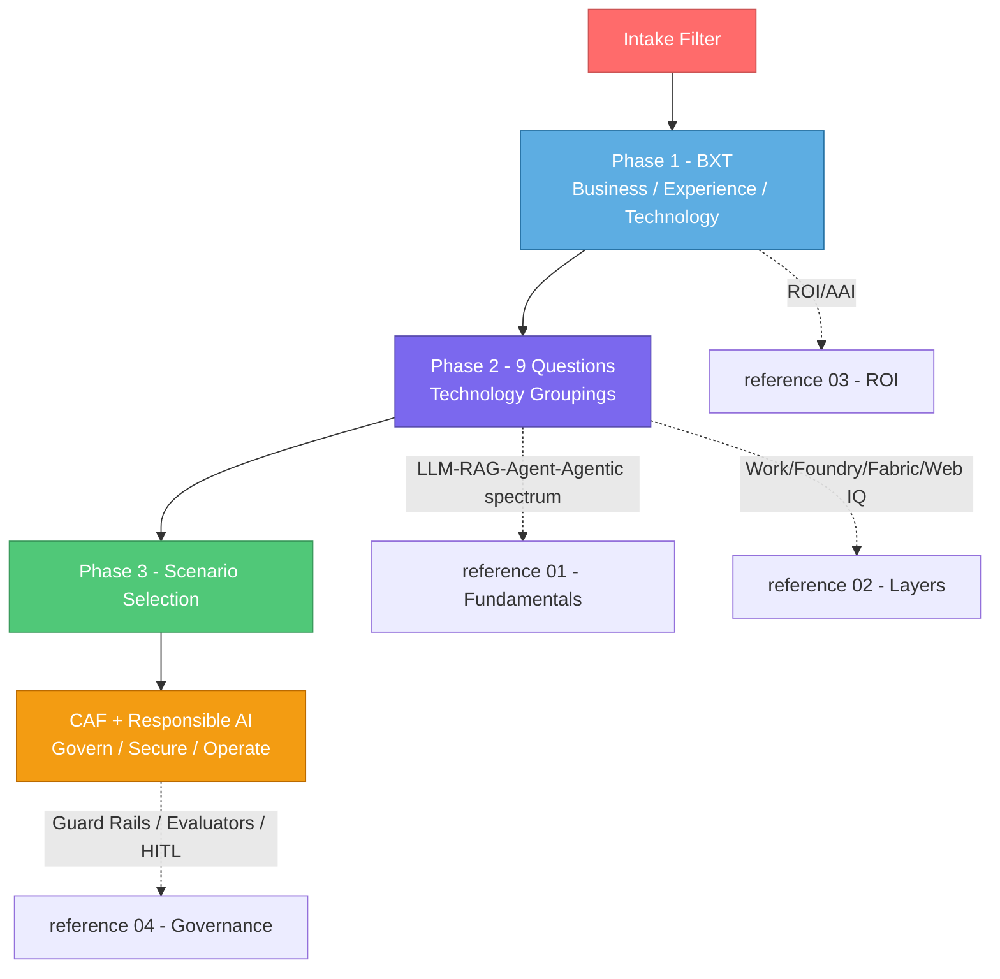

## 🧭 5. Microsoft AI Decision Framework — BXT, Capability Model and 9 Questions

This reference aligns this guide's adoption strategy with the **Microsoft AI Decision Framework** (microsoft.github.io/Microsoft-AI-Decision-Framework). The goal is to provide a repeatable and defensible **technology selection** method, complementing the "complexity spectrum" (LLM → RAG → AI Agent → Agentic) already described in reference 01.

> Core flow of the framework: **Outcomes → Behaviors → Platforms**. Name the business outcome and the user experience **before** choosing any product.

---

### 🚦 Intake Filter (before anything else)

Entry gate to avoid "Shiny Object Syndrome". If there is no clear answer, **do not advance** to technology selection:

1. **Which business outcome** do I want to achieve? (precise ROI / problem solved)
2. **Which user experience** delivers that outcome? (prototype the interaction first)
3. **Does a tool already exist?** Start rigid (SaaS) → configuration (low-code) → build (pro-code). Do not start at "custom build" by default.

Pre-checkpoint **"Do I really need an agent?"**:
- Structured and predictable work → deterministic code or non-generative AI.
- Retrieval of static knowledge → classic RAG (no tool execution / multi-step).
- Agents introduce non-determinism, latency and cost: use them only when there is reasoning or tool orchestration.

---

### 1️⃣ Phase 1 — Business Impact Assessment (BXT)

Every initiative must prove the three lenses before funding the build:

| Lens | Key question | Connection to this guide |
|---|---|---|
| **Business (Viability)** | ROI beyond generic productivity? Quantifiable savings/revenue? Strategic alignment? TCO vs. benefit? | ROI/AAI model (reference 03) |
| **Experience (Desirability)** | A real reason to use it instead of the current alternative? Does it solve a frequent pain point? Measurable adoption? Does it fit into the flow? | Work IQ layer (reference 02) |
| **Technology (Technical feasibility)** | Team skills? Accessible and governable data? Infra and compliance ready? | Governed data + Fabric IQ (reference 02) |

**Decision Gate:** if any dimension is low → reframe, postpone or move to "Shelve / Research / Incubate". If all are medium-high → advance to Phase 2.

---

### 2️⃣ Phase 2 — Technology Groupings (9 Critical Questions)

Pre-question — **Capability Envisioning** (approach selection):
- **Adopt/extend** a Microsoft Copilot (fast, low customization)
- **Build** a custom copilot (own experience, multichannel, advanced orchestration)
- **Build on Fabric** (data-heavy apps with embedded AI)

The 9 questions generate **technology groups** (not the final choice):

| # | Question | Decision it guides |
|---|---|---|
| 1 | **Location of the experience** | M365 (Copilot Chat/Teams/Word) vs. custom/multichannel vs. API/headless |
| 2 | **Control spectrum (build style)** | SaaS (M365 Copilot) → Orchestration/low-code (Copilot Studio) → Foundation/pro-code (Foundry / Agent SDK) |
| 3 | **Data grounding pattern** | RAG (Graph, AI Search, Cosmos, SQL, Fabric Data Agents) + memory + analytics |
| 4 | **Orchestration complexity (The Coin)** | Soloist (single agent) → Orchestra (multi-agent hub-and-spoke) → Mesh (A2A/connected) |
| 5 | **Compliance and trust boundary** | Trust boundary M365 / Power Platform / Azure landing zone / hybrid |
| 6 | **Scale and cost** | Predictable vs. variable spend vs. unified pre-purchase (ACUs) vs. zero marginal cost (edge) |
| 7 | **Destructive actions? (action safety)** | Draft-only → configurable execution (HITL) → autonomous execution (with its own guardrails) |
| 8 | **Team skills and ownership** | Makers/fusion vs. pro-code devs vs. AI/ML engineers vs. integrators |
| 9 | **Initiates actions? (proactivity)** | Reactive (prompt) vs. proactive (triggers, schedules, webhooks) |

> **Timeless principles:** standardize first (MCP); cloud-to-edge continuity; composability over monoliths; security by design; unified data estate.

---

### 3️⃣ Phase 3 — Scenario-Specific Selection

Given the Phase 2 grouping, apply the criteria in order to choose the technology:

1. **Time-to-market** (days / weeks / months)
2. **Managed vs. self-managed** (SaaS/PaaS vs. full control)
3. **Complexity level** (low / medium / high)
4. **Budget and licensing** (per-user / usage / prepaid / Azure consumption)
5. **Integration requirements** (connectors, multichannel)
6. **Orchestration needs** (checkpointing, multi-agent, workflow)
7. **Operationalize and govern** (CAF: Strategy → Plan → Ready → Govern → Secure → Manage + Responsible AI v2)

#### Practical decision matrix (Copilot Studio vs Foundry vs Mixed)

| Predominant scenario | Suggested choice | Rationale |
|---|---|---|
| Conversational business experience, low/medium complexity, low-code team | **Copilot Studio** | Lower time-to-market and native integration with Microsoft channels |
| Advanced reasoning, complex integrations, pro-code engineering, multi-step/multi-agent | **Microsoft Foundry** | Greater technical control, evaluation and advanced orchestration |
| Combined need for business UX + advanced intelligence/orchestration | **Mixed solution (Copilot Studio + Microsoft Foundry)** | Best balance between delivery speed and technical depth |

**Triggers for adopting a mixed solution:**
1. The case requires a business experience or channel capability best served by Copilot Studio and advanced pro-code reasoning or orchestration that it cannot reliably satisfy.
2. Both runtime responsibilities are required in the current scope, have clear owners and can be evaluated independently.
3. A single-runtime baseline was assessed and rejected with evidence against a specific requirement.

Compliance, anticipated scale and component reuse are design considerations, not sufficient reasons for a mixed solution. Apply identity, permissions, data controls, audit, evaluators and HITL to the simplest viable architecture first.

#### Mandatory complexity-escalation gate

Evaluate the following sequence in order: existing product/SaaS → deterministic automation → direct LLM → RAG → single agent → multi-agent or mixed architecture. Stop at the first option that reliably meets current requirements.

Before selecting the next level, record:

| Required evidence | Decision question |
|---|---|
| Unmet requirement | What current requirement cannot the simpler option satisfy? |
| Validation | Which test, pilot result or explicit assumption supports that conclusion? |
| Complexity delta | What additional cost, latency, failure modes and operational ownership are introduced? |
| Governance delta | Which additional identity, evaluation, audit and HITL controls become necessary? |
| Evolution trigger | Which measurable threshold would justify adding this complexity later if it is deferred now? |

When evidence is incomplete, select the lower-complexity baseline for the pilot and make the uncertainty an explicit validation objective.

**Official Microsoft sources:**
- Microsoft Copilot Studio documentation: https://learn.microsoft.com/microsoft-copilot-studio/
- Microsoft Foundry documentation: https://learn.microsoft.com/azure/foundry/
- Microsoft 365 Copilot documentation: https://learn.microsoft.com/microsoft-365-copilot/
- Cloud Adoption Framework for AI: https://learn.microsoft.com/azure/cloud-adoption-framework/scenarios/ai/

**Decision output template:** Simplest viable baseline · Simpler options assessed · Unmet requirements and evidence · Selected technology · Deferred capabilities · Escalation triggers · Time-to-market · Managed vs. self-managed · Complexity · Budget · Integrations · Orchestration · Accepted trade-offs · Next steps (pilot/POC/deploy).

---

### 🧱 Capability Model — 3 Buckets and 5 Groupings

**3 AI Buckets** (who benefits and how): Copilot for everyone (productivity) · AI as a product/capability · Agentic coding.

**5 Capability Groupings** (building blocks, not a maturity ladder):
1. End-user copilots (ready-made UI)
2. Extensibility in existing copilots (plugins, Graph connectors)
3. Build apps and agents (hybrid by default)
4. AI services and building blocks (Foundry: models, retrieval, evaluations, governance)
5. Specialized agents (do not rebuild what already exists)

**The IQ layers** (how agents understand the organization) — anchor directly to this guide's architecture (reference 02):
- **Foundry IQ = Memory** (knowledge bases / agentic retrieval, citations, ACL + Purview)
- **Work IQ = Awareness** (the same intelligence as M365 Copilot; Mail, Calendar, Teams, 1,500+ connectors via MCP)
- **Fabric IQ = Understanding** (ontologies, semantic models, business rules, governed actions)
- **Web IQ = External Grounding** (up-to-date web evidence for market context and public facts)

---

### 🔗 Alignment map with this guide

### 📌 How to use it with the SKILL

1. Run the **Intake Filter** and the "do I need an agent?" checkpoint.
2. Score **BXT** (reference 03 for the Business/ROI lens).
3. Use the **9 questions** to generate groups; the **complexity spectrum** (reference 01) mainly answers questions 2, 3 and 4.
4. Select the technology in **Phase 3** and document the decision template.
5. Close with **CAF + Responsible AI** and the controls from reference 04 (Guard Rails, Evaluators, HITL).

> Official sources: Microsoft AI Decision Framework; BXT / Business Envisioning; Capability Envisioning; CAF AI agent adoption (plan, govern & secure, build, operate); Responsible AI Standard v2.
