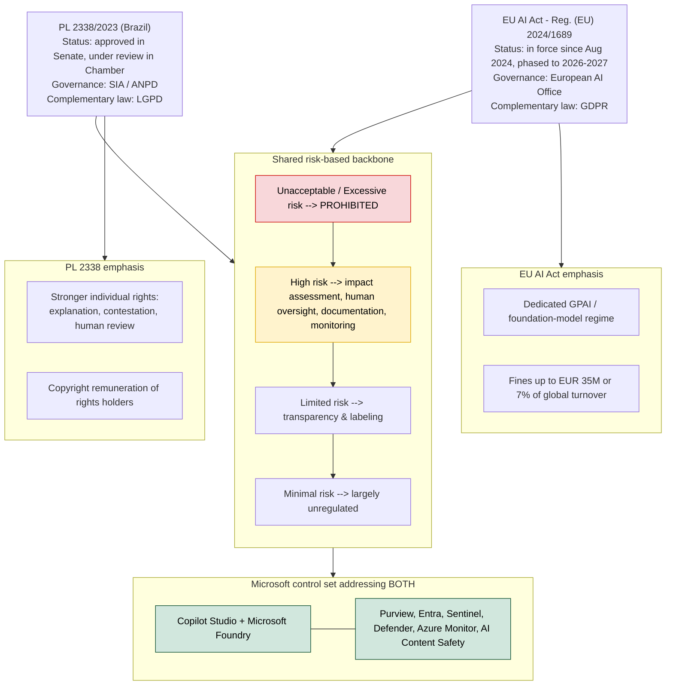

# PL 2338/2023 and the adherence of Microsoft Copilot Studio and Microsoft Foundry

## Executive overview

**PL 2338/2023** (Brazil's AI bill) establishes a framework based on rights, risk classification, transparency, human oversight, governance, traceability and accountability for artificial intelligence systems. A reading of the official sources indicates that **Microsoft Copilot Studio** and **Microsoft Foundry** provide the technical and governance building blocks needed to meet a large part of these requirements, especially when combined with **Microsoft Purview**, **Microsoft Entra**, **Microsoft Sentinel**, **Azure Monitor**, **Defender for Cloud** and **Azure AI Content Safety**.

The central point is this: **Microsoft's tools do not automatically produce legal compliance**, but they deliver the technical, operational and governance controls needed to implement guard rails, evaluators, monitoring, traceability, data protection, retention, auditing and human oversight in line with the bill's pillars.

Because PL 2338/2023 was strongly inspired by the European framework, this document also maps it to its direct counterpart — the **EU Artificial Intelligence Act (Regulation (EU) 2024/1689)** — since both share the same risk-based backbone and the same Microsoft control set addresses both (see the section "European counterpart: the EU AI Act").

> Status checked **2026-07-20**: **PL 2338/2023 has not yet been definitively enacted**. The Senate-approved substitute is awaiting the rapporteur's opinion in the Chamber of Deputies' special committee. The text, article references and regulatory scope can still change before final approval and any sanction.

## Official sources considered

### Official sources for PL 2338/2023

- Federal Senate, matter page: https://www25.senado.leg.br/web/atividade/materias/-/materia/157233
- Federal Senate, enrolled bill sent to the Chamber: https://legis.senado.leg.br/sdleg-getter/documento?dm=9915448&ts=1774551291270&disposition=inline
- Federal Senate, official initial text: https://legis.senado.leg.br/sdleg-getter/documento?dm=9347593&ts=1774551274647&disposition=inline
- Federal Senate, public consultation on the matter: https://www12.senado.leg.br/ecidadania/visualizacaomateria?id=157233
- Chamber of Deputies, official record of the proposal: https://dadosabertos.camara.leg.br/api/v2/proposicoes/2487262
- Chamber of Deputies, full text of the proposal in the Chamber: https://www.camara.leg.br/proposicoesWeb/prop_mostrarintegra?codteor=2868197

### Official sources for the EU AI Act (Regulation (EU) 2024/1689)

- EUR-Lex, Regulation (EU) 2024/1689, full official text: https://eur-lex.europa.eu/eli/reg/2024/1689/oj
- European Commission, AI Act regulatory framework overview: https://digital-strategy.ec.europa.eu/en/policies/regulatory-framework-ai
- European Commission, AI Act application timeline: https://digital-strategy.ec.europa.eu/en/policies/ai-act-timeline
- European AI Office: https://digital-strategy.ec.europa.eu/en/policies/ai-office
- EU General Data Protection Regulation (GDPR), Regulation (EU) 2016/679: https://eur-lex.europa.eu/eli/reg/2016/679/oj
- Council of Europe, Framework Convention on Artificial Intelligence (2024): https://www.coe.int/en/web/artificial-intelligence/the-framework-convention-on-artificial-intelligence

### Official Microsoft sources

- Copilot Studio, security and governance: https://learn.microsoft.com/microsoft-copilot-studio/security-and-governance
- Copilot Studio, auditing in Purview: https://learn.microsoft.com/microsoft-copilot-studio/admin-logging-copilot-studio
- Purview for Copilot Studio: https://learn.microsoft.com/purview/ai-copilot-studio
- Microsoft Foundry, Responsible AI: https://learn.microsoft.com/azure/foundry/responsible-use-of-ai-overview
- Microsoft Foundry, observability: https://learn.microsoft.com/azure/foundry/concepts/observability
- Purview for Microsoft Foundry: https://learn.microsoft.com/purview/ai-azure-foundry
- Prompt Shields in Azure AI Content Safety: https://learn.microsoft.com/azure/ai-services/content-safety/concepts/jailbreak-detection
- Compliance and security management in Foundry: https://learn.microsoft.com/azure/foundry/control-plane/how-to-manage-compliance-security
- Regulatory governance of AI apps: https://learn.microsoft.com/security/security-for-ai/govern

## Objective reading of the bill

For this analysis, the primary legal reference is the **enrolled bill approved in the Senate and sent to the Chamber**, complemented by the **initial text** to make it easier to identify the articles and the original structure of the proposal. According to the official Senate sources, the central pillars of PL 2338/2023 include:

- **Right to prior information about interaction with AI**.
- **Right to explanation, contestation and human intervention**.
- **Non-discrimination and correction of biases**.
- **Risk classification and algorithmic impact assessment for high-risk systems**.
- **Measures for governance, security, reliability and continuous monitoring**.
- **Traceability, auditability, liability and accountability**.
- **Public disclosure of information and oversight mechanisms by the competent authority**.

Relevant official excerpts, consistent between the initial text and the version approved in the Senate, include:

- **Article 5**: right to prior information, explanation, contestation, human participation, non-discrimination, privacy and data protection.
- **Article 7**: obligation to disclose the automated nature, the operators, governance measures, the role of humans, the data used, security measures, non-discrimination and reliability.
- **Articles 8 and 9**: right to explanation, review, contestation and to request human intervention.
- **Article 12**: prohibition of direct, indirect, illegal or abusive discrimination.
- **Articles 23 and 24**: algorithmic impact assessment with functional independence, mitigation, monitoring and recording of residual risks.
- **Article 30**: codes of good practice and governance, internal oversight mechanisms, response to harmful outcomes and updating with continuous monitoring.
- **Article 32**: enforcement, regulation and the requirement to publicly disclose information.

## How Copilot Studio and Microsoft Foundry address the bill's requirements

| PL 2338/2023 pillar | Reading of the requirement in the official source | How Microsoft Copilot Studio addresses it | How Microsoft Foundry addresses it | Official Microsoft links |
|---|---|---|---|---|
| **Transparency and prior information** | Articles 5 and 7 require disclosing automated interaction, operators, data used, the human role and governance measures. | Copilot Studio enables governance per environment, authentication, controls over knowledge sources, actions, connectors, skills, HTTP requests and publication to channels. With Purview, it also inherits classification, an audit trail and sensitivity display in supported scenarios. | Foundry enables documenting the project, model, filters and metrics; it has a control plane, centralized governance and integration with Purview for visibility into interactions and classifications. | https://learn.microsoft.com/microsoft-copilot-studio/security-and-governance ; https://learn.microsoft.com/purview/ai-copilot-studio ; https://learn.microsoft.com/azure/foundry/control-plane/overview ; https://learn.microsoft.com/security/security-for-ai/govern |
| **Explainability, contestation and human oversight** | Articles 5, 8 and 9 deal with explanation, review, contestation and human intervention. | Copilot Studio helps in designing workflows with authentication, administrative approval and publication control. It is suitable for processes with a human in the loop, especially when the agent only recommends, collects context or triggers supervised flows. | Foundry offers tracing, evaluation and monitoring to understand calls, agent decisions, tool invocations and execution chains. This makes it easier to explain system behavior and implement human review in higher-risk scenarios. | https://learn.microsoft.com/microsoft-copilot-studio/security-and-governance ; https://learn.microsoft.com/azure/foundry/concepts/observability ; https://learn.microsoft.com/azure/foundry/responsible-use-of-ai-overview |
| **Non-discrimination, security and reliability** | Article 12 prohibits discrimination; the bill's principles include non-discrimination, explainability, auditability, robustness and information security. | Copilot Studio relies on DLP, sensitivity labels, auditing, Sentinel and authentication controls. With Purview, it allows monitoring interactions, detecting risky behavior and applying policies to reduce improper exposure. | Foundry brings built-in evaluators for safety and security, red teaming, prompt attack detection, content filters, Prompt Shields, risk monitoring and integration with Defender for Cloud. | https://learn.microsoft.com/purview/ai-copilot-studio ; https://learn.microsoft.com/azure/foundry/concepts/observability ; https://learn.microsoft.com/azure/ai-services/content-safety/concepts/jailbreak-detection ; https://learn.microsoft.com/azure/foundry/control-plane/how-to-manage-compliance-security |
| **Risk classification and algorithmic impact assessment** | Articles 23 and 24 require an impact assessment with preparation, risk awareness, mitigation and monitoring, especially for high risk. | Copilot Studio helps in cases of lower autonomy and greater operational control, but it does not replace the formal impact assessment process. It contributes with audit trails, telemetry, DLP, governance by environment and logs of configuration and usage changes. | Foundry is more suited to scenarios that require a technical evidence pack: evaluators, red teaming, tracing, dashboards, content safety filter configurations, monitoring and exportable documentation for GRC and audit flows. | https://learn.microsoft.com/microsoft-copilot-studio/admin-logging-copilot-studio ; https://learn.microsoft.com/azure/foundry/concepts/observability ; https://learn.microsoft.com/security/security-for-ai/govern ; https://learn.microsoft.com/azure/foundry/responsible-use-of-ai-overview |
| **Corporate governance and continuous monitoring** | Article 30 speaks of good practices, internal oversight mechanisms, response to harmful outcomes and updating through continuous monitoring. | Copilot Studio offers data policy controls, publishing blocking, environment routing, CMK, logs in Purview, integration with Sentinel and central administration in the Power Platform admin center. | Foundry brings governance across the entire lifecycle: Discover, Protect, Govern; integration with Azure Monitor, Application Insights, Defender for Cloud, Purview and the control plane for operation at scale. | https://learn.microsoft.com/microsoft-copilot-studio/security-and-governance ; https://learn.microsoft.com/azure/foundry/responsible-use-of-ai-overview ; https://learn.microsoft.com/azure/foundry/control-plane/overview |
| **Traceability, auditing and accountability** | The bill makes traceability, auditability, liability and accountability explicit as principles and governance mechanisms. | Copilot Studio records events for creation, change, publication, sharing, configuration and user interaction. These events can be searched in Purview and analyzed in DSPM for AI; integration with Sentinel reinforces the SOC and incident response. | Foundry integrates auditing and classification via Purview, activity explorer, retention, eDiscovery and operational monitoring through traces, logs and dashboards. This supports the decision trail and evidence for auditing. | https://learn.microsoft.com/microsoft-copilot-studio/admin-logging-copilot-studio ; https://learn.microsoft.com/purview/ai-copilot-studio ; https://learn.microsoft.com/purview/ai-azure-foundry ; https://learn.microsoft.com/azure/foundry/concepts/observability |
| **Data protection, retention and investigation** | The bill relates to privacy, data protection, liability and enforcement. | With Purview, Copilot Studio supports auditing, classification, sensitivity labels, DLP, Insider Risk Management, Communication Compliance, eDiscovery, Data Lifecycle Management and Compliance Manager. | The same set is supported for Foundry, provided that the Purview Data Security configurations and collection policies are enabled. This is especially relevant for the retention of prompts, responses and regulatory investigation. | https://learn.microsoft.com/purview/ai-copilot-studio ; https://learn.microsoft.com/purview/ai-azure-foundry |
| **Security against abuse, prompt injection and misuse** | The bill requires risk mitigation, security and monitoring, especially in sensitive or high-risk scenarios. | In Copilot Studio, the main control layer lies in connector policy, authentication, publication, DLP, labels, auditing and restriction of the agent's capabilities. | In Foundry, Azure AI Content Safety and Prompt Shields detect user prompt attacks and document attacks; Defender for Cloud complements this with jailbreak detection and workload risk detection. | https://learn.microsoft.com/azure/ai-services/content-safety/concepts/jailbreak-detection ; https://learn.microsoft.com/azure/foundry/control-plane/how-to-manage-compliance-security |

## European counterpart: the EU AI Act (Regulation (EU) 2024/1689)

PL 2338/2023 was strongly inspired by the European framework. Its direct counterpart is the **EU Artificial Intelligence Act (Regulation (EU) 2024/1689)**, the first comprehensive, horizontal AI law in the world. It entered into force on **1 August 2024**, with a phased application timeline: prohibited-practice rules from **February 2025**, general-purpose AI (GPAI) model obligations from **August 2025**, and the bulk of the high-risk obligations from **August 2026**, with certain embedded high-risk systems extending to **August 2027**.

### Shared logic: a risk-based approach

Both texts organize AI governance around the same tiered classification of risk, which is the core mechanism of the EU AI Act and was largely imported into the Brazilian bill:

- **Unacceptable / excessive risk → prohibited.** Practices such as government social scoring, manipulation exploiting vulnerabilities, untargeted scraping of facial images and certain biometric categorization are banned. PL 2338 mirrors this with its category of "excessive risk".
- **High risk → permitted with strong governance.** Systems in areas such as health, biometrics, critical infrastructure, education, employment/HR, access to essential services, credit, law enforcement and justice require risk management, data governance, technical documentation, logging, human oversight, transparency, accuracy, robustness and cybersecurity. This maps directly to PL 2338's algorithmic impact assessment for high-risk systems (Articles 23 and 24).
- **Limited risk → transparency obligations.** Users must be informed when they interact with an AI system, and AI-generated or manipulated content (deepfakes) must be labeled. This aligns with PL 2338's right to prior information (Articles 5 and 7).
- **Minimal risk → largely unregulated.**

### Key differences from PL 2338/2023

- **Individual rights.** The Brazilian bill is more robust on the rights of affected persons (explanation, contestation and human review of automated decisions), inheriting the tradition of the LGPD. The EU AI Act focuses more on the product/system and leaves individual data rights to the **GDPR (Regulation (EU) 2016/679)**.
- **General-purpose AI (GPAI).** The EU AI Act adds a dedicated regime for GPAI and foundation models, including transparency, technical documentation, copyright-compliance policies and, for models with systemic risk, model evaluation, adversarial testing and incident reporting. PL 2338 addresses generative AI mainly through transparency and copyright-remuneration provisions.
- **Copyright.** PL 2338 contains specific provisions on remuneration of rights holders for use of protected works in training; the EU AI Act handles this more narrowly, via a duty to disclose a summary of training content and to respect text-and-data-mining opt-outs.
- **Governance and enforcement.** The EU relies on the **European AI Office** and national competent authorities, with fines up to **EUR 35 million or 7% of global annual turnover** for prohibited practices. Brazil's PL 2338 foresees a national AI governance and regulation system (SIA) coordinated by the ANPD.

### Related European instruments

- **GDPR (Regulation (EU) 2016/679)** — complements the AI Act on personal-data processing, much as the LGPD complements PL 2338 in Brazil.
- **Council of Europe Framework Convention on AI (2024)** — the first binding international treaty on AI and human rights, democracy and the rule of law.

### Relevance for Copilot Studio and Microsoft Foundry

Because the two frameworks share the same risk-based backbone, the same Microsoft control set that addresses PL 2338/2023 also supports EU AI Act obligations: Copilot Studio and Microsoft Foundry, combined with **Microsoft Purview**, **Microsoft Entra**, **Microsoft Sentinel**, **Azure Monitor**, **Defender for Cloud** and **Azure AI Content Safety**, provide transparency, human oversight, risk assessment, evaluators, red teaming, content safety, logging, traceability, data governance and continuous monitoring — the technical and governance building blocks required for high-risk systems and GPAI transparency under Regulation (EU) 2024/1689. As with PL 2338, these tools do not by themselves produce legal compliance; they enable the controls, documentation and evidence that compliance depends on.

### Visual overview: how the two frameworks relate

### Side-by-side comparison: PL 2338/2023 vs. EU AI Act

| Dimension | PL 2338/2023 (Brazil) | EU AI Act — Regulation (EU) 2024/1689 |
|---|---|---|
| **Status** | Approved in the Senate (Dec 2024), under review in the Chamber of Deputies; not yet definitively enacted | In force since 1 Aug 2024; phased application through 2026-2027 |
| **Legal nature** | National bill (federal law once enacted) | Directly applicable EU regulation across all member states |
| **Regulatory approach** | Hybrid: risk-based **and** fundamental-rights-based | Predominantly risk-based (product/system safety) |
| **Risk tiers** | Excessive risk (prohibited), high risk, and general provisions | Unacceptable (prohibited), high, limited (transparency), minimal |
| **Prohibited practices** | Excessive-risk systems (e.g., social scoring, exploitation of vulnerabilities, autonomous lethal weapons) | Social scoring, manipulative/exploitative AI, untargeted facial scraping, certain biometric categorization and real-time remote biometric ID (with exceptions) |
| **High-risk obligations** | Algorithmic impact assessment, mitigation, monitoring, documentation (Arts. 23-24) | Risk management, data governance, technical documentation, logging, human oversight, accuracy, robustness, cybersecurity (Arts. 8-15) |
| **Individual rights** | Strong: prior information, explanation, contestation, human review (Arts. 5, 7, 8, 9) | Lighter within the Act; individual data rights mainly via GDPR |
| **Generative / GPAI** | Transparency plus copyright-remuneration provisions | Dedicated GPAI regime: transparency, technical docs, copyright policy; extra duties for systemic-risk models |
| **Copyright** | Explicit remuneration of rights holders for training use | Duty to disclose a training-content summary and respect TDM opt-outs |
| **Transparency to users** | Right to prior information about AI interaction (Arts. 5, 7) | Duty to inform on AI interaction and to label AI-generated content / deepfakes |
| **Governance body** | National AI governance and regulation system (SIA), coordinated by ANPD | European AI Office plus national competent authorities |
| **Penalties** | To be defined in the final text/regulation | Up to EUR 35M or 7% of global annual turnover for prohibited practices |
| **Complementary law** | LGPD (data protection) | GDPR (Regulation (EU) 2016/679) |

### Official sources for the EU AI Act

See the consolidated list under **"Official sources considered → Official sources for the EU AI Act (Regulation (EU) 2024/1689)"** at the top of this document, which includes the full EUR-Lex text, the European Commission overview and application timeline, the European AI Office, the GDPR and the Council of Europe Framework Convention on AI.

## Executive synthesis

If the question is whether **Microsoft Copilot Studio** or **Microsoft Foundry** can contribute controls relevant to PL 2338/2023, the answer is **conditionally yes for specific operational and governance requirements**, subject to the selected architecture, licensing, supported integrations, configuration, evidence and legal interpretation.

The rationale is simple:

- **Copilot Studio** meets well what the bill demands in **operational governance, access control, audit trail, DLP, sensitivity labeling, controlled publication and administrative oversight**.
- **Microsoft Foundry** better meets what the bill demands in **risk assessment, evaluators, tracing, continuous monitoring, technical evidence, guard rails, content safety, red teaming and governance of agents in production**.
- **Microsoft Purview** closes the regulatory gap in **classification, auditing, retention, eDiscovery, compliance evidence and data controls**.

## Important trade-offs

- **Copilot Studio** is stronger for use cases with a business process, Microsoft channels, governed connectors and lower technical complexity.
- **Microsoft Foundry** is stronger for use cases with custom models, multi-agent, deep observability, an evaluation pipeline and greater technical GRC requirements.
- For **high-risk** scenarios, strengthen identity, authorization, data protection, audit, HITL, guard rails, evaluators, incident response and legal governance. Select Work IQ, Foundry IQ, Fabric IQ, Web IQ, Fabric or multiple runtimes only when the scenario independently requires each capability. Risk classification alone does not justify a larger product stack or multi-agent architecture.

## Practical conclusion

To support the claim that Microsoft's AI tools can meet the demands of PL 2338/2023, the most defensible formulation is this:

> Microsoft offers, in official sources, the technical and governance controls needed to implement the main operational requirements associated with PL 2338/2023, including transparency, human oversight, risk classification, risk assessment and mitigation, traceability, auditing, data protection, retention, investigation and continuous monitoring. Legal-material compliance depends on the correct configuration of these controls, the process design, the risk documentation and the organization's corporate governance.

## Ready-to-use executive statement

> From an architecture and governance standpoint, the simplest viable Microsoft platform can be configured with applicable Entra, Purview, monitoring, security, guard rail, evaluator and human-oversight controls to support selected PL 2338/2023 obligations. Use Copilot Studio, Microsoft Foundry and additional services only where the scenario independently requires them, and validate legal adequacy, product coverage and capacity before production approval.
