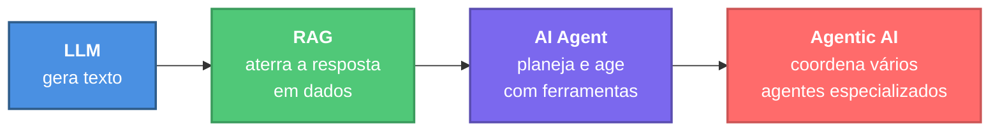
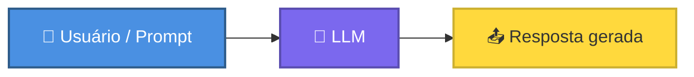
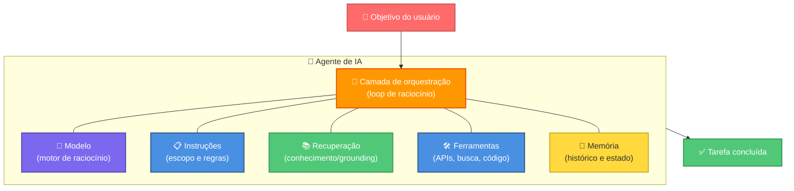
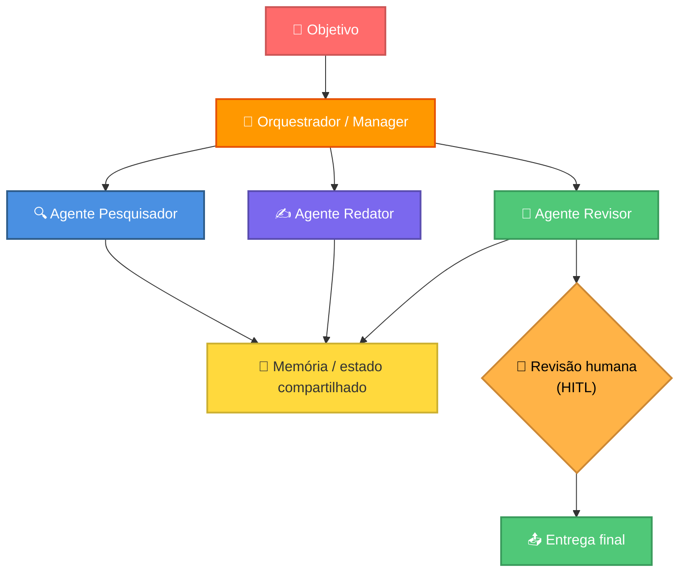
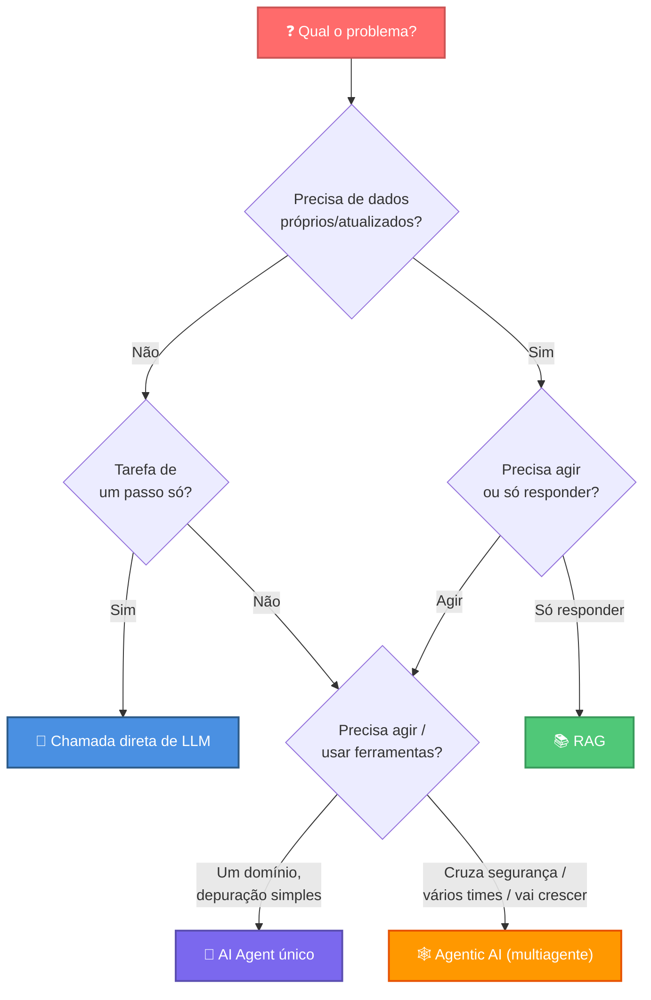

## 🧬 1.1. Fundamentos de Arquitetura de IA — LLM × RAG × AI Agent × Agentic AI

> Esta seção estabelece a base conceitual do guia. Antes de detalhar as camadas corporativas (Work IQ, Foundry IQ, Fabric IQ e a plataforma de dados), é essencial entender os quatro padrões que formam o **espectro de autonomia e complexidade** das aplicações de IA generativa. Eles não são tecnologias concorrentes: cada nível **incorpora** o anterior e adiciona uma nova capacidade.

### 📈 Visão geral — o espectro de complexidade

A Microsoft descreve essa progressão como um **espectro de complexidade** e recomenda, como princípio de arquitetura, usar **o menor nível de complexidade que resolve o problema de forma confiável** — cada degrau adicional introduz latência, custo e novos modos de falha.

> ⚠️ **Nota terminológica.** A indústria usa "AI Agent" e "Agentic AI" de formas variadas. Na documentação da Microsoft, a distinção principal é entre **agente único com ferramentas** (single agent) e **orquestração multiagente** (multi-agent), e não há fronteira rígida — é um contínuo. Neste guia tratamos "Agentic AI" como o nível de **orquestração multiagente** (detalhado na seção 17).

### 📊 Quadro comparativo

| Aspecto | **LLM** | **RAG** | **AI Agent** | **Agentic AI** |
|---|---|---|---|---|
| **Definição** | Gerador de texto: você pergunta, ele responde com base no que aprendeu no treino. | LLM que recupera informação de uma base de dados *antes* de responder. | IA que planeja passos, usa ferramentas e executa tarefas completas. | Conjunto de agentes especializados que colaboram, coordenados por um orquestrador. |
| **Arquitetura** | `pergunta → modelo → resposta` | `pergunta → busca em índice → recupera trechos → gera resposta fundamentada` | `objetivo → plano → uso de ferramentas → avalia → ajusta → conclui` | `objetivo → orquestrador distribui → agentes executam → revisão → entrega` |
| **Componentes** | Um modelo treinado em grande volume de texto. | Modelo + índice pesquisável (vetorial/keyword/híbrido) + *embeddings*. | Modelo + instruções + recuperação + ferramentas + memória. | Múltiplos agentes + memória/estado compartilhado + camada de orquestração. |
| **Funcionalidade** | Prevê o próximo token; gera linguagem natural. | Responde fundamentado em dados próprios e atualizados (*grounding*). | Decompõe o objetivo, escolhe ferramentas e itera até concluir. | Especialistas distribuem trabalho, trocam contexto e coordenam-se como um time. |
| **Caso típico** | Redação, resumo, tradução, classificação. | Q&A sobre políticas internas, manuais, base de conhecimento. | Pesquisa multi-etapa, coleta de dados, automação de fluxos. | Campanhas, projetos grandes, processos de negócio ponta a ponta. |
| **Ferramentas** | Nenhuma. Opera isolado. | Lê dados via índice, mas não executa ações. | Usa busca, APIs, código etc. (via *function calling* / MCP). | Cada agente usa as ferramentas do seu domínio; integração via MCP / A2A. |
| **Memória** | Sem memória entre sessões (só janela de contexto). | Busca informação fresca a cada consulta, mas não lembra perguntas anteriores. | Mantém estado ao longo dos passos (memória de trabalho). | Estado/memória compartilhada entre os agentes do time. |
| **Planejamento** | Responde de imediato, sem planejar. | Recupera e responde; não planeja adiante. | Raciocina e se autocorrige (ReAct, CoT, Plan-and-Solve, Reflexion). | Agentes decidem em conjunto; orquestração serial, concorrente ou dinâmica. |
| **Autonomia** | Reativo: precisa de um *prompt* a cada interação. | Recupera documentos automaticamente, mas só responde quando perguntado. | Executa a tarefa sozinho após receber o objetivo. | Conduz projetos inteiros com mínima supervisão humana. |
| **Custo relativo** *(ilustrativo)* | Mais baixo — paga só pela geração. | Médio — modelo + índice. | Mais alto — múltiplas chamadas e ferramentas. | Mais alto de todos — vários agentes em execução. |
| **Tempo de implementação** *(ilustrativo)* | Horas. | Dias. | Dias a semanas. | Semanas ou mais. |
| **Pontos fortes** | Rápido, simples, ótimo para texto. | Reduz alucinação, cita fontes, usa conhecimento privado e atualizado. | Resolve tarefas complexas multi-etapa; aprende com erros. | Especialização por agente; paralelismo; resolve problemas grandes. |
| **Fraquezas** | Alucina; sem memória; *knowledge cutoff*. | Qualidade limitada pela dos dados/índice; não age. | Não determinístico; exige governança e limites de iteração. | Difícil de configurar e controlar; falha de um agente afeta os demais. |
| **Quando usar** | Respostas rápidas ou geração simples de texto. | Quando a resposta precisa vir de documentos/dados específicos. | Projetos multi-etapa, pesquisa, coleta de dados. | Projetos complexos que exigiriam um time inteiro. |

> Os campos **Custo** e **Tempo de implementação** são estimativas ilustrativas de ordem de grandeza — **não** constam como números oficiais na documentação Microsoft.

### 🏛️ Diagramas de arquitetura por padrão

#### LLM puro

#### RAG — Retrieval · Augmentation · Generation

```mermaid
flowchart LR
    U["👤 Pergunta do usuário"] --> Q["🔎 Consulta ao índice"]
    Q --> IDX["🗂️ Índice / Vector Store"]
    IDX --> C["📄 Trechos relevantes<br/>(grounding)"]
    C --> P["🧩 Prompt aumentado"]
    U --> P
    P --> M["🧠 LLM"]
    M --> A["📤 Resposta fundamentada<br/>+ citações"]

    style U fill:#4A90E2,stroke:#2E5C8A,color:#fff,stroke-width:2px
    style Q fill:#50C878,stroke:#3A9B5C,color:#fff,stroke-width:2px
    style IDX fill:#FF6B6B,stroke:#CC5555,color:#fff,stroke-width:2px
    style C fill:#50C878,stroke:#3A9B5C,color:#fff,stroke-width:2px
    style P fill:#FF9800,stroke:#E65100,color:#fff,stroke-width:2px
    style M fill:#7B68EE,stroke:#5A4DB0,color:#fff,stroke-width:2px
    style A fill:#FFD93D,stroke:#CCB030,color:#333,stroke-width:2px
```

As três etapas canônicas do RAG, conforme a Microsoft: **recuperação** (consulta à base externa), **aumento** (combinação dos dados recuperados com o prompt) e **geração** (o LLM produz a resposta fundamentada).

#### AI Agent — os 5 componentes centrais

A Microsoft define o agente sobre cinco componentes: **modelo** (motor de raciocínio), **instruções**, **recuperação/conhecimento** (grounding), **ações/ferramentas** e **memória**. A camada de orquestração é o loop cíclico que recebe informação, raciocina e decide a próxima ação até atingir o objetivo ou um critério de parada.

#### Agentic AI — orquestração multiagente

### 🧠 LLM — o modelo de linguagem

**O que é.** Um modelo treinado em grande volume de texto que gera linguagem natural prevendo a continuação mais provável. É a base ("cérebro") de todos os padrões seguintes — e, nesta arquitetura, o motor de raciocínio hospedado na camada **Foundry IQ**.

**Características.** Conhecimento congelado no treino (*knowledge cutoff*); sem memória persistente entre conversas; pode **alucinar** (afirmações plausíveis, porém incorretas); não acessa ferramentas ou sistemas externos por conta própria.

**Quando basta um LLM (chamada direta de modelo).** É o nível **menos complexo**: uma única chamada com um *prompt* bem elaborado, sem lógica de agente nem ferramentas. Se a engenharia de prompt resolve (classificar, resumir, traduzir, tarefas de um passo), **não há necessidade de um agente**.

### 📚 RAG — geração aumentada por recuperação

**O que é.** Técnica que **fundamenta** (*grounds*) as respostas do LLM em dados próprios, em vez de depender apenas do que o modelo aprendeu no treino. Nesta arquitetura, o RAG é viabilizado pela camada **Fabric IQ** + **Microsoft Fabric**, que fornecem os dados governados e o índice pesquisável.

**As três etapas (definição Microsoft).**

1. **Recuperação (Retrieval):** a solicitação consulta uma base externa — *vector store*, busca por palavra-chave ou SQL — para obter dados de apoio.
2. **Aumento (Augmentation):** os dados de apoio são combinados com o pedido do usuário, normalmente via *template* com instruções, formando o *prompt*.
3. **Geração (Generation):** o *prompt* é enviado ao LLM, que gera a resposta fundamentada.

**Benefícios validados pela Microsoft.** Incorpora **conhecimento proprietário**; entrega **informação atualizada** (contorna o *knowledge cutoff*); permite **citar fontes** (verificação factual); e a recuperação pode respeitar **controles de acesso (ACL)** por credencial do usuário — exatamente o que os rótulos do Purview e o RLS do Fabric garantem nesta arquitetura.

**RAG vs. Fine-tuning.** Escolha **RAG** para conteúdo dinâmico, ampla cobertura de tópicos e recursos limitados de treino. Escolha **fine-tuning** para desempenho em tarefa muito específica, controle sobre dados proprietários e conteúdo estável.

### 🤖 AI Agent — agente único com ferramentas

**Definição (Microsoft).** Um agente é uma aplicação de IA que usa um modelo generativo para **raciocinar** sobre solicitações e **tomar ações autônomas** para atendê-las. Diferente de um chatbot que só gera texto, o agente chama ferramentas, acessa dados externos e toma decisões ao longo de **múltiplos passos** — papel da camada **Foundry IQ**.

**Os 5 componentes (Cloud Adoption Framework).** (1) Modelo generativo — motor de raciocínio; (2) Instruções — escopo, limites e regras; (3) Recuperação/Conhecimento — dados de *grounding*; (4) Ações/Ferramentas — funções, APIs e sistemas; (5) Memória — histórico e estado (ver seção 18).

**Diferença essencial entre RAG e Agente.** O RAG segue um processo de recuperação **determinístico**. O agente usa o modelo generativo para **decidir, a cada passo**, qual conhecimento e quais ferramentas usar — comportamento **adaptativo e não determinístico**, que exige testes, evaluators (seção 9) e governança robusta (seção 8).

**Raciocínio e planejamento.** Frameworks de agentes incorporam métodos como **ReAct** (intercala raciocínio e ação), **Chain-of-Thought**, **Plan-and-Solve** (divide a tarefa em subtarefas) e **Reflexion/self-critique** (auto-reflexão sobre o feedback).

**Boa prática.** Para evitar laços infinitos de chamadas de ferramenta, **defina limites de iteração**. O agente único costuma ser o **padrão default** para muitos casos corporativos — mais simples de depurar e testar que arranjos multiagente.

### 🕸️ Agentic AI — orquestração multiagente

**O que é.** Múltiplos agentes especializados que **coordenam** para resolver problemas, com um orquestrador (ou protocolo entre pares) gerenciando distribuição de trabalho, compartilhamento de contexto e agregação de resultados. A implementação detalhada em Foundry — com os padrões Sequencial, Paralelo, Condicional e Feedback Loop — está na **seção 17**.

**Vantagens (Azure Architecture Center).** Especialização (cada agente foca um domínio); escalabilidade (adicionar/alterar agentes sem redesenhar tudo); manutenibilidade (testar agente por agente); otimização (cada agente usa modelo e ferramentas distintos).

**Quando NÃO partir direto para multiagente.** A Microsoft recomenda começar com multiagente **apenas** quando critérios específicos exigem separação: (1) **fronteiras de segurança/conformidade** (isolamento de dados imposto por regulação); (2) **múltiplos times** (domínios mantidos por equipes distintas, com ciclos independentes); (3) **crescimento futuro planejado** (soluções com mais de 3–5 funções distintas se beneficiam da modularidade).

**Padrões de orquestração multiagente (documentação Microsoft).**

| Padrão | Descrição | Quando usar |
|---|---|---|
| **Sequencial (serial)** | Agentes encadeados em ordem predefinida (A → B → C). | Processos com ordem estrita, regras de negócio e auditabilidade. |
| **Concorrente (fan-out/fan-in)** | Vários agentes processam a mesma entrada em paralelo; resultados agregados (*scatter-gather* / *map-reduce*). | Análises independentes sob perspectivas distintas. |
| **Orquestrador + subagentes** | Orquestrador delega a especialistas (também "Russian doll" / magentic). | Separação clara de responsabilidades; reuso de agentes especializados. |
| **Agents-as-Tools** | Um agente principal invoca outros como se fossem ferramentas (via *function calling*). | Pedidos diretos, com 2–3 agentes e escopos bem delimitados. |
| **Magentic** | Orquestração dinâmica para problemas abertos, sem fluxo predefinido. | Domínios criativos/exploratórios onde os subtarefas não são conhecidos de antemão. |

**Integração e governança de ferramentas.** A Microsoft recomenda **MCP (Model Context Protocol)** para acesso seguro e autenticado a ferramentas/dados, e o protocolo **A2A (Agent2Agent, Linux Foundation)** para integração entre agentes de plataformas diferentes. Princípios transversais: **menor privilégio**, simplicidade, auditabilidade, governança robusta e **HITL (human-in-the-loop)** em pontos de aprovação (ver seção 10).

### 🧭 Guia de decisão arquitetural

Use o **menor nível de complexidade** que atende ao requisito de forma confiável.

**Resumo prático.**

- **Resposta de texto, um passo →** LLM.
- **Resposta fundamentada em documentos →** RAG.
- **Tarefa multi-etapa, com ações, em um domínio →** AI Agent único (default corporativo).
- **Cruza fronteiras de segurança, múltiplos times ou crescimento previsto →** Agentic AI (multiagente).

### ✅ Validação com fontes oficiais Microsoft

| Afirmação | Status | Observação |
|---|---|---|
| RAG busca em documentos antes de responder | ✅ Confirmado | As 3 etapas (retrieval/augmentation/generation) são a definição canônica Microsoft. |
| RAG reduz invenção de fatos e permite citar fontes | ✅ Confirmado | Microsoft cita redução de alucinação, *grounding* e citação de fontes. |
| LLM "esquece" após a conversa e pode alucinar | ✅ Confirmado | LLMs são estáticos (conhecimento do treino) e propensos a alucinação sem *grounding*. |
| Agente planeja, usa ferramentas e itera | ✅ Confirmado | Definição Microsoft de agente; inclui ReAct, planejamento e auto-correção. |
| Agente tem memória dos passos | ✅ Confirmado | Memória é um dos 5 componentes centrais do agente. |
| Agentic AI = vários especialistas coordenados | ✅ Confirmado | Corresponde à orquestração multiagente do Azure Architecture Center. |
| AI Agent e Agentic AI são categorias totalmente distintas | ⚠️ Ajuste | A Microsoft trata como **espectro/contínuo**, não como caixas estanques. |
| Agentic AI é "sempre" mais caro e demorado | ⚠️ Contextualizar | Tendência verdadeira, mas a recomendação oficial é **evitar** complexidade desnecessária. |
| Valores de custo e tempo de implementação | ⚠️ Ilustrativo | Não há números oficiais Microsoft; tratar como ordem de grandeza. |

**Conclusão da validação.** As definições e capacidades de cada padrão estão **substancialmente corretas**. Os ajustes são de **enquadramento**: (1) ver os quatro padrões como um espectro contínuo de complexidade; (2) usar sempre o nível mínimo necessário; (3) tratar custo/tempo como estimativas, não fatos oficiais.

### 📖 Glossário de fundamentos

- **LLM (Large Language Model):** modelo treinado para gerar linguagem natural prevendo o próximo token.
- **RAG (Retrieval-Augmented Generation):** padrão que fundamenta respostas do LLM em dados recuperados de uma base externa.
- **Grounding:** ancorar a resposta em dados reais/recuperados, reduzindo alucinação.
- **Embeddings:** representações numéricas (vetores) de conteúdo, usadas em busca por similaridade.
- **Índice / Vector Store:** estrutura otimizada para recuperação (keyword, semântica, vetorial ou híbrida).
- **AI Agent:** aplicação que usa um modelo para raciocinar e tomar ações autônomas com ferramentas.
- **Agentic AI / Multiagente:** sistema de múltiplos agentes especializados coordenados por orquestração.
- **Orquestração:** camada/loop que distribui trabalho, compartilha contexto e agrega resultados entre agentes.
- **MCP (Model Context Protocol):** protocolo para acesso seguro e autenticado a ferramentas e dados.
- **A2A (Agent2Agent):** protocolo (Linux Foundation) para integração entre agentes de plataformas distintas.
- **Function calling:** mecanismo pelo qual o LLM gera parâmetros para invocar ferramentas/funções.
- **ReAct (Reason + Act):** método que intercala traços de raciocínio e ações específicas.
- **Chain-of-Thought (CoT):** raciocínio passo a passo antes da resposta.
- **Plan-and-Solve:** divide a tarefa em subtarefas e as executa conforme um plano.
- **Reflexion / self-critique:** o agente reflete verbalmente sobre o feedback para melhorar decisões futuras.
- **HITL (Human-in-the-Loop):** pontos de revisão/aprovação humana no fluxo (seção 10).
- **Knowledge cutoff:** data limite do conhecimento aprendido pelo modelo no treino.
- **Fan-out/Fan-in:** padrão concorrente — distribui (fan-out) e agrega (fan-in) resultados.

> **Conexão com as camadas deste guia:** o **LLM** é o motor de raciocínio em **Foundry IQ**; o **RAG** materializa-se no consumo de dados governados de **Fabric IQ + Microsoft Fabric**; o **AI Agent** e a **Agentic AI** operam em **Foundry IQ**, com a experiência entregue por **Work IQ** e controles aplicados por **Guard Rails** e **Evaluators**. As fontes oficiais que embasam esta seção estão consolidadas na seção 15 e na seção 20.

---

