## 🏗️ 2. Arquitetura de Referência (Visão Geral)

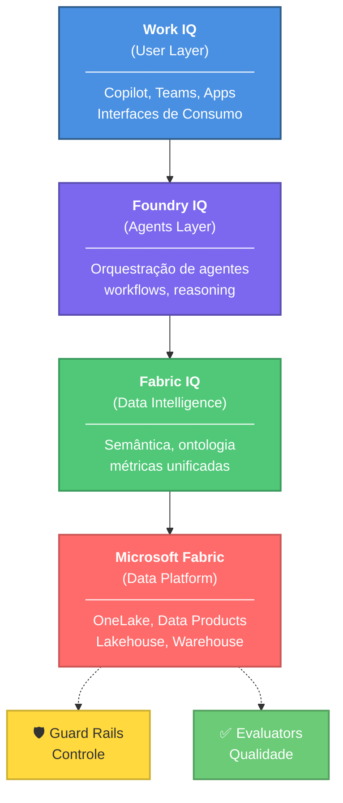

### 🧠 Papel de cada camada

#### 💼 **Work IQ (User Layer)**
A camada de interface com o usuário final. Integra o **Microsoft 365 Copilot** em ferramentas já usadas cotidianamente (Teams, Word, Outlook, Excel, PowerPoint). Seu papel é:
- Fazer IA invisível: os usuários não veem complexidade, apenas resultados
- Fornecer contexto ao usuário: grounding com dados do Microsoft Graph e SharePoint
- Iniciar orquestração: encaminha solicitações complexas para camadas abaixo quando necessário
- Manter experiência familiar: nenhuma interface nova para treinar usuários

**Exemplo:** Um diretor escreve no Word "resuma esta reunião" — o Copilot (Work IQ) busca a transcrição no OneDrive, resume e insere no documento.

---

#### 🤖 **Foundry IQ (Agents Layer)**
A camada de **inteligência agêntica** — onde a lógica de decisão, reasoning e orquestração acontecem. Hospedada no **Microsoft Foundry** e **Copilot Studio**, seu papel é:
- Executar raciocínio encadeado: Claude Opus 4.6 processa contexto de 1M tokens e decide qual tool call fazer
- Orquestrar multi-agent systems: agentes comunicam entre si (via A2A protocol) para resolver problemas complexos
- Aplicar lógica de negócio: implementa regras que Work IQ não pode executar sozinha
- Fazer tool calls controlados: integra com APIs, Fabric, e MCP servers com autenticação Entra ID
- Implementar guardrails em runtime: bloqueia ou redirecionam requisições perigosas

**Exemplo:** Um agente recebe "analise por que a margem caiu" → realiza tool call 1 (busca dados financeiros no Fabric) → tool call 2 (busca benchmarks do setor via MCP) → raciocina sobre contexto → gera análise estruturada.

---

#### 📊 **Fabric IQ (Data Intelligence)**
A camada de **semântica e contexto** que enriquece os dados com significado corporativo. Constrói a verdade única sobre métricas, dimensões e relacionamentos. Seu papel é:
- Criar modelos semânticos: definem métricas (receita, margem, COGS) uma única vez
- Mapear ontologia: relacionamentos entre entidades (produtos, clientes, regiões, períodos)
- Garantir consistência: todos os agentes usam a mesma definição de "margem", "cliente", "Q3"
- Acelerar desenvolvimento: novos agentes reutilizam modelos existentes em vez de reconstruir
- Ativar análise natural: usuários perguntam em linguagem natural, modelos semânticos traduzem para SQL

**Exemplo:** Fabric IQ define que "Margem = (Receita - COGS) / Receita". Quando um agente é consultado sobre margem, ele não precisa saber a fórmula — consome a métrica já calculada.

---

#### 🗄️ **Microsoft Fabric (Data Platform)**
A base — plataforma unificada que armazena, governa e entrega dados para todas as camadas acima. Seu papel é:
- Armazenar (OneLake): repositório lógico único por tenant, construído sobre ADLS Gen2
- Transformar (Spark, Python, SQL): pipelines ETL que alimentam Bronze → Silver → Gold
- Servir (SQL Analytics Endpoint): expõe dados via endpoint T-SQL para agentes executarem queries
- Governar: integra com Purview (classificação), Entra ID (identidade), Defender (segurança)
- Viabilizar BI: Power BI acessa o mesmo Fabric sem duplicação de dados

**Exemplo:** Dados brutos (Bronze) → transformações (Silver) → Data Products prontos para agentes (Gold) → SQL Analytics Endpoint → Agentes consultam em tempo real com row-level security.

---

#### 🛡️ **Guard Rails (Transversal)**
Camada de **controle e segurança** que permeia todas as operações de agentes. Seu papel é:
- Detectar ataques: Prompt Shields bloqueia prompt injection
- Filtrar conteúdo: Content Safety verifica categorias de risco (violência, NSFW, etc.)
- Validar acesso a dados: Purview labels controlam qual agente acessa qual dado
- Sanitizar respostas: PII Detection remove informações sensíveis antes de retornar
- Auditabilidade: toda ação é registrada em Audit Logs para conformidade

**Exemplo:** Um agente tenta acessar dados rotulados como "Highly Confidential" → Guard Rail intercepta, registra tentativa, bloqueia acesso → log enviado ao Purview para auditoria.

---

#### ✅ **Evaluators (Transversal)**
Camada de **medição contínua** que valida se os agentes estão operando corretamente. Seu papel é:
- Avaliar qualidade: groundedness, task adherence, toxicity, riscos de segurança
- Detectar drift: modelo começa a performar pior? Evaluators disparam alertas
- Gerar feedback: resultados da avaliação alimentam retraining ou ajustes de prompts
- Suportar decisões: dados de qualidade justificam promote para produção ou rollback
- Integrar conformidade: Purview logs de acesso a dados sensíveis viram métricas de qualidade

**Exemplo:** Avaliador valida que resposta sobre margem usou dados corretos (groundedness = 95%), explicação foi clara (task adherence = 98%), sem vazamento de dados detectado no teste (segurança = alta) → resposta aprovada para usuário.

---

### 📌 Como Trabalham em Conjunto

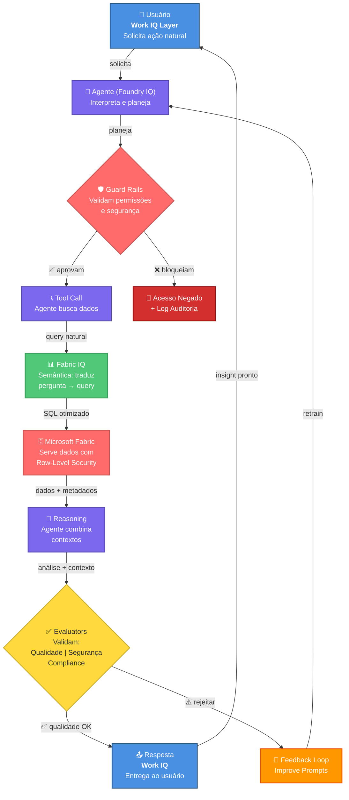

**Insight:** Fabric fornece a base de verdade dos dados. Guard Rails ajudam a assegurar que apenas os agentes certos acessem os dados adequados. Evaluators reforçam a confiabilidade da resposta. Foundry IQ e Work IQ viabilizam que o usuário receba valor pronto para ação.

---

## 🔧 2.1. Especificações Técnicas por Camada

### 🗄️ Microsoft Fabric — OneLake e Delta Lake

#### 📍 **OneLake: O Lago Unificado da Organização**

**O que é:**
OneLake é um **único lago de dados lógico por tenant**, construído automaticamente sobre **Azure Data Lake Storage Gen2 (ADLS Gen2)**. É o equivalente corporativo do OneDrive para dados — provisionado por padrão quando você ativa Fabric, sem configuração adicional.

**Características principais:**
- 🎯 **Centralização:** Todos os dados de analytics da organização em um único local lógico
- 📦 **Multi-tenant:** Suporta múltiplos workspaces (departamentos, domínios) dentro do mesmo OneLake
- 🔗 **Interoperabilidade:** Acessível por todos os engines de Fabric (Spark, SQL, Power BI) simultaneamente
- 📊 **Redução de duplicação:** Evita silos de dados, reduz custos de armazenamento
- 🔐 **Governança unificada:** Políticas de acesso, classificação e conformidade aplicadas centralmente via Purview

**Estrutura física:**
Quando você cria um **Lakehouse** em Fabric, duas pastas principais são provisionadas automaticamente em OneLake:
- `/Tables` — Armazena tabelas gerenciadas em formato Delta (ideal para dados estruturados)
- `/Files` — Armazena dados em qualquer formato (CSV, Parquet, imagens, documentos)

**Exemplo de armazenamento:**

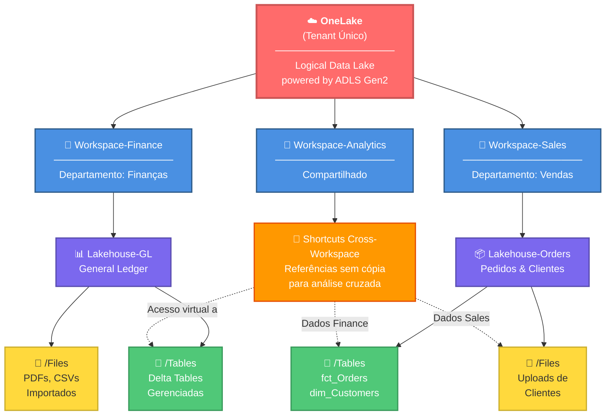

**Leitura do diagrama:**
- 🔴 **OneLake (topo):** Tenant único, automaticamente provisionado
- 🔵 **Workspaces:** Isolam dados por departamento/domínio
- 🟣 **Lakehouses:** Concretos (Finance-GL, Sales-Orders) em cada workspace
- 🟢 **/Tables:** Armazena Delta tables gerenciadas (estruturadas)
- 🟡 **/Files:** Armazena qualquer formato (bruto)
- 🟠 **Shortcuts:** Criam referências cross-workspace sem duplicação física

---

#### 🔄 **Delta Lake: O Formato Padrão de Armazenamento**

**O que é:**
**Delta Lake** é um formato open-source mantido pela Linux Foundation que adiciona camada de transações ACID, validação de schema e histórico a arquivos Parquet. Fabric padroniza em Delta Lake — todo engine (Spark, SQL, Data Warehouse, Power BI) que escreve dados cria automaticamente Delta tables.

**Propriedades técnicas (Delta Lake vs Parquet puro):**

| Propriedade | Parquet | Delta Lake |
|---|---|---|
| **ACID Transactions** | ❌ Não | ✅ Sim (Atomicity, Consistency, Isolation, Durability) |
| **Schema Enforcement** | ❌ Não | ✅ Sim (evita dados "sujos") |
| **Time Travel** | ❌ Não | ✅ Sim (consulta dados de qualquer ponto no tempo) |
| **Data Rollback** | ❌ Não | ✅ Sim (reversão de escritas ruins) |
| **Unified Read** | ✅ Sim | ✅ Sim (todos os engines leem a mesma cópia) |
| **Query Performance** | Básico | **V-Order optimization** (muito mais rápido) |
| **Auditoria e Conformidade** | ❌ Não | ✅ Sim (Delta Lake table history) |

**Benefícios específicos para agentes de IA:**
- **Confiabilidade:** Agentes confiam que dados estão corretos (ACID previne corrupção)
- **Consistência:** Múltiplos agentes lendo simultaneamente tendem a ver versão consistente
- **Rastreabilidade:** Histórico completo de quando/quem alterou dados (auditoria)
- **Sem duplicação:** Spark transforma dados → SQL lê → Power BI visualiza **da mesma cópia**

**Exemplo:**
```
Um agente escreve dados de "margem" em Delta:
  ✅ Margem = (Receita - COGS) / Receita
  ✅ Schema enforce: se alguém tenta escrever "margens" (typo), é bloqueado
  ✅ Outro agente lê simultaneamente, vê dados consisten
  ✅ Se erro descoberto, time-travel volta para versão anterior
```

---

#### 🔗 **Shortcuts: Dados Virtualizados Sem Cópia**

**O que é:**
Shortcuts são **referências virtuais** (como links simbólicos) para dados externos. Agentes consultam dados como se estivessem no OneLake, mas são servidos de fontes externas sem cópia física.

**Fontes suportadas:**
- ✅ Azure Data Lake Storage Gen2 (ADLS Gen2)
- ✅ Amazon S3
- ✅ Google Cloud Storage
- ✅ Dataverse (Microsoft dynamics 365)
- ✅ Outros lakehouses/workspaces (cross-workspace)

**Benefícios:**
- 💰 **Zero copy:** Não duplica dados, economiza armazenamento
- ⚡ **Dados frescos:** Agentes tendem a ver a versão mais atual da fonte
- 🔐 **Segurança integrada:** Purview labels são herdados automaticamente
- 📍 **Governança centralizada:** Uma máscara de dados serve a todos os consumidores

**Exemplo:**
```
Dados de HR vivem em ADLS Gen2 externo (gerenciado por outro time)
Você cria Shortcut → aparece como tabela em seu Lakehouse
Agente executa: SELECT * FROM HR.Employees
  ↓ Fetch direto de ADLS Gen2, autenticado, com RLS aplicada
  ↓ Sem ETL, sem duplicação, governança centralizada
```

---

#### 🔍 **SQL Analytics Endpoint: Interface T-SQL para Dados**

**O que é:**
Cada Lakehouse em Fabric **provisiona automaticamente** um **SQL Analytics Endpoint** — é um endpoint TDS (Tabular Data Stream) que expõe Delta tables como tabelas SQL padrão, consultáveis com T-SQL.

**Características:**
- 🚀 **Automático:** Criado junto com o Lakehouse, zero setup
- 📖 **Read-only:** Não suporta INSERT/UPDATE/DELETE (use Spark para modificar dados)
- ⚡ **Alto performance:** Powered pelo mesmo engine do Fabric Data Warehouse
- 🔐 **Row & Column Security:** Aplica SQL granular permissions (RLS, column masking)
- 📊 **Metadata Auto-Sync:** Delta tables aparecem automaticamente como tabelas SQL
- 🔗 **Cross-workspace:** Pode consultar dados via Shortcuts de outros workspaces

**Capacidades:**
✅ `SELECT` contra Delta tables (incluindo via Shortcuts)  
✅ Criar views, funções, stored procedures em T-SQL  
✅ Aplicar row-level security (RLS) e column security  
✅ Conectar Power BI diretamente para reports  
✅ Executar queries via Azure Data Studio, SQL Server Management Studio (SSMS), qualquer cliente TDS  

**Exemplo de uso por agente:**
```sql
-- Agente no Foundry executa:
SELECT 
    p.ProductName,
    SUM(s.Amount) as TotalSales,
    AVG(s.Amount) as AvgPrice
FROM Gold.Products p
INNER JOIN Gold.Sales s ON p.ProductID = s.ProductID
WHERE s.Date >= DATEADD(month, -3, GETDATE())
GROUP BY p.ProductName
ORDER BY TotalSales DESC

-- Resultado é retornado via TDS ao agente
-- Row-level security já filtrou dados conforme permissão do agente (Entra ID)
```

**Performance considerations:**
- Sincronização automática entre Lakehouse (Spark) e SQL Analytics Endpoint: **< 1 minuto** tipicamente
- Usa **V-Order optimization:** Spark escreve Parquet otimizado para leituras SQL rápidas
- Índices automáticos: Fabric mantém estatísticas e histogramas sem ação do usuário

---

#### 🏗️ **Arquitetura Medallion: Organização em Camadas**

##### 📖 **O que é Medallion Architecture?**

A **Medallion Architecture** (também conhecida como "Bronze-Silver-Gold" ou "Delta Lake Medallion") é um **padrão de organização de dados** recomendado pela Microsoft para estruturar Lakehouses de forma escalável, governável e reutilizável. É um modelo **comprovado em escala de petabytes** (a Microsoft IDEAS, por exemplo, usa Medallion para 4 PiB de dados).

**Princípios fundamentais:**
- 🎯 **Progresso de qualidade:** Cada camada aumenta qualidade, validação e valor dos dados
- 🔄 **Reutilização:** Dados transformados uma vez, consumidos por múltiplos consumers (agentes, BI, apps)
- 🏗️ **Separação de responsabilidades:** Bronze = ingestão, Silver = transformação, Gold = negócio
- 📊 **Escalabilidade:** Suporta crescimento de terabytes a petabytes sem reorganização
- 🔐 **Governança estratificada:** Cada camada tem política própria (isolamento de workspace)

**Alternativas que Medallion não substitui:**
- ✅ Medallion funciona bem em **Data Lake** (Bronze→Silver→Gold com Spark)
- ✅ Medallion funciona bem em **Data Warehouse** (modelagem dimensional, slowly changing dimensions)
- ✅ Fabric permite **combinação:** Bronze+Silver como lakehouses, Gold como data warehouse
- ✅ Para casos muito descentralizados: **Data Mesh** (múltiplos domínios, cada com seu Medallion)

---

##### 🌍 **Fluxo Geral: De Dados Brutos a Insights**

```mermaid
graph LR
    A["🚀 Fonte de Dados<br/>─────────────────<br/>ERP, CRM, APIs,<br/>Uploads, Sensores"]
    
    B["🟤 BRONZE<br/>RAW DATA<br/>─────────────────<br/>Formato original<br/>Sem limpeza"]
    
    C["⚙️ Spark/Python<br/>Transformação<br/>Validação"]
    
    D["🟡 SILVER<br/>CLEAN DATA<br/>─────────────────<br/>Dados validados<br/>Estruturados"]
    
    E["⚙️ Spark/SQL<br/>Agregação<br/>Semântica"]
    
    F["🟢 GOLD<br/>BUSINESS DATA<br/>─────────────────<br/>Pronto para<br/>consumo"]
    
    G["📊 Consumo<br/>─────────────────<br/>Agentes, BI,<br/>Apps, Reports"]
    
    A -->|"Ingerir (as-is)"| B
    B -->|"Transformar"| C
    C -->|"Validar, limpar"| D
    D -->|"Agregar"| E
    E -->|"Semantificar"| F
    F -->|"SQL Analytics<br/>Endpoint"| G
    
    style A fill:#FF6B6B,stroke:#CC5555,color:#fff,stroke-width:2px
    style B fill:#8B6F47,stroke:#664D2A,color:#fff,stroke-width:2px
    style C fill:#FFD93D,stroke:#CCB030,color:#333,stroke-width:2px
    style D fill:#C9A961,stroke:#9B7E48,color:#fff,stroke-width:2px
    style E fill:#FFD93D,stroke:#CCB030,color:#333,stroke-width:2px
    style F fill:#50C878,stroke:#3A9B5C,color:#fff,stroke-width:2px
    style G fill:#4A90E2,stroke:#2E5C8A,color:#fff,stroke-width:2px
```

---

##### 🟤 **Bronze Layer — RAW DATA (Dados Brutos)**

**Propósito:**
- ✅ Capturar dados **como chegam**, em formato original
- ✅ Permitir **auditoria** (rastreamento até origem)
- ✅ Permitir **reprocessamento** (se lógica Silver/Gold mudar)
- ✅ Manter histórico completo (compliance, GDPR, etc.)

**Características:**

| Aspecto | Detalhe |
|---|---|
| **Formatos** | CSV, JSON, Parquet, Delta, AVRO, imagens, PDFs — qualquer um |
| **Validação** | ❌ Nenhuma — "trust but verify later" |
| **Duplicação** | Pode ter linhas duplicadas |
| **Schema** | Loose (pode evoluir sem quebra) |
| **Retenção** | Típica: 90 dias a 2 anos (compliance) |
| **Workspace** | Privado (Bronze-Workspace) |
| **Owner** | Data Engineers (ingestão) |
| **Tecnologia** | Data Factory, Mirroring, Synapse Spark, Dataflows |

**Exemplo de conteúdo Bronze:**

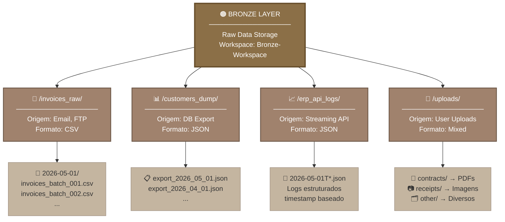

**Características deste exemplo:**

| Pasta | Origem | Formato | Tamanho | Frequência | Qualidade |
|---|---|---|---|---|---|
| `/invoices_raw/` | Email, FTP manual | CSV | 10-500 MB/dia | Diária | ❌ Pode ter erros, duplicatas |
| `/customers_dump/` | DB Export (nightly) | JSON | 100 MB | Diária (1x) | ⚠️ Pode haver caracteres especiais |
| `/erp_api_logs/` | Streaming API | JSON | 5-50 GB/dia | Contínuo | ⚠️ Timestamps podem desincronizar |
| `/uploads/` | User uploads | Variado (PDF, IMG) | 1-10 GB/dia | On-demand | ❌ Pode ter vírus, corrupção |

**Fluxo recomendado para Bronze:**
1. **Mirroring** (ideal): Replicação near real-time de DB → OneLake (suporta SQL Server, MySQL, PostgreSQL, Snowflake)
2. **Data Factory:** Pipelines com 200+ conectores nativos
3. **Shortcuts:** Referenciar dados de ADLS Gen2/S3 sem cópia
4. **Dataflow Gen2:** Interface visual, transformações leves

---

##### 🟡 **Silver Layer — CLEAN DATA (Dados Validados e Estruturados)**

**Propósito:**
- ✅ **Validar** integridade: duplicatas, nulls, tipos de dados
- ✅ **Limpar** dados: padronizar formatos, remover valores inválidos
- ✅ **Estruturar** para análise: desnormalizações, agregações leves
- ✅ **Integrar** múltiplas fontes: invoices + customers + products em tabelas coerentes
- ✅ Servir como **single source of truth** para analistas e agentes

**Características:**

| Aspecto | Detalhe |
|---|---|
| **Formatos** | ✅ **Padrão: Delta Lake** (ACID, schema enforcement) |
| **Validação** | ✅ Sim — integridade referencial, tipos, ranges |
| **Duplicação** | ❌ Removidas (distinct keys garantidas) |
| **Schema** | Strict (schema enforcement — rejeita dados inválidos) |
| **Retenção** | Indefinido (dados de produção) |
| **Workspace** | Semi-privado (Silver-Workspace, acesso controlado) |
| **Owner** | Data Engineers (transformação ELT) |
| **Tecnologia** | Spark (Python, SQL, Scala), Synapse notebooks |

**Transformações típicas Bronze → Silver:**

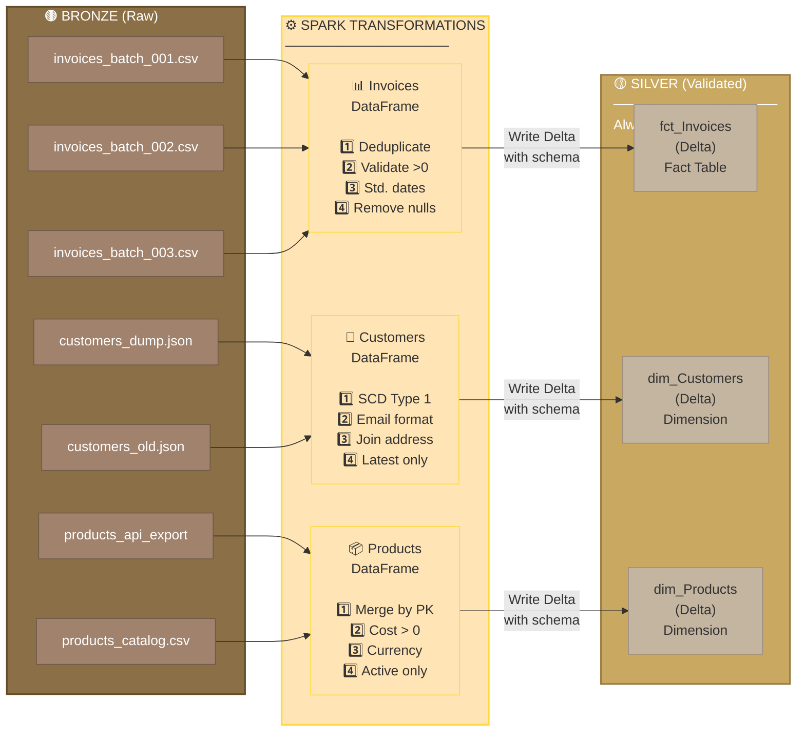

**Fluxo por categoria:**

| Origem | Processamento Spark | Validações | Saída Silver |
|---|---|---|---|
| **Invoices** (múltiplos CSVs) | Spark DataFrame merge | ✅ Dedup by ID<br/>✅ Amount > 0<br/>✅ Date standard<br/>✅ Remove nulls | **fct_Invoices** (Delta) |
| **Customers** (JSON exports) | Spark DataFrame merge | ✅ Latest version (SCD1)<br/>✅ Email format<br/>✅ Join address data<br/>✅ Active only | **dim_Customers** (Delta) |
| **Products** (API export) | Spark DataFrame merge | ✅ Merge by ProductID<br/>✅ Cost > 0<br/>✅ Currency aligned<br/>✅ Active flag | **dim_Products** (Delta) |

**Garantias de qualidade Silver:**
- 🔐 **ACID transactions** — nenhum dado parcial ou corrompido
- 🔑 **Primary key unique** — sem duplicatas por ID
- 📊 **Schema strict** — rejeita dados fora do tipo esperado
- ✅ **Data completeness** — nenhum NULL em colunas críticas
- 🔄 **Referential integrity** — FK relationships validadas

**Estrutura típica Silver:**

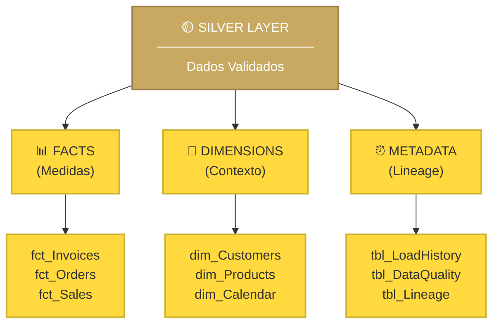

---

##### 🟢 **Gold Layer — BUSINESS DATA (Dados Prontos para Negócio)**

**Propósito:**
- ✅ **Agregar** dados em dimensões de negócio (produto, região, período)
- ✅ **Calcular** métricas (receita, margem, COGS, KPIs)
- ✅ **Semantificar** dados com nomes e lógica corporativa compreensível
- ✅ Expor como **Data Products** consumíveis por agentes, BI, apps
- ✅ Garantir **performance** (dados pré-agregados, índices, estatísticas)

**Características:**

| Aspecto | Detalhe |
|---|---|
| **Formatos** | ✅ **Padrão: Delta Lake** (com V-Order optimization) |
| **Agregação** | ✅ Sim — fatos agregados por dimensões de negócio |
| **Cálculos** | ✅ Métricas corporativas pré-calculadas |
| **Schema** | Semantic — nomes de negócio (não técnicos) |
| **Retenção** | Indefinido (dados de histórico completo) |
| **Workspace** | Público/Semi-público (Gold-Workspace, acesso amplo) |
| **Owner** | Analytics Engineers / Business Analysts |
| **Exposure** | SQL Analytics Endpoint, Power BI, APIs para agentes |
| **Tecnologia** | Spark (agregações), SQL (views, stored procs), Power BI (semantic models) |

**Estrutura típica Gold (Data Products):**

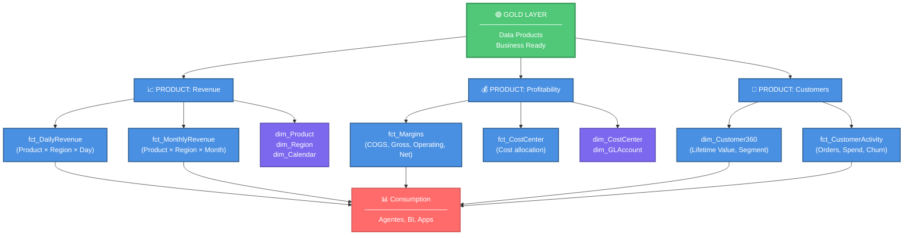

**Exemplos de tabelas Gold:**

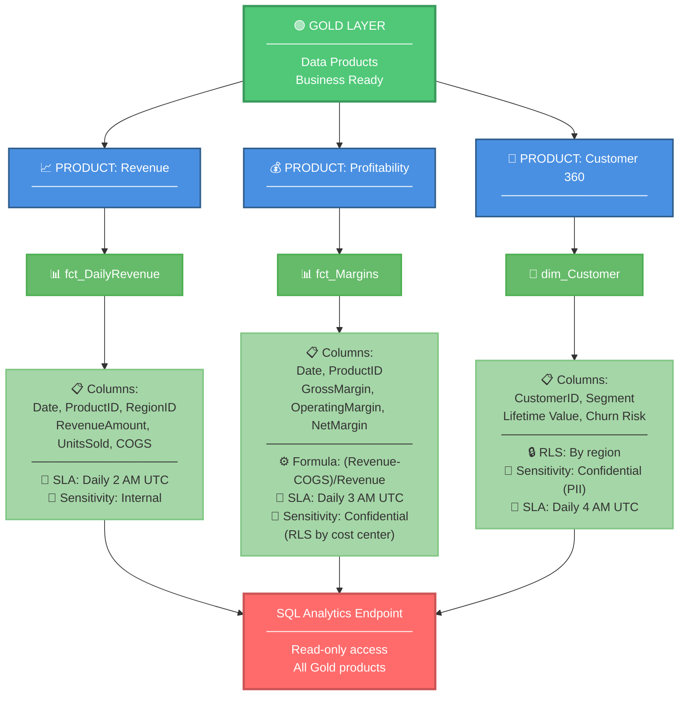

**Resumo de Data Products Gold:**

| Product | Tabela | Propósito | Atualizado | Acesso |
|---|---|---|---|---|
| **Revenue** | `fct_DailyRevenue` | Receita por produto-região-dia | 2 AM UTC | 🔵 Internal |
| **Profitability** | `fct_Margins` | Margens bruta, operacional, líquida | 3 AM UTC | 🟡 Confidential (RLS) |
| **Customer 360** | `dim_Customer` | Cliente + lifetime value + churn risk | 4 AM UTC | 🔴 Confidential (PII + RLS) |

**Garantias por Data Product:**
- ✅ **Documentação:** Dicionário de dados, fórmulas, lineage
- ✅ **SLA:** Horário garantido de atualização diária
- ✅ **Segurança:** Sensitivity labels + Row-level security automática
- ✅ **Descoberta:** Indexado em Data Catalog (Purview)
- ✅ **Auditoria:** Acesso registrado em Audit Logs

---

##### 🏢 **Workspace Isolation (Recomendação Microsoft)**

Microsoft recomenda **criar cada camada em workspace separado** para melhor governança:

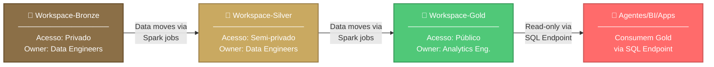

**Benefícios:**
- 🔐 **Isolamento:** Bronze (raw) não exposto a usuários finais
- 👥 **RBAC granular:** Diferentes permissões por layer
- 📊 **Billing separado:** Rastrear custos de cada fase do pipeline
- 🚀 **Performance:** Capacity dedicada para cada workload
- 🔄 **Evolução:** Mudar Silver/Gold sem afetar ingestão Bronze

---

##### 📚 **Padrões de Implementação em Fabric**

Existem **3 padrões principais** recomendados pela Microsoft para implementar Medallion em Fabric. A escolha depende da **maturidade do time, complexidade dos dados e requisitos de BI**.

---

###### **OPÇÃO 1️⃣ — Três Lakehouses (um por camada)**

**Quando usar:**
- ✅ Times de **Data Engineering puros** (sem BI tradicional)
- ✅ Arquitetura **amplamente aberta** (Delta Lake, sem esquema dimensional)
- ✅ Foco em **análises exploratórias e agentes de IA**
- ✅ Equipes que dominam **Spark/Python** mais que SQL

**Arquitetura:**

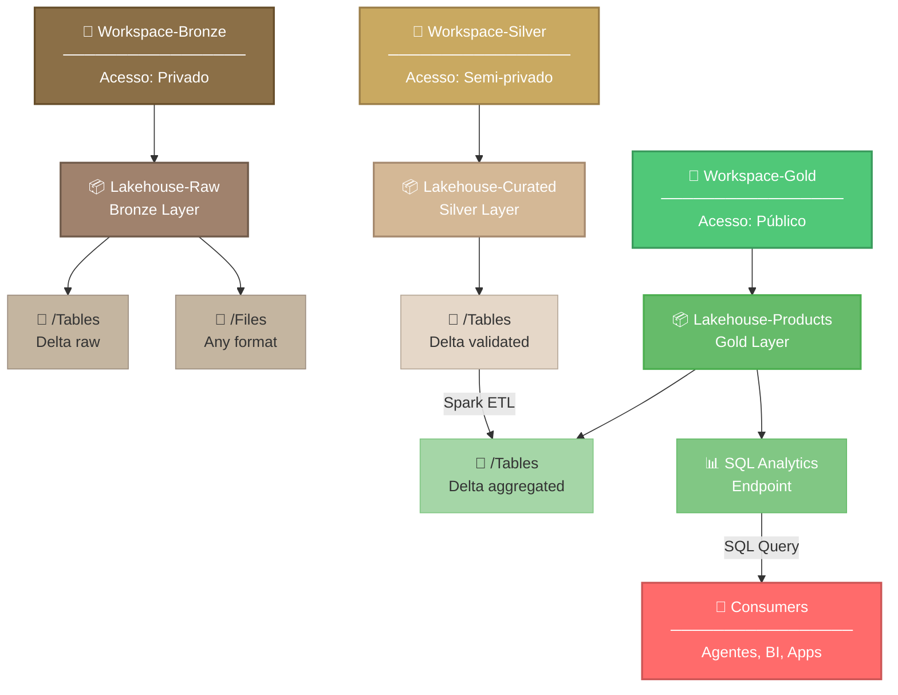

**Características:**

| Aspecto | Detalhe |
|---|---|
| **Lakehouses** | 3 separados (Bronze, Silver, Gold) |
| **Formatos** | Bronze: múltiplos, Silver: Delta, Gold: Delta |
| **Computação** | Spark (transformação), SQL (queries) |
| **BI Support** | Limitado — SQL Analytics Endpoint apenas |
| **Escalabilidade** | ⭐⭐⭐⭐⭐ Excelente para data lakes |
| **Governança** | ⭐⭐⭐⭐ Isolamento por workspace |
| **Complexidade** | Média (3 lakehouses para manter) |
| **Custo** | 💰 3 capacidades = custos 3x |

**Casos de uso reais:**
- Agências de Big Data que servem múltiplos clientes
- Organizações com cultura Data Science (Python/R dominant)
- Processamento de petabytes com Spark
- Análises exploratórias e machine learning

---

###### **OPÇÃO 2️⃣ — Lakehouse Bronze+Silver, Data Warehouse Gold** ⭐ **RECOMENDADO**

**Quando usar:**
- ✅ Times com **experiência em BI tradicional** (Star schema, dimensional modeling)
- ✅ Necessidade de **Power BI + SQL Reports** como consumidores
- ✅ Análises **estruturadas e repetíveis** (não exploratórias)
- ✅ Equipes que dominam **SQL/DAX** mais que Spark/Python

**Arquitetura:**

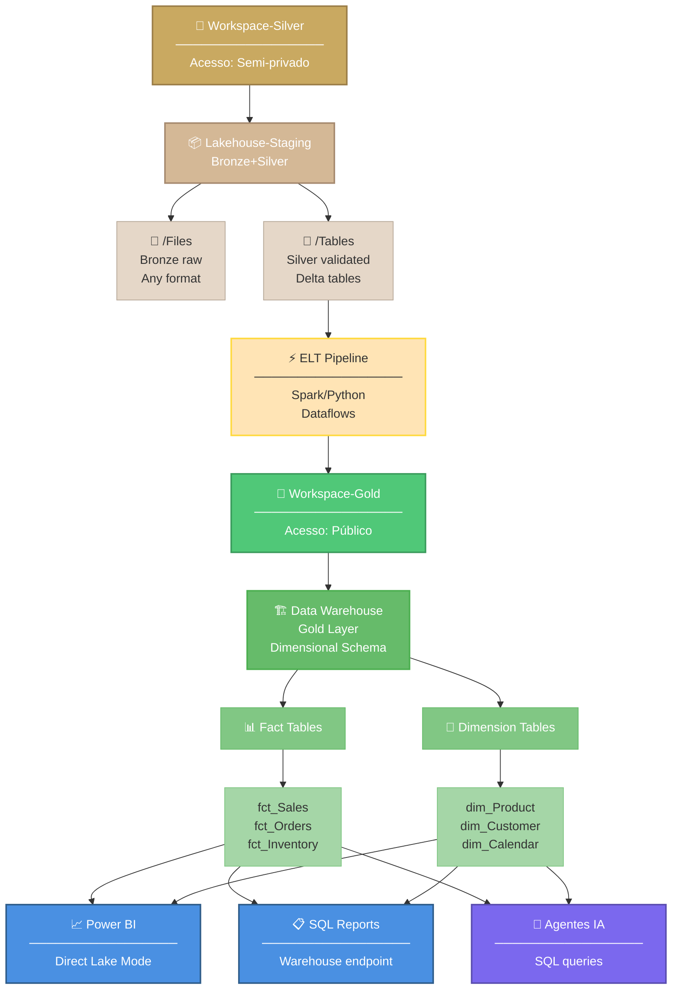

**Características:**

| Aspecto | Detalhe |
|---|---|
| **Lakehouses** | 1 (Bronze+Silver combinados) |
| **Warehouses** | 1 (Gold em DW dimensional) |
| **Formatos** | Bronze: múltiplos, Silver: Delta, Gold: DW schema |
| **Computação** | Spark (ETL), SQL (DW queries) |
| **BI Support** | ⭐⭐⭐⭐⭐ Native Power BI + SQL Reports |
| **Escalabilidade** | ⭐⭐⭐⭐ Bom para BI enterprise |
| **Governança** | ⭐⭐⭐⭐ Isolamento Bronze/Silver vs Gold |
| **Complexidade** | Média (1 Lakehouse + 1 DW) |
| **Custo** | 💰💰 2 capacidades (mais eficiente) |

**Casos de uso reais:**
- Organizações com BI maduro (Power BI em escala)
- Empresas em transição de data warehouse tradicional
- Análises estruturadas com modelos dimensionais
- Relatórios operacionais repetíveis

**Benefício único:** Usa **Direct Lake mode** do Power BI — carrega dados diretamente de Delta tables no DW, reduzindo a necessidade de refreshes caros de datasets Import.

---

###### **OPÇÃO 3️⃣ — Medallion + Data Mesh** (Para grandes organizações)

**Quando usar:**
- ✅ Organizações **muito grandes** (200+ dados engineers)
- ✅ **Múltiplos domínios** autônomos (Finance, Sales, Operations, HR, etc.)
- ✅ Necessidade de **federação de dados** (cada domínio possui seus dados)
- ✅ Cada domínio opera seu próprio **Medallion completo**

**Arquitetura:**

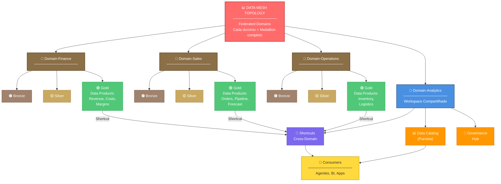

**Características:**

| Aspecto | Detalhe |
|---|---|
| **Domínios** | 3+ (cada um = Medallion completo) |
| **Propriedade** | Cada domínio = team autônomo |
| **Integração** | Shortcuts + OneLake cross-workspace |
| **Governança** | Hub centralizado (Purview) |
| **Escalabilidade** | ⭐⭐⭐⭐⭐ Petabyte-scale |
| **Autonomia** | ⭐⭐⭐⭐⭐ Máxima independência |
| **Complexidade** | Alta (requer disciplina) |
| **Custo** | 💰💰💰 Múltiplas capacidades |

**Princípios Data Mesh:**
1. **Domain ownership:** Cada domínio = proprietário de seus dados
2. **Data as product:** Gold layers são "Data Products" com SLA
3. **Self-serve infrastructure:** Cada domínio provisiona seu próprio Medallion
4. **Federated governance:** Políticas centrais (Purview), implementação local

**Casos de uso reais:**
- Grandes conglomerados (múltiplas filiais, geografias)
- Organizações fintech (cada serviço = domínio independente)
- Empresas em scaling (100+ engenheiros de dados)
- Indústria de mídia (múltiplos estúdios/plataformas)

---

##### 📋 **Matriz de Decisão: Qual Padrão Escolher?**

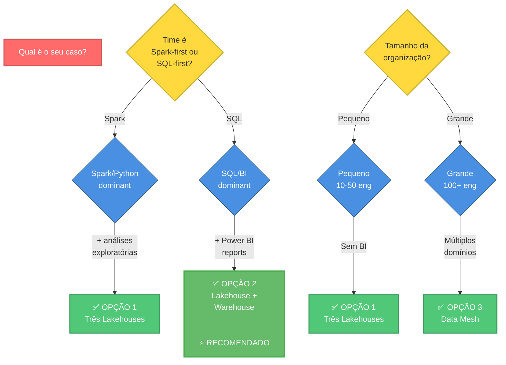

---

**Referências Microsoft:**
- [Understand medallion lakehouse architecture for Microsoft Fabric with OneLake](https://learn.microsoft.com/fabric/onelake/onelake-medallion-lakehouse-architecture)
- [Lakehouse end-to-end scenario: overview and architecture](https://learn.microsoft.com/fabric/data-engineering/tutorial-lakehouse-introduction)
- [Data Platform end-to-end with Microsoft Fabric](https://learn.microsoft.com/azure/architecture/example-scenario/dataplate2e/data-platform-end-to-end)

---

#### 📊 **Data Products: Pacotes de Dados para Reutilização**

**O que é:**
Um **Data Product** é um conjunto curado de tabelas Gold com semântica clara, documentação, e SLA de qualidade — pronto para ser reutilizado por múltiplos agentes e usuários.

**Características:**
- 📖 **Documentado:** Dicionário de dados, lineage, business rules claras
- 🎯 **Semanticamente claro:** "Revenue = Sales Price × Quantity", não ambíguo
- 🔐 **Seguro:** Row-level security aplicado automaticamente via Purview labels
- ⚙️ **Operacionalizado:** Pipelines de refresh ajudam a manter dados frescos, com SLA de atualização
- 📈 **Versionado:** Mudanças de schema são controladas, compatibilidade mantida
- 📣 **Descobrível:** Catálogo (Data Catalog in Purview) indexa e descreve

**Exemplo de Data Product:**

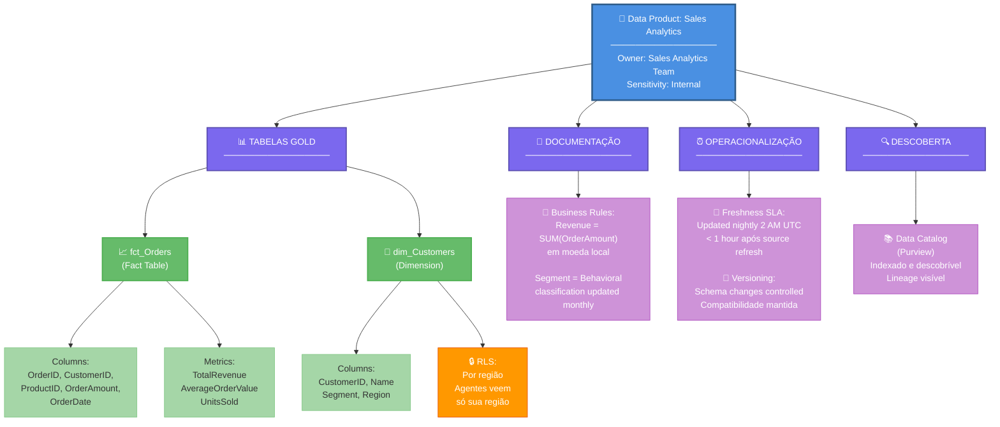

**Componentes do Data Product:**

| Componente | O que é | Responsabilidade |
|---|---|---|
| **Fact Tables** | `fct_Orders` — medidas (OrderAmount, UnitsSold) | Núcleo analítico |
| **Dimensions** | `dim_Customers` — contexto (Name, Segment) | Contexto de negócio |
| **Metrics** | TotalRevenue, AverageOrderValue | KPIs pré-calculados |
| **RLS** | Row-level security por região | Segurança + conformidade |
| **Documentação** | Business rules, fórmulas, glossário | Semântica clara |
| **SLA** | Updated 2 AM UTC, < 1h lag | Confiabilidade |
| **Versionamento** | Schema changes com compatibilidade | Evolução controlada |
| **Catálogo** | Purview indexa e descreve | Descoberta |

**Uso por Agente:**
```python
# Agente no Foundry
from azure.ai.projects import AIProjectClient
import pyodbc

# Conecta via SQL Analytics Endpoint (autenticado com Agent ID via Entra)
conn = pyodbc.connect(
    'Driver=ODBC Driver 17 for SQL Server;'
    'Server=fabric.database.windows.net;'
    'Database=Sales_Analytics;'
    'Authentication=ActiveDirectoryMSI'
)

# Consulta Data Product Gold (RLS automática)
cursor = conn.cursor()
cursor.execute('''
    SELECT OrderAmount, CustomerSegment, OrderDate
    FROM fct_Orders
    WHERE OrderDate >= DATEADD(month, -3, GETDATE())
''')

# Agent raciocina com dados
data = cursor.fetchall()
# ... Claude processa contexto, gera análise
```

---

#### 🔐 **Integração com Governança (Purview + Entra)**

A integração entre **Microsoft Entra Agent ID**, **Microsoft Purview** e **Microsoft Fabric** cria uma arquitetura de segurança multinível onde cada agente é autenticado como uma identidade corporativa distinta (não apenas um aplicativo genérico), e cada acesso a dados é governado por classificação de sensibilidade e regras de controle de acesso.

##### 🪪 **Entra ID Agent Identity - Identidades para IA**

Microsoft Entra Agent ID é um framework de segurança propositalmente construído para agentes de IA autônomos. Diferentemente de um service principal tradicional, o Agent ID oferece:

| Aspecto | Service Principal (Legado) | Entra Agent ID (Novo) |
|---------|-------------------------|---------------------|
| **Propósito** | Aplicativo genérico | Agente de IA específico |
| **Contexto** | Sem identidade real | Identidade Zero Trust com contexto |
| **Autenticação** | Username/senha ou certificado | JWT + contexto de risco |
| **Autorização** | Baseado em função (RBAC) | Baseado em função + risco + contexto |
| **Auditoria** | Logs básicos | Logs estruturados de agente com intenção |
| **Governança** | Manual por grupo | Automática via policy de ciclo de vida |
| **Conditional Access** | Limitado | Suporta policies por agent |

**Como funciona Agent ID:**

1. **Criação:** Cada agente recebe uma identidade única no Entra ID (ex: `eng-sales-agent-001`)
2. **Autenticação:** Agent solicita token JWT usando `ClientSecret` ou `Certificate`
3. **JWT contém:**
   - `app_displayname`: "Eng Sales Agent"
   - `appid`: GUID único do agent
   - `roles`: ["Data Explorer", "Contributor"] 
   - `oid`: ID de objeto do agent
4. **Zero Trust:** Token é enviado a cada request com contexto de risco
5. **Renovação:** Token expira (1h padrão) e agent deve re-autenticar

**Exemplo de JWT Payload:**
```json
{
  "aud": "https://database.windows.net",
  "iss": "https://sts.windows.net/12345678-1234-1234-1234-123456789012/",
  "iat": 1704067200,
  "nbf": 1704067200,
  "exp": 1704070800,
  "acr": "1",
  "appid": "87654321-4321-4321-4321-210987654321",
  "appidacr": "1",
  "email": "eng-sales-agent-001@company.onmicrosoft.com",
  "name": "Engineering Sales Agent",
  "oid": "11111111-1111-1111-1111-111111111111",
  "roles": ["Data Explorer", "Contributor"],
  "rh": "0.ARcAoP...",
  "scp": "user_impersonation",
  "sub": "oL....",
  "tid": "12345678-1234-1234-1234-123456789012",
  "unique_name": "eng-sales-agent-001@company.onmicrosoft.com",
  "upn": "eng-sales-agent-001@company.onmicrosoft.com",
  "uti": "....",
  "ver": "1.0"
}
```

---

##### 🏷️ **Purview Sensitivity Labels - Hierarquia e Classificação**

Sensitivity labels em Purview fornecem classificação multinível com proteção progressiva:

| Label | Descrição | Cenário de Uso | Proteção | Acesso por Agente |
|-------|-----------|---|----------|---|
| **Public** | Sem restrição, pode ser compartilhado externamente | Dados públicos de marketing, preços públicos | Nenhuma criptografia | ✅ Automático |
| **Internal** | Apenas para uso interno, não sensível | Documentos operacionais, comunicados | Marca de água | ✅ Automático |
| **Confidential** | Dados comerciais sensíveis, restrito a funcionários autorizados | Contratos, planos de vendas, análises internas | Criptografia + Restrição de Acesso | ⚠️ Requer Conditional Access |
| **Highly Confidential** | Dados extremamente sensíveis, máxima proteção | Dados financeiros, PII, segredos comerciais | Criptografia forte + Restrição rígida | ❌ Bloqueado (human-in-loop obrigatório) |

**Hierarquia de Labels em Purview:**

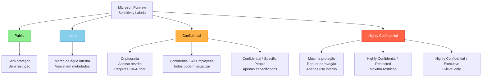

**Aplicação de Labels em Fabric:**

Quando dados são ingeridos no OneLake, Purview pode aplicar labels automaticamente:

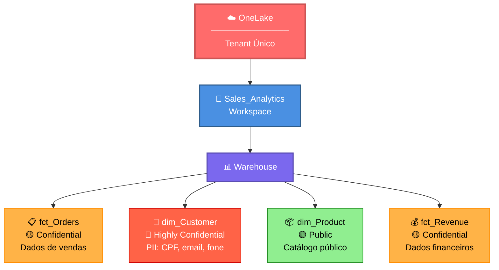

---

##### 🔒 **Row-Level Security (RLS) - Filtragem por Contexto do Agente**

O SQL Analytics Endpoint em Fabric suporta RLS via `EXECUTE AS` com Agent ID:

```sql
-- Tabela base: fct_Orders
SELECT 
    OrderID, 
    Amount, 
    CustomerID, 
    OrderDate,
    SensitivityLabel  -- Coluna adicionada por Purview
FROM [dbo].[fct_Orders]

-- Política RLS aplicada ao Agent "eng-sales-agent-001"
CREATE SECURITY POLICY SalesRLS
    ADD FILTER PREDICATE dbo.fn_securitypredicate(SalesRegion)
    ON dbo.fct_Orders
    AFTER INSERT, AFTER UPDATE;

-- Função que define o filtro
CREATE FUNCTION dbo.fn_securitypredicate(@SalesRegion AS nvarchar(max))
    RETURNS TABLE
    WITH SCHEMABINDING
AS
RETURN SELECT 1 AS fn_securitypredicate_result
WHERE @SalesRegion IN (
    SELECT value FROM STRING_SPLIT(
        SESSION_CONTEXT(N'SalesRegion'), ','
    )
);

-- Agent conecta com contexto
EXECUTE sp_set_session_context @key=N'SalesRegion', @value=N'LATAM,EMEA';
SELECT * FROM fct_Orders;  -- Retorna apenas LATAM + EMEA
```

**Fluxo de RLS para Agente:**

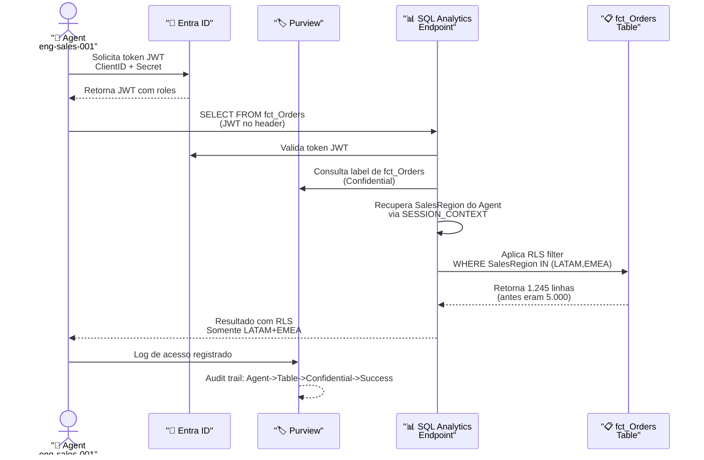

---

##### 🔐 **Conditional Access - Políticas Adaptativas**

Quando um Agent tenta acessar dados **Confidential** ou **Highly Confidential**, Entra ID avalia políticas de Conditional Access:

**Exemplos de Políticas:**

| Cenário | Condição | Ação |
|---------|----------|------|
| Agent em IP corporativo + horário comercial | `TrustedLocation AND 09:00-18:00` | ✅ Permitir |
| Agent em horário fora do comercial | `After 18:00 OR Weekend` | ⚠️ Requer MFA + PIM approval |
| Agent acessando Highly Confidential | Por política corporativa | ❌ Bloquear + Notificar admin |
| Agent com comportamento anômalo | Risco elevado detectado | ⚠️ Step-up (MFA, manual approval) |

**Política de Exemplo (em Entra):**

```
Name: High Sensitivity Data Access
Applies to: All agents
Conditions:
  - Cloud apps: Azure Data Warehouse, SQL Database
  - Users: Service principals (agents)
  - Sensitivity: >= Confidential

Grant Controls:
  - Require multi-factor authentication
  - Require device to be marked as compliant
  - Require app protection policies
  
Session Controls:
  - Use app enforced restrictions
  - Sign-in frequency: 1 hour
```

**Integração com PIM (Privileged Identity Management):**

Para acessar dados Highly Confidential, o Agent precisa de aprovação:

```
Request Flow:
1. Agent tenta SELECT * FROM dim_Customer (Highly Confidential)
2. Entra detecta risco elevado
3. PIM requer aprovação de Security Admin
4. Admin recebe notificação:
   "Agent 'eng-sales-001' requests access to 'Highly Confidential' data.
    Reason: [Agent enviou]. Approve? [Yes/No]"
5. Se aprovado: Acesso concedido por 15 minutos
6. Se rejeitado: Acesso bloqueado + Alert

Timeout: Token expira após 15 minutos ou quando PIM approval expira
```

---

##### 📋 **Audit & Compliance - Rastreamento Completo**

Purview e Entra registram tudo:

**O que é auditado:**

| Evento | Quem | Quando | O quê | Resultado |
|--------|------|--------|-------|----------|
| Agent authentication | Entra ID | 2024-01-15 10:32:45Z | Agent `eng-sales-001` autenticou | ✅ Success |
| Query execution | Fabric RLS | 2024-01-15 10:33:12Z | SELECT fct_Orders (Confidential) | ✅ 1.245 rows |
| Label check | Purview | 2024-01-15 10:33:12Z | Sensibility: Confidential, RLS: Applied | ✅ Pass |
| Conditional Access | Entra | 2024-01-15 10:33:12Z | IP: 192.168.1.100, Location: Trust, Risk: Low | ✅ Allow |
| Data export | Purview DLP | 2024-01-15 10:35:00Z | Agent exportou 1.245 rows para CSV | ❌ Bloqueado (DLP) |
| Failed access | Fabric + Purview | 2024-01-15 10:45:00Z | Agent tentou Highly Confidential (PIM pending) | ❌ Denied |

**Exemplo de Audit Log:**

```json
{
  "timestamp": "2024-01-15T10:33:12.456Z",
  "auditEventType": "DataAccessAudit",
  "actor": {
    "type": "ServicePrincipal",
    "id": "87654321-4321-4321-4321-210987654321",
    "displayName": "eng-sales-agent-001"
  },
  "resource": {
    "type": "Table",
    "id": "fct_Orders",
    "workspace": "Sales Analytics",
    "sensitivity": "Confidential"
  },
  "action": {
    "type": "Query",
    "query": "SELECT OrderID, Amount, CustomerID FROM fct_Orders",
    "result": "Success"
  },
  "security": {
    "authentication": "EntraID_JWT",
    "authenticationResult": "Success",
    "rls_applied": true,
    "rls_filter": "SalesRegion IN ('LATAM','EMEA')",
    "rows_returned": 1245,
    "conditional_access": "Allow",
    "risk_level": "Low"
  },
  "compliance": {
    "regulatory_framework": ["LGPD", "SOC2", "ISO27001"],
    "data_residency": "BR-South",
    "encryption": "AES-256"
  }
}
```

**Retenção de Logs:**

- Entra ID Sign-in logs: 30 dias (default) → 90 dias com Azure Log Analytics
- Fabric Audit logs: 90 dias (default) → Retenção ilimitada com Long Term Retention
- Purview DLP logs: 1 ano (default) → Configurável até 10 anos

---

##### 🔄 **Fluxo Completo de Acesso (4 Camadas de Validação)**

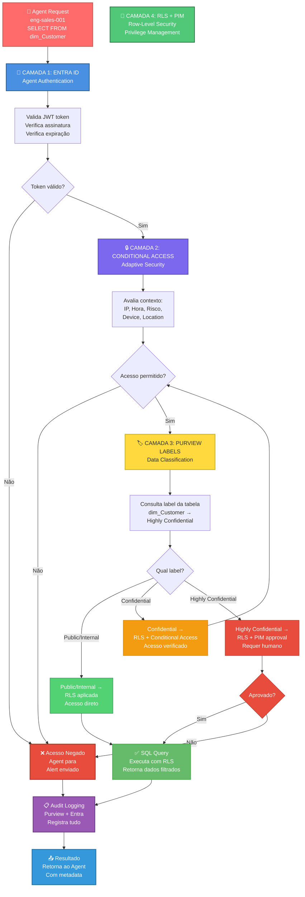

---

##### 🔗 **Referências Microsoft**

- [**Microsoft Entra Agent ID**](https://learn.microsoft.com/entra/agent-id/what-is-microsoft-entra-agent-id) - Framework de segurança para agentes de IA (Preview)
- [**Conditional Access for Agents**](https://learn.microsoft.com/entra/identity/conditional-access/agent-id) - Políticas adaptativas para identidades de agente
- [**Microsoft Entra Authentication in Fabric**](https://learn.microsoft.com/fabric/data-warehouse/entra-id-authentication) - Autenticação Zero Trust para SQL Analytics Endpoint
- [**Sensitivity Labels in Fabric**](https://learn.microsoft.com/fabric/governance/protected-sensitivity-labels) - Classificação de dados com proteção automática
- [**Row-Level Security in Fabric**](https://learn.microsoft.com/fabric/security/service-admin-row-level-security) - Filtragem de dados por contexto de usuário/agente
- [**Data Governance with Purview**](https://learn.microsoft.com/azure/cloud-adoption-framework/data/governance-security-baselines-purview-data-estate-unify-data-platform) - Classificação, governança e conformidade
- [**Audit Logging in Purview**](https://learn.microsoft.com/purview/compliance-portal) - Rastreamento e conformidade regulatória
- ⏹️ **Conditional Access:** Aprovações para dados sensíveis

### 📋 Resumo Técnico — De Dados Brutos a Insights de IA

| Componente | Função | Agentes Usam? |
|---|---|---|
| **OneLake** | Armazenamento lógico único, sem silos | Implicitamente (via SQL endpoint) |
| **Delta Lake** | Garantia ACID, confiabilidade, time-travel | Implicitamente (através de tabelas) |
| **Shortcuts** | Acesso a dados externos sem cópia | ✅ Sim (veem como tabelas locais) |
| **SQL Analytics Endpoint** | Interface T-SQL para consultas | ✅ Sim (principal forma de acesso) |
| **Medalha Medallion (Bronze→Silver→Gold)** | Organização e qualidade progressiva | ✅ Sim (acessam Gold layer) |
| **Data Products** | Pacotes curados para reutilização | ✅ Sim (principal consumidor) |
| **Purview Labels** | Classificação e governança de dados | ✅ Sim (define quem acessa o quê) |
| **Entra ID (Agent ID)** | Identidade e autenticação de agentes | ✅ Sim (autenticação + auditoria) |

**Referências Microsoft:**
- [Understand medallion lakehouse architecture for Microsoft Fabric with OneLake](https://learn.microsoft.com/fabric/onelake/onelake-medallion-lakehouse-architecture)
- [What is a lakehouse in Microsoft Fabric?](https://learn.microsoft.com/fabric/data-engineering/lakehouse-overview)
- [What is the SQL analytics endpoint for a lakehouse?](https://learn.microsoft.com/fabric/data-engineering/lakehouse-sql-analytics-endpoint)
- [Delta Lake table format interoperability](https://learn.microsoft.com/fabric/fundamentals/delta-lake-interoperability)

---

