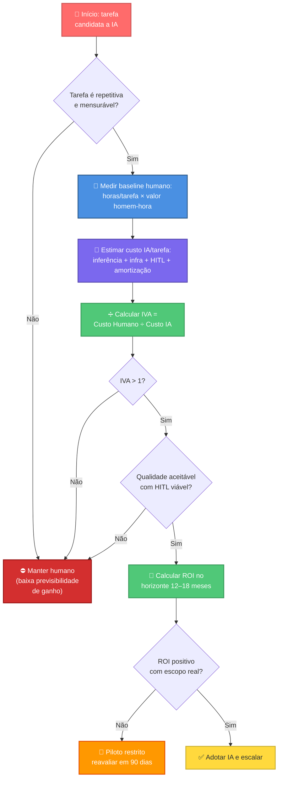
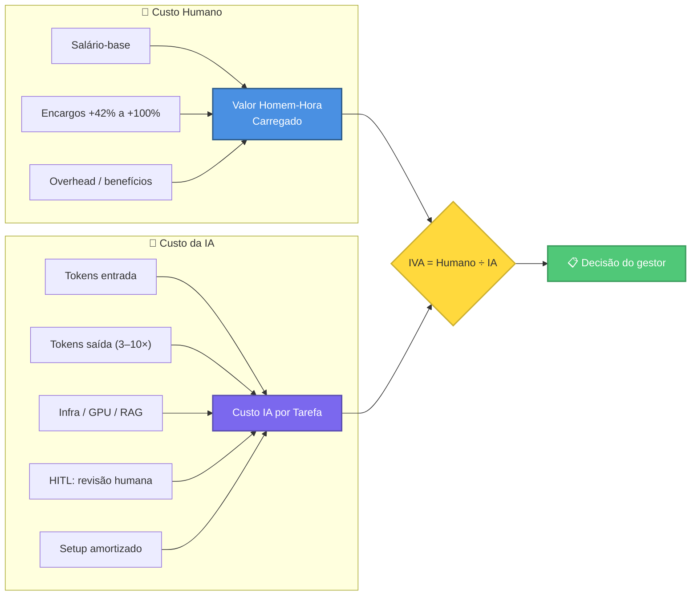
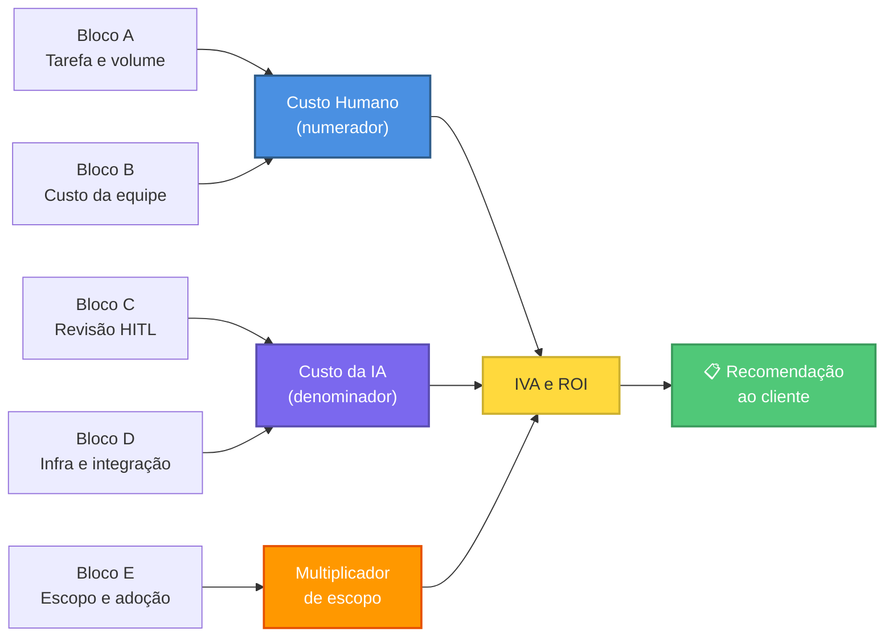
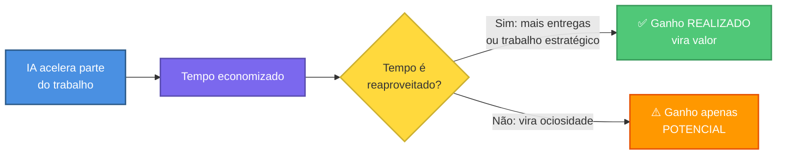

## 💰 4.1. Modelo de ROI — IA vs. Custo de Homem-Hora

> **Objetivo:** dar aos gestores um modelo de decisão **financeiro e auditável** para responder, em cada cenário de adoção, à pergunta central: *"vale mais a pena usar IA ou pagar pelo trabalho humano?"* — e justificar, em números, as decisões de roadmap das seções 3 e 4.

### 📌 Resumo executivo

A decisão não deve ser tomada "no token" (custo unitário de inferência), mas sim **no custo por tarefa concluída e validada**. O preço de um token é irrisório; o custo escondido está no *retrabalho, na revisão humana (HITL) e na infraestrutura*. A regra prática: **medir custo por tarefa completa, não por token, é o que separa quem otimiza de quem apenas economiza.**

A fórmula central é o **Índice de Vantagem da IA (IVA)**:

$$
\text{IVA} = \frac{\text{Custo Humano da Tarefa}}{\text{Custo Total da IA por Tarefa}}
$$

- **IVA > 1** → a IA é financeiramente vantajosa.
- **IVA = 1** → ponto de equilíbrio (indiferente).
- **IVA < 1** → manter o trabalho humano.

Quanto maior o IVA, maior o retorno. Um IVA de $4{,}0$ significa que a tarefa via IA custa **¼** do valor da mesma tarefa feita por uma pessoa.

> **Dois modos de avaliar o ROI.**
> 1. **Modo eficiência/substituição:** *"a IA faz esta tarefa mais barato que um humano?"* — usa o IVA acima.
> 2. **Modo ampliação:** *"quanto a IA aumenta a produtividade do funcionário que continua no comando?"* — a IA não substitui a pessoa; amplia a vazão de quem já está lá (ver final desta seção). Coerente com o modo *ampliação* das camadas Work IQ e Foundry IQ deste guia.

### 🧮 As duas metades da equação

**Custo Humano da Tarefa (numerador):**

$$
\text{Custo}_{\text{Humano}} = \text{Valor}_{\text{Homem-Hora}} \times \text{Horas}_{\text{por Tarefa}} \times \text{N}^\circ_{\text{Tarefas}}
$$

| Variável | Descrição | Como obter |
|---|---|---|
| `Valor_Homem_Hora` | Custo **totalmente carregado** (salário + encargos + overhead), **não** o salário-base | Salário-hora × fator de carga |
| `Horas_por_Tarefa` | Tempo médio que um humano leva na tarefa | Amostragem / sistema de tickets |
| `Nº_Tarefas` | Volume de tarefas no período | Histórico operacional |

> ⚠️ **Erro mais comum:** usar o salário bruto. O *Employment Cost Index* do BLS (EUA) aponta carga adicional de **~42% sobre o salário**. No Brasil, encargos CLT elevam o custo entre **+70% e +100%** sobre o salário-base. **Use sempre o custo carregado.** Exemplo (Brasil/CLT): salário-base R$ 8.000 × fator de carga 1,8 = R$ 14.400/mês ÷ ~160 h ≈ **R$ 90/hora**.

**Custo Total da IA por Tarefa (denominador):**

$$
\text{Custo}_{\text{IA Tarefa}} = \text{Custo}_{\text{Inferência}} + \text{Custo}_{\text{Infra}} + \text{Custo}_{\text{HITL}} + \text{Custo}_{\text{Amortizado}}
$$

| Componente | O que inclui | Observação crítica |
|---|---|---|
| `Custo_Inferência` | Tokens de entrada + saída × preço do modelo | Tokens de **saída** custam **3× a 10× mais** que os de entrada |
| `Custo_Infra` | GPUs/cloud, orquestração de agentes, bancos vetoriais (RAG), APIs | Diluído por tarefa |
| `Custo_HITL` | Tempo humano de **revisão, correção e aprovação** das saídas da IA | É aqui que mora a *"produtividade fantasma"* |
| `Custo_Amortizado` | Setup único (integração, *prompt engineering*, limpeza de dados) ÷ volume total | Integração com legado costuma levar **2× a 3×** o estimado |

Detalhe do custo de inferência:

$$
\text{Custo}_{\text{Inferência}} = (\text{Tokens}_{\text{Entrada}} \times \text{Preço}_{\text{Entrada}}) + (\text{Tokens}_{\text{Saída}} \times \text{Preço}_{\text{Saída}})
$$

Preços de referência por **milhão de tokens** (mercado, 2026 — entrada / saída):

| Faixa / Modelo | Entrada (US$/1M) | Saída (US$/1M) | Uso típico |
|---|---|---|---|
| Econômico (Haiku, GPT mini, Gemini Flash) | ~0,10 – 1,00 | ~0,40 – 5,00 | Chat, classificação, alto volume |
| Intermediário (Sonnet, GPT-5) | ~2,50 – 3,00 | ~15,00 | Raciocínio de produção, código |
| Premium (Opus, o3) | ~5,00 – 15,00 | ~25,00 – 75,00 | Análise crítica, agentes multi-passo |

> 💡 **Alavancas de redução de inferência:** **Prompt caching** reduz custo de *input* em **30–60%** quando o system prompt se repete; **Batch API** corta entrada e saída pela metade quando latência não é crítica; **janela de contexto** — encher 80% de 128K pode custar **4–6×** mais que um contexto de 16K para a mesma tarefa.

### 📈 A fórmula completa do ROI

$$
\text{ROI}\,(\%) = \frac{\text{Custo}_{\text{Humano}} - \text{Custo}_{\text{IA Total}}}{\text{Custo}_{\text{IA Total}}} \times 100
$$

Onde, no horizonte avaliado:

$$
\text{Custo}_{\text{IA Total}} = \text{Custos}_{\text{Únicos}} + (\text{Custos}_{\text{Recorrentes}} \times \text{Períodos}) + \text{Custo}_{\text{HITL}}
$$

> 📌 **Horizonte temporal.** Muitos projetos têm **ROI negativo no ano 1** (setup) e só viram positivos no ano 2. O *Project NANDA* (MIT) constatou que **95% das empresas não veem impacto no resultado em 6 meses** — frequentemente por medir cedo demais. **Avalie em janela de 12–18 meses** (coerente com o roadmap em ondas das seções 3 e 19).

### 🌐 O multiplicador de escopo (o fator mais decisivo)

$$
\text{Benefício}_{\text{Real}} = \text{Benefício}_{\text{Potencial}} \times \text{Multiplicador}_{\text{Escopo}}
$$

A McKinsey (2025) aponta o paradoxo: **88% de adoção declarada, mas só 6% de impacto real**. Se apenas 5% dos funcionários estão no rollout, o retorno é **5% do potencial total**. Esse fator pesa mais que a matemática por tarefa — e conecta-se diretamente às metas de adoção (`adoption rate`) dos KPIs deste guia.

### 🔀 Fluxograma de decisão

### 🧠 Anatomia da decisão (mapa dos custos)

### 🔢 Exemplo numérico — triagem de e-mails de suporte

**Cenário:** 1.000 tarefas/mês.

**Lado humano:** R$ 90/h carregado × 0,5 h/tarefa = **R$ 45/tarefa** → R$ 45.000/mês.

**Lado IA (modelo intermediário, com revisão):**

| Componente | Valor/tarefa |
|---|---|
| Inferência (2.000 entrada + 800 saída) | ≈ R$ 0,12 |
| Infra diluída | ≈ R$ 0,20 |
| HITL (revisão de 20% × 5 min × R$ 90/h) | ≈ R$ 1,50 |
| Setup amortizado (R$ 60.000 ÷ 12.000 tarefas/ano) | ≈ R$ 5,00 |
| **Custo IA total/tarefa** | **≈ R$ 6,82** |

**Resultado:** $\text{IVA} = 45{,}00 \div 6{,}82 \approx 6{,}6$ (fortemente vantajoso); $\text{ROI} = (45.000 - 6.820) \div 6.820 \times 100 \approx 560\%$.

> Note que **HITL + setup amortizado** (R$ 6,50 dos R$ 6,82) dominam o custo — a inferência é quase desprezível. **É por isso que a fórmula não pode parar no preço do token.**

### 📉 Tabela de sensibilidade (quando a IA *deixa* de valer)

| % de saídas que exigem revisão | Custo HITL/tarefa | Custo IA total/tarefa | IVA | Decisão |
|---|---|---|---|---|
| 0% (autônomo) | R$ 0,00 | R$ 5,32 | 8,5 | ✅ Excelente |
| 20% | R$ 1,50 | R$ 6,82 | 6,6 | ✅ Ótimo |
| 60% | R$ 4,50 | R$ 9,82 | 4,6 | ✅ Bom |
| 100% (revisão total) | R$ 7,50 | R$ 12,82 | 3,5 | ✅ Ainda vale |
| Tarefa de baixo valor (R$ 12/tarefa humana) + revisão 100% | R$ 7,50 | R$ 12,82 | 0,9 | ❌ Não vale |

**Leitura:** o ponto de virada quase nunca é o custo de inferência — é a **combinação de baixo valor da tarefa humana com alta necessidade de revisão**. Tarefas baratas para um humano e que exigem supervisão constante são as piores candidatas.

### ✅ Checklist do gestor antes de decidir

1. Usei o custo de homem-hora **carregado** (com encargos), não o salário bruto?
2. Inclui o **HITL** (tempo de revisão humana) no custo da IA?
3. **Amortizei o setup** (integração, prompt engineering) pelo volume real?
4. Estabeleci um **baseline** humano *antes* do projeto?
5. Avaliei no horizonte de **12–18 meses**, não em 3?
6. Apliquei o **multiplicador de escopo** (quantos realmente vão usar)?
7. Considerei **alavancas** (caching, batch, modelo certo para a tarefa certa)?

### 📊 Benchmarks de mercado para calibrar expectativas

- **Valor por tarefa:** a Anthropic estima a tarefa mediana em **US$ 54** de trabalho humano, com tarefas **80% mais rápidas** com IA (estudo de 100.000 conversas, nov/2025).
- **Ganhos operacionais:** **15–35%** de redução de custo operacional, **20–40%** de ganho de eficiência e **30–60%** de redução de erros em processos repetitivos.
- **Produtividade em código:** o RCT do GitHub Copilot (Kalliamvakou et al., 2022) mostrou desenvolvedores **55% mais rápidos**.
- **ROI agêntico:** retornos típicos relatados de **250–600%**.
- **Taxa de descarte:** **46% dos pilotos** foram abandonados antes da produção em 2025 — geralmente por gestão de mudança e integração, não falha tecnológica.

### 🔎 Guia de descoberta com o cliente (do discovery ao número)

Cada bloco de perguntas mapeia para uma variável da fórmula. Ao final, você terá os números para o IVA e o ROI.

| Bloco | Foco | Alimenta |
|---|---|---|
| **A — Tarefa e volume** | Escopo, repetitividade, frequência, tempo por tarefa, crescimento, baseline | Numerador (`Nº_Tarefas`, `Horas_por_Tarefa`) |
| **B — Custo da equipe** | Headcount, faixa salarial, regime (CLT/PJ), encargos, realocação vs. economia | `Valor_Homem_Hora` carregado |
| **C — Qualidade e HITL** | Custo do erro, necessidade de aprovação, fração revisada, tempo de revisão, acurácia mínima | `Custo_HITL` (define a viabilidade) |
| **D — Infra e integração** | RAG, sistemas (CRM/ERP), APIs vs. legado, LGPD, batch, caching | `Custo_Amortizado` e `Custo_Infra` |
| **E — Escopo e horizonte** | Quantos usariam, piloto vs. produção, prazo de retorno, patrocínio, orçamento | `Multiplicador_Escopo` |

**As 5 perguntas mínimas (se o tempo for curto):** (1) Quantas **tarefas**/mês? (2) Quanto **tempo** cada uma, por uma pessoa? (3) Qual o **custo carregado/hora** dessa pessoa? (4) Que **fração das saídas** da IA precisaria de revisão? (5) Quantas **pessoas** de fato usariam a solução?

### 🏦 Caso prático — Credit/Investment Analysis (investir ou não em um cliente)

Uma área de investimento recebe, de cada cliente potencial, um **pacote de documentos** (demonstrações financeiras, faturamento, fluxo de caixa, contratos). Um **analista pleno** lê, consolida e emite recomendação. Hoje consome **~1,5 dia (12 h)** por cliente; volume de **40 clientes/mês**.

**Premissas:** salário-base R$ 6.000 × fator 1,8 = R$ 10.800/mês ÷ 168 h ≈ **R$ 64,30/h carregado**. Custo humano por análise = 64,30 × 12 h ≈ **R$ 771,60** → R$ 30.864/mês (≈ 3 analistas para 40 clientes).

O agente faz **extração e consolidação dos documentos**, calcula indicadores e produz **parecer estruturado com recomendação preliminar**. Como a decisão é de risco, **mantém-se o analista no circuito (HITL)** — agora ele **revisa e decide**, em vez de garimpar dados:

| Componente | Valor/análise |
|---|---|
| Inferência (~150K entrada + 8K saída, com *caching*) | ≈ R$ 4,50 |
| Infra (orquestração, RAG, OCR) diluída | ≈ R$ 2,00 |
| **HITL**: analista revisa e decide (2 h × R$ 64,30) | **R$ 128,60** |
| Setup amortizado (R$ 120.000 ÷ 480 análises/ano) | ≈ R$ 250,00 |
| **Custo IA total/análise (ano 1)** | **≈ R$ 385,10** |
| **Custo IA total/análise (ano 2+)** | **≈ R$ 135,10** |

**Resultado:** Ano 1 → $\text{IVA} \approx 2{,}0$, $\text{ROI} \approx 100\%$. Ano 2+ → $\text{IVA} \approx 5{,}7$, $\text{ROI} \approx 471\%$.

**Impacto na capacidade (o ganho real não é demitir, é multiplicar a vazão):**

| Métrica | Sem IA | Com IA | Efeito |
|---|---|---|---|
| Tempo do analista por análise | 12 h | 2 h (só revisão/decisão) | **−83%** |
| Análises por analista/mês | ~14 | ~84 | **6× a capacidade** |
| Analistas p/ 40 clientes/mês | ~3 | ~1 (com folga) | Libera 2 p/ trabalho de maior valor |
| Custo mensal da operação (ano 2+) | R$ 30.864 | R$ 5.404 | **−82%** |

> O HITL **não é opcional** aqui — a IA acelera triagem e consolidação, mas a **decisão de risco permanece humana**. Isso conecta-se ao Human-in-the-Loop da seção 10 e aos guard rails da seção 8.

### 🚀 Modo ampliação — quanto a IA aumenta a produtividade do funcionário

Em vez de *"a IA é mais barata que o humano?"*, este modo pergunta: **"se eu der IA ao meu funcionário, quanto a mais ele produz — e isso paga a ferramenta?"** A pessoa **não sai do circuito**; passa a entregar mais no mesmo tempo. Dados da Anthropic (nov/2025) mostram **52% das conversas já "aumentadas"** (copiloto) contra 45% "automatizadas".

$$
\text{ROI}_{\text{ampl}} = \frac{\text{Valor}_{\text{Tempo Liberado}} - \text{Custo}_{\text{IA}}}{\text{Custo}_{\text{IA}}} \times 100
$$

$$
\text{Valor}_{\text{Tempo Liberado}} = \text{Valor}_{\text{Homem-Hora}} \times \text{Horas}_{\text{Trabalhadas}} \times \text{Ganho}_{\text{Produtividade}}
$$

> ⚠️ **A armadilha do ganho bruto.** Um funcionário não passa 100% do dia em tarefas que a IA acelera. Se a IA economiza 50% do tempo, mas só **40% do trabalho** é "automatizável", o ganho **efetivo** é $50\% \times 40\% = 20\%$, não 50%:
>
> $$\text{Ganho}_{\text{Efetivo}} = \text{Ganho}_{\text{na Tarefa}} \times \text{Fração}_{\text{do Trabalho Afetada}}$$

**Tempo liberado só vira valor se for reaproveitado.** Economizar 1 hora só gera retorno se preenchida com trabalho de valor; senão o ganho é **potencial**, não **realizado**:

$$
\text{Valor}_{\text{Realizado}} = \text{Valor}_{\text{Tempo Liberado}} \times \text{Fator}_{\text{de Realização}}
$$

**Exemplo (analista financeiro com copiloto):** R$ 64,30/h, 168 h/mês, ganho na tarefa 50%, fração afetada 40% → ganho efetivo **20%**; fator de realização 70%; custo da IA R$ 300/mês.

$$
\text{Valor}_{\text{Tempo Liberado}} = 64{,}30 \times 168 \times 20\% = R\$\,2.160{,}48/\text{mês}
$$
$$
\text{Valor}_{\text{Realizado}} = 2.160{,}48 \times 70\% = R\$\,1.512{,}34/\text{mês}
$$
$$
\text{ROI}_{\text{ampl}} = (1.512{,}34 - 300) \div 300 \times 100 \approx 404\%
$$

Em horas: o analista "devolve" $168 \times 20\% = 33{,}6$ h/mês; com 70% de reaproveitamento, **~23,5 h/mês** viram trabalho de valor — quase **três dias úteis a mais por mês**, ao custo de R$ 300.

| Ganho efetivo | Horas liberadas/mês | Valor realizado/mês | ROI ampliação | Veredito |
|---|---|---|---|---|
| 5% | 8,4 | R$ 378 | +26% | ✅ Compensa, margem baixa |
| 10% | 16,8 | R$ 756 | +152% | ✅ Compensa |
| 20% | 33,6 | R$ 1.512 | +404% | ✅ Forte |
| 35% | 58,8 | R$ 2.647 | +782% | ✅ Excelente |

> Ponto de equilíbrio: para R$ 64,30/h, IA de R$ 300/mês e 70% de realização, basta um ganho efetivo de **~4%** (≈ 4,7 h/mês reaproveitadas) para a ferramenta se pagar. **Por isso copilotos de baixo custo quase sempre têm ROI positivo para trabalho qualificado** — o salário carregado torna cada hora liberada muito mais valiosa que a assinatura.

### 🔗 Como o modelo de ROI se conecta à arquitetura deste guia

| Conceito do ROI | No modo eficiência | No modo ampliação | Camada/seção relacionada |
|---|---|---|---|
| Numerador | Custo humano da tarefa | Valor do tempo liberado | Casos de negócio (seções 3–4) |
| Denominador | Custo total da IA por tarefa | Custo da IA por funcionário | Foundry IQ + Fabric (seção 2) |
| Fator de realidade | Multiplicador de escopo | Fator de realização | KPIs de adoção (seções 3, 19) |
| HITL | Custo a subtrair | Não se aplica (humano comanda) | Human-in-the-Loop (seção 10) |
| Pergunta-chave | "Substituir sai mais barato?" | "Ampliar gera mais valor que custa?" | Mensagem estratégica (seção 13) |

> **Trade-offs explícitos:** o modelo torna mensurável o equilíbrio entre **custo, risco, velocidade e complexidade** — tarefas de alto volume e baixa criticidade favorecem automação (IVA alto, HITL baixo); tarefas de alto risco mantêm o humano no comando (HITL como custo necessário, não opcional). Use sempre o **menor nível de automação** que entrega o ROI desejado dentro dos guard rails.

**Fontes:** Anthropic — *Estimating AI Productivity Gains* (nov/2025), *Economic Index Report* (jan/2026); CloudZero — *State of AI Costs* (2026); McKinsey *State of AI* (2025); MIT *Project NANDA* (2025); Kalliamvakou et al. — *GitHub Copilot RCT* (2022); US BLS *Employment Cost Index*; Portal Salário/CAGED, Glassdoor, Indeed (2025–2026).

> *Nota: modelo de apoio à decisão; não constitui aconselhamento financeiro. Calibre as variáveis com os dados reais da operação.*

### 🧮 Calculadora de ROI (planilha `ROI-IA-Calculadora.xlsx`)

O arquivo `ROI-IA-Calculadora.xlsx`, na raiz do repositório, é a **versão operacional desta seção**: uma planilha que transforma o modelo IVA/ROI em uma ferramenta de cálculo onde o gestor preenche as premissas da operação e obtém, automaticamente, o Índice de Vantagem da IA (IVA), o ROI percentual, o veredito (USAR IA / MANTER HUMANO) e o impacto na capacidade da equipe. Use-a para sair do conceito e chegar a um número defensável por cenário.

#### O que é

Uma calculadora de apoio à decisão que responde, em números, à pergunta central da seção: *"para esta tarefa, vale mais a pena usar IA ou pagar pelo trabalho humano?"*. Ela cobre os **dois modos** de avaliação descritos acima — **eficiência/substituição** (IVA e ROI por tarefa) e **ampliação** (ganho de produtividade do funcionário que permanece no comando) — e já vem com **três cenários** pré-preenchidos para calibrar expectativas.

A pasta de trabalho tem **5 abas**:

| Aba | Função |
|---|---|
| **Calculadora** | Núcleo do modelo. Três colunas de cenário (Suporte/e-mails, Análise de Investimento e Personalizado) com lado humano, lado IA, escopo e os resultados IVA/ROI/veredito. |
| **Sensibilidade HITL** | Varia o tempo de revisão humana (0 a 4 h) sobre o Cenário 2 e mostra como o HITL muda o IVA e a decisão. |
| **Como usar** | Instruções, dicas de preenchimento e premissas de mercado (2025–2026). |
| **Capacidade e Gráfico** | Converte os números em impacto de equipe: custo humano × IA, tarefas/pessoa, analistas necessários, pessoas liberadas e multiplicador de capacidade. |
| **Ampliação (produtividade)** | Modo ampliação: calcula o ROI quando a IA aumenta a vazão do funcionário (copiloto), sem substituí-lo. O Funcionário 1 herda o homem-hora da aba Calculadora. |

#### Como usar

1. **Abra no Excel** e vá para a aba **Calculadora**.
2. **Edite apenas as células azuis (fundo amarelo)** — tudo em preto é calculado por fórmula e não deve ser alterado.
3. **Escolha o cenário** (cada coluna é independente): **Cenário 1** = triagem de e-mails (alto volume, tarefa barata); **Cenário 2** = análise de investimento/crédito (analista pleno, ~1,5 dia/cliente); **Cenário 3** = livre, para o seu caso.
4. **Preencha o lado humano:** salário-base mensal, **fator de carga** (encargos+benefícios+overhead; CLT ~1,8), horas úteis/mês, horas por tarefa e nº de tarefas/mês. A planilha calcula o **valor homem-hora carregado** e o custo humano por tarefa.
5. **Preencha o lado IA:** custo de inferência (tokens) por tarefa, infra/RAG por tarefa, **tempo de revisão humana (HITL)** em horas, setup único e o horizonte de amortização (nº de tarefas no período). A planilha separa **Custo IA Ano 1** (com setup) de **Ano 2+** (setup pago).
6. **Ajuste escopo:** multiplicador de adoção (% que realmente usa) — corrige a economia mensal para a realidade.
7. **Leia os resultados** (linhas IVA, ROI %, economia mensal e VEREDITO). Para produtividade de copilotos, use a aba **Ampliação**; para impacto de headcount, a aba **Capacidade e Gráfico**.

> Para coletar essas premissas com o cliente, use o **Guia de descoberta (Blocos A–E)** e as **5 perguntas mínimas** desta mesma seção — cada bloco alimenta diretamente uma célula de entrada da planilha.

#### Como interpretar os resultados

| Indicador (célula) | Leitura | Decisão sugerida |
|---|---|---|
| **IVA > 1** | A IA custa menos que o humano por tarefa | Forte candidata a adoção (quanto maior, melhor) |
| **IVA = 1** | Ponto de equilíbrio | Indiferente no custo; decida por risco/velocidade |
| **IVA < 1** | A IA sai mais cara que o humano | Manter o trabalho humano |
| **VEREDITO** | `USAR IA` (IVA Ano 2+ ≥ 1) ou `MANTER HUMANO` | Recomendação automática do modelo |
| **ROI % (Ano 1 × Ano 2+)** | Ano 1 inclui o setup; Ano 2+ é o regime | Avalie sempre o Ano 2+ e a janela de 12–18 meses |
| **Economia mensal (ajustada por escopo)** | Ganho real após o multiplicador de adoção | Se baixa apesar de IVA alto, ataque a adoção |
| **Ampliação — ROI / ganho de equilíbrio** | Quanto o copiloto rende vs. quanto custa | `VALE A PENA` quando o tempo liberado é reaproveitado |

**Sinais de atenção ao ler a planilha:**

- O **HITL e o setup amortizado** costumam dominar o custo da IA — a inferência é quase irrelevante. Preencha o tempo de revisão com cuidado: é o fator que mais derruba o ROI (veja a aba **Sensibilidade HITL**).
- Um IVA alto com **escopo baixo** entrega pouca economia real: priorize adoção (`adoption rate`).
- Tarefas **baratas para um humano + revisão alta** são as piores candidatas (IVA tende a < 1).
- Na **Ampliação**, lembre que ganho efetivo = ganho na tarefa × fração do trabalho afetada, e só vira valor com **fator de realização** (tempo reinvestido em entregas).
- Resultados são **estimativas de apoio à decisão**, não aconselhamento financeiro: calibre com dados reais e revise após o piloto.

---

