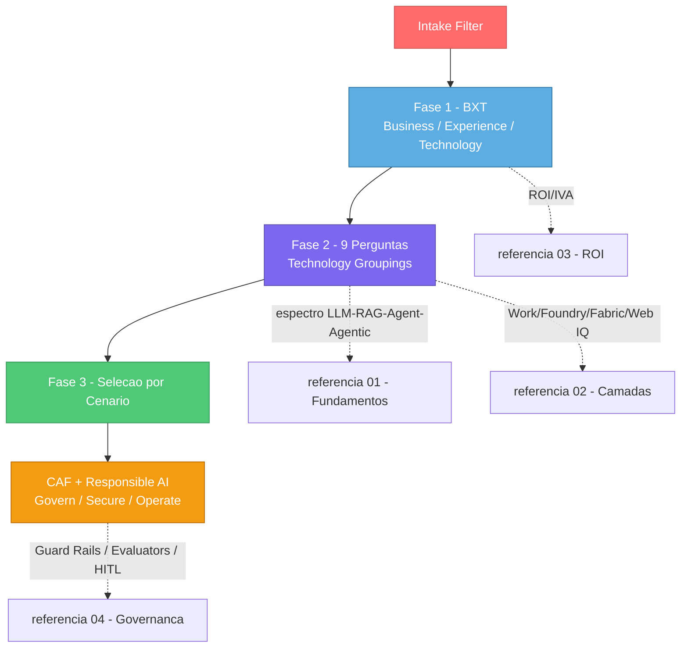

## 🧭 5. Microsoft AI Decision Framework — BXT, Capability Model e 9 Perguntas

Esta referencia alinha a estrategia de adocao deste guia ao **Microsoft AI Decision Framework** (microsoft.github.io/Microsoft-AI-Decision-Framework). O objetivo e dar um metodo de **selecao de tecnologia** repetivel e defensavel, complementando o "espectro de complexidade" (LLM → RAG → AI Agent → Agentic) ja descrito na referencia 01.

> Fluxo central do framework: **Resultados → Comportamentos → Plataformas** (Outcomes → Behaviors → Platforms). Nomeie o resultado de negocio e a experiencia do usuario **antes** de escolher qualquer produto.

---

### 🚦 Intake Filter (antes de tudo)

Gate de entrada para evitar "Shiny Object Syndrome". Se nao houver resposta clara, **nao avance** para selecao de tecnologia:

1. **Qual resultado de negocio** quero atingir? (ROI preciso / problema resolvido)
2. **Qual experiencia de usuario** entrega esse resultado? (prototipar a interacao primeiro)
3. **Ja existe ferramenta?** Comecar rigido (SaaS) → configuracao (low-code) → construcao (pro-code). Nao comecar em "custom build" por padrao.

Pre-checkpoint **"Preciso mesmo de um agente?"**:
- Trabalho estruturado e previsivel → codigo deterministico ou IA nao generativa.
- Recuperacao de conhecimento estatico → RAG classico (sem tool execution / multi-step).
- Agentes introduzem nao-determinismo, latencia e custo: use apenas quando ha raciocinio ou orquestracao de ferramentas.

---

### 1️⃣ Fase 1 — Business Impact Assessment (BXT)

Toda iniciativa deve provar as tres lentes antes de financiar a construcao:

| Lente | Pergunta-chave | Conexao com este guia |
|---|---|---|
| **Business (Viabilidade)** | ROI alem de produtividade generica? Economia/receita quantificavel? Alinhamento estrategico? TCO x beneficio? | Modelo de ROI/IVA (referencia 03) |
| **Experience (Desejabilidade)** | Motivo real para usar em vez da alternativa atual? Resolve dor frequente? Adocao mensuravel? Encaixa no fluxo? | Camada Work IQ (referencia 02) |
| **Technology (Viabilidade tecnica)** | Skills do time? Dados acessiveis e governaveis? Infra e compliance prontos? | Dados governados + Fabric IQ (referencia 02) |

**Decision Gate:** se qualquer dimensao for baixa → reformular, adiar ou mover para "Shelve / Research / Incubate". Se todas medias-altas → avancar para a Fase 2.

---

### 2️⃣ Fase 2 — Technology Groupings (9 Perguntas Criticas)

Pre-pergunta — **Capability Envisioning** (selecao de abordagem):
- **Adotar/estender** um Copilot Microsoft (rapido, baixa customizacao)
- **Construir** um copilot custom (experiencia propria, multicanal, orquestracao avancada)
- **Construir sobre o Fabric** (apps data-heavy com IA embarcada)

As 9 perguntas geram **grupos de tecnologia** (nao a escolha final):

| # | Pergunta | Decisao que orienta |
|---|---|---|
| 1 | **Local da experiencia** | M365 (Copilot Chat/Teams/Word) vs. custom/multicanal vs. API/headless |
| 2 | **Espectro de controle (build style)** | SaaS (M365 Copilot) → Orquestracao/low-code (Copilot Studio) → Foundation/pro-code (Foundry / Agent SDK) |
| 3 | **Padrao de grounding de dados** | RAG (Graph, AI Search, Cosmos, SQL, Fabric Data Agents) + memoria + analytics |
| 4 | **Complexidade de orquestracao (The Coin)** | Soloist (agente unico) → Orchestra (multiagente hub-and-spoke) → Mesh (A2A/connected) |
| 5 | **Fronteira de compliance e confianca** | Trust boundary M365 / Power Platform / Azure landing zone / hibrido |
| 6 | **Escala e custo** | Spend previsivel x variavel x pre-compra unificada (ACUs) x custo marginal zero (edge) |
| 7 | **Acoes destrutivas? (action safety)** | Draft-only → execucao configuravel (HITL) → execucao autonoma (com guardrails proprios) |
| 8 | **Skills e ownership do time** | Makers/fusion x devs pro-code x AI/ML engineers x integradores |
| 9 | **Inicia acoes? (proatividade)** | Reativo (prompt) vs. proativo (triggers, schedules, webhooks) |

> **Principios atemporais:** padronizar primeiro (MCP); continuidade cloud-to-edge; composabilidade sobre monolitos; seguranca por design; estado de dados unificado.

---

### 3️⃣ Fase 3 — Selecao Especifica por Cenario

Dado o agrupamento da Fase 2, aplicar criterios em ordem para escolher a tecnologia:

1. **Time-to-market** (dias / semanas / meses)
2. **Managed x self-managed** (SaaS/PaaS x controle total)
3. **Nivel de complexidade** (baixa / media / alta)
4. **Budget e licenciamento** (per-user / usage / pre-pago / consumo Azure)
5. **Requisitos de integracao** (conectores, multicanal)
6. **Necessidades de orquestracao** (checkpointing, multiagente, workflow)
7. **Operacionalizar e governar** (CAF: Strategy → Plan → Ready → Govern → Secure → Manage + Responsible AI v2)

#### Matriz de decisão prática (Copilot Studio vs Foundry vs Misto)

| Cenário predominante | Escolha sugerida | Justificativa |
|---|---|---|
| Experiência conversacional de negócio, baixa/média complexidade, time low-code | **Copilot Studio** | Menor time-to-market e integração nativa com canais Microsoft |
| Raciocínio avançado, integrações complexas, engenharia pro-code, multi-step/multiagente | **Azure AI Foundry** | Maior controle técnico, avaliação e orquestração avançada |
| Necessidade combinada de UX de negócio + inteligência/orquestração avançada | **Solução mista (Copilot Studio + Azure AI Foundry)** | Melhor equilíbrio entre velocidade de entrega e profundidade técnica |

**Gatilhos para adotar solução mista:**
1. O caso exige publicação rápida em canais de negócio e também reasoning/tool calling avançado.
2. Há requisitos de compliance e rastreabilidade fortes em fluxo multi-etapa.
3. O roadmap prevê escala para múltiplos domínios com reuso de componentes.

**Fontes oficiais Microsoft:**
- Microsoft Copilot Studio documentation: https://learn.microsoft.com/microsoft-copilot-studio/
- Azure AI Foundry documentation: https://learn.microsoft.com/azure/ai-foundry/
- Microsoft 365 Copilot documentation: https://learn.microsoft.com/microsoft-365-copilot/
- Cloud Adoption Framework for AI: https://learn.microsoft.com/azure/cloud-adoption-framework/scenarios/ai/

**Template de saida da decisao:** Tecnologia selecionada · Racional (grupos da Fase 2) · Time-to-market · Managed x self-managed · Complexidade · Budget · Integracoes · Orquestracao · Padrao de arquitetura · Trade-offs aceitos · Proximos passos (piloto/POC/deploy).

---

### 🧱 Capability Model — 3 Buckets e 5 Agrupamentos

**3 AI Buckets** (quem se beneficia e como): Copilot para todos (produtividade) · IA como produto/capability · Agentic coding.

**5 Capability Groupings** (blocos de construcao, nao escada de maturidade):
1. End-user copilots (UI pronta)
2. Extensibilidade em copilots existentes (plugins, Graph connectors)
3. Construir apps e agentes (hibrido por padrao)
4. AI services e building blocks (Foundry: modelos, retrieval, evaluations, governanca)
5. Agentes especializados (nao reconstruir o que ja existe)

**As camadas IQ** (como os agentes entendem a organizacao) — ancoram diretamente a arquitetura deste guia (referencia 02):
- **Foundry IQ = Memory** (knowledge bases / agentic retrieval, citacoes, ACL + Purview)
- **Work IQ = Awareness** (mesma inteligencia do M365 Copilot; Mail, Calendar, Teams, 1.500+ conectores via MCP)
- **Fabric IQ = Understanding** (ontologias, semantic models, regras de negocio, acoes governadas)
- **Web IQ = External Grounding** (evidencia web atualizada para contexto de mercado e fatos publicos)

---

### 🔗 Mapa de alinhamento com este guia

### 📌 Como usar com o SKILL

1. Rode o **Intake Filter** e o checkpoint "preciso de agente?".
2. Pontue **BXT** (referencia 03 para a lente Business/ROI).
3. Use as **9 perguntas** para gerar grupos; o **espectro de complexidade** (referencia 01) responde principalmente as perguntas 2, 3 e 4.
4. Selecione a tecnologia na **Fase 3** e documente o template de decisao.
5. Feche com **CAF + Responsible AI** e os controles da referencia 04 (Guard Rails, Evaluators, HITL).

> Fontes oficiais: Microsoft AI Decision Framework; BXT / Business Envisioning; Capability Envisioning; CAF AI agent adoption (plan, govern & secure, build, operate); Responsible AI Standard v2.
