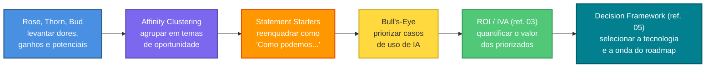

# Adendo — Métodos de Priorização do LUMA System

> **Guia prático para equipes.** Conversão do material *"Métodos de Priorização do LUMA Workspace: Guia Prático para Equipes"* em formato de referência. Este adendo apoia o **processo de priorização e mapeamento de oportunidades de projetos de IA** deste repositório: use-o nas fases de discovery e enquadramento, antes de aplicar o modelo de ROI/IVA (referencias/03) e a seleção de tecnologia do decision framework (referencias/05).

## Por que priorização importa

A **sobrecarga de informação** é o principal obstáculo para o progresso em projetos colaborativos. Os métodos do LUMA System ajudam equipes a codificar dados de pesquisa, revelar padrões temáticos e construir entendimento compartilhado por meio de técnicas visuais e participativas que garantem que todas as vozes sejam ouvidas igualmente no processo decisório.

- **36 métodos** compõem o LUMA System de Design Centrado no Ser Humano.
- **4 métodos essenciais** são detalhados neste adendo: Rose/Thorn/Bud, Affinity Clustering, Statement Starters e Bull's-Eye Diagramming.

### Contexto: as três categorias do LUMA System

| Categoria | Foco | Exemplos |
|---|---|---|
| **Looking** | Observar a experiência humana | Pesquisa etnográfica, participativa, avaliativa |
| **Understanding** | Analisar e sintetizar | Enquadramento de problemas, padrões e prioridades |
| **Making** | Criar soluções | Ideação de conceitos, modelagem e prototipagem |

Os quatro métodos a seguir pertencem principalmente à categoria **Understanding** (Patterns & Priorities e Problem Framing). Eles podem ser combinados em "receitas de design" para resolver desafios específicos e se adaptam a diferentes setores, funções e processos de trabalho.

---

## Método 1 — Rose, Thorn, Bud

Técnica para identificar aspectos **positivos, negativos e potenciais** em qualquer situação. Inspirada nos escoteiros americanos, fornece estrutura simples para analisar um conjunto de dados ou delimitar um problema, revelando áreas de foco.

- **Duração típica:** 10–30 min.
- **3 perspectivas:** Rosa (positivo), Espinho (negativo), Botão (potencial).
- O uso de cores diferentes por tipo de nota ajuda a visualizar padrões emergentes.

### Como executar

1. **Identificar** — defina o tópico para consideração.
2. **Reunir** — monte um grupo diverso de stakeholders.
3. **Distribuir** — dê caneta e 3 blocos de post-its coloridos a cada participante.
4. **Explicar** — Rosa = rosa (positivo), Espinho = azul (negativo), Botão = verde (potencial).
5. **Gerar** — cada pessoa gera múltiplos pontos de dados, um insight por post-it.

> **Dicas:** instrua a escrever múltiplos itens por cor; resista a descrever soluções nesta fase (mantenha o foco em identificação e enquadramento do problema); limite o tempo e a discussão para preservar energia e foco. Use as notas como base para atividades subsequentes (ex.: Affinity Clustering).

### Cenários ideais

- **Retrospectivas / post-mortems** de projetos — compreensão de condições existentes e oportunidades.
- **Codificação de pesquisa** qualitativa — identificar issues e insights rapidamente.
- **Check-ins de equipe** — sessões semanais ou após eventos significativos.
- **Enquadramento de problemas** — revelar áreas de foco no início do projeto.
- **Reflexão individual** e **facilitação de discussão** — processar perspectivas de forma balanceada.

---

## Método 2 — Affinity Clustering

Técnica gráfica para **organizar itens por similaridade**, transformando caos em ordem. Padrões emergem quando a equipe agrupa itens por similaridade percebida, revelando pontos em comum inerentes mas não óbvios.

- **Duração típica:** 45–90 min.
- **3–8 clusters:** número ideal de agrupamentos.

### Como executar

1. **Preparar** — identifique o tópico e reúna o dataset (achados de pesquisa, ideias).
2. **Documentar** — registre cada item em um cartão ou post-it separado.
3. **Organizar** — forme a equipe e escolha um facilitador.
4. **Iniciar** — uma pessoa descreve e posiciona um item.
5. **Agrupar** — os demais colocam itens similares em proximidade.

> **Dicas:** repita descrever-e-posicionar até incluir todos os itens; discuta e reorganize conforme os agrupamentos emergem organicamente; crie subagrupamentos dentro de clusters maiores; **rotule os clusters por último** — não cedo demais, pois podem mudar durante a discussão.

### Cenários ideais

- **Análise de pesquisa** — organizar achados de entrevistas e dados qualitativos em temas acionáveis.
- **Sessões de brainstorming** — organizar conceitos em grupos para identificar direções promissoras.
- **Workshops de descoberta** — ex.: MIT Sloan organizou 27 necessidades em 4 temas principais.
- **Síntese de feedback** — consolidar feedback de múltiplas fontes em padrões compreensíveis.
- **Planejamento de projetos** e **construção de consenso** — pé de igualdade entre participantes.

---

## Método 3 — Statement Starters

Frases iniciais que **reenquadram problemas** como convites à exploração, em vez de declarações que limitam soluções. Começar pelas perguntas certas — sem aceitar o desafio pelo valor aparente — leva a soluções melhores.

- **"Como podemos…"** (How Might We) é a frase inicial mais comum.
- **3+ variações:** explore diferentes formas de enquadrar cada problema.

### Como executar

1. **Identificar** — defina o conjunto de problemas ou oportunidades.
2. **Formular** — declare cada questão em uma frase curta.
3. **Adicionar** — coloque um "iniciador" no começo de cada frase.
4. **Testar** — experimente variações ("Como podemos?", "De que formas?").
5. **Selecionar** — escolha o melhor statement starter para a ideação.

> **Exemplo:** *"Precisamos de um dispositivo para música"* vira *"Como podemos ajudar a ouvir música?"* — a nova formulação abre espaço para múltiplas interpretações. **Não incorpore soluções nas declarações**; mantenha abertura máxima à criatividade.

### Cenários ideais

- **Enquadramento de problemas** — desafiar suposições e garantir que se resolve o problema certo.
- **Preparação para brainstorming** — transformar briefs em convites abertos à ideação.
- **Redefinição de escopo** — reabrir possibilidades quando o projeto está travado numa solução.
- **Workshops de inovação** e **refinamento de insights** — converter achados em questões acionáveis.
- **Votação de prioridades** — escolher a melhor declaração de problema entre opções.

---

## Método 4 — Bull's-Eye Diagramming

Forma de **ranquear itens por importância** usando um diagrama de alvo. Por design, limita quantos itens podem ser considerados críticos, **forçando a equipe a deliberar sobre os essenciais** antes de produzir qualquer coisa.

- **3 círculos:** Primário (centro), Secundário (meio), Terciário (externo).
- **Foco forçado:** o centro limitado obriga a priorizar o que mais importa.

### Como executar

1. **Identificar** — defina o projeto que requer priorização.
2. **Criar** — faça um pôster grande com 3 círculos concêntricos.
3. **Rotular** — Centro = Primário, Meio = Secundário, Externo = Terciário.
4. **Preparar** — forme a equipe e reúna os dados (issues, features).
5. **Organizar** — divida os dados em pequenas unidades (tiras de papel ou post-its).

> **Dicas:** debata a importância relativa de cada item com todos; plote no alvo e estabeleça prioridades por consenso visual; **dimensione o anel central para caber poucos itens**, forçando escolhas difíceis; imponha limite de tempo por rodada para evitar paralisia por análise. *Terciário não significa irrelevante — apenas menos prioritário no contexto e recursos atuais.*

### Cenários ideais

- **Priorização de features** — roadmaps onde funcionalidades competem por recursos limitados.
- **Planejamento de sprint** — decidir o que entra numa sprint com capacidade restrita.
- **Alocação de recursos** — ex.: MIT Sloan priorizou 27 necessidades educacionais (com Affinity Clustering).
- **Decisões de trade-off** — escolhas entre opções atraentes mas mutuamente exclusivas.
- **Desenvolvimento de estratégia** — alinhar essencial × importante × desejável.

---

## Como aplicar ao mapeamento de oportunidades de IA

Sequência sugerida para conectar estes métodos ao roadmap de adoção deste repositório:

| Etapa | Método LUMA | Saída para o processo de IA |
|---|---|---|
| Levantar | Rose, Thorn, Bud | Inventário de dores, ganhos e potenciais por área |
| Agrupar | Affinity Clustering | Temas de oportunidade (3–8 clusters) |
| Reenquadrar | Statement Starters | Casos de uso como perguntas "Como podemos…" |
| Priorizar | Bull's-Eye | Casos primários × secundários × terciários |
| Quantificar | ROI/IVA (referencias/03) | IVA, ROI e veredito por caso priorizado |
| Selecionar | Decision Framework (referencias/05) | Tecnologia-alvo e onda do roadmap |

---

## Referências

- [1] *Rose, Thorn, Bud* — LUMA Institute
- [2] *Affinity Clustering* — LUMA Institute
- [3] *Statement Starters* — LUMA Institute
- [4] *Bull's-eye Diagramming* — LUMA Institute
- [5] *Affinity Clustering*
- [6] *Classroom of the Future — Discovery 2: Organizing Insights*

> Fonte: apresentação *"Métodos de Priorização do LUMA Workspace: Guia Prático para Equipes"* (LUMA System), convertida para este adendo.
